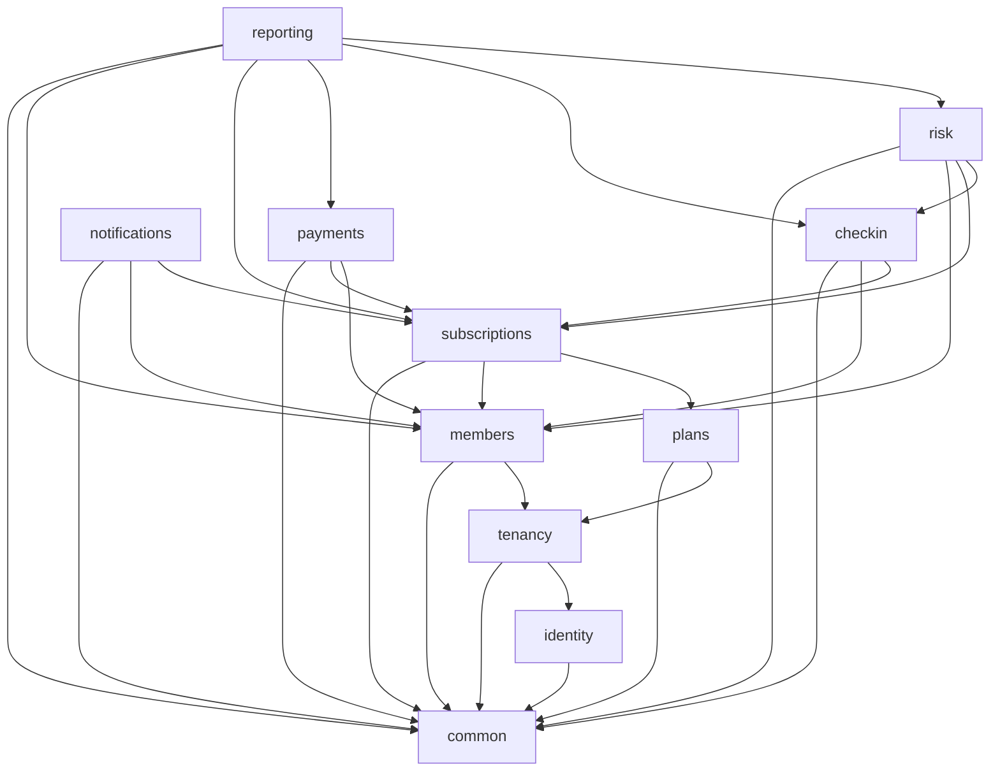
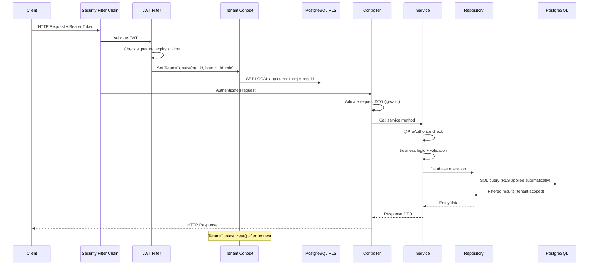
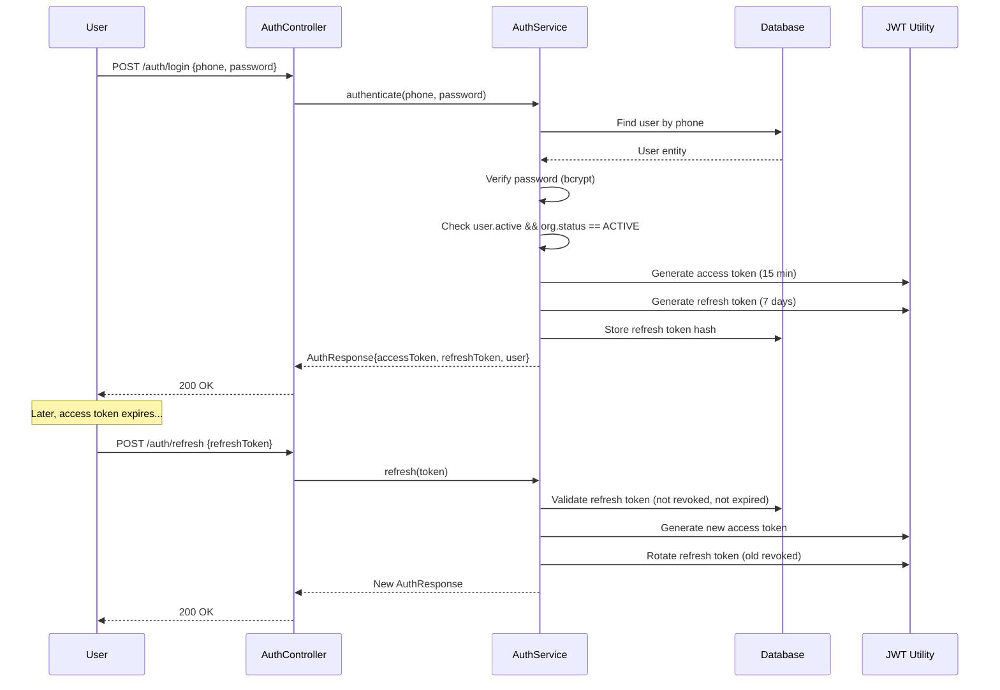
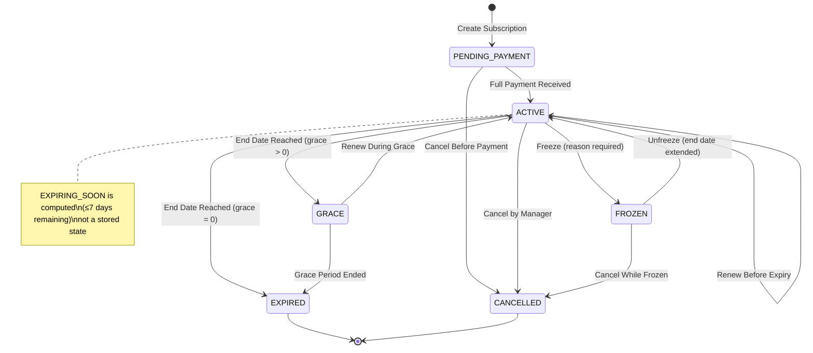
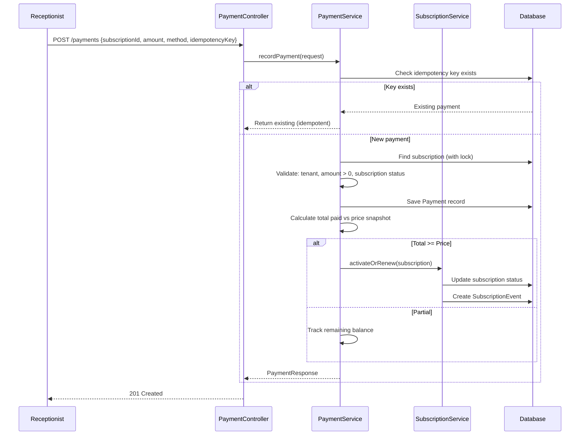
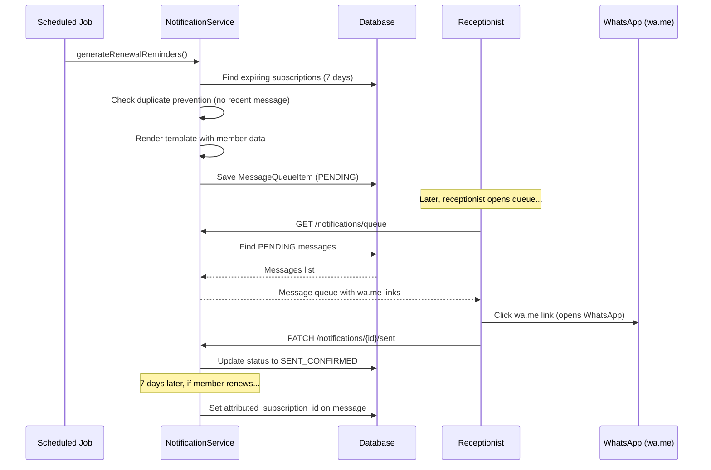
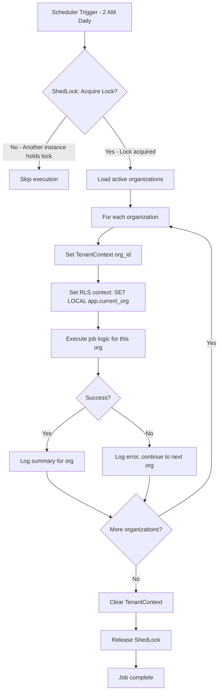
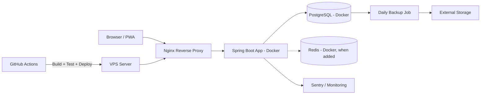

# Kammel — System Architecture

> **Document Version:** 1.0  
> **Last Updated:** November 2026  
> **Related:** [04_DOMAIN_MODEL.md](./04_DOMAIN_MODEL.md) · [05_DATABASE_DESIGN.md](./05_DATABASE_DESIGN.md) · [06_SECURITY_AND_MULTI_TENANCY.md](./06_SECURITY_AND_MULTI_TENANCY.md)

---

## 1. Architectural Style: Modular Monolith

**Decision:** Kammel is built as a **Modular Monolith** — a single deployable application with clearly defined internal module boundaries.

| Factor | Modular Monolith | Microservices |
|--------|-----------------|---------------|
| Developer count | ✅ One developer | ❌ Requires team |
| Deployment complexity | ✅ Single artifact | ❌ Multiple services, orchestration |
| Transactional consistency | ✅ Single DB transaction | ❌ Distributed transactions |
| Debugging | ✅ Single process | ❌ Distributed tracing |
| Operational cost | ✅ One VPS | ❌ Multiple containers/services |
| Future extraction | ✅ Clean boundaries enable later extraction | — |

**Trade-off:** We lose independent deployment per module but gain simplicity, consistency, and development speed — all critical for a single-developer project.

**Boundary enforcement:** Use **Spring Modulith** in CI to verify that modules respect their declared dependencies. This prevents the monolith from degrading into a "big ball of mud."

---

## 2. Feature-Based Package Structure

### 2.1 Top-Level Structure

```
com.kammel/
├── KammelApplication.java
├── common/                    # Shared infrastructure
│   ├── config/                # Security, Redis, Flyway, OpenAPI, async configs
│   ├── exception/             # Global exception handler, error DTOs
│   ├── security/              # JWT filter, tenant context, UserPrincipal
│   ├── audit/                 # Audit interceptor, AuditLog entity & repository
│   ├── validation/            # Custom validators (@ValidPhone, etc.)
│   ├── dto/                   # Shared DTOs: PageResponse, ErrorResponse
│   └── util/                  # MoneyUtil, PhoneUtil, DateUtil
│
├── identity/                  # Authentication, users, roles
│   ├── controller/
│   ├── service/
│   ├── repository/
│   ├── dto/request/
│   ├── dto/response/
│   ├── entity/
│   ├── enums/
│   └── mapper/
│
├── tenancy/                   # Organizations, branches
│   ├── controller/
│   ├── service/
│   ├── repository/
│   ├── dto/
│   ├── entity/
│   └── mapper/
│
├── members/                   # Member management, Excel import
├── plans/                     # Membership plan templates
├── subscriptions/             # Subscription lifecycle, events
├── payments/                  # Payments, refunds, shifts
├── checkin/                   # Attendance check-in
├── notifications/             # Message queue, channels
├── risk/                      # Risk score computation
├── reporting/                 # Dashboard queries, KPIs
└── leads/                     # P1: Lead management
```

### 2.2 Within-Module Structure (Example: subscriptions)

```
subscriptions/
├── controller/
│   └── SubscriptionController.java
├── service/
│   ├── SubscriptionService.java          # Public interface
│   └── SubscriptionServiceImpl.java      # Implementation
├── repository/
│   └── SubscriptionRepository.java
│   └── SubscriptionEventRepository.java
├── dto/
│   ├── request/
│   │   ├── CreateSubscriptionRequest.java
│   │   ├── RenewSubscriptionRequest.java
│   │   └── FreezeSubscriptionRequest.java
│   └── response/
│       ├── SubscriptionResponse.java
│       └── SubscriptionEventResponse.java
├── entity/
│   ├── Subscription.java
│   └── SubscriptionEvent.java
├── enums/
│   ├── SubscriptionStatus.java
│   └── SubscriptionEventType.java
├── mapper/
│   └── SubscriptionMapper.java
└── exception/
    └── InvalidStateTransitionException.java
```

### 2.3 Module Responsibilities

| Module | Owns | Public API |
|--------|------|-----------|
| **common** | Shared config, security infra, audit, utilities | Utility classes, base DTOs |
| **identity** | Users, authentication, JWT, password hashing | `AuthService`, `UserService` |
| **tenancy** | Organizations, branches, tenant lifecycle | `OrganizationService`, `BranchService` |
| **members** | Member records, Excel import | `MemberService`, `ImportService` |
| **plans** | Membership plan definitions | `PlanService` |
| **subscriptions** | Subscription lifecycle, state machine, events | `SubscriptionService` |
| **payments** | Payment records, refunds, cash shifts | `PaymentService`, `ShiftService` |
| **checkin** | Check-in records, QR validation | `CheckInService` |
| **notifications** | Message queue, templates, channel adapters | `NotificationService` |
| **risk** | Risk score computation, signals | `RiskScoreService` |
| **reporting** | Dashboard aggregations, KPIs | `DashboardService` |
| **leads** | Lead funnel (P1) | `LeadService` |

### 2.4 Module Communication Rules

1. **Modules communicate ONLY through public Service Interfaces** — never by accessing another module's Repository directly.
2. **Dependency direction** flows downward. Upper modules depend on lower modules, never the reverse.
3. **Spring Application Events** for decoupled cross-module communication (e.g., `PaymentReceivedEvent` triggers subscription activation).
4. **No circular dependencies** between modules.

### 2.5 Dependency Graph



The `reporting` module depends on many others because it aggregates data for dashboards. It only reads through service interfaces — never writes.

### 2.6 Shared Components (`common`)

The `common` module contains infrastructure that all modules use:

- **Security config:** JWT filter, CORS, method security
- **Tenant context:** `TenantContext` (ThreadLocal), tenant-setting interceptor
- **Audit:** `AuditLog` entity and logging interceptor
- **Exception handling:** `GlobalExceptionHandler` with standard error format
- **Validation:** Custom constraint annotations
- **DTOs:** `PageResponse<T>`, `ErrorResponse`
- **Utilities:** `MoneyUtil` (piasters ↔ display), `PhoneUtil` (format validation), `DateUtil` (timezone conversion)

---

## 3. Layer Responsibilities

| Layer | Responsibility | Rules |
|-------|---------------|-------|
| **Controller** | Accept HTTP requests, validate input, delegate to service, return DTOs | No business logic. No direct repository calls. Thin layer. |
| **Service Interface** | Define public contract for the module | Java interface. Only input/output DTOs — never entities. |
| **Service Implementation** | Business logic, orchestration, transaction management, authorization | @Transactional. @PreAuthorize. Domain rule enforcement. |
| **Repository** | Data access via Spring Data JPA | Interface extending JpaRepository. Custom @Query where needed. No business logic. |
| **Entity** | JPA entity mapping to database table | @Entity. Constraints. Relationships. Audit columns. org_id. |
| **DTO** | Request validation + response shaping | Bean Validation annotations on request DTOs. Response DTOs with formatted data. |
| **Mapper** | Convert between Entity and DTO | Stateless. Can be manual methods or MapStruct. |
| **Enums** | Business enumerations | Status values, types, methods. |
| **Exception** | Module-specific business exceptions | Extend RuntimeException. Caught by GlobalExceptionHandler. |

---

## 4. Request Processing Flow



Every request passes through: authentication → tenant context setup → authorization → business logic → tenant-filtered data access.

---

## 5. Authentication & Authorization Flow



---

## 6. Subscription Workflow



Each transition creates an immutable `SubscriptionEvent` record with actor, timestamp, reason, and before/after metadata.

---

## 7. Payment Workflow



---

## 8. Notification Workflow



---

## 9. Background Job Workflow



**Critical:** Each organization processed in its own transaction with explicit tenant context. One org failing does not block others. `TenantContext.clear()` in finally block.

---

## 10. Transaction Management

| Rule | Description |
|------|-------------|
| `@Transactional` on service methods | Not on controllers, not on repositories |
| Read-only for queries | `@Transactional(readOnly = true)` for GET operations |
| Atomic financial operations | Payment + subscription status update in single transaction |
| Tenant context per transaction | `SET LOCAL app.current_org` at transaction start for RLS |
| Optimistic locking | `@Version` on entities modified concurrently |
| Pessimistic locking | `SELECT FOR UPDATE` for subscription payment operations |

---

## 11. Exception Handling

### Global Exception Handler

```java
@RestControllerAdvice
public class GlobalExceptionHandler {
    // ResourceNotFoundException → 404
    // DuplicateResourceException → 409
    // InvalidStateTransitionException → 422
    // AccessDeniedException → 403
    // TenantMismatchException → 404 (not 403, prevents ID enumeration)
    // MethodArgumentNotValidException → 400 with field details
    // Exception → 500 (generic, no stack trace in production)
}
```

### Standard Error Response

```json
{
  "timestamp": "2026-11-03T12:00:00Z",
  "status": 400,
  "error": "Bad Request",
  "message": "Validation failed",
  "path": "/api/v1/members",
  "details": [
    { "field": "phone", "message": "Phone number is required" }
  ]
}
```

---

## 12. Validation Strategy

| Level | Mechanism | Purpose |
|-------|-----------|---------|
| **DTO** | Bean Validation (`@NotBlank`, `@Size`, `@Pattern`) | Input format validation |
| **Custom Validators** | `@ValidPhone`, `@ValidDateRange` | Business format rules |
| **Service** | Programmatic checks | Cross-entity business rules (e.g., freeze days remaining) |
| **Database** | CHECK constraints, UNIQUE, FK | Final safety net |

---

## 13. Caching Strategy

**Not included in MVP.** When introduced, Redis caches plan lists, org config, and dashboard aggregates with tenant-aware cache keys (`kammel:{org_id}:{entity}:{id}`). See [09_REDIS_CACHING.md](./09_REDIS_CACHING.md).

---

## 14. Deployment Architecture



### Docker Compose Services

| Service | Image | Purpose |
|---------|-------|---------|
| `app` | Custom Spring Boot image | Application |
| `postgres` | postgres:16 | Primary database |
| `redis` | redis:7 (when added) | Cache |

### Environment Profiles

| Profile | Purpose | Configuration |
|---------|---------|--------------|
| `dev` | Local development | H2 or local PostgreSQL, debug logging |
| `test` | CI testing | Testcontainers, test data |
| `staging` | Pre-production | Production-like, test data |
| `prod` | Production | Production database, info logging, HTTPS |
