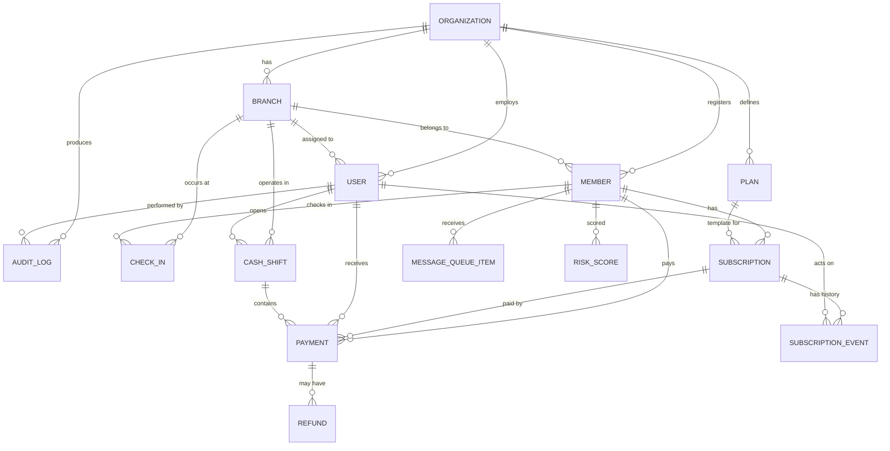

# Kammel — Domain Model & Business Entities

> **Document Version:** 1.0  
> **Last Updated:** November 2026  
> **Related:** [03_SYSTEM_ARCHITECTURE.md](./03_SYSTEM_ARCHITECTURE.md) · [05_DATABASE_DESIGN.md](./05_DATABASE_DESIGN.md)

---

## 1. Design Principles

| Principle | Rule |
|-----------|------|
| Tenant isolation | Every entity except Organization has `org_id` |
| Financial precision | Amounts as `Long` in minor units (piasters). Never `double`. |
| Price immutability | Subscription snapshots plan price at creation |
| Event-driven state | Subscription state derived from events, not manual updates |
| Soft deletion | Members soft-deleted (deleted_at). Payments never deleted. |
| Audit trail | Sensitive operations produce immutable audit records |
| Timestamps | All in UTC (`TIMESTAMPTZ`), displayed in Cairo timezone |
| Consistent audit columns | `created_at`, `updated_at` on mutable entities |

---

## 2. Entity Relationship Diagram

---

## 3. Entity Definitions

### 3.1 Organization

| Attribute | Type | Required | Constraints | Notes |
|-----------|------|----------|-------------|-------|
| id | UUID | Yes | PK | Auto-generated |
| name | String | Yes | 2–255 chars | Gym business name |
| status | Enum | Yes | ACTIVE, SUSPENDED, CLOSED | Default ACTIVE |
| created_at | Instant | Yes | Auto | |
| updated_at | Instant | Yes | Auto | |

**Purpose:** Represents a gym business (tenant). The top-level isolation boundary.

**Lifecycle:** Created by Platform Admin → ACTIVE → may be SUSPENDED (non-payment) → CLOSED (decommissioned). SUSPENDED orgs' users cannot log in.

**Business Rules:**
- One Organization can have multiple Branches.
- All other entities belong to an Organization via org_id.
- Organization is the only entity WITHOUT org_id (it IS the org).

---

### 3.2 Branch

| Attribute | Type | Required | Constraints | Notes |
|-----------|------|----------|-------------|-------|
| id | UUID | Yes | PK | |
| org_id | UUID | Yes | FK → organizations | Tenant |
| name | String | Yes | 2–255 chars | "Main Branch", "Maadi Branch" |
| address | String | No | | Physical location |
| timezone | String | Yes | Default "Africa/Cairo" | |
| active | Boolean | Yes | Default true | |
| created_at | Instant | Yes | Auto | |

**Purpose:** A physical gym location within an organization.

**Relationships:** One Organization has many Branches. Users, Members, Check-ins, and Shifts belong to a Branch.

**Business Rules:**
- At least one Branch per Organization.
- Branch Manager is scoped to one Branch.
- Branch deactivation: existing data remains, no new operations.

---

### 3.3 User (Staff Account)

| Attribute | Type | Required | Constraints | Notes |
|-----------|------|----------|-------------|-------|
| id | UUID | Yes | PK | |
| org_id | UUID | Yes | FK → organizations | Tenant |
| branch_id | UUID | No | FK → branches | Null for GYM_OWNER (all branches) |
| name | String | Yes | 2–100 chars | |
| phone | String | Yes | UNIQUE(org_id, phone) | Login identifier |
| email | String | No | UNIQUE(org_id, email) where not null | Secondary login |
| password_hash | String | Yes | bcrypt hash | |
| role | Enum | Yes | GYM_OWNER, BRANCH_MANAGER, RECEPTIONIST, TRAINER | |
| active | Boolean | Yes | Default true | |
| created_at | Instant | Yes | Auto | |
| updated_at | Instant | Yes | Auto | |

**Purpose:** Staff accounts for logging into Kammel and performing operations.

**Important:** User ≠ Member. Users are gym staff who log in. Members are gym clients. They are separate entities because members don't log in (until PWA in P1), and their data models serve different purposes.

**Business Rules:**
- GYM_OWNER: branch_id is null (access to all branches).
- BRANCH_MANAGER, RECEPTIONIST, TRAINER: assigned to one branch.
- Password hashed with bcrypt (work factor 12).
- Deactivated users cannot log in; their existing sessions are invalidated.

---

### 3.4 Member

| Attribute | Type | Required | Constraints | Notes |
|-----------|------|----------|-------------|-------|
| id | UUID | Yes | PK | |
| org_id | UUID | Yes | FK → organizations | Tenant |
| branch_id | UUID | Yes | FK → branches | Primary branch |
| full_name | String | Yes | 2–100 chars | |
| phone | String | Yes | UNIQUE(org_id, phone) | Primary search key |
| gender | Enum | No | MALE, FEMALE | |
| birth_date | LocalDate | No | | |
| photo_url | String | No | | Optional profile photo |
| source | Enum | No | INSTAGRAM, FRIEND, WALK_IN, AD, REFERRAL, OTHER | Acquisition source |
| notes | String | No | Max 1000 chars | Free-form notes |
| whatsapp_opt_in | Boolean | Yes | Default false | Explicit consent for messages |
| status | Enum | Yes | ACTIVE, INACTIVE | Default ACTIVE |
| created_at | Instant | Yes | Auto | |
| updated_at | Instant | Yes | Auto | |
| deleted_at | Instant | No | Null = not deleted | Soft delete |

**Purpose:** A gym client who holds subscriptions, checks in, and receives messages.

**Lifecycle:** Registered → ACTIVE (has subscription) → INACTIVE (all subscriptions expired, hasn't renewed) → Soft-deleted (owner request or data cleanup).

**Business Rules:**
- Phone is the primary search key for check-in and payment operations.
- (org_id, phone) is unique — no duplicate phones per gym.
- Soft delete: `deleted_at` set, member excluded from queries but data preserved.
- WhatsApp messages only sent when `whatsapp_opt_in = true`.

---

### 3.5 MembershipPlan

| Attribute | Type | Required | Constraints | Notes |
|-----------|------|----------|-------------|-------|
| id | UUID | Yes | PK | |
| org_id | UUID | Yes | FK → organizations | Tenant |
| name | String | Yes | 2–100 chars | "Monthly", "3-Month", "PT 12 Sessions" |
| type | Enum | Yes | MONTHLY, QUARTERLY, SEMI_ANNUAL, ANNUAL, SESSION_PACK, DAY_PASS, PT_PACKAGE, TIME_RESTRICTED | |
| duration_days | Integer | Yes | > 0 | 30, 90, 180, 365, etc. |
| session_count | Integer | No | > 0 if set | For session-based plans |
| price_minor | Long | Yes | ≥ 0 | In piasters (700 EGP = 70000) |
| freeze_max_days | Integer | Yes | ≥ 0 | 0 = no freeze allowed |
| grace_days | Integer | Yes | ≥ 0 | 0 = no grace period |
| time_restriction | String | No | | e.g., "MORNING", "EVENING" |
| active | Boolean | Yes | Default true | |
| created_at | Instant | Yes | Auto | |
| updated_at | Instant | Yes | Auto | |

**Purpose:** Template for creating subscriptions. Defines pricing, duration, and rules.

**Business Rules:**
- Deactivating a plan does NOT affect existing subscriptions — only prevents new ones.
- Price changes do NOT retroactively modify existing subscriptions (price snapshot pattern).
- Session-based plans: `session_count` defines total sessions; `duration_days` defines expiry.

---

### 3.6 Subscription

| Attribute | Type | Required | Constraints | Notes |
|-----------|------|----------|-------------|-------|
| id | UUID | Yes | PK | |
| org_id | UUID | Yes | FK → organizations | Tenant |
| member_id | UUID | Yes | FK → members | |
| plan_id | UUID | Yes | FK → plans | |
| price_minor_snapshot | Long | Yes | ≥ 0 | Frozen at creation time |
| start_date | LocalDate | Yes | | |
| end_date | LocalDate | Yes | ≥ start_date | |
| status | Enum | Yes | PENDING_PAYMENT, ACTIVE, FROZEN, GRACE, EXPIRED, CANCELLED | |
| sessions_remaining | Integer | No | ≥ 0 | For session-based plans |
| frozen_days_used | Integer | Yes | Default 0 | Accumulated freeze days |
| created_at | Instant | Yes | Auto | |
| updated_at | Instant | Yes | Auto | |

**Purpose:** An active membership relationship between a member and a plan.

**Lifecycle:** See [08_BUSINESS_LOGIC_AND_STATE_MACHINES.md](./08_BUSINESS_LOGIC_AND_STATE_MACHINES.md) for the complete state machine.

**Critical Business Rules:**
1. `price_minor_snapshot` captured from `plan.price_minor` at creation — immutable thereafter.
2. `EXPIRING_SOON` (≤ 7 days remaining) is **computed, not stored**.
3. Renewal before expiry: `new_end_date = current_end_date + plan.duration_days`.
4. Renewal after expiry: `new_start_date = payment_date`, `new_end_date = start + duration`.
5. Freeze: `frozen_days_used` must be < `plan.freeze_max_days`.
6. Unfreeze: `end_date` extended by number of days frozen.
7. Every state change creates a `SubscriptionEvent`.

---

### 3.7 SubscriptionEvent

| Attribute | Type | Required | Constraints | Notes |
|-----------|------|----------|-------------|-------|
| id | UUID | Yes | PK | |
| subscription_id | UUID | Yes | FK → subscriptions | |
| type | Enum | Yes | CREATED, ACTIVATED, RENEWED, FROZEN, UNFROZEN, GRACE_ENTERED, EXPIRED, CANCELLED | |
| from_status | Enum | No | | Status before transition |
| to_status | Enum | Yes | | Status after transition |
| actor_id | UUID | No | FK → users | Null for system-triggered events |
| reason | String | No | | Required for freeze, cancel, override |
| metadata | JSONB | No | | Extra context (frozen_days, previous_end_date, etc.) |
| created_at | Instant | Yes | Auto | |

**Purpose:** Immutable history of every subscription state change.

**Business Rules:**
- **Immutable** — no updates or deletes.
- Source of truth for subscription history.
- System-triggered events (expiration, grace) have null actor_id.
- User-triggered events (freeze, cancel) must have actor_id and reason.

---

### 3.8 Payment

| Attribute | Type | Required | Constraints | Notes |
|-----------|------|----------|-------------|-------|
| id | UUID | Yes | PK | |
| org_id | UUID | Yes | FK → organizations | Tenant |
| subscription_id | UUID | Yes | FK → subscriptions | |
| member_id | UUID | Yes | FK → members | Denormalized for query convenience |
| amount_minor | Long | Yes | > 0 | In piasters |
| method | Enum | Yes | CASH, INSTAPAY, BANK_TRANSFER, ONLINE | |
| reference | String | No | | Transfer/InstaPay reference number |
| received_by | UUID | Yes | FK → users | Staff who recorded payment |
| shift_id | UUID | No | FK → cash_shifts | Linked for cash reconciliation |
| status | Enum | Yes | COMPLETED, REVERSED | Default COMPLETED |
| idempotency_key | String | Yes | UNIQUE | Prevents duplicate recording |
| notes | String | No | | |
| created_at | Instant | Yes | Auto | |

**Purpose:** Record of money received from a member for a subscription.

**Business Rules:**
- **NEVER deleted.** Corrections via Refund (reverse entry).
- `idempotency_key` prevents duplicate recording (unique constraint).
- CASH payments linked to open shift via `shift_id`.
- When sum of payments ≥ `subscription.price_minor_snapshot`, subscription activates.
- `member_id` is denormalized (also available via subscription) for query convenience.

---

### 3.9 Refund

| Attribute | Type | Required | Constraints | Notes |
|-----------|------|----------|-------------|-------|
| id | UUID | Yes | PK | |
| org_id | UUID | Yes | FK → organizations | Tenant |
| payment_id | UUID | Yes | FK → payments | Original payment |
| amount_minor | Long | Yes | > 0, ≤ original payment | |
| reason | String | Yes | Mandatory | |
| approved_by | UUID | Yes | FK → users | Manager or Owner |
| created_at | Instant | Yes | Auto | |

**Purpose:** Reverse entry for a payment. Does NOT delete the original payment.

**Business Rules:**
- Refund amount cannot exceed original payment amount (validated at application level).
- Reason is mandatory.
- Requires BRANCH_MANAGER or GYM_OWNER approval.
- Original payment status changes to REVERSED.
- Audit logged.

---

### 3.10 CashShift

| Attribute | Type | Required | Constraints | Notes |
|-----------|------|----------|-------------|-------|
| id | UUID | Yes | PK | |
| org_id | UUID | Yes | FK → organizations | Tenant |
| branch_id | UUID | Yes | FK → branches | |
| user_id | UUID | Yes | FK → users | Receptionist |
| opened_at | Instant | Yes | | Shift start |
| closed_at | Instant | No | | Null while open |
| expected_cash_minor | Long | No | | Computed at close: SUM(cash payments) − SUM(cash refunds) |
| counted_cash_minor | Long | No | | Entered by receptionist at close |
| notes | String | No | | |

**Purpose:** Track cash collected during a receptionist's work shift for reconciliation.

**Business Rules:**
- Only one open shift per user at a time.
- Must close previous shift before opening new one.
- Variance = `counted_cash_minor − expected_cash_minor`.
- Immutable after closing (except notes by manager).

---

### 3.11 CheckIn

| Attribute | Type | Required | Constraints | Notes |
|-----------|------|----------|-------------|-------|
| id | UUID | Yes | PK | |
| org_id | UUID | Yes | FK → organizations | Tenant |
| branch_id | UUID | Yes | FK → branches | |
| member_id | UUID | Yes | FK → members | |
| subscription_id | UUID | No | FK → subscriptions | Null if check-in override |
| method | Enum | Yes | NAME_SEARCH, PHONE_SEARCH, STATIC_QR, DYNAMIC_QR | |
| checked_in_at | Instant | Yes | | |
| overridden_by | UUID | No | FK → users | If check-in was overridden |
| override_reason | String | No | | Required if overridden |

**Purpose:** Record of a member entering the gym.

**Business Rules:**
- Foundation for Risk Score computation (attendance patterns).
- Duplicate same-day check-in: warned, not blocked.
- Override requires reason and is audit-logged.
- Session-based plan: decrements `subscription.sessions_remaining`.

---

### 3.12 MessageQueueItem

| Attribute | Type | Required | Constraints | Notes |
|-----------|------|----------|-------------|-------|
| id | UUID | Yes | PK | |
| org_id | UUID | Yes | FK → organizations | Tenant |
| member_id | UUID | Yes | FK → members | |
| template | Enum | Yes | RENEWAL_REMINDER, MISS_YOU, WELCOME, COLLECTION | |
| rendered_text | String | Yes | | Personalized message text |
| status | Enum | Yes | PENDING, OPENED, SENT_CONFIRMED, CANCELLED, FAILED | |
| due_date | LocalDate | Yes | | When to send |
| wa_me_link | String | No | | Pre-built wa.me URL |
| sent_at | Instant | No | | When confirmed sent |
| sent_by | UUID | No | FK → users | Receptionist who sent |
| attributed_subscription_id | UUID | No | FK → subscriptions | If renewal within 7 days |
| created_at | Instant | Yes | Auto | |

**Purpose:** Queue of WhatsApp messages to be sent by reception.

**Business Rules:**
- OPENED ≠ SENT. Opening wa.me link is not confirmation of sending.
- Duplicate prevention: max one per template per member per 3 days.
- Attribution: if member renews within 7 days of SENT_CONFIRMED → link subscription.

---

### 3.13 RiskScore

| Attribute | Type | Required | Constraints | Notes |
|-----------|------|----------|-------------|-------|
| member_id | UUID | Yes | FK → members | Composite PK |
| computed_at | Instant | Yes | | Composite PK |
| score | Integer | Yes | 0–100 | |
| reasons | JSONB | Yes | | Array of explanation strings |
| signals | JSONB | No | | Raw signal values for debugging |
| model_version | String | Yes | | "rules-v1", "ml-v1", etc. |
| recommended_action | String | No | | Suggested action text |
| draft_message | String | No | | Pre-composed WhatsApp message |

**Purpose:** Computed risk assessment for a member's likelihood of not renewing.

**Business Rules:**
- Computed in nightly batch job, not real-time.
- Explainable: `reasons` array describes each contributing factor.
- `model_version` tracks which algorithm produced the score.
- New members with < 14 days of data: score = null or "INSUFFICIENT_DATA".

---

### 3.14 AuditLog

| Attribute | Type | Required | Constraints | Notes |
|-----------|------|----------|-------------|-------|
| id | UUID | Yes | PK | |
| org_id | UUID | Yes | FK → organizations | Tenant |
| actor_id | UUID | Yes | FK → users | Who performed action |
| action | String | Yes | | "FREEZE", "REFUND", "DISCOUNT", etc. |
| entity_type | String | Yes | | "SUBSCRIPTION", "PAYMENT", etc. |
| entity_id | UUID | Yes | | ID of affected entity |
| before_state | JSONB | No | | State before change |
| after_state | JSONB | No | | State after change |
| reason | String | No | | Justification for sensitive actions |
| ip_address | String | No | | Request IP |
| created_at | Instant | Yes | Auto | |

**Purpose:** Immutable, append-only record of all sensitive operations.

**Business Rules:**
- **NO updates or deletes.** Enforced by application (and optionally by DB trigger).
- Captures: discounts, freezes, refunds, payment modifications, check-in overrides, role changes.
- JSONB before/after: flexible schema for different entity types.
- No PII in application logs — audit log is the secure record.

---

## 4. Key Design Decisions

| Decision | Rationale |
|----------|-----------|
| **Price snapshot** | Plan price changes shouldn't retroactively change existing subscription amounts. The price is frozen at the moment of sale. |
| **Event-sourced subscription history** | SubscriptionEvents provide complete audit trail and enable state derivation. Prevents manual status manipulation. |
| **Amounts in minor units (Long)** | Avoids floating-point precision errors. 700 EGP = 70000 piasters. All aggregations remain exact. |
| **Separate Member and User** | Members are gym clients; Users are staff. Different auth models, different data needs. Members gain login capability only with PWA (P1). |
| **Soft delete for members** | Preserves referential integrity. Historical subscriptions and payments still reference the member. |
| **JSONB for audit before/after** | Flexible schema accommodates different entity types without separate audit tables per entity. |
| **Denormalized member_id on Payment** | Avoids join through Subscription for common payment queries. Trade-off: slight denormalization for query performance. |

---

## 5. Cross-Entity Business Rules

| Rule | Entities Involved | Description |
|------|-------------------|-------------|
| Payment activates subscription | Payment, Subscription | When total payments ≥ price_minor_snapshot → status transitions to ACTIVE |
| Check-in validates subscription | CheckIn, Subscription | Active sub → allowed. Frozen → blocked. Expired → alert. |
| Check-in decrements sessions | CheckIn, Subscription | Session-based plan → sessions_remaining -= 1. If 0 → EXPIRED. |
| Freeze extends end_date | Subscription, SubscriptionEvent | Unfreeze extends end_date by frozen_days. frozen_days_used incremented. |
| Cash payment links to shift | Payment, CashShift | Cash payments associated with open shift for reconciliation. |
| Risk score uses attendance | RiskScore, CheckIn, Subscription | Attendance patterns + subscription data → risk computation. |
| Message attributes renewal | MessageQueueItem, Subscription | If member renews within 7 days of sent message → attribution link. |
| Refund reverses payment | Refund, Payment | Creates reverse entry. Original payment status → REVERSED. |
