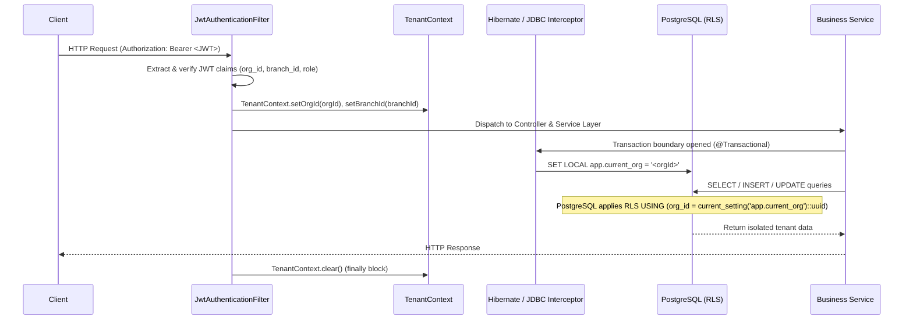

# Kammel — Authentication, Authorization & Multi-Tenancy

> **Document Version:** 1.0  
> **Last Updated:** November 2026  
> **Related:** [03_SYSTEM_ARCHITECTURE.md](./03_SYSTEM_ARCHITECTURE.md) · [04_DOMAIN_MODEL.md](./04_DOMAIN_MODEL.md) · [05_DATABASE_DESIGN.md](./05_DATABASE_DESIGN.md)

---

## 1. Architectural Security & Multi-Tenancy Overview

Multi-tenancy and robust security form the core foundation of Kammel. Because Kammel is a multi-tenant SaaS serving numerous independent gym businesses, strict data isolation is mandatory. An architectural failure resulting in Gym A viewing or modifying Gym B's data would destroy commercial trust and violate data protection regulations.

Kammel implements **Defense-in-Depth Isolation**:
1. **API / Transport Layer:** Strict token claims validation, context extraction, non-predictable UUID keys.
2. **Application / Service Layer:** Spring Security `@PreAuthorize`, manual & automated TenantContext verification, Hibernate `@Filter` / tenant parameters.
3. **Database / Persistence Layer:** PostgreSQL **Row-Level Security (RLS)** using session variables (`SET LOCAL app.current_org`), foreign key constraints, and partial unique indexes.
4. **Automated Verification:** Mandatory multi-tenant integration test suite executed on every pull request.

---

## 2. Authentication Architecture

### 2.1 User Registration & Provisioning Flow

Kammel does not permit open public self-registration for staff accounts. User creation strictly adheres to a hierarchical provisioning model:

1. **Organization Creation:** The `PLATFORM_ADMIN` provisions a new `Organization` and the initial `GYM_OWNER` account during onboarding.
2. **Staff Provisioning:** The `GYM_OWNER` logs in and creates accounts for `BRANCH_MANAGER`, `RECEPTIONIST`, and `TRAINER`.
3. **Branch Assignment:** `BRANCH_MANAGER`, `RECEPTIONIST`, and `TRAINER` accounts are strictly bound to a designated `branch_id`. `GYM_OWNER` accounts maintain a `null` `branch_id`, conferring organization-wide authority across all branches.
4. **Member Provisioning:** Members (gym clients) are registered via the receptionist or imported via Excel. In the MVP, members do not possess login credentials (authentication for members is introduced in P1 via PWA Magic Links).

### 2.2 Password Security & Hashing

- **Algorithm:** `BCryptPasswordEncoder` with a work factor (strength) of 12 (or Argon2id).
- **Password Policies:** Minimum 8 characters, requiring at least one uppercase letter, one lowercase letter, one digit, and one special character.
- **Rate Limiting:** IP- and account-level rate limiting on login attempts (maximum 5 failed attempts per minute per IP before temporary lockout).

### 2.3 JWT Token Strategy & Lifecycle

Kammel uses stateless JWT (JSON Web Token) authentication with short-lived access tokens and database-backed refresh tokens with automatic token rotation.

#### JWT Access Token Claims Structure:
```json
{
  "sub": "b2c3d4e5-f6a7-4b8c-9d0e-1f2a3b4c5d6e",
  "org_id": "a1b2c3d4-e5f6-4a5b-8c9d-0e1f2a3b4c5d",
  "branch_id": "c3d4e5f6-a7b8-4c9d-0e1f-2a3b4c5d6e7f",
  "role": "BRANCH_MANAGER",
  "name": "Mostafa Ibrahim",
  "iat": 1730635200,
  "exp": 1730636100
}
```

- **Algorithm:** HMAC-SHA256 (`HS256`) or RSA (`RS256`).
- **Access Token TTL:** 15 minutes (limits exposure window if intercepted).
- **Refresh Token TTL:** 7 days.
- **Refresh Token Rotation:** Every refresh request issues a new access token AND a new refresh token; the old refresh token is immediately invalidated in the database.
- **Revocation:** Refresh tokens are revoked upon explicit logout or password change. For emergency revocation of access tokens before expiration, a short-lived Redis token blacklist can be queried by `jti` (P1).

---

## 3. Authorization Architecture

### 3.1 Role Hierarchy & Capabilities Matrix

| Capability / Action | PLATFORM_ADMIN | GYM_OWNER | BRANCH_MANAGER | RECEPTIONIST | TRAINER | MEMBER (P1) |
|---|:---:|:---:|:---:|:---:|:---:|:---:|
| Create/Suspend Organizations | ✅ | ❌ | ❌ | ❌ | ❌ | ❌ |
| Manage Org Billing & Subscription | ✅ | ✅ | ❌ | ❌ | ❌ | ❌ |
| Create & Configure Branches | ❌ | ✅ | ❌ | ❌ | ❌ | ❌ |
| Create & Configure Plans | ❌ | ✅ | ❌ | ❌ | ❌ | ❌ |
| Create Staff Accounts (Managers, Reception) | ❌ | ✅ | ❌ | ❌ | ❌ | ❌ |
| View Financial Dashboards & Revenue | ❌ | ✅ (All Branches) | ❌ (or Branch only) | ❌ | ❌ | ❌ |
| Reconcile Cash Shifts & View Variances | ❌ | ✅ | ✅ (Own Branch) | ❌ | ❌ | ❌ |
| Open/Close Own Cash Shift | ❌ | ❌ | ✅ | ✅ | ❌ | ❌ |
| Register Members & Record Check-in | ❌ | ✅ | ✅ | ✅ | ❌ | ❌ |
| Record Payments & Issue Receipts | ❌ | ✅ | ✅ | ✅ | ❌ | ❌ |
| Process Refunds & Payment Reversals | ❌ | ✅ | ✅ (Own Branch) | ❌ | ❌ | ❌ |
| Approve Subscription Freezes | ❌ | ✅ | ✅ (Own Branch) | ❌ | ❌ | ❌ |
| Send WhatsApp Renewal Messages | ❌ | ✅ | ✅ | ✅ | ❌ | ❌ |
| View Assigned Clients & Check-ins | ❌ | ✅ | ✅ | ✅ | ✅ (Own Clients) | ❌ |
| View Own Subscription & QR Code | ❌ | ❌ | ❌ | ❌ | ❌ | ✅ |

### 3.2 Method-Level Security Implementation

Spring Security method-level authorization is enforced using `@PreAuthorize` on all service interfaces.

```java
// Common service authorization signatures
@PreAuthorize("hasRole('GYM_OWNER')")
PlanResponse createPlan(CreatePlanRequest request);

@PreAuthorize("hasAnyRole('GYM_OWNER', 'BRANCH_MANAGER')")
RefundResponse processRefund(UUID paymentId, RefundRequest request);

@PreAuthorize("hasAnyRole('GYM_OWNER', 'BRANCH_MANAGER', 'RECEPTIONIST')")
MemberResponse registerMember(CreateMemberRequest request);

@PreAuthorize("hasAnyRole('GYM_OWNER', 'BRANCH_MANAGER', 'RECEPTIONIST', 'TRAINER')")
MemberResponse getMemberById(UUID memberId);
```

### 3.3 Branch-Level Access Control

Authorization cannot rely purely on roles; branch scoping is required. A `BRANCH_MANAGER` or `RECEPTIONIST` at Branch A must not access or manipulate entities belonging to Branch B, even if both branches reside under the same `Organization`.

```java
@Component("branchSecurity")
public class BranchSecurityExpressionMethods {

    public boolean canAccessBranch(UUID targetBranchId) {
        UserPrincipal principal = SecurityUtils.getCurrentUser();
        if (principal.getRole() == Role.GYM_OWNER) {
            return true; // Gym Owner spans all branches within the organization
        }
        return principal.getBranchId() != null && principal.getBranchId().equals(targetBranchId);
    }
}
```

Usage in controllers and services:
```java
@PreAuthorize("hasRole('GYM_OWNER') or (hasRole('BRANCH_MANAGER') and @branchSecurity.canAccessBranch(#branchId))")
BranchDashboardResponse getBranchMetrics(UUID branchId);
```

---

## 4. Multi-Tenancy Implementation

### 4.1 Tenancy Architecture Pattern

Kammel employs a **Shared Database, Shared Schema** multi-tenancy model:
- All tenants share the same PostgreSQL database and table schemas.
- Every business table contains an `org_id UUID NOT NULL` column with a foreign key to `organizations(id)`.
- **Why this choice?**
  - Schema-per-tenant adds severe operational overhead with Flyway migrations across hundreds of schemas.
  - Database-per-tenant is economically unviable and technically wasteful for gyms with 100–500 members on low-cost VPS hosting.
  - Shared schema with **Row-Level Security (RLS)** provides cryptographic and database-level isolation guarantees equivalent to schema separation, with fractional operational maintenance cost.

### 4.2 Tenant Context Lifecycle



#### ThreadLocal Tenant Context Implementation:
```java
public final class TenantContext {

    private static final ThreadLocal<UUID> CURRENT_ORG = new ThreadLocal<>();
    private static final ThreadLocal<UUID> CURRENT_BRANCH = new ThreadLocal<>();

    private TenantContext() {}

    public static void setOrgId(UUID orgId) {
        CURRENT_ORG.set(orgId);
    }

    public static UUID getOrgId() {
        return CURRENT_ORG.get();
    }

    public static void setBranchId(UUID branchId) {
        CURRENT_BRANCH.set(branchId);
    }

    public static UUID getBranchId() {
        return CURRENT_BRANCH.get();
    }

    public static void clear() {
        CURRENT_ORG.remove();
        CURRENT_BRANCH.remove();
    }
}
```

### 4.3 Database-Level Isolation: PostgreSQL Row-Level Security (RLS)

PostgreSQL Row-Level Security provides a mathematically verified barrier: even if an application query omits `WHERE org_id = ?`, the database engine refuses to return or modify rows belonging to another organization.

#### Migration Script: `V14__enable_rls_policies.sql`
```sql
-- Enable and force RLS on all tenant-owned tables
DO $$
DECLARE
    t text;
    tenant_tables text[] := ARRAY[
        'branches', 'users', 'members', 'plans', 'subscriptions',
        'subscription_events', 'payments', 'refunds', 'cash_shifts',
        'check_ins', 'message_queue', 'risk_scores', 'audit_log'
    ];
BEGIN
    FOREACH t IN ARRAY tenant_tables
    LOOP
        EXECUTE format('ALTER TABLE %I ENABLE ROW LEVEL SECURITY;', t);
        EXECUTE format('ALTER TABLE %I FORCE ROW LEVEL SECURITY;', t);
        
        -- Drop existing policy if any
        EXECUTE format('DROP POLICY IF EXISTS tenant_isolation_policy ON %I;', t);
        
        -- Create standard isolation policy
        EXECUTE format('
            CREATE POLICY tenant_isolation_policy ON %I
            FOR ALL
            USING (org_id = NULLIF(current_setting(''app.current_org'', true), '''')::uuid)
            WITH CHECK (org_id = NULLIF(current_setting(''app.current_org'', true), '''')::uuid);
        ', t);
    END LOOP;
END $$;
```

#### Critical RLS Constraints & Engineering Rules:
1. **Never use DB Superuser for the Application:** Superusers in PostgreSQL automatically bypass Row-Level Security regardless of `FORCE ROW LEVEL SECURITY`. The application connection pool must connect using a dedicated non-superuser role (e.g., `kammel_app_user`).
2. **Transaction Scope (`SET LOCAL`):** Always execute `SET LOCAL app.current_org = ?` within an active transaction. `SET LOCAL` guarantees that the variable is automatically reset upon transaction commit or rollback, preventing context leaking in pooled HikariCP connections.
3. **Hibernate Connection Callback:** A custom Hibernate `StatementInspector` or Spring `@Transactional` listener executes `SET LOCAL` immediately upon acquiring a connection from HikariCP.

### 4.4 Background Jobs & Asynchronous Multi-Tenancy

Scheduled tasks (e.g., nightly risk score evaluation, expiration processing) originate within the application runtime rather than an authenticated HTTP request. They have no incoming JWT.

**Engineering Protocol for Background Tasks:**
1. Background jobs execute as the system administrator level.
2. The job iterates over each active `Organization` sequentially or in managed batches.
3. For each organization, a dedicated transaction is initiated:
   - `TenantContext.setOrgId(org.getId())` is invoked.
   - `SET LOCAL app.current_org = org.getId()` is dispatched to the connection.
   - The job logic executes strictly within this tenant scope.
   - A `try-finally` block guarantees `TenantContext.clear()` is executed even upon unhandled exceptions.

```java
@Scheduled(cron = "0 0 2 * * *") // 2:00 AM daily
@SchedulerLock(name = "processExpirations", lockAtMostFor = "30m")
public void executeDailyExpirations() {
    List<UUID> activeOrgIds = organizationRepository.findAllActiveOrgIds();
    
    for (UUID orgId : activeOrgIds) {
        try {
            TenantContext.setOrgId(orgId);
            tenantRunner.runInTenantTransaction(orgId, () -> {
                subscriptionService.processExpirationsForTenant();
            });
        } catch (Exception ex) {
            log.error("Failed processing expirations for tenant: {}", orgId, ex);
        } finally {
            TenantContext.clear();
        }
    }
}
```

---

## 5. Security Scenarios & Vulnerability Mitigations

| Vulnerability Vector | Attack Scenario | Kammel Mitigation Mechanism |
|---|---|---|
| **ID Enumeration (IDOR)** | Attacker from Gym A guesses UUID of Member in Gym B and calls `GET /api/v1/members/{uuid}` | 1. RLS returns zero rows; application responds with `404 Not Found` (never `403`, to avoid revealing entity existence).<br>2. Service layer verifies entity `org_id == TenantContext.getOrgId()`. |
| **Tampered Request Body** | Attacker includes `"orgId": "<other-gym-id>"` in JSON body during `POST /api/v1/members` | 1. DTOs completely omit `orgId` as an acceptable input field.<br>2. Service binds entity `orgId` exclusively from `TenantContext.getOrgId()`. |
| **Connection Pool Leakage** | Request A (Gym A) finishes; connection returns to HikariCP; Request B (Gym B) acquires connection with dirty state | 1. `SET LOCAL` automatically expires on transaction completion.<br>2. Connection checkout interceptor explicitly overrides or resets session settings. |
| **SQL Injection** | Attacker attempts SQL injection via search fields | Spring Data JPA parameter binding exclusively; zero raw unescaped string concatenations. |
| **Cross-Tenant Data in Cache** | Gym A caches active plans under generic key `"plans:active"`; Gym B reads Gym A's cached plans | All cache keys are strictly prefixed with `org_id`: `kammel:{org_id}:plans:active`. (See [09_REDIS_CACHING.md](./09_REDIS_CACHING.md)). |

---

## 6. Multi-Tenant Testing Requirements

A comprehensive automated test suite must run in CI to mathematically verify zero data leakage across tenants:

1. **Isolation Integration Test:**
   - Create two test organizations: `Org_Alpha` and `Org_Beta`.
   - Populate distinct members, plans, and subscriptions in each.
   - Authenticate as `Org_Alpha` receptionist.
   - Execute `GET /api/v1/members`: Assert 100% of returned records belong to `Org_Alpha`.
   - Execute `GET /api/v1/members/{org_beta_member_id}`: Assert HTTP `404 Not Found`.
   - Execute `PATCH /api/v1/members/{org_beta_member_id}`: Assert HTTP `404 Not Found`.
   - Execute `POST /api/v1/subscriptions/{org_beta_sub_id}/renew`: Assert HTTP `404 Not Found`.
2. **RLS Database-Level Test:**
   - Connect via raw JDBC using `kammel_app_user` (non-superuser).
   - Execute `SET LOCAL app.current_org = '<org_alpha_id>'`.
   - Execute `SELECT count(*) FROM members`: Assert count matches only `Org_Alpha`.
   - Attempt `UPDATE members SET full_name = 'Hacked' WHERE org_id = '<org_beta_id>'`: Assert 0 rows affected.
