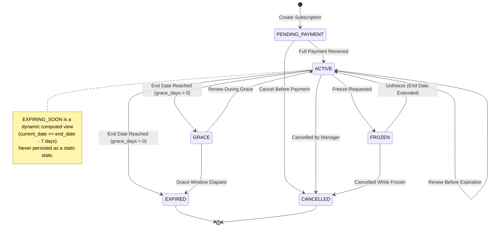
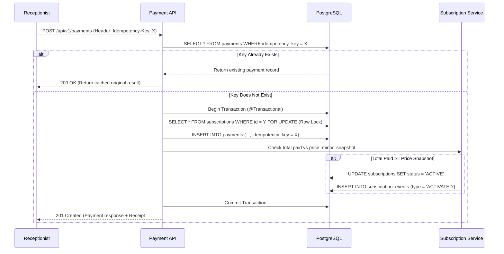
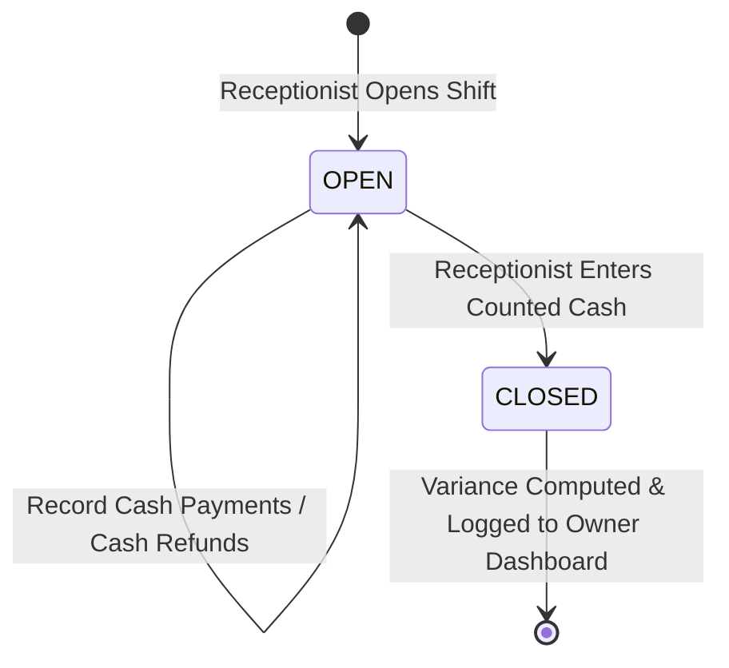

# Kammel — Core Business Logic & State Machines

> **Document Version:** 1.0  
> **Last Updated:** November 2026  
> **Related:** [01_BUSINESS_REQUIREMENTS.md](./01_BUSINESS_REQUIREMENTS.md) · [04_DOMAIN_MODEL.md](./04_DOMAIN_MODEL.md) · [07_API_DESIGN.md](./07_API_DESIGN.md)

---

## 1. Subscription Lifecycle & State Machine

The subscription lifecycle represents the most critical business workflow in Kammel. In traditional systems, subscriptions are often treated as mutable records with a simple status column manually toggled by users. In Kammel, subscriptions are managed as an **Event-Driven State Machine** governed by explicit business rules, where every state change produces an immutable `SubscriptionEvent`.

### 1.1 State Diagram



### 1.2 State Transition Matrix

| From State | Event / Trigger | Target State | Authorized Actor | Business Preconditions & Invariants |
|---|---|---|---|---|
| *None* | `SubscriptionCreated` | `PENDING_PAYMENT` | Receptionist, Manager, Owner | Member must be active; Plan must be active. Snapshot plan price. |
| `PENDING_PAYMENT` | `PaymentCompleted` | `ACTIVE` | System (on Payment) | Cumulative payments for this subscription ≥ `price_minor_snapshot`. |
| `PENDING_PAYMENT` | `ManualCancel` | `CANCELLED` | Manager, Owner | Mandatory cancellation reason. No completed payments exist. |
| `ACTIVE` | `FreezeRequested` | `FROZEN` | Manager, Owner | `frozen_days_used + requested_days <= plan.freeze_max_days`. Reason mandatory. |
| `ACTIVE` | `RenewalPaid` | `ACTIVE` | System (on Payment) | Paid before `end_date`. **New `end_date` = current `end_date` + plan `duration_days`**. |
| `ACTIVE` | `EndDateReached` | `GRACE` | Nightly Scheduler | Today > `end_date` AND `plan.grace_days > 0`. |
| `ACTIVE` | `EndDateReached` | `EXPIRED` | Nightly Scheduler | Today > `end_date` AND `plan.grace_days == 0`. |
| `ACTIVE` | `ManualCancel` | `CANCELLED` | Manager, Owner | Requires reason and manager authorization; logged in Audit. |
| `FROZEN` | `UnfreezeRequested`| `ACTIVE` | Manager, Owner, Scheduler | Extend `end_date` by exact actual frozen days. Update `frozen_days_used`. |
| `GRACE` | `RenewalPaid` | `ACTIVE` | System (on Payment) | **New `start_date` = payment date**. New `end_date` = payment date + duration. |
| `GRACE` | `GracePeriodElapsed`| `EXPIRED` | Nightly Scheduler | Today > `end_date + plan.grace_days`. |

### 1.3 Strict Transition Rules & Invalid Paths

Any attempt to execute an invalid transition throws `InvalidStateTransitionException` (HTTP 422):
- **EXPIRED → ACTIVE:** Forbidden. Once expired, a brand-new subscription record must be created.
- **CANCELLED → ACTIVE:** Forbidden. A cancelled contract is permanently dead.
- **PENDING_PAYMENT → FROZEN:** Forbidden. Only active, paid subscriptions can be frozen.
- **FROZEN → FROZEN:** Forbidden. A subscription cannot be re-frozen while currently in frozen state.
- **GRACE → FROZEN:** Forbidden. Freezing is disallowed during grace periods.

### 1.4 Renewal Business Logic Details

#### Scenario A: Renewal Prior to Expiration (Preserving Member Days)
- Member subscription expires on **December 10**.
- Member pays renewal for a 30-day plan on **December 5** (5 days prior to expiration).
- **Rule:** The member must never lose their paid days.
- **Formula:**
  $$\text{New End Date} = \text{Current End Date} + \text{Plan Duration} = \text{Dec 10} + 30 \text{ days} = \text{Jan 9}$$

#### Scenario B: Renewal After Expiration or During Grace
- Member subscription expired on **November 15**.
- Member visits reception and renews on **November 22**.
- **Rule:** The subscription starts from the renewal payment date (unless retroactivity is explicitly approved by a Manager with logged justification).
- **Formula:**
  $$\text{New Start Date} = \text{Payment Date} = \text{Nov 22}$$
  $$\text{New End Date} = \text{Nov 22} + 30 \text{ days} = \text{Dec 22}$$

### 1.5 Subscription Freeze Logic
- A freeze places attendance on hold while the member is traveling or injured.
- While `FROZEN`, check-in attempts are rejected with a clear message: `"Subscription is frozen until {date}. Reason: {reason}"`.
- When unfrozen (either manually or automatically at scheduled unfreeze date):
  $$\text{Days Frozen} = \text{Unfreeze Date} - \text{Freeze Date}$$
  $$\text{New End Date} = \text{Old End Date} + \text{Days Frozen}$$
  $$\text{frozen\_days\_used} = \text{frozen\_days\_used} + \text{Days Frozen}$$
- System guarantees `frozen_days_used` can never exceed `plan.freeze_max_days`.

---

## 2. Payment & Financial Workflows

### 2.1 Financial Invariants
1. **Never use floating-point types (`double`, `float`):** All financial transactions and calculations operate strictly on 64-bit integers (`Long` / `BIGINT`) denominated in minor currency units (piasters).
2. **Immutable Financial History:** Payment records cannot be modified or deleted via SQL `UPDATE` or `DELETE`. Adjustments or cancellations require compensatory ledger records (`Refund` or `PaymentReversal`).
3. **Idempotency Guarantee:** Network drops or double-clicks must never result in duplicate financial charges.

### 2.2 Payment Idempotency & Concurrency



### 2.3 Partial Payments & Outstanding Balances
- Gyms frequently accept installments (e.g., 50% deposit on registration, remaining balance within 14 days).
- A subscription remains in `PENDING_PAYMENT` if:
  $$\sum \text{payments} < \text{subscription.price\_minor\_snapshot}$$
- The member appears on the **Collections Queue** on the Owner Dashboard showing exact remaining balance.
- Once the remaining balance is paid in a subsequent transaction, the subscription automatically transitions to `ACTIVE`.

### 2.4 Refunds & Reversals
- **Refund:** Money returned to member due to relocation, medical emergency, or dissatisfaction.
  - Requires `amount_minor <= original_payment.amount_minor`.
  - Requires mandatory reason text and `BRANCH_MANAGER` or `GYM_OWNER` approval.
  - Generates a `Refund` entity referencing the original payment.
  - If total remaining payments drop below price snapshot, subscription status reverts to `PENDING_PAYMENT` or `CANCELLED`.
- **Reversal:** Voiding a clerical error (e.g., receptionist entered 70,000 piasters instead of 7,000 piasters).
  - Status of original payment set to `REVERSED`.
  - Reverse audit record logged.

---

## 3. Cash Management & Shift Reconciliation

Cash theft and unrecorded receipts are primary revenue leakages in Egyptian gyms. Kammel treats cash drawer reconciliation as a foundational business process.

### 3.1 Shift Flow Lifecycle



### 3.2 Shift Reconciliation Mathematics

When a receptionist closes a shift:
1. **Expected Cash Computation:**
   $$\text{Expected Cash} = \sum_{\text{shift}} \text{Cash Payments} - \sum_{\text{shift}} \text{Cash Refunds}$$
   *(Note: Non-cash payments like InstaPay or Bank Transfers are tracked separately and excluded from drawer cash counts).*
2. **Receptionist Blind Count:**
   - The receptionist counts the actual physical currency in the drawer and inputs `counted_cash_minor`.
   - The receptionist is intentionally not shown the expected cash before entering their physical count to prevent figure manipulation.
3. **Variance Calculation:**
   $$\text{Variance} = \text{Counted Cash} - \text{Expected Cash}$$
   - **Variance = 0:** Perfect balance.
   - **Variance < 0 (Shortage):** Cash missing; flagged on Owner Dashboard in red.
   - **Variance > 0 (Overage):** Unrecorded receipt or change error; flagged for review.
4. **Sealed Record:** The shift is closed, timestamped, and rendered immutable.

---

## 4. Attendance Check-In Verification Flow

Check-in must execute in under 1 second to prevent bottlenecking the reception desk during peak gym hours (e.g., 6:00 PM – 9:00 PM).

```mermaid
flowchart TD
    Start[Member Arrives: Search Phone/Name or Scan QR] --> FindMember{Member Found?}
    FindMember -->|No| PromptRegister[Prompt: Register New Member]
    FindMember -->|Yes| FindSub{Has Active or Grace Subscription?}

    FindSub -->|No Subscription| NoSubAlert[Alert: No Active Membership\nShow Plan Options]
    FindSub -->|Has Subscription| CheckStatus{Subscription Status}

    CheckStatus -->|ACTIVE| CheckDuplicate{Checked In Today?}
    CheckStatus -->|FROZEN| BlockFrozen[Block Entry: Show Freeze Reason & Unfreeze Button]
    CheckStatus -->|EXPIRED| ExpiredAlert[Friendly Alert: Expired on {date}\nShow 'Renew Now' Button]
    CheckStatus -->|GRACE| GraceAlert[Allow Entry + Warning: Grace Period Ends in {N} Days]

    CheckDuplicate -->|Yes| WarnDuplicate[Warning: Member Checked In at 10:15 AM\nAllow Reception Override]
    CheckDuplicate -->|No| CheckPlanType{Is Session-Based Plan?}

    CheckPlanType -->|Yes| DeductSession[Deduct 1 Session\nCheck Remaining Sessions]
    CheckPlanType -->|No| RecordCheckIn[Record CheckIn in Database]

    DeductSession --> RecordCheckIn
    GraceAlert --> RecordCheckIn
    WarnDuplicate -->|Receptionist Confirms| RecordCheckIn

    RecordCheckIn --> Success[Display Success: Welcome {Name}!]
```

---

## 5. Retention & Churn Risk Scoring Engine

Kammel avoids premature, uncalibrated Machine Learning models. Instead, it executes an **Explainable, Rule-Based Scoring Engine** that runs as a nightly batch job.

### 5.1 Risk Scoring Algorithm & Signals

Every night at 3:00 AM, the engine computes a score from **0 to 100** for each active member:

$$\text{RiskScore} = \min\left(100, \sum_{i=1}^{n} (\text{SignalValue}_i \times \text{Weight}_i)\right)$$

| Signal | Weight | Computation Logic | Rationale |
|---|:---:|---|---|
| **Days Since Last Visit** | 30% | $\begin{cases} 0 & \text{days} \le 3 \\ 10 & 4 \le \text{days} \le 7 \\ 20 & 8 \le \text{days} \le 13 \\ 30 & \text{days} \ge 14 \end{cases}$ | Consistent attendance absence is the single strongest precursor to churn. |
| **Attendance Frequency Drop** | 25% | Compare visits in last 14 days vs prior 14 days.<br>Drop $> 50\% \to 25$ pts.<br>Drop $> 25\% \to 15$ pts. | Behavioral disengagement trajectory. |
| **Days Remaining in Contract** | 20% | $\begin{cases} 20 & \le 3 \text{ days} \\ 15 & 4 \text{ to } 7 \text{ days} \\ 5 & 8 \text{ to } 14 \text{ days} \\ 0 & > 14 \text{ days} \end{cases}$ | Imminent contract end combined with low visits produces highest churn vulnerability. |
| **Payment History Friction** | 10% | Past late payments or payment delay count $> 0 \to 10$ pts. | Financial friction or hesitation to commit. |
| **Freeze Frequency** | 10% | Member has frozen subscription $\ge 2$ times $\to 10$ pts. | Habit disruption. |
| **Tenure Hazard** | 5% | Membership age $< 60$ days $\to 5$ pts. | New gym members experience highest dropout rate in first 2 months. |

### 5.2 Risk Categorization & Explainability Output

| Score Range | Category | Color | Mandatory Action |
|---|---|---|---|
| **0 – 30** | `LOW` | Green | Member engaged. No action required. |
| **31 – 60** | `MEDIUM` | Yellow | Normal monitoring. Optional check-in. |
| **61 – 80** | `HIGH` | Orange | Target with "Miss You" WhatsApp reminder this week. |
| **81 – 100** | `CRITICAL` | Red | Immediate outreach today. Pre-drafted WhatsApp message generated. |

#### Sample Generated Explainability Record (Stored in `risk_scores`):
```json
{
  "memberId": "a0b1c2d3-e4f5-6a7b-8c9d-0e1f2a3b4c5d",
  "score": 85,
  "riskLevel": "CRITICAL",
  "reasons": [
    "Absent for 14 consecutive days",
    "Attendance frequency dropped by 65% over past 14 days",
    "Subscription expires in 4 days (2026-11-07)"
  ],
  "recommendedAction": "Contact member today via WhatsApp with renewal incentive",
  "draftMessage": "أهلاً يا كريم، وحشتنا في الجيم! بقالك أسبوعين مجتش، واشتراكك بيخلص السبت الجاي. تحب نجهّزلك كابتن يراجع معاك جدول تمرينك أول ما ترجع؟"
}
```

### 5.3 Holdout Group Impact Measurement

To empirically prove to gym owners that Kammel increases retention, the system supports **Holdout A/B Verification**:
1. At-risk members are deterministically split into **Group A (90% - Intervention)** and **Group B (10% - Holdout Control)**.
2. Group A receives WhatsApp reminders; Group B receives no automated outreach.
3. At month-end, the Owner Dashboard contrasts renewal rates:
   $$\text{Attributed Lift} = \text{RenewalRate}_A - \text{RenewalRate}_B$$
   $$\text{Retained Revenue Lift} = \text{Attributed Lift} \times \text{Average Subscription Price}$$
4. This transforms Kammel from a software expense into a measurable revenue generator.
