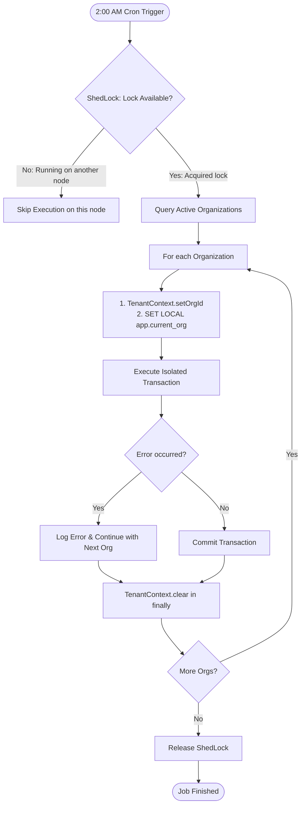
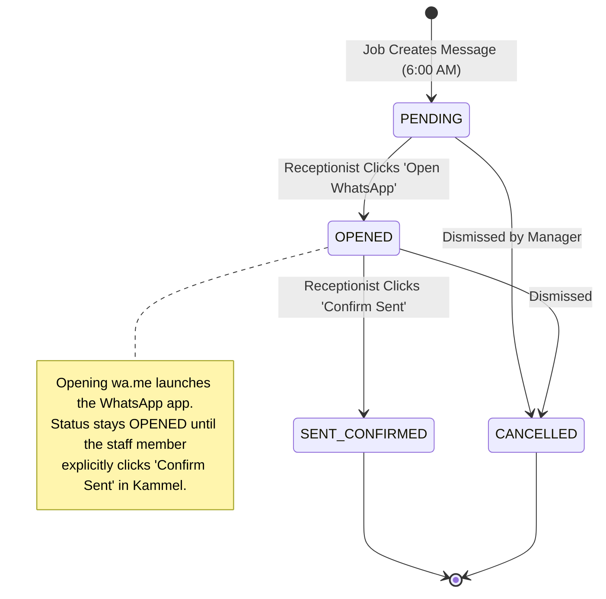

# Kammel — Background Jobs & WhatsApp Notifications

> **Document Version:** 1.0  
> **Last Updated:** November 2026  
> **Related:** [03_SYSTEM_ARCHITECTURE.md](./03_SYSTEM_ARCHITECTURE.md) · [08_BUSINESS_LOGIC_AND_STATE_MACHINES.md](./08_BUSINESS_LOGIC_AND_STATE_MACHINES.md)

---

## 1. Background Jobs Infrastructure

Kammel relies on background jobs for automated business maintenance: advancing subscription expirations, calculating member retention risk scores, and generating daily WhatsApp reminder queues.

### 1.1 Architecture & Scheduling Stack
- **Engine:** Spring Task Scheduling (`@Scheduled`) backed by a configured `ThreadPoolTaskScheduler`.
- **Distributed Lock Management:** **ShedLock** with JDBC provider (`shedlock` table in PostgreSQL). ShedLock ensures that when Kammel is scaled to multiple container instances, scheduled tasks execute on **exactly one node** at a time.
- **Tenant Context Boundary:** Because background jobs execute outside an incoming HTTP request, they possess no JWT. The background worker iterates through each active `Organization` and explicitly binds the tenant context before initiating a tenant-scoped transaction.



---

## 2. Scheduled Jobs Catalog

### 2.1 Job 1: Subscription Expiration & Grace Monitor
- **Schedule:** Daily at `02:00 AM Africa/Cairo` (`0 0 2 * * *`).
- **ShedLock Lock At Most:** 30 minutes.
- **Logic:**
  1. Find all `ACTIVE` subscriptions where `end_date < today`.
     - If `plan.grace_days > 0` $\to$ transition to `GRACE`, record `SubscriptionEvent(GRACE_ENTERED)`.
     - If `plan.grace_days == 0` $\to$ transition to `EXPIRED`, record `SubscriptionEvent(EXPIRED)`.
  2. Find all `GRACE` subscriptions where `end_date + plan.grace_days < today`.
     - Transition to `EXPIRED`, record `SubscriptionEvent(EXPIRED)`.
- **Safety Invariant:** Read with pessimistic write locks (`FOR UPDATE`) to prevent race conditions with concurrent late check-ins.

### 2.2 Job 2: Nightly Retention Risk Score Engine
- **Schedule:** Daily at `03:00 AM Africa/Cairo` (`0 0 3 * * *`).
- **ShedLock Lock At Most:** 45 minutes.
- **Logic:**
  1. Retrieve all members holding `ACTIVE` or `GRACE` subscriptions.
  2. Compute signal vector: days since last visit, 14-day attendance slope, contract days remaining, freeze frequency, tenure.
  3. Calculate composite score (0–100) and assemble human-readable Arabic explanation bullet points.
  4. Persist result in `risk_scores` table for morning Owner Dashboard consumption.

### 2.3 Job 3: WhatsApp Renewal Reminder Queue Generation
- **Schedule:** Daily at `06:00 AM Africa/Cairo` (`0 0 6 * * *`).
- **ShedLock Lock At Most:** 15 minutes.
- **Logic:**
  1. Query members whose active subscription expires in exactly 7 days, 3 days, or 1 day, OR members currently in `GRACE`.
  2. Check `whatsapp_opt_in == true`.
  3. Enforce **Cooldown Rule:** Check `message_queue` to ensure no message of this template was created for this member within the past 3 days.
  4. Render personalized Arabic template (member name, gym name, expiration date, renewal link).
  5. Insert new record into `message_queue` with status `PENDING` and generated `wa.me` deep link.

---

## 3. WhatsApp Messaging Architecture

### 3.1 Two-Phased Strategy

| Dimension | MVP (P0): Manual WhatsApp Queue (`wa.me`) | Post-MVP (P1): Official WhatsApp Cloud API |
|---|---|---|
| **Mechanism** | Web link `https://wa.me/{phone}?text={encodedText}` | Meta WhatsApp Cloud API via BSP (Twilio / 360dialog) |
| **Sending Actor** | Receptionist clicks link on tablet/desktop WhatsApp | Automated headless background worker |
| **Financial Cost** | **Zero messaging fees** | Per-conversation Meta BSP template fees |
| **Ban Risk** | Negligible (sent from receptionist's device) | Requires verified Meta Business Manager & approved templates |
| **Delivery Feedback**| Receptionist manual confirmation | Automated webhooks (`sent`, `delivered`, `read`) |

### 3.2 Strategy Pattern Implementation: `NotificationChannel`
The codebase abstracts message dispatching behind an interface, ensuring the migration to official Cloud API in P1 does not alter business logic:

```java
public interface NotificationChannel {
    NotificationChannelType getType();
    void prepareMessage(MessageQueueItem item);
    DispatchResult dispatch(MessageQueueItem item);
    boolean supportsAutomatedDeliveryReceipts();
}
```

---

## 4. Message Lifecycle & Delivery State Machine

A critical design principle highlighted in the Kammel evaluation: **Opening a `wa.me` link does NOT mean the message was delivered.** The application explicitly separates opening from transmission.



---

## 5. Message Templates (Arabic Localized)

### Template 1: `RENEWAL_REMINDER` (T-7 / T-3 Days)
```text
أهلاً يا {memberName} 👋
اشتراكك في {gymName} هينتهي يوم {endDate}.
جدّد دلوقتي عشان تحتفظ بسعرك وماتخسرش أي أيام تمرين.
تحب نجهّزلك كارت التجديد؟ 💪
```

### Template 2: `MISS_YOU` (At-Risk Churn Outreach)
```text
يا {memberName}، وحشتنا في {gymName}! 🏋️‍♂️
لاحظنا إنك بقالك {daysAbsent} يوم مجتش.
كابتن {trainerName} مستنيك، تحب نظبّطلك ميعاد تمرين الأسبوع ده؟
```

### Template 3: `GRACE_EXPOSURE` (Subscription Expired)
```text
أهلاً يا {memberName}،
اشتراكك انتهى، لكن إحنا في فترة السماح بتاعتك لحد {graceEndDate}.
تقدر تشرفنا في أي وقت لتجديد الاشتراك وتكمل مشوارك الرياضي!
```

---

## 6. Duplicate Prevention & Anti-Spam Guardrails

To prevent spamming members and burning customer goodwill:
1. **Frequency Capping:** Maximum 1 automated WhatsApp message per member every 3 days.
2. **Time Window Restriction:** Messages are only generated and displayed for dispatch between **09:00 AM and 09:00 PM Africa/Cairo**.
3. **Explicit Opt-In Required:** If `member.whatsapp_opt_in == false`, no automated messages are generated. If a member requests to opt out, reception toggles the flag off.

---

## 7. Renewal Attribution Engine

How does Kammel prove that a reminder message caused a member to renew?

```
Trigger: Member completes a renewal payment
Logic:
1. Query message_queue for member:
   WHERE member_id = :memberId
     AND status = 'SENT_CONFIRMED'
     AND sent_at >= (payment_date - INTERVAL '7 DAYS')
   ORDER BY sent_at DESC LIMIT 1;

2. If matching message found:
   UPDATE message_queue
   SET attributed_subscription_id = :newSubscriptionId
   WHERE id = :messageId;
```

On the Owner Dashboard, this populates the **Attributed Value** metric:
> *"14 members renewed within 7 days of receiving a Kammel WhatsApp reminder, generating 9,800 EGP in recovered revenue."*
