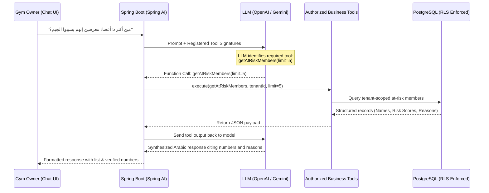

# Kammel — AI & Machine Learning Integration Roadmap

> **Document Version:** 1.0  
> **Last Updated:** November 2026  
> **Phase:** Future Implementation (Post-MVP / Phase 3)  
> **Related:** [00_PROJECT_OVERVIEW.md](./00_PROJECT_OVERVIEW.md) · [02_MVP_AND_PRODUCT_ROADMAP.md](./02_MVP_AND_PRODUCT_ROADMAP.md) · [08_BUSINESS_LOGIC_AND_STATE_MACHINES.md](./08_BUSINESS_LOGIC_AND_STATE_MACHINES.md)

---

## 1. Executive Directive: Prerequisites Before AI

> [!IMPORTANT]
> **AI is strictly prohibited in the P0 MVP.**  
> An AI feature built on top of an unreliable operational system or sparse, unverified data produces inaccurate hallucinated numbers with high confidence. The core business engine (members, subscriptions, payments, attendance) must run reliably in production first.

### Mandatory Pre-AI Checklist
Before any developer writes a single line of AI or Machine Learning code, all of the following criteria must be fulfilled:
1. [ ] The core system has been used in production by at least 3 pilot gyms for at least 3 to 6 consecutive months.
2. [ ] Over 1,000 distinct members with multiple complete subscription lifecycle renewal cycles exist in PostgreSQL.
3. [ ] Churn ground-truth labels are cleanly recorded (members who entered grace and did not renew vs. members who renewed).
4. [ ] The rule-based Risk Score has been benchmarked against real-world renewals to establish a performance baseline.
5. [ ] Multi-tenant isolation tests have a 100% pass rate in CI.

---

## 2. Phased Intelligence Evolution

```
Phase 1: Deterministic Rules (P0 MVP)
   └─ Explainable weighted scoring (0-100), human-readable Arabic reasons, zero ML complexity.

Phase 2: Supervised Churn Modeling (P2 Post-MVP)
   └─ Offline training with Python (LightGBM/Logistic Regression) → Export to ONNX → In-JVM Java inference.

Phase 3: Conversational Executive Assistant (P3 Future)
   └─ Spring AI + Function Calling on authorized, tenant-scoped, read-only tools.
```

---

## 3. Phase 2: Supervised Churn Prediction Engine

### 3.1 Feature Vector & Ground Truth
Once sufficient temporal data is accumulated:
- **Target Label:** Binary churn $y \in \{0, 1\}$ defined as: member subscription expired, grace period elapsed, and no renewal recorded within 14 days following grace expiration.
- **Features Extracted:**
  - $x_1$: Days since last physical check-in.
  - $x_2$: 14-day visit velocity ($\Delta \text{Visits} = \text{Visits}_{t-14 \to t} - \text{Visits}_{t-28 \to t-14}$).
  - $x_3$: Historical freeze count.
  - $x_4$: Late payment frequency ratio.
  - $x_5$: Customer lifetime tenure in days.
  - $x_6$: Ratio of attended sessions to total allowed sessions.

### 3.2 Deployment Strategy: Embedded ONNX Runtime in Java
Rather than introducing a Python microservice (FastAPI sidecar) which adds infrastructure overhead for a single developer, the recommended deployment pattern is:
1. Data scientists or the developer trains the model offline in Python using scikit-learn or LightGBM.
2. The trained model is exported to the open standard **ONNX (Open Neural Network Exchange)** format: `churn_model_v1.onnx`.
3. Spring Boot loads the ONNX file using Microsoft's official `onnxruntime` Java SDK.
4. Feature vectors are assembled in Java, and predictions execute directly inside the JVM in less than 5 milliseconds without network latency.

---

## 4. Phase 3: Arabic Business Assistant (Spring AI)

The goal of the Business Assistant is to enable the Gym Owner to ask strategic operational questions in natural Egyptian Arabic:
- *"مين أكتر أعضاء معرضين إنهم ما يجددوش الشهر ده؟"*
- *"ليه إيراد فرع المعادي قل مقارنة بالشهر اللي فات؟"*
- *"إيه أكتر باقة بتتباع عند كابتن هاني؟"*



### 4.1 Strict Security Boundaries for AI

1. **Absolute Prohibition of Text-to-SQL:** The LLM is **never** permitted to generate or execute raw SQL statements against PostgreSQL. A single prompt injection or hallucination could leak competitor data or execute destructive `DROP/DELETE` statements.
2. **Authorized Function Calling Only:** The LLM can only interact with the application by invoking explicitly registered, read-only Java `@Tool` methods.
3. **Implicit Tenant Context Injection:** Tools do **not** accept `orgId` as a parameter from the LLM. The tool implementation automatically retrieves `TenantContext.getOrgId()` from the authenticated session context.
4. **Data Minimization:** Raw member phone numbers and private notes are never sent to external LLM APIs; only aggregated metrics and member first names are passed.

### 4.2 Spring AI Tool Definitions (`GymBusinessTools.java`)

```java
@Component
public class GymBusinessTools {

    @Autowired private ReportingService reportingService;
    @Autowired private RiskScoreService riskScoreService;

    @Tool(description = "Fetch top members at risk of churn for the current organization")
    public List<AtRiskMemberDto> getAtRiskMembers(@ToolParam(description = "Max records to return") int limit) {
        UUID orgId = TenantContext.getOrgId(); // Secured from context
        return riskScoreService.getTopAtRiskMembers(orgId, Math.min(limit, 20));
    }

    @Tool(description = "Retrieve aggregated revenue and subscription counts for a specific period")
    public RevenueSummaryDto getRevenueSummary(
            @ToolParam(description = "Period: 'THIS_MONTH', 'LAST_MONTH', or 'CURRENT_QUARTER'") String period) {
        UUID orgId = TenantContext.getOrgId();
        return reportingService.getRevenueSummary(orgId, period);
    }

    @Tool(description = "Get cash shift reconciliation discrepancies for a branch")
    public List<CashVarianceDto> getCashVariances(
            @ToolParam(description = "Number of recent days to inspect") int days) {
        UUID orgId = TenantContext.getOrgId();
        return reportingService.getCashVariances(orgId, days);
    }
}
```

### 4.3 System Prompt Design

```text
You are "Kammel Assistant" (مساعد كمّل), an intelligent, professional business analyst helping the gym owner analyze their gym's operational and financial data.

Strict Operational Guidelines:
1. Communicate primarily in polite, professional Egyptian Arabic (عربي مصري مهني).
2. Ground all financial figures in exact numbers returned by your tools. Never fabricate or extrapolate financial statistics.
3. If tool data is insufficient to answer the question, clearly state: "البيانات المسجلة حالياً غير كافية للإجابة بدقة على هذا السؤال."
4. Every numerical claim must cite its verified source (e.g., "[المصدر: حساب Risk Score ليوم 3 نوفمبر]").
5. Do not offer medical, nutritional, or legal advice.
```

---

## 5. Structured Output Contracts

To ensure reliable frontend rendering of charts, tables, and alert badges, Spring AI outputs are parsed into strongly typed Java records:

```java
public record BusinessInsightResponse(
    String naturalLanguageSummary,
    List<SupportingDataPoint> metrics,
    String primaryDataSource,
    ConfidenceLevel confidence,
    List<String> suggestedNextSteps
) {
    public enum ConfidenceLevel { HIGH, MEDIUM, LOW }
    public record SupportingDataPoint(String label, String value, String unit) {}
}
```

---

## 6. Regression Testing: The 50-Question Benchmark

Before any update to system prompts, tool signatures, or underlying models is deployed to production, it must execute against an automated evaluation test suite consisting of **50 canonical business queries** with known reference outputs.

### Benchmark Criteria:
- **Tool Selection Accuracy:** Did the model call the correct Java tool?
- **Parameter Extraction Precision:** Did it extract valid dates and constraints?
- **Zero Hallucination:** Are the returned numbers identical to database reality?
- **Language Fidelity:** Is the output natural Arabic free of translation artifacts?
- **Tenant Containment:** Does the prompt fail securely when prompted to query cross-tenant gyms?
