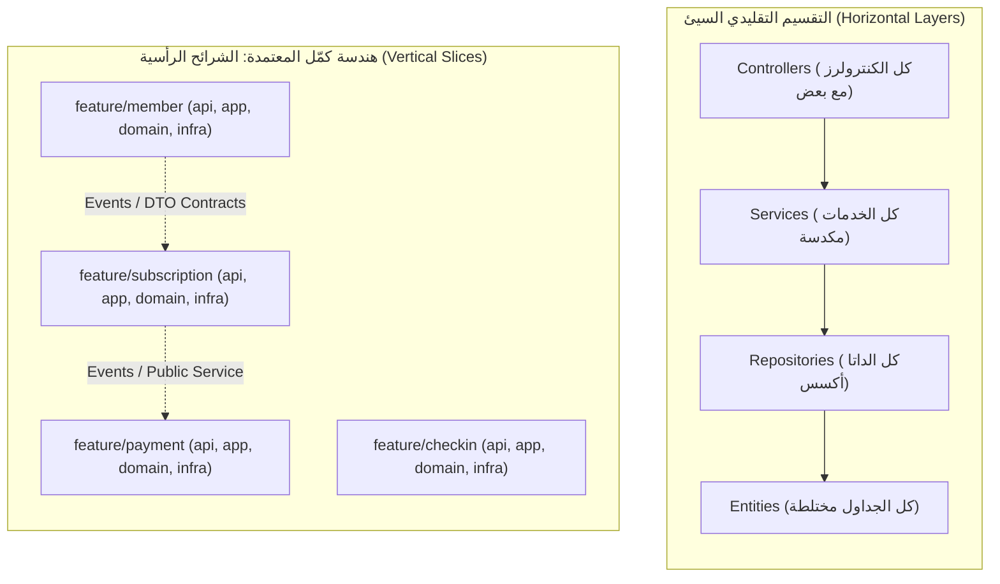

# 00 - نظرة عامة على المشروع والهندسة المعمارية (Project Overview & Architecture)

> **مسار الملف:** `implementation-blueprint/00-project-overview.md`  
> **الحالة:** معتمد للتنفيذ (Approved for Implementation)  
> **الهدف:** توفير الرؤية المعمارية الكاملة لمشروع "كمّل" (Kammel) بنمط Feature-Based (Vertical Slice) Architecture.

---

## 1. ما هو مشروع "كمّل" (Kammel SaaS)؟

مشروع **كمّل (Kammel)** مش مجرد نظام إدارة جيم روتيني (CRUD Gym Management App) لتسجيل الحضور والكارنيهات. كمّل مبني في الأساس ليكون:
**"محرك ذكي لاستبقاء الأعضاء ومنع تسرب الإيرادات (Gym Retention & Revenue Leakage Engine) مخصص للجيمات المستقلة وسلاسل الجيمات الصغيرة والمتوسطة في السوق المصري."**

### 1.1 المشكلة الحقيقية في السوق المصري (The Core Problem)
أغلب الجيمات في مصر (100 إلى 500+ عضو) بتواجه 3 مشاكل بتنزف أرباح الجيم يومياً:
1. **تسرب الاشتراكات (Member Churn):** الجيم بيكتشف إن العضو مش هيجدد بعد ما اشتراكه ينتهي بالفعل وميرجعش، ومفيش أي متابعة استباقية (Proactive Retention) لما يبتدي يقطع تمرين.
2. **تسرب الإيرادات والكاش (Revenue Leakage):** تجديدات كاش بتتسجل في كشاكيل ورق أو شيتات إكسيل بدون مطابقة جرد يومي (Shift Reconciliation)، أو موظف الاستقبال بيعمل خصومات وتجميد (Freeze) بدون رقابة صاحب الجيم.
3. **طرق تواصل معقدة أو مكلفة:** أنظمة الجيمات التقليدية بتطلب SMS غالي أو اشتراكات WhatsApp Business API مكلفة جداً على جيم محلي، فمحدش بيستمر في إرسال التنبيهات.

### 1.2 معادلة القيمة لـ كمّل (The Value Proposition)
- **بيع النتيجة وليس السيستم:** كمّل بيثبت لصاحب الجيم: "السيستم رجّعلك كم مشترك الشهر ده وجابلك إيرادات مباشرة كام جنيه (Attributed Revenue)".
- **الاعتماد على القنوات المستخدمة فعلياً:** رسائل واتساب سريعة عبر روابط مجانية (`wa.me`) تفتح من كليك واحدة لموظف الاستقبال، مع إمكانية التحويل المستقبلي لـ WhatsApp Cloud API.
- **تتبع مالي صارم بالقرش (Piasters):** تخزين كل المبالغ المالية كـ `Long / BIGINT` لمنع أخطاء التقريب البرمجية، مع قيود عدم الحذف والـ Idempotency لمنع التكرار وسرقة الكاش.

---

## 2. القرار المعماري الصارم: Feature-Based (Vertical Slice) Architecture

تم الاتفاق بشكل حاسم على بناء النظام بأسلوب **Feature-Based Architecture (الهندسة المبنية على الميزات والشرائح الرأسية)** بدلاً من التقسيم التقني الأفقي التقليدي (Layered / Horizontal Architecture).



### 2.1 ليه اخترنا Vertical Slice Architecture للجيمات؟
1. **عزل التغييرات وسهولة التطوير (High Cohesion, Low Coupling):** لما نطور أو نعدل في دورة حياة الاشتراكات (Subscriptions)، كل ملفاتها (من الـ DTO للـ Entity لقواعد الـ State Machine) موجودة داخل نفس الـ Package بدون تشتت في 6 فولدرات مختلفة.
2. **حدود واضحة وقابلة للاختبار (Modular Monolith):** نقدر نشغل Spring Modulith للتحقق من عدم حدوث استدعاءات عشوائية بين الموديولات.
3. **سهولة استخراج Microservices لاحقاً (Future Extraction):** لو موديول زي الـ `checkin` أو `risk` احتاج Scaling منفصل في المستقبل، الشريحة الرأسية الخاصة به معزولة تماماً ويمكن تحويلها لخدمة مستقلة بدون إعادة هيكلة الكود.

### 2.2 تقسيم الشريحة الرأسية الواحدة (Internal Slice Structure)
كل Feature داخل الـ `features/` هيمتلك 4 طبقات داخلية واضحة ومحددة المسؤوليات:

```text
features/{feature-name}/
├── api/             # Controllers, Request/Response DTOs, Web Mappers
├── application/     # Service Interfaces, Service Implementations, Use Cases, Event Handlers
├── domain/          # Entities, Enums, Value Objects, Domain Exceptions, Domain Events
└── infrastructure/  # Spring Data JPA Repositories, DB Adapters, External Integrations
```

---

## 3. قائمة الميزات الأساسية ونطاق الـ MVP (P0 vs Post-MVP)

علشان نضمن إطلاق المنتج في غضون **10-12 أسبوع** بواسطة مطور واحد وتجربته في جيم حقيقي لمدة 14 يوم بدون عودة للدفاتر، تم فرز الميزات بصرامة كالتالي:

| الفئة المعمارية | الموديول / الميزة | النطاق (Scope) | الوصف والدور في النظام |
|---|---|---|---|
| **Core Platform** | `identity` | **P0 (MVP)** | مصادقة الموظفين، إصدار JWT Access/Refresh tokens، تشفير BCrypt، وتأمين الصلاحيات (RBAC). |
| **Core Platform** | `tenancy` | **P0 (MVP)** | إدارة المنظمات (Gym Tenants) والفروع وعزل البيانات التام عبر PostgreSQL RLS. |
| **Member Management**| `member` | **P0 (MVP)** | تسجيل الأعضاء، البحث السريع برقم الموبايل، الحذف المرن (Soft Delete)، واستيراد ملفات Excel. |
| **Membership Plans** | `plan` | **P0 (MVP)** | قوالب الاشتراكات (شهري، ربع سنوي، باقة حصص)، مع تجميد السعر في لحظة الشراء (Snapshot). |
| **Contracts & State**| `subscription` | **P0 (MVP)** | آلة الحالة للاشتراك (State Machine)، تمديد التجديدات، تجميد الاشتراك (Freeze)، وسجل الأحداث غير القابل للتعديل. |
| **Financial Ledger** | `payment` | **P0 (MVP)** | تسجيل المدفوعات (كاش، إنستاباي، تحويل)، منع التكرار (Idempotency Key)، إيصالات الدفع، والأقساط الجزئية. |
| **Daily Operations** | `checkin` | **P0 (MVP)** | تسجيل الحضور السريع (< 1 ثانية) بالاسم/الموبايل/QR، فحص صلاحية الاشتراك وخصم الحصص. |
| **Intelligence** | `risk` | **P0 (MVP)** | محرك احتساب احتمالية التسرب الحسابي (0-100) يومياً في وظيفة ليلية مبنية على قواعد واضحة ومفسرة بالعربي. |
| **Outreach** | `notification` | **P0 (MVP)** | طابور رسائل الواتساب للتجديدات مع روابط `wa.me` وكشف التكرار ونظام نسبة التجديدات للرسائل (Attribution). |
| **Executive View** | `reporting` | **P0 (MVP)** | لوحة تحكم صاحب الجيم (Dashboard): الإيرادات الشهرية، نسبة التجديد، والأعضاء المهددون بالمغادرة. |
| **Compliance** | `audit` | **P0 (MVP)** | سجل عمليات التدقيق غير القابل للتعديل (Immutable Audit Log) لعمليات الخصومات والاسترجاع والتجميد. |
| **Cash Control** | `shift` (Cash Shifts)| **P1 (Post-MVP)**| جرد درج الكاش، تسجيل ورديات موظف الاستقبال، احتساب العجز والزيادة (Variance). |
| **CRM & Growth** | `lead` (Sales Funnel)| **P1 (Post-MVP)**| قمع المبيعات ومتابعة العملاء المحتملين قبل التسجيل. |
| **Client Portal** | `pwa` (Member PWA) | **P1 (Post-MVP)**| تطبيق ويب تقدمي للعضو لعرض اشتراكه وكود الـ QR الخاص به. |
| **Automated Outreach**| `whatsapp-cloud` | **P1 (Post-MVP)**| إرسال رسائل الواتساب آلياً عبر Meta Cloud API / BSP. |
| **AI Insights** | `ai` (Spring AI) | **P3 (Future)** | المساعد الإداري بالذكاء الاصطناعي والتنبؤ المتقدم بتسرب الأعضاء عبر نماذج مدربة محلياً. |

---

## 4. القرارات المعمارية الأساسية ومبرراتها (Architecture Decision Records)

### القرار 1: نظام مونويلث مجزأ (Modular Monolith) بدلاً من الميكروسيرفسز (Microservices)
- **القرار:** بناء كمّل كـ Spring Boot Single Artifact مقسم داخلياً بحزم مستقلة مع Spring Modulith.
- **السبب:** المشروع يُبنى بمطور واحد، ولتجنب تعقيدات الشبكات، والمصادقة الموزعة، ومشاكل الـ Distributed Transactions. المونويلث المجزأ يتيح أداء استثنائي وتطوير سريع جداً.

### القرار 2: عزل المستأجرين بقاعدة بيانات واحدة وسياسات RLS (PostgreSQL Row-Level Security)
- **القرار:** استخدام Shared Database مع عمود `org_id` في جميع الجداول مفعل عليه RLS إجباري مدعوم بـ `SET LOCAL app.current_org = ?`.
- **السبب:** يوفر أعلى معايير الأمان لمنع اختراق البيانات بين الجيمات (Cross-tenant data leaks) على مستوى محرك قاعدة البيانات نفسه، دون تكلفة إنشاء قاعدة بيانات منفصلة لكل جيم.

### القرار 3: التعامل مع كل المبالغ المالية بالقروش والـ BIGINT
- **القرار:** ممنوع منعاً باتاً استخدام `float` أو `double` أو `BigDecimal` غير المحدود في تخزين العملة. السعر 700 جنيه يُخزن كرقم صحيح: `70000` قرش كـ `Long`.
- **السبب:** تفادي أخطاء الفاصلة العائمة (Floating-point precision errors) وضمان دقة الحسابات المالية والتقارير المحاسبية.

### القرار 4: تأجيل الذكاء الاصطناعي (AI) و Redis تماماً لمرحلة ما بعد الـ MVP
- **القرار:** لا وجود لـ Spring AI أو Redis في الـ MVP.
- **السبب:** الـ Redis يضيف تعقيداً على بيئة التشغيل لـ 500 مستخدم لا يحتاجونه، ومحرك الـ Risk في كمّل في مرحلة الـ MVP يعتمد على خوارزمية قواعد حسابية واضحة (Explainable Rule-Based Formula)، بينما الذكاء الاصطناعي يحتاج بيانات تاريخية نظيفة لسلوك الأعضاء ستتجمع بعد 3-6 أشهر من إطلاق المنتج في جيمات تجريبية.

---

## 5. خريطة ملفات الـ Blueprint

تتوزع تفاصيل هذا المخطط المعماري الكامل في 11 ملفاً تكميلياً:

1. [`00-project-overview.md`](./00-project-overview.md) - هذا الملف (الرؤية والقرارات الأساسية).
2. [`01-target-project-structure.md`](./01-target-project-structure.md) - هيكل المجلدات وحزم الـ Vertical Slices بالتفصيل.
3. [`02-features-breakdown.md`](./02-features-breakdown.md) - التفصيل الكامل لجميع ميزات التطبيق ومكوناتها الداخلية.
4. [`03-entity-relationships.md`](./03-entity-relationships.md) - الكيانات الـ 14، سماتها، وعلاقات JPA ومخطط ERD.
5. [`04-shared-components.md`](./04-shared-components.md) - المكونات العامة المشتركة (Shared Infrastructure).
6. [`05-feature-dependencies.md`](./05-feature-dependencies.md) - مصفوفة الاعتماديات ومخطط التدفق لمنع الـ Circular Dependencies.
7. [`06-implementation-roadmap.md`](./06-implementation-roadmap.md) - خطة التنفيذ خطوة بخطوة لكل شريحة رأسية و Definition of Done.
8. [`07-api-design.md`](./07-api-design.md) - توثيق كامل للـ REST APIs مصنفة حسب كل ميزة.
9. [`08-testing-strategy.md`](./08-testing-strategy.md) - استراتيجية الاختبارات واختبارات عزل المستأجرين والعمليات المالية.
10. [`09-ai-integration-roadmap.md`](./09-ai-integration-roadmap.md) - خارطة طريق إدخال الذكاء الاصطناعي بعد استقرار النظام.
11. [`10-development-checklist.md`](./10-development-checklist.md) - القوائم التفقدية اليومية لخطوات التطوير للتتبع أثناء البرمجة.
