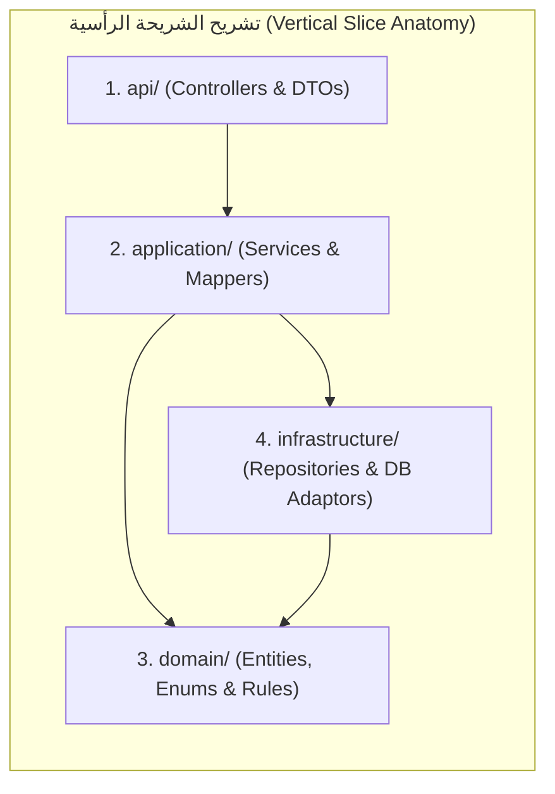

# 01 - هيكل المشروع المستهدف (Target Project Structure)

> **مسار الملف:** `implementation-blueprint/01-target-project-structure.md`  
> **الحالة:** معتمد للتنفيذ (Approved for Implementation)  
> **المرجع:** [00-project-overview.md](./00-project-overview.md) · [02-features-breakdown.md](./02-features-breakdown.md) · [04-shared-components.md](./04-shared-components.md)

---

## 1. الهيكل الشامل للحزم (Package Hierarchy)

مشروع **كمّل (Kammel)** منظم بالكامل وفق نموذج **Feature-Based / Vertical Slice Architecture**.  
الحزمة الجذرية للمشروع هي: `com.kammel`.

```text
com.kammel/
├── KammelApplication.java               # مدخل تشغيل تطبيق Spring Boot 3
│
├── shared/                              # النواة المشتركة (Shared Infrastructure & Cross-Cutting Concerns)
│   ├── domain/                          # الكيانات الأساسية المشتركة ونماذج التدقيق
│   │   ├── BaseEntity.java              # الكيان الأب (id, created_at, updated_at)
│   │   ├── BaseAuditableEntity.java     # الكيان الخاضع للتتبع (created_by, updated_by)
│   │   └── TenantScoped.java            # Interface يفرضه أي كيان مرتبط بمستأجر org_id
│   ├── api/                             # هياكل الـ HTTP العامة الموحدة
│   │   ├── ApiResponse.java             # الغلاف العام لاستجابات الـ JSON
│   │   ├── PageResponse.java            # الغلاف الموحد للترقيم والتصفح (Pagination)
│   │   └── ErrorResponse.java           # الهيكل المعياري لرسائل الأخطاء وتفاصيل الفاليديشن
│   ├── exception/                       # منظومة إدارة الأخطاء العامة
│   │   ├── GlobalExceptionHandler.java  # @RestControllerAdvice للتعامل مع الاستثناءات
│   │   ├── BusinessException.java       # الكلاس الأب لجميع استثناءات منطق العمل
│   │   ├── ResourceNotFoundException.java
│   │   ├── DuplicateResourceException.java
│   │   ├── InvalidStateTransitionException.java
│   │   └── TenantMismatchException.java
│   ├── security/                        # أمان المستأجرين والتحقق من الهوية
│   │   ├── TenantContext.java           # تخزين org_id و branch_id في ThreadLocal
│   │   ├── TenantFilter.java            # استخراج الهوية والمستأجر من الـ JWT وضبط الـ Context
│   │   ├── JwtService.java              # توليد وفحص توكن الـ JWT
│   │   ├── UserPrincipal.java           # تطبيق Spring Security UserDetails
│   │   └── SecurityUtils.java           # استخراج هوية المستخدم الحالي بأمان
│   ├── config/                          # إعدادات Spring Boot Framework
│   │   ├── SecurityConfig.java          # إعداد سلاسل فلاتر الأمان (SecurityFilterChain)
│   │   ├── OpenApiConfig.java           # توثيق Swagger / OpenAPI
│   │   ├── SchedulingConfig.java        # إعدادات المهام المجدولة وقفل ShedLock
│   │   └── JacksonConfig.java           # إعدادات تسلسل الـ JSON والتواريخ والأرقام
│   ├── validation/                      # أدوات التحقق المخصصة (Custom Validators)
│   │   ├── ValidPhone.java              # التحقق من أرقام الموبايل المصرية (010, 011, 012, 015)
│   │   └── PhoneValidator.java
│   └── util/                            # الفئات المساعدة الحسابية والزمنية
│       ├── MoneyUtil.java               # تحويلات القروش والجنيهات (piasters <-> EGP)
│       ├── PhoneUtil.java               # تنسيق وتطبيع أرقام الهواتف (E.164 normalization)
│       └── DateUtil.java                # التعامل مع التوقيت الموحد لمنطقة أفريقيا/القاهرة
│
├── features/                            # الميزات الرأسية لبيزنس الجيم (Vertical Slices)
│   │
│   ├── identity/                        # [P0] إدارة المستخدمين وحسابات الموظفين وتوليد التوكن
│   │   ├── api/
│   │   ├── application/
│   │   ├── domain/
│   │   └── infrastructure/
│   │
│   ├── tenancy/                         # [P0] إدارة بيانات الجيمات والفروع وعزل المستأجرين
│   │   ├── api/
│   │   ├── application/
│   │   ├── domain/
│   │   └── infrastructure/
│   │
│   ├── member/                          # [P0] إدارة الأعضاء وملفاتهم واستيراد الإكسيل
│   │   ├── api/
│   │   ├── application/
│   │   ├── domain/
│   │   └── infrastructure/
│   │
│   ├── plan/                            # [P0] قوالب الاشتراكات وتحديد الأسعار والمدد
│   │   ├── api/
│   │   ├── application/
│   │   ├── domain/
│   │   └── infrastructure/
│   │
│   ├── subscription/                    # [P0] دورة حياة عقود الاشتراكات وآلة الحالات والتجميد
│   │   ├── api/
│   │   ├── application/
│   │   ├── domain/
│   │   └── infrastructure/
│   │
│   ├── payment/                         # [P0] تسجيل العمليات المالية ومنع التكرار والإيصالات
│   │   ├── api/
│   │   ├── application/
│   │   ├── domain/
│   │   └── infrastructure/
│   │
│   ├── checkin/                         # [P0] تسجيل الحضور السريع وفحص الصلاحيات وخصم الحصص
│   │   ├── api/
│   │   ├── application/
│   │   ├── domain/
│   │   └── infrastructure/
│   │
│   ├── notification/                    # [P0] طابور رسائل واتساب وروابط wa.me ونسبة التحويل
│   │   ├── api/
│   │   ├── application/
│   │   ├── domain/
│   │   └── infrastructure/
│   │
│   ├── risk/                            # [P0] محرك احتساب احتمالية التسرب وإشارات الغياب
│   │   ├── api/
│   │   ├── application/
│   │   ├── domain/
│   │   └── infrastructure/
│   │
│   ├── reporting/                       # [P0] مؤشرات الأداء ولوحة تحكم صاحب الجيم
│   │   ├── api/
│   │   ├── application/
│   │   ├── domain/
│   │   └── infrastructure/
│   │
│   ├── audit/                           # [P0] سجل عمليات التدقيق غير القابل للتعديل
│   │   ├── api/
│   │   ├── application/
│   │   ├── domain/
│   │   └── infrastructure/
│   │
│   ├── shift/                           # [P1] جرد درج النقدية ومطابقة الورديات
│   └── lead/                            # [P1] قمع المبيعات ومتابعة العملاء الجدد
│
└── ai/                                  # [P3 Future] قدرات الذكاء الاصطناعي والمساعد الإداري
    ├── assistant/                       # Spring AI Chat Assistant & Tools
    └── churn/                           # Onnx ML Churn Inference Engine
```

---

## 2. التشريح الداخلي للـ Feature (Inside the Vertical Slice)

كل Feature تمثل وحدة أعمال مكتملة (Self-Contained Business Capability) تحتوي على 4 طبقات متعامدة:



### 2.1 مسؤوليات الطبقات الأربع (The 4 Layers Explained)

#### 1. طبقة الـ `api/`:
- **Controllers:** تستقبل الـ HTTP Requests وتطبق `@Valid` وترد بـ `ResponseEntity<ApiResponse<T>>`.
- **Request DTOs:** كلاسات Java Records أو DTOs للتحقق من المدخلات بواسطة Bean Validation annotations (`@NotBlank`, `@Pattern`, إلخ).
- **Response DTOs:** كلاسات لتشكيل البيانات الخارجة للواجهة وحجب التفاصيل الداخلية والحساسة.
- **قاعدة صارمة:** لا يدخل أي Controller في تفاصيل قواعد البيزنس أو استدعاء Repositories بشكل مباشر مطلقاً.

#### 2. طبقة الـ `application/`:
- **Service Interface:** العقد البرمجي العام للميزة الذي يمكن للميزات الأخرى التخاطب معه.
- **Service Implementation:** تنفيذ منطق الأعمال، والتحكم بالمعاملات عبر `@Transactional`، وفحص الصلاحيات عبر `@PreAuthorize`.
- **Mappers:** تحويلات الـ Entity <-> DTO (سواء يدوياً أو بواسطة MapStruct).
- **Event Listeners:** استقبال وإطلاق الـ Domain Events (مثل استقبال حدث اكتمال الدفع `PaymentCompletedEvent` لتفعيل الاشتراك).

#### 3. طبقة الـ `domain/`:
- **Entities:** كائنات الـ JPA التي تمثل جداول قاعدة البيانات ومزودة بعمود `org_id` والمفاتيح الأساسية UUID.
- **Enums:** القيم المعيارية مثل الحالات والأنواع (مثل `SubscriptionStatus`, `PaymentMethod`).
- **Domain Exceptions:** الاستثناءات الخاصة بهذه الميزة تحديداً (مثل `SubscriptionAlreadyActiveException`).
- **Domain Events:** أحداث النطاق (مثل `MemberCreatedEvent`, `SubscriptionStateChangedEvent`).

#### 4. طبقة الـ `infrastructure/`:
- **Repositories:** واجهات Spring Data JPA التي ترث `JpaRepository` وتحدد استعلامات البحث المخصصة.
- **Adapters & Clients:** أي تعامل مع خدمات خارجية أو استعلامات مركبة ذات أداء عالي تخص الميزة.

---

## 3. مثال عملي توضيحي: ميزة الاشتراكات (`features/subscription/`)

هكذا يبدو الهيكل التفصيلي لملفات شريحة الـ `subscription`:

```text
features/subscription/
├── api/
│   ├── SubscriptionController.java           # Endpoints: /api/v1/subscriptions/**
│   ├── request/
│   │   ├── CreateSubscriptionRequest.java    # Record مع @NotNull memberId, planId
│   │   ├── RenewSubscriptionRequest.java     # بيانات التجديد
│   │   └── FreezeSubscriptionRequest.java    # بيانات التجميد والسبب
│   └── response/
│       ├── SubscriptionResponse.java         # بيانات العقد الشاملة وحالته
│       └── SubscriptionEventResponse.java    # تاريخ الحالات والأحداث
│
├── application/
│   ├── SubscriptionService.java              # الواجهة العامة (Public Interface)
│   ├── SubscriptionServiceImpl.java          # منطق آلة الحالة واحتساب التواريخ
│   ├── SubscriptionEventListener.java        # الاستماع لحدث PaymentCompletedEvent
│   └── mapper/
│       └── SubscriptionMapper.java           # Entity to Response DTO
│
├── domain/
│   ├── Subscription.java                     # JPA Entity
│   ├── SubscriptionEvent.java                # سجل الأحداث التاريخي غير القابل للتعديل
│   ├── SubscriptionStatus.java               # Enum: PENDING_PAYMENT, ACTIVE, FROZEN, GRACE, EXPIRED, CANCELLED
│   ├── SubscriptionEventType.java            # Enum: CREATED, ACTIVATED, RENEWED, FROZEN, UNFROZEN, EXPIRED...
│   ├── SubscriptionStateChecker.java         # قواعد التحقق من صحة التحولات
│   └── exception/
│       └── SubscriptionFrozenException.java
│
└── infrastructure/
    ├── SubscriptionRepository.java           # Spring Data JPA
    └── SubscriptionEventRepository.java      # تخزين أحداث الاشتراكات
```

---

## 4. الفروق الجوهرية: التقسيم القديم مقابل التقسيم الرأسي الجديد

| المعيار | الهيكل القديم (Layer-First) | الهيكل المعتمد (Vertical Slice) |
|---|---|---|
| **مكان الـ Entity** | `com.kammel.entities.Subscription` | `com.kammel.features.subscription.domain.Subscription` |
| **مكان الـ Service**| `com.kammel.services.SubscriptionService`| `com.kammel.features.subscription.application.SubscriptionService` |
| **مكان الـ DTO** | `com.kammel.dtos.CreateSubscriptionRequest` | `com.kammel.features.subscription.api.request.CreateSubscriptionRequest` |
| **التأثير عند تعديل ميزة**| فتح 5 إلى 7 باكدجات مختلفة متباعدة | فتح حزمة واحدة فقط: `com.kammel.features.subscription` |
| **عزل الاعتماديات** | صعوبة منع تسرب اعتمادات Repositories | سهولة فرض الوصول عبر Service Interface فقط |
| **Spring Modulith**| مستحيل تطبيقه على Layered architecture | يتكامل تلقائياً مع الحزم الرأسية للتحقق من الحدود |

---

## 5. قواعد التواصل الصارمة بين الميزات (Inter-Feature Communication)

لضمان عدم تحول المشروع لكتلة متداخلة (Spaghetti Architecture):
1. **ممنوع استدعاء Repositories من خارج الميزة:** إذا كانت ميزة `checkin` تحتاج معرفة هل اشتراك العضو ساري أم لا، تستدعي `SubscriptionService.getActiveSubscription(memberId)`، وممنوع نهائياً أن تحقن `SubscriptionRepository` داخل ميزة أخرى.
2. **التواصل بالأحداث للعمليات غير المتزامنة (Event-Driven Decoupling):** عند تسجيل دفع ناجح في `payment`، تطلق الميزة حدثاً `PaymentCompletedEvent`، لتستمع له ميزة `subscription` وتقوم بتفعيل الاشتراك دون أن تكون ميزة المدفوعات معتمدة بشكل مباشر ومحكم على ميزة الاشتراكات.
3. **تبادل المعرفات فقط (Loose Coupling via IDs):** لا تقم بإنشاء علاقات JPA Bidirectional عريضة مثل `@ManyToMany` بين ميزات مختلفة؛ استخدم الـ UUID الخاص بالكيان فقط لفك الارتباط.
