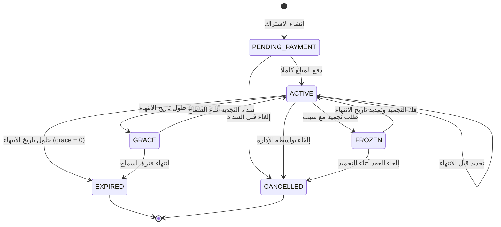

# 02 - تفصيل ميزات النظام (Features Breakdown)

> **مسار الملف:** `implementation-blueprint/02-features-breakdown.md`  
> **الحالة:** معتمد للتنفيذ (Approved for Implementation)  
> **المرجع:** [01-target-project-structure.md](./01-target-project-structure.md) · [03-entity-relationships.md](./03-entity-relationships.md) · [07-api-design.md](./07-api-design.md)

---

## 1. الفهرس العام للميزات (Features Directory)

يتكون نظام **كمّل (Kammel)** من 11 ميزة أساسية لنطاق الـ MVP (P0) بالإضافة إلى ميزات المراحل اللاحقة:

1. [`features/identity`](#2-feature-identity-إدارة-الهوية-والمستخدمين) — مصادقة وحسابات موظفي الجيم.
2. [`features/tenancy`](#3-feature-tenancy-إدارة-الجيمات-والفروع-والمستأجرين) — إدارة بيانات المستأجر والفروع وعزل البيانات.
3. [`features/member`](#4-feature-member-إدارة-الأعضاء-واستيراد-البيانات) — سجلات الأعضاء واستيراد الإكسيل.
4. [`features/plan`](#5-feature-plan-قوالب-باقات-وعقود-الاشتراك) — إعداد باقات الجيم والأسعار والمدد.
5. [`features/subscription`](#6-feature-subscription-إدارة-عقود-الاشتراكات-وآلة-الحالة) — دورة حياة العقود، التجديد والتجميد.
6. [`features/payment`](#7-feature-payment-إدارة-المدفوعات-والإيصالات-المالية) — تسجيل المقبوضات ومنع التكرار والأقساط.
7. [`features/checkin`](#8-feature-checkin-تسجيل-حضور-الأعضاء) — التحقق من الحضور وتخطي التكرار وخصم الحصص.
8. [`features/notification`](#9-feature-notification-طابور-رسائل-الواتساب-ونسبة-التجديد) — تنبيهات المتابعة والتجديد عبر روابط `wa.me`.
9. [`features/risk`](#10-feature-risk-محرك-احتساب-مخاطر-التسرب-الذكي) — الخوارزمية الليلية لتحديد الأعضاء المعرضين للانسحاب.
10. [`features/reporting`](#11-feature-reporting-لوحة-تحكم-الإدارة-ومؤشرات-الأداء) — تقارير الإيرادات ونسب التجديد.
11. [`features/audit`](#12-feature-audit-سجل-الرقابة-والعمليات-الحساسة) — التتبع غير القابل للمسح للخصومات والتعديلات.
12. [`الميزات اللاحقة (Post-MVP Features)`](#13-ميزات-المراحل-اللاحقة-post-mvp-features) — الورديات، العملاء المحتملين، وتطبيق الويب التقدمي (PWA).

---

## 2. Feature: `identity` (إدارة الهوية والمستخدمين)

### 2.1 الغرض والمسؤولية (Purpose & Business Context)
المسؤول عن توثيق هوية موظفي الجيم (أصحاب الجيم، مديري الفروع، موظفي الاستقبال، المدربين)، وإصدار توكنات JWT مع الحفاظ على عزل البيانات بناءً على هوية الجيم (`org_id`).
> **ملاحظة محورية:** الـ `User` هو موظف الجيم الذي يمتلك صلاحية تسجيل الدخول للنظام، بينما الـ `Member` هو العميل الممارس للرياضة (ليس له حساب تسجيل دخول في الـ MVP).

### 2.2 المكونات الداخلية (Internal Components)
- **Domain:**
  - `User`: كيان الموظف (UUID id, org_id, branch_id, name, phone, email, password_hash, role, active).
  - `Role`: Enum (`PLATFORM_ADMIN`, `GYM_OWNER`, `BRANCH_MANAGER`, `RECEPTIONIST`, `TRAINER`).
- **Application Services:**
  - `AuthService`: تسجيل الدخول، تدوير الـ Refresh Tokens، وفحص صحة الجلسة.
  - `UserService`: إنشاء وتفعيل وتعطيل حسابات الموظفين وتغيير كلمات السر.
- **API (DTOs & Endpoints):**
  - `LoginRequest`: (username, password).
  - `RefreshTokenRequest`: (refreshToken).
  - `AuthResponse`: (accessToken, refreshToken, expiresInSeconds, userDetails).
  - `POST /api/v1/auth/login` (Public)
  - `POST /api/v1/auth/refresh` (Public)
  - `POST /api/v1/auth/logout` (Authenticated)

### 2.3 قواعد العمل والأمان (Invariants & Security)
1. **تشفير كلمات المرور:** باستخدام BCrypt (Work Factor 12).
2. **عمر التوكن:** الـ Access Token صالح لمدة 15 دقيقة فقط، والـ Refresh Token صالح لمدة 7 أيام مع تدوير إجباري عند كل استخدام (Token Rotation).
3. **صلاحية الفروع:** مستخدم `GYM_OWNER` يمتلك `branch_id = null` للوصول لجميع الفروع، بينما باقي الموظفين مقيدون بفرع واحد فقط.

---

## 3. Feature: `tenancy` (إدارة الجيمات والفروع والمستأجرين)

### 3.1 الغرض والمسؤولية (Purpose)
إدارة حدود المستأجرين (Tenants)، وتخزين بيانات المؤسسة الرياضية والفروع التابعة لها، وضبط سياق المستأجر (Tenant Context) لكل طلب وارد.

### 3.2 المكونات الداخلية (Internal Components)
- **Domain:**
  - `Organization`: المستأجر الرئيسي (id, name, status: ACTIVE/SUSPENDED/CLOSED).
  - `Branch`: فرع الجيم (id, org_id, name, address, timezone, active).
- **Application Services:**
  - `OrganizationService`: تفعيل وتعليق الجيمات بواسطة أدمن المنصة.
  - `BranchService`: إنشاء وتعديل الفروع وتعيين المديرين.
- **API Endpoints:**
  - `POST /api/v1/tenancy/branches` (`hasRole('GYM_OWNER')`)
  - `GET /api/v1/tenancy/branches` (`hasAnyRole('GYM_OWNER', 'BRANCH_MANAGER')`)

### 3.3 قواعد العمل والأمان (Invariants)
1. المنظمة هي الكيان الوحيد في النظام الذي لا يحتوي على حقل `org_id`.
2. إيقاف الجيم (`SUSPENDED`) يمنع تلقائياً دخول أي مستخدم يتبع هذه المنظمة.

---

## 4. Feature: `member` (إدارة الأعضاء واستيراد البيانات)

### 4.1 الغرض والمسؤولية (Purpose)
إدارة ملفات أعضاء الجيم، البحث السريع بواسطة رقم الهاتف عند الاستقبال، واستيراد الأعضاء بشكل جماعي من ملفات Excel القديمة لتسهيل نقل الجيم إلى كمّل.

### 4.2 المكونات الداخلية (Internal Components)
- **Domain:**
  - `Member`: الكيان الرئيسي (id, org_id, branch_id, full_name, phone, gender, birth_date, source, notes, whatsapp_opt_in, status, deleted_at).
  - `AcquisitionSource`: Enum (`INSTAGRAM`, `FRIEND`, `WALK_IN`, `AD`, `REFERRAL`, `OTHER`).
  - `MemberStatus`: Enum (`ACTIVE`, `INACTIVE`).
- **Application Services:**
  - `MemberService`: إضافة وتعديل وبحث وحذف الأعضاء مرناً (Soft Delete).
  - `MemberImportService`: معالجة ملفات Excel والتحقق من صحة أرقام الموبايل المصرية.
- **API Endpoints:**
  - `POST /api/v1/members`: تسجيل عضو جديد.
  - `GET /api/v1/members`: استعلام مفلتر ومفهرس برقم الهاتف أو الاسم مع Pagination.
  - `GET /api/v1/members/{id}`: جلب الملف الشخصي للعضو.
  - `DELETE /api/v1/members/{id}`: حذف مرن (Soft Delete) عبر ملء `deleted_at`.
  - `POST /api/v1/members/import`: رفع شيت إكسيل ومعالجته مع تقرير تفصيلي بالأخطاء.

### 4.3 قواعد العمل (Business Invariants)
1. **فرادة رقم الهاتف:** الزوج `(org_id, phone)` فريد تماماً لمنع تكرار العضو داخل نفس الجيم.
2. **الحذف المرن الإجباري:** ممنوع استخدام SQL `DELETE` على جدول الأعضاء؛ حفاظاً على تكامل عقود الاشتراكات وسجلات المدفوعات التاريخية.
3. **التحقق من رقم الهاتف المصري:** يجب أن يطابق النمط `^(010|011|012|015)[0-9]{8}$`.

---

## 5. Feature: `plan` (قوالب باقات وعقود الاشتراك)

### 5.1 الغرض والمسؤولية (Purpose)
إنشاء القوالب المعتمدة للاشتراكات في الجيم مع تحديد السعر بالقرش، والمدة بالأيام، والحد الأقصى للتجميد، وأيام السماح بعد انتهاء العقد.

### 5.2 المكونات الداخلية (Internal Components)
- **Domain:**
  - `MembershipPlan`: الكيان (id, org_id, name, type, duration_days, session_count, price_minor, freeze_max_days, grace_days, time_restriction, active).
  - `PlanType`: Enum (`MONTHLY`, `QUARTERLY`, `SEMI_ANNUAL`, `ANNUAL`, `SESSION_PACK`, `DAY_PASS`, `PT_PACKAGE`).
- **Application Services:**
  - `PlanService`: إنشاء الباقات وتعديلها وتعطيلها مع كاش مؤقت للباقات النشطة.
- **API Endpoints:**
  - `POST /api/v1/plans`: إنشاء باقة (`hasRole('GYM_OWNER')`).
  - `GET /api/v1/plans`: عرض الباقات الفعالة للاستقبال.
  - `PATCH /api/v1/plans/{id}/deactivate`: إيقاف الباقة دون التأثير على المشتركين الحاليين.

### 5.3 قواعد العمل (Business Invariants)
1. **تجميد السعر (Price Immutability):** تعديل سعر الباقة لا يؤثر على الاشتراكات القائمة بالفعل؛ لأن كل اشتراك يأخذ لقطة ثابتة من السعر وقت إنشائه.
2. الباقات ذات الحصص (`SESSION_PACK`) تتطلب تحديد `session_count > 0` مع `duration_days` تمثل صلاحية استهلاك تلك الحصص.

---

## 6. Feature: `subscription` (إدارة عقود الاشتراكات وآلة الحالة)

### 6.1 الغرض والمسؤولية (Purpose)
إدارة العقد الفعلي الرابط بين العضو والباقة، وتنفيذ آلة الحالات (Finite State Machine)، وتسجيل تاريخ الأحداث (Subscription Events) وتطبيق قواعد التجديد والتجميد.

### 6.2 آلة الحالات (Subscription State Machine)

### 6.3 المكونات الداخلية (Internal Components)
- **Domain:**
  - `Subscription`: كيان العقد (id, org_id, member_id, plan_id, price_minor_snapshot, start_date, end_date, status, sessions_remaining, frozen_days_used).
  - `SubscriptionEvent`: كيان السجل التاريخي للأحداث غير القابل للتعديل (id, subscription_id, type, from_status, to_status, actor_id, reason, metadata, created_at).
  - `SubscriptionStatus`: Enum (`PENDING_PAYMENT`, `ACTIVE`, `FROZEN`, `GRACE`, `EXPIRED`, `CANCELLED`).
  - `SubscriptionEventType`: Enum (`CREATED`, `ACTIVATED`, `RENEWED`, `FROZEN`, `UNFROZEN`, `GRACE_ENTERED`, `EXPIRED`, `CANCELLED`).
- **Application Services:**
  - `SubscriptionService`: إنشاء العقود، فحص صحة التحول بين الحالات، تمديد التجديد، والتجميد.
  - `SubscriptionEventService`: تسجيل كل تغيير كحدث رسمي.
- **API Endpoints:**
  - `POST /api/v1/subscriptions`: إنشاء عقد جديد (حالة أولية `PENDING_PAYMENT`).
  - `POST /api/v1/subscriptions/{id}/renew`: تجديد العقد.
  - `POST /api/v1/subscriptions/{id}/freeze`: تجميد العقد لعدد من الأيام.
  - `POST /api/v1/subscriptions/{id}/unfreeze`: فك التجميد يدوياً أو آلياً.
  - `GET /api/v1/subscriptions/{id}/events`: استعراض سجل أحداث العقد.

### 6.4 قواعد العمل الدقيقة (Critical Invariants)
1. **معادلة التجديد قبل الانتهاء (عدم ضياع الأيام):**
   $$\text{New End Date} = \text{Current End Date} + \text{Plan Duration}$$
2. **معادلة التجديد بعد الانتهاء:**
   $$\text{New Start Date} = \text{Payment Date}$$
   $$\text{New End Date} = \text{Payment Date} + \text{Plan Duration}$$
3. **معادلة التجميد:**
   - يشترط أن يكون $\text{frozen\_days\_used} + \text{requested\_days} \le \text{plan.freeze\_max\_days}$.
   - عند فك التجميد، يمتد تاريخ الانتهاء بمقدار عدد الأيام المجمدة فعلياً:
   $$\text{New End Date} = \text{Current End Date} + (\text{Unfreeze Date} - \text{Freeze Date})$$
4. **حالة `EXPIRING_SOON`:** ليست حالة مخزنة في قاعدة البيانات؛ بل هي رؤية ديناميكية حسابية عندما تكون الأيام المتبقية $\le 7$ أيام.

---

## 7. Feature: `payment` (إدارة المدفوعات والإيصالات المالية)

### 7.1 الغرض والمسؤولية (Purpose)
تسجيل الإيرادات بدقة متناهية، وإصدار إيصالات الدفع، ومنع التكرار (Idempotency)، ودعم المدفوعات الجزئية، وتسجيل الاسترجاع (Refund) كقيد عكسي دون حذف الأصل.

### 7.2 المكونات الداخلية (Internal Components)
- **Domain:**
  - `Payment`: كيان المعاملة المالية (id, org_id, subscription_id, member_id, amount_minor, method, reference, received_by, shift_id, status, idempotency_key, notes).
  - `Refund`: كيان الاسترداد العكسي (id, org_id, payment_id, amount_minor, reason, approved_by).
  - `PaymentMethod`: Enum (`CASH`, `INSTAPAY`, `BANK_TRANSFER`, `ONLINE`).
  - `PaymentStatus`: Enum (`COMPLETED`, `REVERSED`).
- **Application Services:**
  - `PaymentService`: تسجيل الدفع، فحص الـ Idempotency، إطلاق حدث التفعيل عند اكتمال القيمة، وإصدار إيصال الدفع.
  - `RefundService`: معالجة استرداد الأموال مع فحص موافقة المدير وتعديل حالة الدفع إلى `REVERSED`.
- **API Endpoints:**
  - `POST /api/v1/payments`: تسجيل دفعة مالية مع تمرير `Idempotency-Key` في الهيدر.
  - `POST /api/v1/payments/{id}/refund`: استرجاع مبلغ دفعة سابقة مع اشتراط السبب وموافقة الإدارة.
  - `GET /api/v1/payments/collections`: استعراض الاشتراكات التي عليها مبالغ معلقة (Partial Payments).

### 7.3 القواعد المالية الصارمة (Financial Invariants)
1. **عدم المساس بالدفاتر (Immutable Ledger):** لا يتم حذف أو تعديل أي سجل دفع على الإطلاق باستخدام `UPDATE` أو `DELETE`.
2. **قفل الصفوف عند الدفع (Pessimistic Locking):** يتم تطبيق `SELECT ... FOR UPDATE` على العقد المرتبط لمنع تضارب المعاملات المتزامنة من موظفي استقبال مختلفين.
3. **تفعيل الاشتراك التلقائي:** بمجرد أن يصبح مجموع مدفوعات العقد $\ge \text{price\_minor\_snapshot}$، ينتقل الاشتراك فوراً لحالة `ACTIVE`.

---

## 8. Feature: `checkin` (تسجيل حضور الأعضاء)

### 8.1 الغرض والمسؤولية (Purpose)
تسجيل دخول الأعضاء إلى صالة الجيم بسرعة فائقة (< 500 مللي ثانية)، والتحقق من صلاحية العقد، وتنبيه موظف الاستقبال في حال اقتراب الانتهاء أو التجميد، وخصم الحصص للباقات الخاصة.

### 8.2 المكونات الداخلية (Internal Components)
- **Domain:**
  - `CheckIn`: كيان الحضور (id, org_id, branch_id, member_id, subscription_id, method, checked_in_at, overridden_by, override_reason).
  - `CheckInMethod`: Enum (`PHONE_SEARCH`, `NAME_SEARCH`, `STATIC_QR`, `DYNAMIC_QR`).
- **Application Services:**
  - `CheckInService`: تنفيذ فحص الصلاحية وخصم الحصص وتخزين سجل الدخول.
- **API Endpoints:**
  - `POST /api/v1/checkins`: محاولة تسجيل الدخول واستقبال الرد الفوري بحالة العضو وتفاصيله.

### 8.3 قواعد التحقق وسيناريوهات الاستقبال (Validation Flow)
- **الاشتراك `ACTIVE`:** يُسمح بالدخول فوراً.
- **الاشتراك `FROZEN`:** يتم حظر الدخول مع ظهور رسالة واضحة: *"الاشتراك مجمد حتى تاريخ X بسبب Y"*.
- **الاشتراك `EXPIRED`:** تنبيه ودي لموظف الاستقبال لطلب التجديد دون إحراج العضو.
- **الاشتراك `GRACE`:** يُسمح بالدخول مع تحذير: *"فترة سماح تنتهي بعد N أيام"*.
- **تكرار الحضور في نفس اليوم:** تحذير لموظف الاستقبال مع إمكانية التمرير (Override) بذكر السبب وحفظه في سجل الرقابة.
- **باقات الحصص:** يتم خصم حصة واحدة تلقائياً من `subscription.sessions_remaining`.

---

## 9. Feature: `notification` (طابور رسائل الواتساب ونسبة التجديد)

### 9.1 الغرض والمسؤولية (Purpose)
تجهيز رسائل التذكير والتواصل المخصصة بالعضو باللغة العربية وإتاحتها في طابور مهام يومي لموظف الاستقبال لإرسالها عبر رابط `wa.me` بنقرة زر مجانية، مع قياس نسبة التجديدات المباشرة الناتجة عن تلك الرسائل.

### 9.2 المكونات الداخلية (Internal Components)
- **Domain:**
  - `MessageQueueItem`: كيان الرسالة (id, org_id, member_id, template, rendered_text, status, due_date, wa_me_link, sent_at, sent_by, attributed_subscription_id).
  - `NotificationTemplate`: Enum (`RENEWAL_REMINDER`, `MISS_YOU`, `WELCOME`, `COLLECTION`).
  - `MessageStatus`: Enum (`PENDING`, `OPENED`, `SENT_CONFIRMED`, `CANCELLED`).
- **Application Services:**
  - `NotificationScheduler`: وظيفة مجدولة يومياً في السادسة صباحاً لاكتشاف الأعضاء المستحقين للتذكير وتوليد الرسائل.
  - `NotificationService`: جلب الطابور اليومي، تسجيل حالة الإرسال، واحتساب نسبة التجديد (Attribution).
- **API Endpoints:**
  - `GET /api/v1/notifications/queue`: جلب الرسائل المستحقة لليوم.
  - `PATCH /api/v1/notifications/{id}/sent`: تأكيد موظف الاستقبال إرسال الرسالة.

### 9.3 قواعد منع الإزعاج ونسبة التجديد (Guardrails & Attribution)
1. **منع التكرار (Cooldown):** حد أقصى رسالة واحدة من نفس القالب لنفس العضو كل 3 أيام.
2. **ساعات الإرسال المقبولة:** الرسائل تظهر في الطابور بين 9 صباحاً و 9 مساءً بتوقيت القاهرة.
3. **نسبة العائد (Renewal Attribution):** إذا جدد العضو اشتراكه خلال 7 أيام من تاريخ إرسال رسالة تذكير مؤكدة (`SENT_CONFIRMED`)، يتم ربط العقد الجديد بالرسالة لاحتسابها في لوحة تحكم صاحب الجيم كإيراد مسترد بفضل كمّل.

---

## 10. Feature: `risk` (محرك احتساب مخاطر التسرب الذكي)

### 10.1 الغرض والمسؤولية (Purpose)
احتساب احتمالية عدم تجديد العضو لاشتراكه (Churn Risk Score) من 0 إلى 100 كل ليلة، مع تقديم أسباب رقمية مفصلة ومقروءة بالعربية وتجهيز مسودة رسالة تواصل لصاحب الجيم.

### 10.2 خوارزمية الاحتساب الرياضية (Scoring Engine Formula)
تُحسب النتيجة يومياً الساعة 3:00 فجراً لجميع الأعضاء أصحاب الاشتراكات النشطة:

$$\text{RiskScore} = \min\left(100, \sum_{i=1}^{n} (\text{SignalValue}_i \times \text{Weight}_i)\right)$$

| الإشارة السلوكية (Signal) | الوزن | طريقة الاحتساب |
|---|:---:|---|
| **عدد أيام الانقطاع عن الحضور** | 30% | $\ge 14$ يوم: 30 نقطة، 8-13 يوم: 20 نقطة، 4-7 أيام: 10 نقاط. |
| **هبوط وتيرة التمرين (Frequency Drop)**| 25% | مقارنة زيارات آخر 14 يوم بالـ 14 يوم السابقة (هبوط $>50\%$ يعطي 25 نقطة). |
| **الأيام المتبقية في العقد** | 20% | $\le 3$ أيام: 20 نقطة، 4-7 أيام: 15 نقطة. |
| **تعثر وتأخر المدفوعات السابق** | 10% | وجود تأخير سابق في دفع الأقساط: 10 نقاط. |
| **تكرار طلب التجميد (Freeze Count)** | 10% | تجميد الاشتراك مرتين أو أكثر: 10 نقاط. |
| **حداثة الانضمام (Tenure Hazard)** | 5% | المشترك الجديد في أول شهرين أكثر عرضة للانسحاب: 5 نقاط. |

### 10.3 المكونات الداخلية (Internal Components)
- **Domain:**
  - `RiskScore`: الكيان (member_id, computed_at, score, reasons JSONB, signals JSONB, model_version, recommended_action, draft_message).
  - `RiskLevel`: Enum (`LOW` 0-30, `MEDIUM` 31-60, `HIGH` 61-80, `CRITICAL` 81-100).
- **Application Services:**
  - `RiskScoreBatchJob`: معالجة دفعات الأعضاء ليلين واحتساب الدرجات وحفظ الأسباب.
  - `RiskScoreService`: استعراض الأعضاء الأكثر خطورة لمدير وصاحب الجيم.
- **API Endpoints:**
  - `GET /api/v1/risk/at-risk`: استعراض قائمة الأعضاء في منطقتي `HIGH` و `CRITICAL` مع القيمة المالية المعرضة للضياع.

---

## 11. Feature: `reporting` (لوحة تحكم الإدارة ومؤشرات الأداء)

### 11.1 الغرض والمسؤولية (Purpose)
تقديم رؤية تنفيذية موحدة لصاحب الجيم تركز على الإيرادات، التجديدات القادمة، والأعضاء المعرضين للتسرب.

### 11.2 المكونات الداخلية (Internal Components)
- **Application Services:**
  - `DashboardService`: تجميع المؤشرات عبر استعلامات مجمعة عالية الكفاءة معتمدة على الفهارس المركبة.
- **API Endpoints:**
  - `GET /api/v1/dashboard/summary`: ملخص تنفيذي (تجديدات الأسبوع الحالي، مبالغ الاشتراكات المعلقة، إجمالي إيراد الشهر، نسبة التجديد التاريخية، وإجمالي العائد المنسوب لكمّل).

---

## 12. Feature: `audit` (سجل الرقابة والعمليات الحساسة)

### 12.1 الغرض والمسؤولية (Purpose)
توثيق كل حركة حساسة يقوم بها موظف الاستقبال أو المدير (مثل: تطبيق خصم، تجميد اشتراك، استرداد مبلغ، أو تجاوز فحص حضور) في جدول محصن ضد الحذف والتعديل.

### 12.2 المكونات الداخلية (Internal Components)
- **Domain:**
  - `AuditLog`: كيان السجل (id, org_id, actor_id, action, entity_type, entity_id, before_state JSONB, after_state JSONB, reason, ip_address, created_at).
- **Application:**
  - `AuditLogService`: واجهة حفظ السجلات التدقيقية بصورة غير متزامنة.

---

## 13. ميزات المراحل اللاحقة (Post-MVP Features)

1. **`features/shift` (P1 - مطابقة ورديات الكاش):** فتح الوردية عند بدء العمل، وتطبيق الجرد الأعمى (Blind Count) عند الإغلاق واحتساب الفارق (Variance).
2. **`features/lead` (P1 - إدارة قمع المبيعات):** استقبال المهتمين وتتبع تحولهم لأعضاء مسجلين.
3. **`ai/` (P3 - الذكاء الاصطناعي والمساعد الإداري):** التنبؤ بالانسحاب عبر نماذج ONNX والمساعد الصوتي/الكتابي بالعامية المصرية عبر Spring AI بعد اكتمال البيانات.
