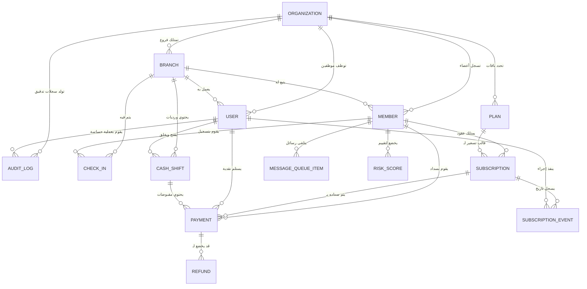

# 03 - كيانات النظام ومخطط العلاقات (Entity Relationships & Database Schema)

> **مسار الملف:** `implementation-blueprint/03-entity-relationships.md`  
> **الحالة:** معتمد للتنفيذ (Approved for Implementation)  
> **المرجع:** [01-target-project-structure.md](./01-target-project-structure.md) · [02-features-breakdown.md](./02-features-breakdown.md) · [04-shared-components.md](./04-shared-components.md)

---

## 1. المبادئ المعمارية لتصميم الكيانات وقاعدة البيانات

تم بناء مخطط قاعدة البيانات وكيانات الـ JPA في كمّل وفقاً للقواعد الصارمة التالية:

1. **عزل المستأجر الإلزامي (Strict Multi-Tenancy):** كل جدول في النظام (باستثناء جدول `organizations` نفسه) يمتلك عمود `org_id UUID NOT NULL` ومرتبط بسياسات أمان صفوف قاعدة البيانات (PostgreSQL RLS).
2. **المفاتيح الأساسية العشوائية (UUID PKs):** جميع الكيانات تستخدم `UUID` يتم توليده برمجياً أو عبر `gen_random_uuid()` لمنع تخمين المعرفات وهجمات الـ IDOR.
3. **الدقة المالية بالقروش (Minor Currency Units):** جميع القيم النقدية تخزن كـ `BIGINT` بالقروش (Piasters) لتفادي أخطاء الـ Floating-Point نهائياً.
4. **تفضيل الـ Lazy Loading:** كل العلاقات المعرفة بـ `@ManyToOne` أو `@OneToMany` تستخدم إجبارياً `fetch = FetchType.LAZY` لمنع مشاكل الـ $N+1$ واستنزاف الذاكرة.
5. **الحد الأدنى من العلاقات ثنائية الاتجاه (Bidirectional Decoupling):** الميزات المختلفة تتبادل المعرفات (`UUID`) فقط بدلاً من علاقات الـ JPA المباشرة العريضة لتقليل الارتباط (Decoupling).
6. **سجلات الأحداث المالية والتاريخية غير قابلة للحذف (Append-Only Ledgers):** جداول `payments`, `subscription_events`, و `audit_logs` لا تحتوي على عمليات `DELETE` أو `UPDATE`.

---

## 2. مخطط العلاقات الشامل (Mermaid ERD)



---

## 3. كتالوج الكيانات والحقول (Entities Catalog)

### 3.1 كيان المؤسسة الرياضية: `Organization` (مستأجر النظام)
يمثل الجيم أو الكيان التجاري المشترك في منصة كمّل.

| الحقل (Attribute) | نوع البيانات في DB | قيود وشروط الحقل | الوصف وملاحظات الاستخدام |
|---|---|---|---|
| `id` | `UUID` | `PRIMARY KEY` | المعرف الفريد للجيم. |
| `name` | `VARCHAR(255)` | `NOT NULL` | اسم الجيم التجاري (مثل: Gold's Gym Maadi). |
| `status` | `VARCHAR(30)` | `NOT NULL, DEFAULT 'ACTIVE'` | حالة الجيم: `ACTIVE`, `SUSPENDED`, `CLOSED`. |
| `created_at` | `TIMESTAMPTZ` | `NOT NULL, DEFAULT NOW()` | تاريخ التسجيل بالمنصة. |
| `updated_at` | `TIMESTAMPTZ` | `NOT NULL, DEFAULT NOW()` | تاريخ آخر تعديل على بيانات الجيم. |

---

### 3.2 كيان الفرع: `Branch`
الفرع الجغرافي التابع للمؤسسة الرياضية.

| الحقل (Attribute) | نوع البيانات في DB | قيود وشروط الحقل | الوصف وملاحظات الاستخدام |
|---|---|---|---|
| `id` | `UUID` | `PRIMARY KEY` | معرف الفرع. |
| `org_id` | `UUID` | `NOT NULL, FK -> organizations(id)` | المنظمة المالكة للفرع. |
| `name` | `VARCHAR(255)` | `NOT NULL` | اسم الفرع (مثل: فرع مدينة نصر). |
| `address` | `VARCHAR(500)` | `NULLABLE` | العنوان الفعلي للفرع. |
| `timezone` | `VARCHAR(50)` | `NOT NULL, DEFAULT 'Africa/Cairo'` | المنطقة الزمنية المعتمدة للجداول والحضور. |
| `active` | `BOOLEAN` | `NOT NULL, DEFAULT TRUE` | حالة عمل الفرع. |
| `created_at` | `TIMESTAMPTZ` | `NOT NULL, DEFAULT NOW()` | تاريخ إنشاء الفرع. |

---

### 3.3 كيان مستخدم النظام (الموظف): `User`
حسابات موظفي الجيم المسموح لهم بتسجيل الدخول إلى النظام.

| الحقل (Attribute) | نوع البيانات في DB | قيود وشروط الحقل | الوصف وملاحظات الاستخدام |
|---|---|---|---|
| `id` | `UUID` | `PRIMARY KEY` | معرف الموظف. |
| `org_id` | `UUID` | `NOT NULL, FK -> organizations(id)` | الجيم التابع له. |
| `branch_id` | `UUID` | `NULLABLE, FK -> branches(id)` | `NULL` لصاحب الجيم (كل الفروع). |
| `name` | `VARCHAR(100)` | `NOT NULL` | اسم الموظف ثلاثي. |
| `phone` | `VARCHAR(20)` | `NOT NULL, UNIQUE(org_id, phone)` | رقم موبايل تسجيل الدخول. |
| `email` | `VARCHAR(255)` | `NULLABLE, UNIQUE(org_id, email)` | البريد الإلكتروني (اختياري). |
| `password_hash` | `VARCHAR(255)` | `NOT NULL` | كلمة المرور المشفرة بـ BCrypt. |
| `role` | `VARCHAR(30)` | `NOT NULL` | الرتبة: `GYM_OWNER`, `BRANCH_MANAGER`, `RECEPTIONIST`, `TRAINER`. |
| `active` | `BOOLEAN` | `NOT NULL, DEFAULT TRUE` | إمكانية تسجيل الدخول. |
| `created_at` | `TIMESTAMPTZ` | `NOT NULL, DEFAULT NOW()` | تاريخ الإنشاء. |
| `updated_at` | `TIMESTAMPTZ` | `NOT NULL, DEFAULT NOW()` | تاريخ آخر تعديل. |

---

### 3.4 كيان العضو الممارس: `Member`
العميل المشترك في الجيم المتلقي للخدمات الرياضية.

| الحقل (Attribute) | نوع البيانات في DB | قيود وشروط الحقل | الوصف وملاحظات الاستخدام |
|---|---|---|---|
| `id` | `UUID` | `PRIMARY KEY` | معرف العضو. |
| `org_id` | `UUID` | `NOT NULL, FK -> organizations(id)` | الجيم المشترك به. |
| `branch_id` | `UUID` | `NOT NULL, FK -> branches(id)` | الفرع الأساسي لتسجيل العضو. |
| `full_name` | `VARCHAR(100)` | `NOT NULL` | اسم العضو الكامل. |
| `phone` | `VARCHAR(20)` | `NOT NULL, UNIQUE(org_id, phone, deleted_at)` | رقم الهاتف والبحث الأساسي. |
| `gender` | `VARCHAR(10)` | `NULLABLE` | النوع: `MALE`, `FEMALE`. |
| `birth_date` | `DATE` | `NULLABLE` | تاريخ الميلاد (لتهنئات الميلاد). |
| `photo_url` | `VARCHAR(500)` | `NULLABLE` | رابط الصورة الشخصية. |
| `source` | `VARCHAR(30)` | `NULLABLE` | مصدر المعرفة بالجيم (Instagram, Friend, إلخ). |
| `notes` | `VARCHAR(1000)` | `NULLABLE` | ملاحظات كابتن الاستقبال عن العضو. |
| `whatsapp_opt_in` | `BOOLEAN` | `NOT NULL, DEFAULT FALSE` | موافقة العضو على استقبال رسائل الواتساب. |
| `status` | `VARCHAR(20)` | `NOT NULL, DEFAULT 'ACTIVE'` | حالة العضوية: `ACTIVE`, `INACTIVE`. |
| `created_at` | `TIMESTAMPTZ` | `NOT NULL, DEFAULT NOW()` | تاريخ التسجيل بالجيم. |
| `updated_at` | `TIMESTAMPTZ` | `NOT NULL, DEFAULT NOW()` | تاريخ التحديث. |
| `deleted_at` | `TIMESTAMPTZ` | `NULLABLE` | الحذف المرن؛ إذا وُجد تاريخ فالعضو محذوف. |

---

### 3.5 كيان قالب الباقة: `MembershipPlan`
النماذج المعيارية للاشتراكات والأسعار والمدد.

| الحقل (Attribute) | نوع البيانات في DB | قيود وشروط الحقل | الوصف وملاحظات الاستخدام |
|---|---|---|---|
| `id` | `UUID` | `PRIMARY KEY` | معرف الباقة. |
| `org_id` | `UUID` | `NOT NULL, FK -> organizations(id)` | الجيم المعرف للباقة. |
| `name` | `VARCHAR(100)` | `NOT NULL` | اسم الباقة (مثل: اشتراك 3 شهور VIP). |
| `type` | `VARCHAR(30)` | `NOT NULL` | `MONTHLY`, `QUARTERLY`, `SESSION_PACK`, إلخ. |
| `duration_days` | `INTEGER` | `NOT NULL, CHECK (duration_days > 0)` | مدة الاشتراك بالأيام. |
| `session_count` | `INTEGER` | `NULLABLE, CHECK (session_count > 0)` | عدد الحصص (لباقات الحصص فقط). |
| `price_minor` | `BIGINT` | `NOT NULL, CHECK (price_minor >= 0)` | السعر بالقرش (1,500 جنيه = 150000). |
| `freeze_max_days` | `INTEGER` | `NOT NULL, DEFAULT 0` | أقصى مدة تجميد مسموحة للعقد بالأيام. |
| `grace_days` | `INTEGER` | `NOT NULL, DEFAULT 0` | أيام السماح بالدخول بعد انتهاء العقد. |
| `time_restriction`| `VARCHAR(20)` | `NULLABLE` | تقييد زمني مثل: `MORNING_ONLY`. |
| `active` | `BOOLEAN` | `NOT NULL, DEFAULT TRUE` | هل الباقة متاحة للبيع حالياً. |
| `created_at` | `TIMESTAMPTZ` | `NOT NULL, DEFAULT NOW()` | تاريخ الإضافة. |
| `updated_at` | `TIMESTAMPTZ` | `NOT NULL, DEFAULT NOW()` | تاريخ التعديل. |

---

### 3.6 كيان عقد الاشتراك: `Subscription`
العقد الفعلي المرتبط بعضو وباقة محددة.

| الحقل (Attribute) | نوع البيانات في DB | قيود وشروط الحقل | الوصف وملاحظات الاستخدام |
|---|---|---|---|
| `id` | `UUID` | `PRIMARY KEY` | معرف العقد. |
| `org_id` | `UUID` | `NOT NULL, FK -> organizations(id)` | الجيم المستأجر. |
| `member_id` | `UUID` | `NOT NULL, FK -> members(id)` | العضو صاحب العقد. |
| `plan_id` | `UUID` | `NOT NULL, FK -> membership_plans(id)`| الباقة المشتراة. |
| `price_minor_snapshot` | `BIGINT` | `NOT NULL` | لقطة ثابتة لسعر الباقة عند التعاقد. |
| `start_date` | `DATE` | `NOT NULL` | تاريخ بداية سريان العقد. |
| `end_date` | `DATE` | `NOT NULL, CHECK (end_date >= start_date)` | تاريخ انتهاء سريان العقد. |
| `status` | `VARCHAR(30)` | `NOT NULL` | حالة العقد: `PENDING_PAYMENT`, `ACTIVE`, `FROZEN`, إلخ. |
| `sessions_remaining` | `INTEGER` | `NULLABLE` | الحصص المتبقية لباقات الحصص. |
| `frozen_days_used` | `INTEGER` | `NOT NULL, DEFAULT 0` | إجمالي الأيام المستهلكة في التجميد. |
| `created_at` | `TIMESTAMPTZ` | `NOT NULL, DEFAULT NOW()` | وقت إنشاء العقد. |
| `updated_at` | `TIMESTAMPTZ` | `NOT NULL, DEFAULT NOW()` | وقت تحديث العقد. |

---

### 3.7 كيان سجل أحداث الاشتراك: `SubscriptionEvent` (سجل غير قابل للمسح)
توثيق تاريخي لكل حركة طرأت على العقد.

| الحقل (Attribute) | نوع البيانات في DB | قيود وشروط الحقل | الوصف وملاحظات الاستخدام |
|---|---|---|---|
| `id` | `UUID` | `PRIMARY KEY` | معرف الحدث. |
| `subscription_id` | `UUID` | `NOT NULL, FK -> subscriptions(id)` | العقد المعني. |
| `type` | `VARCHAR(30)` | `NOT NULL` | نوع الحدث: `CREATED`, `ACTIVATED`, `FROZEN`... |
| `from_status` | `VARCHAR(30)` | `NULLABLE` | الحالة السابقة. |
| `to_status` | `VARCHAR(30)` | `NOT NULL` | الحالة الناتجة بعد التحول. |
| `actor_id` | `UUID` | `NULLABLE, FK -> users(id)` | الموظف الذي قام بالإجراء (NULL للنظام). |
| `reason` | `VARCHAR(500)` | `NULLABLE` | سبب الإجراء (إلزامي في التجميد والإلغاء). |
| `metadata` | `JSONB` | `NULLABLE` | تفاصيل إضافية (أيام التجميد، التواريخ السابقة). |
| `created_at` | `TIMESTAMPTZ` | `NOT NULL, DEFAULT NOW()` | وقت وقوع الحدث الدقيق. |

---

### 3.8 كيان المعاملة المالية: `Payment` (الدفاتر غير القابلة للتعديل)
تسجيل المبالغ المالية المقبوضة من الأعضاء.

| الحقل (Attribute) | نوع البيانات في DB | قيود وشروط الحقل | الوصف وملاحظات الاستخدام |
|---|---|---|---|
| `id` | `UUID` | `PRIMARY KEY` | معرف السند المالي. |
| `org_id` | `UUID` | `NOT NULL, FK -> organizations(id)` | الجيم المستفيد. |
| `subscription_id` | `UUID` | `NOT NULL, FK -> subscriptions(id)` | العقد المسدد عنه. |
| `member_id` | `UUID` | `NOT NULL, FK -> members(id)` | معرف العضو (Denormalized للسرعة). |
| `amount_minor` | `BIGINT` | `NOT NULL, CHECK (amount_minor > 0)` | المبلغ بالقروش. |
| `method` | `VARCHAR(30)` | `NOT NULL` | طريقة الدفع: `CASH`, `INSTAPAY`, `BANK_TRANSFER`. |
| `reference` | `VARCHAR(100)` | `NULLABLE` | رقم تحويل إنستاباي أو إيصال الإيداع. |
| `received_by` | `UUID` | `NOT NULL, FK -> users(id)` | الموظف الذي استلم المبلغ وأصدر الإيصال. |
| `shift_id` | `UUID` | `NULLABLE, FK -> cash_shifts(id)` | وردية الكاش المرتبطة (للمدفوعات النقدية). |
| `status` | `VARCHAR(20)` | `NOT NULL, DEFAULT 'COMPLETED'` | حالة السند: `COMPLETED`, `REVERSED`. |
| `idempotency_key` | `VARCHAR(100)` | `NOT NULL, UNIQUE` | مفتاح منع التكرار المرسل من الواجهة. |
| `notes` | `VARCHAR(500)` | `NULLABLE` | ملاحظات الإيصال. |
| `created_at` | `TIMESTAMPTZ` | `NOT NULL, DEFAULT NOW()` | لحظة السداد في السيستم. |

---

### 3.9 كيان الاسترداد المالي: `Refund`
تسجيل حركة عكسية لأموال مستردة للعميل دون حذف سجل السداد الأصلي.

| الحقل (Attribute) | نوع البيانات في DB | قيود وشروط الحقل | الوصف وملاحظات الاستخدام |
|---|---|---|---|
| `id` | `UUID` | `PRIMARY KEY` | معرف عملية الاسترداد. |
| `org_id` | `UUID` | `NOT NULL, FK -> organizations(id)` | الجيم المستأجر. |
| `payment_id` | `UUID` | `NOT NULL, FK -> payments(id)` | السند المالي الأصلي. |
| `amount_minor` | `BIGINT` | `NOT NULL, CHECK (amount_minor > 0)` | المبلغ المسترد (لا يتعدى قيمة الأصل). |
| `reason` | `VARCHAR(500)` | `NOT NULL` | سبب الاسترداد الإلزامي. |
| `approved_by` | `UUID` | `NOT NULL, FK -> users(id)` | المدير المعتمد للعملية. |
| `created_at` | `TIMESTAMPTZ` | `NOT NULL, DEFAULT NOW()` | وقت إجراء الاسترداد. |

---

### 3.10 كيان تسجيل الحضور: `CheckIn`
سجل حركة دخول العضو اليومية.

| الحقل (Attribute) | نوع البيانات في DB | قيود وشروط الحقل | الوصف وملاحظات الاستخدام |
|---|---|---|---|
| `id` | `UUID` | `PRIMARY KEY` | معرف سجل الدخول. |
| `org_id` | `UUID` | `NOT NULL, FK -> organizations(id)` | الجيم المستأجر. |
| `branch_id` | `UUID` | `NOT NULL, FK -> branches(id)` | الفرع الذي تم الدخول منه. |
| `member_id` | `UUID` | `NOT NULL, FK -> members(id)` | العضو الذي حضر. |
| `subscription_id` | `UUID` | `NULLABLE, FK -> subscriptions(id)` | العقد المفعل (NULL في حال التمرير اليدوي). |
| `method` | `VARCHAR(30)` | `NOT NULL` | طريقة التسجيل: `PHONE_SEARCH`, `STATIC_QR`... |
| `checked_in_at` | `TIMESTAMPTZ` | `NOT NULL, DEFAULT NOW()` | وقت الدخول بدقة. |
| `overridden_by` | `UUID` | `NULLABLE, FK -> users(id)` | الموظف الذي سمح بالدخول استثنائياً. |
| `override_reason` | `VARCHAR(500)` | `NULLABLE` | سبب التمرير الاستثنائي. |

---

### 3.11 كيان طابور رسائل الواتساب: `MessageQueueItem`
جدول إعداد وجدولة الرسائل التذكيرية للمشتركين.

| الحقل (Attribute) | نوع البيانات في DB | قيود وشروط الحقل | الوصف وملاحظات الاستخدام |
|---|---|---|---|
| `id` | `UUID` | `PRIMARY KEY` | معرف الرسالة في الطابور. |
| `org_id` | `UUID` | `NOT NULL, FK -> organizations(id)` | الجيم المستأجر. |
| `member_id` | `UUID` | `NOT NULL, FK -> members(id)` | العضو المستهدف. |
| `template` | `VARCHAR(50)` | `NOT NULL` | القالب: `RENEWAL_REMINDER`, `MISS_YOU`... |
| `rendered_text` | `TEXT` | `NOT NULL` | نص الرسالة النهائي بالعامية المصرية. |
| `status` | `VARCHAR(30)` | `NOT NULL, DEFAULT 'PENDING'` | `PENDING`, `OPENED`, `SENT_CONFIRMED`... |
| `due_date` | `DATE` | `NOT NULL` | تاريخ استحقاق الإرسال للعضو. |
| `wa_me_link` | `TEXT` | `NULLABLE` | الرابط السريع المشفر لفتح تطبيق واتساب. |
| `sent_at` | `TIMESTAMPTZ` | `NULLABLE` | وقت تأكيد الإرسال. |
| `sent_by` | `UUID` | `NULLABLE, FK -> users(id)` | موظف الاستقبال الذي أكد الإرسال. |
| `attributed_subscription_id`| `UUID` | `NULLABLE, FK -> subscriptions(id)` | العقد الجديد إذا تم التجديد بفضل الرسالة. |
| `created_at` | `TIMESTAMPTZ` | `NOT NULL, DEFAULT NOW()` | وقت توليد الرسالة ليلياً. |

---

### 3.12 كيان تقييم مخاطر التسرب: `RiskScore`
جدول نتائج الحسابات الليلية لاحتمالية انقطاع الأعضاء.

| الحقل (Attribute) | نوع البيانات في DB | قيود وشروط الحقل | الوصف وملاحظات الاستخدام |
|---|---|---|---|
| `member_id` | `UUID` | `NOT NULL, FK -> members(id)` | العضو المُقيم (جزء من الـ Composite PK). |
| `computed_at` | `TIMESTAMPTZ` | `NOT NULL` | وقت الاحتساب (جزء من الـ Composite PK). |
| `score` | `INTEGER` | `NOT NULL, CHECK (score BETWEEN 0 AND 100)`| درجة الخطورة الحسابية. |
| `reasons` | `JSONB` | `NOT NULL` | مصفوفة بالأسباب المفسرة للدرجة بالعربية. |
| `signals` | `JSONB` | `NULLABLE` | قيم الإشارات الرقمية المستخدمة في الحساب. |
| `model_version` | `VARCHAR(30)` | `NOT NULL` | إصدار الخوارزمية (مثل: `rules-v1`). |
| `recommended_action` | `VARCHAR(255)` | `NULLABLE` | التوصية المقترحة للمدير. |
| `draft_message` | `TEXT` | `NULLABLE` | مسودة رسالة تواصل جاهزة للإرسال للعضو. |

---

### 3.13 كيان سجل التدقيق الأمني: `AuditLog`
جدول الرقابة الإدارية والأمنية غير القابل للتعديل أو الحذف إطلاقاً.

| الحقل (Attribute) | نوع البيانات في DB | قيود وشروط الحقل | الوصف وملاحظات الاستخدام |
|---|---|---|---|
| `id` | `UUID` | `PRIMARY KEY` | معرف سجل التدقيق. |
| `org_id` | `UUID` | `NOT NULL, FK -> organizations(id)` | الجيم المستأجر. |
| `actor_id` | `UUID` | `NOT NULL, FK -> users(id)` | الموظف منفذ الإجراء الحساس. |
| `action` | `VARCHAR(50)` | `NOT NULL` | نوع الحركة: `FREEZE`, `REFUND`, `DISCOUNT`... |
| `entity_type` | `VARCHAR(50)` | `NOT NULL` | اسم الجدول المتأثر: `SUBSCRIPTION`, `PAYMENT`... |
| `entity_id` | `UUID` | `NOT NULL` | معرف الصف المتأثر. |
| `before_state` | `JSONB` | `NULLABLE` | صورة البيانات قبل التعديل. |
| `after_state` | `JSONB` | `NULLABLE` | صورة البيانات بعد التعديل. |
| `reason` | `VARCHAR(500)` | `NULLABLE` | المبرر الإداري للعملية. |
| `ip_address` | `VARCHAR(45)` | `NULLABLE` | عنوان الـ IP لمصدر الطلب. |
| `created_at` | `TIMESTAMPTZ` | `NOT NULL, DEFAULT NOW()` | اللحظة الدقيقة لتنفيذ الحركة. |

---

## 4. الفهارس وقواعد الأداء المركبة (Performance & Tenant Composite Indexes)

لضمان سرعة استجابة الاستعلامات في زمن يقل عن 500 مللي ثانية وضمان فاعلية عزل الـ RLS، يجب تزويد قاعدة البيانات بالفهارس المركبة الآتية:

```sql
-- 1. فهارس الأعضاء والبحث برقم الموبايل
CREATE INDEX idx_members_org_phone ON members(org_id, phone) WHERE deleted_at IS NULL;
CREATE INDEX idx_members_org_branch ON members(org_id, branch_id) WHERE deleted_at IS NULL;

-- 2. فهارس عقود الاشتراكات وفحص الحالات وتواريخ الانتهاء
CREATE INDEX idx_subscriptions_org_member ON subscriptions(org_id, member_id);
CREATE INDEX idx_subscriptions_org_status_end_date ON subscriptions(org_id, status, end_date);

-- 3. فهارس الدفع وتتبع المقبوضات
CREATE INDEX idx_payments_org_subscription ON payments(org_id, subscription_id);
CREATE INDEX idx_payments_org_created_at ON payments(org_id, created_at DESC);

-- 4. فهارس تسجيل الحضور اليومي السريع
CREATE INDEX idx_checkins_org_member_date ON checkins(org_id, member_id, checked_in_at DESC);
CREATE INDEX idx_checkins_org_branch_date ON checkins(org_id, branch_id, checked_in_at DESC);

-- 5. فهارس طابور الرسائل اليومي
CREATE INDEX idx_messages_org_status_due_date ON message_queue_items(org_id, status, due_date);

-- 6. فهارس تقييم المخاطر الليلية
CREATE INDEX idx_risk_scores_member_computed ON risk_scores(member_id, computed_at DESC);
```
