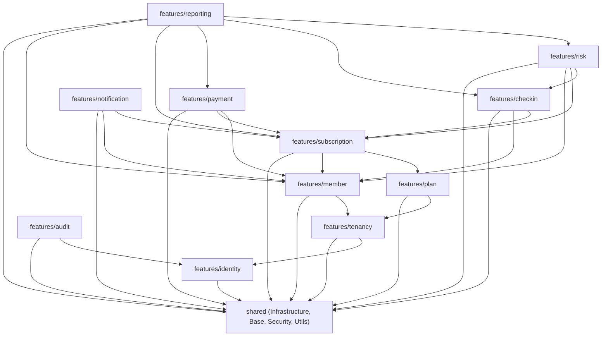
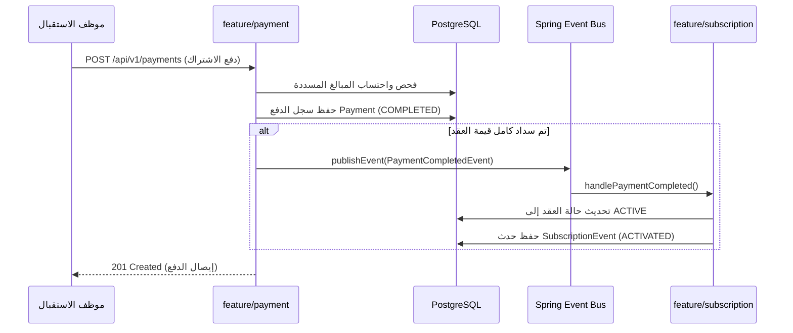

# 05 - تحليل اعتمادات الميزات وتدفق الاتصال (Feature Dependencies & Decoupling)

> **مسار الملف:** `implementation-blueprint/05-feature-dependencies.md`  
> **الحالة:** معتمد للتنفيذ (Approved for Implementation)  
> **المرجع:** [01-target-project-structure.md](./01-target-project-structure.md) · [02-features-breakdown.md](./02-features-breakdown.md) · [03-entity-relationships.md](./03-entity-relationships.md)

---

## 1. فلسفة فك الارتباط المعماري (Decoupling Philosophy)

في بيئات التطوير التي تتبنى **Feature-Based Architecture**، تكمن أكبر مخاطرة في حدوث اعتمادات دائرية (Circular Dependencies) أو تسرب الـ Repositories عبر حدود الميزات، مما يعيد إنتاج "كتلة الطين الكبرى" (Big Ball of Mud) داخل المونويلث.

لضمان بنية نظيفة وقابلة للصيانة والتطوير بواسطة مطور واحد:
1. **قاعدة المعرفات فقط (Loose Coupling via IDs):** الكيانات في ميزة معينة لا تملك علاقات `@ManyToOne` أو `@ManyToMany` مباشرة مع كيانات ميزة أخرى، بل تشير فقط إلى `UUID` الخاص بها.
2. **عقود واجهات الخدمات العامة فقط (Public Service Interfaces):** إذا احتاجت ميزة `checkin` معرفة تفاصيل العقد، تستدعي `SubscriptionService` ولا تلمس `SubscriptionRepository` نهائياً.
3. **أحداث النطاق المنفصلة (Domain Events):** العمليات غير المتزامنة أو المتتابعة تعتمد على Spring Application Events (مثل `PaymentCompletedEvent`).

---

## 2. مخطط اعتمادات الميزات (Mermaid Dependency Graph)



> **ملاحظة معمارية:** لاحظ أن اتجاه الأسهم يسير دوماً في اتجاه واحد هبوطاً من الميزات ذات المستوى الأعلى (مثل `reporting` و `risk`) نحو الميزات التأسيسية (`member`, `plan`, `subscription`). لا توجد أي أسهم عكسية، مما يضمن **انعدام الاعتماديات الدائرية تماماً (Zero Circular Dependencies)**.

---

## 3. مصفوفة الاعتمادات التفصيلية (Dependency Matrix)

| الميزة (Feature) | تعتمد على (Depends On) | طبيعة الاعتماد وطريقة الاتصال | الخدمات أو الأحداث المستهلكة |
|---|---|---|---|
| **`identity`** | `shared` | بنية الحماية، JWT، و `TenantContext`. | `SecurityConfig`, `JwtService` |
| **`tenancy`** | `shared`, `identity` | التحقق من صاحب الجيم عند إنشاء الفروع. | `UserService` |
| **`member`** | `shared`, `tenancy` | ربط العضو بالفرع والتأكد من تفعيل الفرع. | `BranchService` |
| **`plan`** | `shared`, `tenancy` | التحقق من هوية الجيم قبل إنشاء الباقة. | `TenantContext` |
| **`subscription`** | `shared`, `member`, `plan` | التحقق من وجود العضو، وسحب لقطة سعر الباقة. | `MemberService.findById()`, `PlanService.findById()` |
| **`payment`** | `shared`, `subscription`, `member` | قفل العقد بالـ Pessimistic Lock، واستدعاء تفعيله عند اكتمال المبلغ. | `SubscriptionService.activateOrRenew()`, `PaymentCompletedEvent` |
| **`checkin`** | `shared`, `member`, `subscription` | فحص حالة الاشتراك النشط وتناقص الحصص المتبقية. | `SubscriptionService.getActiveSubscription()`, `SubscriptionService.deductSession()` |
| **`notification`**| `shared`, `member`, `subscription` | سحب المشتركين المستحقين للتذكير وربط التجديدات بالعائد. | `SubscriptionService.findExpiringSoon()`, `MemberService.findWithOptIn()` |
| **`risk`** | `shared`, `member`, `subscription`, `checkin` | تحليل سلوك الغياب وهبوط وتيرة التمرين وسجل التجميد. | `CheckInService.getVisitHistory()`, `SubscriptionService.getMemberContracts()` |
| **`reporting`** | `shared` وجميع الميزات السابقة | استعلامات تجميعية للوحة التحكم (Read-Only). | استدعاء مجمعات البيانات بالـ Read-Only Services |
| **`audit`** | `shared`, `identity` | توثيق هوية الموظف القائم بالعملية الحساسة. | `TenantContext.getUserId()` |

---

## 4. تحليل ومنع الاعتماديات الدائرية (Circular Dependency Prevention)

### السيناريو الحرج 1: العلاقة بين `subscription` و `payment`
- **المشكلة الشائعة:** الـ `subscription` يحتاج معرفة هل تم سداد المبلغ ليتفعل، وفي نفس الوقت الـ `payment` يحتاج معرفة لقطة سعر الاشتراك ليعرف كم تبقّى عليه!
- **الحل المعماري في كمّل:**
  1. ميزة `subscription` لا تعتمد على `payment` إطلاقاً. العقد يُنشأ في حالة `PENDING_PAYMENT` مع حفظ لقطة السعر `price_minor_snapshot`.
  2. ميزة `payment` هي التي تعتمد على `subscription`؛ حيث تقرأ لقطة السعر عبر `SubscriptionService`.
  3. عند تسجيل السداد، إذا غطى المبلغ كامل القيمة، تطلق `payment` حدثاً:
     `applicationEventPublisher.publishEvent(new PaymentCompletedEvent(subscriptionId, amount));`
  4. ميزة `subscription` تستمع للحدث وتغير الحالة إلى `ACTIVE` دون أي اعتماد دائري كودي!



---

### السيناريو الحرج 2: العلاقة بين `checkin` و `risk`
- **المشكلة الشائعة:** الـ `risk` يحتاج بيانات الحضور لحساب احتمالية التسرب، وقد يغري المطور جعل الـ `checkin` يستدعي الـ `risk` لعرض تقييم العضو فور دخوله.
- **الحل المعماري في كمّل:**
  - ميزة `checkin` تقتصر فقط على تسجيل الحضور وفحص الصلاحية في زمن < 500ms ولا تعلم أي شيء عن محرك الـ Risk.
  - ميزة `risk` هي التي تقرأ سجلات الحضور السابقة ليلياً في وظيفة مجدولة (Batch Job) عبر واجهة `CheckInQueryService`.

---

## 5. عقود التكامل بين الميزات (Integration Contracts)

تلتزم الميزات بتوفير واجهات محددة لتبادل البيانات (Service Contracts) تقتصر فقط على Java Records وتمنع تصدير كيانات الـ JPA لخارج الميزة:

### 5.1 عقد ميزة الاشتراكات المقدم للميزات الأخرى (`SubscriptionContract`):
```java
public interface SubscriptionInternalService {
    // لميزة الحضور checkin
    Optional<ActiveSubscriptionDto> findActiveSubscription(UUID memberId);
    void deductSession(UUID subscriptionId);

    // لميزة المدفوعات payment
    SubscriptionPriceDto getPriceSnapshot(UUID subscriptionId);
    void activateSubscription(UUID subscriptionId);

    // لميزة التنبيهات notification ومحرك المخاطر risk
    List<ExpiringSubscriptionDto> findSubscriptionsExpiringBetween(LocalDate start, LocalDate end);
}
```

### 5.2 عقد ميزة الحضور المقدم لمحرك المخاطر (`CheckInContract`):
```java
public interface CheckInQueryService {
    int countVisitsBetween(UUID memberId, Instant from, Instant to);
    Optional<Instant> findLastCheckInTime(UUID memberId);
}
```

---

## 6. التحقق الآلي من الحدود عبر Spring Modulith

لضمان عدم قيام أي مطور في المستقبل بكسر هذه القواعد، يتم تضمين اختبار وحدة آلي عبر **Spring Modulith** في الـ CI/CD Pipeline:

```java
package com.kammel;

import org.junit.jupiter.api.Test;
import org.springframework.modulith.core.ApplicationModules;

class ArchitectureBoundaryTests {

    ApplicationModules modules = ApplicationModules.of(KammelApplication.class);

    @Test
    void verifyModularityAndBoundaries() {
        // يفشل الاختبار فوراً إذا تم استدعاء كلاس داخلي أو حدثت دائرة اعتماد
        modules.verify();
    }
}
```
هذا الاختبار يضمن سلامة المعمارية 100% ويمنع أي خرق لحدود الشرائح الرأسية.
