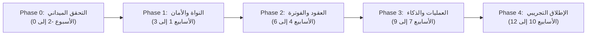

# 06 - خارطة طريق التنفيذ البرمجي (Implementation Roadmap)

> **مسار الملف:** `implementation-blueprint/06-implementation-roadmap.md`  
> **الحالة:** معتمد للتنفيذ (Approved for Implementation)  
> **المرجع:** [01-target-project-structure.md](./01-target-project-structure.md) · [05-feature-dependencies.md](./05-feature-dependencies.md) · [10-development-checklist.md](./10-development-checklist.md)

---

## 1. فلسفة التنفيذ: شريحة تلو شريحة (Slice-by-Slice Strategy)

لتسليم نظام كمّل في غضون **10 إلى 12 أسبوعاً** بواسطة مطور واحد دون تشتت، يتم التطوير وفق نموذج **الشرائح الرأسية المكتملة (Vertical Slice Sprints)**.  
لا ننتقل لتطوير ميزة جديدة إلا بعد اكتمال الميزة الحالية بالكامل من قاعدة البيانات وحتى الـ API واختبارات التكامل، وتمرير معيار الإنجاز (Definition of Done).

---

## 2. معيار اكتمال الشريحة الرأسية (Definition of Done - DoD)

تعتبر أي ميزة (Feature) مكتملة وجاهزة فقط إذا حققت النقاط الثماني التالية:
1. **الكيانات والـ Flyway:** كتابة ملف الـ SQL Migration مع عمود `org_id`، والمفتاح الأساسي UUID، وتفعيل سياسة الـ RLS.
2. **الـ Repository:** كتابة واجهة Spring Data JPA مع الاستعلامات المطلوبة والفهارس المركبة.
3. **الـ Domain & Service Logic:** تنفيذ منطق الأعمال، وحسابات القروش، وفحص الشروط، واستخدام `@Transactional`.
4. **الأمان والصلاحيات:** تأمين جميع دوال الخدمة بـ `@PreAuthorize` مع فحص سياق الفرع والمستأجر.
5. **الـ DTOs والـ Validation:** فحص المدخلات بـ Bean Validation وأرقام الموبايل بـ `@ValidPhone`.
6. **الـ Controller والـ REST Contract:** إنشاء الـ Endpoints وتوثيقها بـ Swagger وتغليف الرد بـ `ApiResponse<T>`.
7. **اختبارات الوحدة (Unit Tests):** تغطية منطق البيزنس والحسابات المالية بنسبة لا تقل عن 85%.
8. **اختبارات عزل المستأجر (Tenant Isolation Integration Tests):** اختبار عبر Testcontainers للتأكد من استحالة وصول مستأجر لبيانات مستأجر آخر.

---

## 3. المراحل الزمنية التفصيلية للتنفيذ (12-Week Schedule)

### المرحلة 0: التحقق الميداني وتجهيز بيانات الاختبار (الأسابيع -2 إلى 0)
- **الهدف:** التأكد من رغبة 3 أصحاب جيمات على الأقل في تجربة النظام قبل كتابة كود الإنتاج، وجمع شيتات إكسيل حقيقية من جيمات مصرية لفحص تنوع البيانات.
- **المهام:**
  - `TSK-VAL-001`: إجراء 10 مقابلات مع أصحاب جيمات مستقلة في القاهرة والجيزة.
  - `TSK-VAL-002`: الحصول على شيتين إكسيل حقيقيين (مع إخفاء الأسماء) لاستخدامهما كـ Test Fixtures.
- **نقطة التحقق (Gate):** الحصول على موافقة خطية أو شفهية مؤكدة من جيمين لبدء مرحلة الـ Pilot.

---

### المرحلة 1: النواة الهيكلية وعزل المستأجرين (الأسابيع 1 إلى 3)
> **نقطة التفتيش 1 (Checkpoint 1):** تطبيق Spring Boot 3 مع PostgreSQL 16 على Docker، ينفذ هجرات Flyway، ويصدر توكنات JWT، ويطبق سياسات RLS، ويمرر اختبارات عزل المستأجرين بنجاح 100%.

#### الأسبوع 1: البنية التحتية والـ Shared Module
- إعداد مشروع Spring Boot 3 مع Java 21 وإدارة الاعتماديات.
- كتابة `docker-compose.yml` (PostgreSQL 16) وإعداد GitHub Actions للـ CI.
- تنفيذ حزمة `shared/` (`BaseEntity`, `TenantContext`, `ApiResponse`, `GlobalExceptionHandler`, `MoneyUtil`, `PhoneUtil`).

#### الأسبوع 2: ميزات `tenancy` و `identity`
- هجرات Flyway لإنشاء جداول `organizations`, `branches`, و `users`.
- برمجة `TenantFilter` واستخراج الـ `org_id` وضبط `SET LOCAL app.current_org = ?`.
- تنفيذ تسجيل الدخول (`/auth/login`)، وتوليد JWT Access/Refresh tokens وتشفير BCrypt.

#### الأسبوع 3: سياسات الـ RLS واختبارات العزل الصارمة
- كتابة وتطبيق سياسات PostgreSQL Row-Level Security على جداول المستأجرين.
- كتابة جناح اختبارات تكامل كامل عبر **Testcontainers** يتأكد من أن مستخدم الجيم (أ) لا يمكنه قراءة أو تعديل مستخدمي الجيم (ب).

---

### المرحلة 2: عقود العضوية والمنظومة المالية (الأسابيع 4 إلى 6)
> **نقطة التفتيش 2 (Checkpoint 2):** موظف الاستقبال يستطيع تسجيل الأعضاء واستيراد شيت إكسيل، وإنشاء باقات، وإصدار اشتراكات تخضع لآلة الحالات، وتحصيل مدفوعات كاش وإنستاباي مع منع التكرار وإصدار إيصالات.

#### الأسبوع 4: شريحة الأعضاء (`features/member`)
- تنفيذ كيان `Member` وعمليات الـ CRUD والفهرسة برقم الموبايل.
- تطبيق الحذف المرن (`deleted_at`) لمنع فقدان البيانات التاريخية.
- برمجة خدمة استيراد الإكسيل (`MemberImportService`) عبر Apache POI مع تقرير فوري بالأخطاء.

#### الأسبوع 5: شريحة الباقات والاشتراكات (`features/plan` & `features/subscription`)
- بناء ميزة `plan` والتقاط لقطة السعر الثابتة (`price_minor_snapshot`).
- بناء آلة الحالات (State Machine) لعقود `subscription` (`PENDING_PAYMENT`, `ACTIVE`, `FROZEN`, `GRACE`, `EXPIRED`).
- تطبيق معادلات التجديد الذكية (تمديد تاريخ الانتهاء دون ضياع أيام العضو) ومعادلات التجميد (Freeze).
- تخزين كل حركة كحدث رسمي غير قابل للتعديل في `subscription_events`.

#### الأسبوع 6: شريحة المدفوعات والقيود المالية (`features/payment`)
- بناء ميزة `payment` بدقة القروش والـ `BIGINT`.
- فرض الـ `Idempotency-Key` في هيدر الطلب لمنع تكرار التحصيل عند انقطاع الشبكة.
- تطبيق الـ Pessimistic Lock (`FOR UPDATE`) على عقود الاشتراكات أثناء السداد.
- تفعيل الاشتراك تلقائياً عند تغطية كامل القيمة وإطلاق حدث `PaymentCompletedEvent`.
- بناء ميزة الاسترداد المالي العكسي (`Refund`) مع طلب موافقة المدير وتدوين السبب.

---

### المرحلة 3: العمليات اليومية ومحرك الاستبقاء (الأسابيع 7 إلى 9)
> **نقطة التفتيش 3 (Checkpoint 3):** تسجيل حضور فوري للأعضاء (< 500ms)، محرك ذكي ليلي لاحتساب مخاطر التسرب مع أسباب بالعربية، طابور رسائل واتساب مع روابط `wa.me`، ولوحة تحكم متكاملة للإدارة.

#### الأسبوع 7: شريحة الحضور السريع (`features/checkin`)
- برمجة شاشة تسجيل الحضور السريع بالاسم أو الموبايل أو كود الـ QR.
- فحص قيود الحضور (منع المجمد، تنبيه المنتهي ودخول فترة السماح).
- خصم الحصص لباقات الـ `SESSION_PACK` والتعامل مع تكرار الحضور في نفس اليوم.

#### الأسبوع 8: محرك المخاطر والوظائف الليلية (`features/risk` & ShedLock)
- ضبط قفل المهام الموزع عبر PostgreSQL و **ShedLock**.
- كتابة الوظيفة المجدولة اليومية لاحتساب انتهاء الاشتراكات ونقلها لـ `GRACE` أو `EXPIRED`.
- برمجة خوارزمية احتساب درجة المخاطر الحسابية (0-100) وتوليد الأسباب ومسودة الرسالة بالعربية.

#### الأسبوع 9: طابور رسائل الواتساب ولوحة التحكم (`features/notification` & `features/reporting`)
- توليد طابور رسائل التجديد والمتابعة اليومية مع روابط `wa.me` المشفرة.
- تطبيق قواعد منع الإزعاج (حد أقصى رسالة كل 3 أيام وساعات الإرسال 9ص-9م).
- برمجة محرك نسبة العائد (Renewal Attribution) لربط التجديدات اللاحقة بالرسائل.
- بناء استعلامات لوحة تحكم صاحب الجيم (`DashboardService`) لاحتساب إيرادات الشهر ونسبة التجديد.

---

### المرحلة 4: الإحكام الأمني، التجهيز والإطلاق الميداني (الأسابيع 10 إلى 12)
> **نقطة التفتيش 4 (Checkpoint 4):** النظام منشور على سيرفر VPS حقيقي مع Nginx وشهادة SSL، نسخ احتياطي يومي مشفر لقاعدة البيانات، تدريب كباتن الاستقبال، وتشغيل الجيم الفعلي لمدة 14 يوماً متواصلة.

#### الأسبوع 10: الإحكام السحابي والنسخ الاحتياطي
- تجهيز خادم VPS (Ubuntu 24.04 LTS) مع Docker و Nginx Reverse Proxy و Let's Encrypt SSL.
- إعداد سكربت النسخ الاحتياطي اليومي المشفر لـ PostgreSQL وإرساله لمخزن سحابي خارجي (Wasabi / S3).
- ربط مراقبة الأخطاء في الوقت الفعلي عبر **Sentry** وتأمين الـ Actuator.

#### الأسبوع 11: ترحيل البيانات وتدريب موظفي الاستقبال
- استيراد بيانات الأعضاء والاشتراكات الحالية للجيم التجريبي من شيت الإكسيل الخاص بهم.
- عمل جلسة تدريبية مدتها ساعة لموظفي الاستقبال وشرح شاشات الحضور واستخدام روابط `wa.me`.
- طباعة كارت إرشادي ورقي مختصر بجوار كمبيوتر الاستقبال.

#### الأسبوع 12: فترة التشغيل التجريبي الميداني (14-Day Pilot Execution)
- تشغيل الجيم التجريبي بالكامل على كمّل دون العودة للدساتير الورقية.
- المتابعة اليومية لنسب الحضور المسجلة، ورسائل الواتساب المرسلة، وأي استثناءات تظهر في Sentry وحلها فوراً.
- قياس نسبة رضا صاحب الجيم وإثبات الإيرادات المستردة عبر لوحة التحكم.
