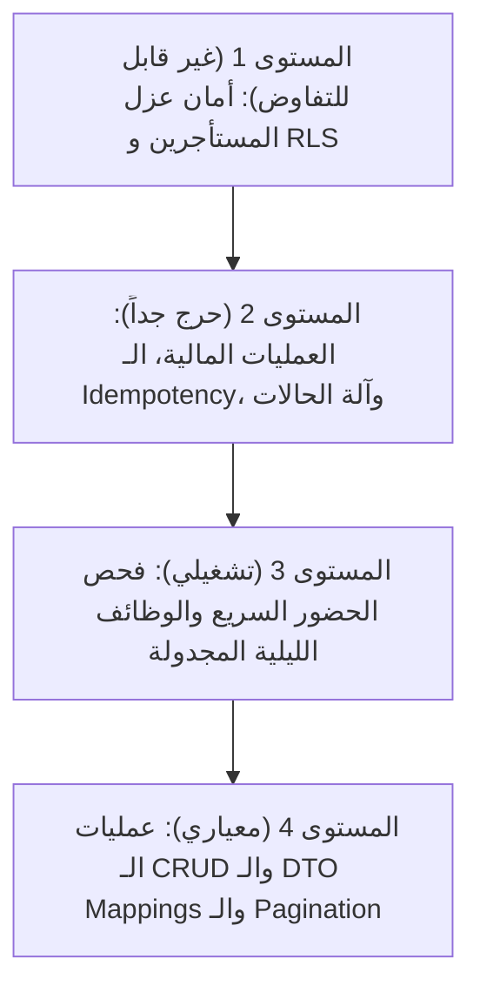

# 08 - استراتيجية الاختبارات وضمان الجودة (Testing Strategy & CI Quality Gates)

> **مسار الملف:** `implementation-blueprint/08-testing-strategy.md`  
> **الحالة:** معتمد للتنفيذ (Approved for Implementation)  
> **المرجع:** [01-target-project-structure.md](./01-target-project-structure.md) · [03-entity-relationships.md](./03-entity-relationships.md) · [06-implementation-roadmap.md](./06-implementation-roadmap.md)

---

## 1. هرم الاختبارات والأولويات الحرجة (Testing Pyramid & Tiers)

لأن كمّل هو نظام مالي وإداري متعدد المستأجرين (Multi-Tenant Financial SaaS)، تم تنظيم الاختبارات في أربعة مستويات ذات أولوية صارمة:



### تفصيل المستويات الأربعة:
1. **Tier 1 (Non-Negotiable - 100% CI Pass):** اختبارات عزل بيانات الجيمات ومنع اختراق البيانات (Cross-Tenant Leakage) عبر التحقق من سياسات PostgreSQL RLS و `TenantContext`.
2. **Tier 2 (Financial Critical):** المعاملات النقدية، منع تكرار الدفع (Idempotency Key)، قفل العقود بالـ Pessimistic Lock، واختبار جميع مسارات آلة الحالات (State Machine Transitions).
3. **Tier 3 (Operational):** أداء تسجيل الدخول وسرعة الحضور في زمن < 500ms، وفحص تناقص الحصص والوظائف الليلية المجدولة عبر ShedLock.
4. **Tier 4 (Standard):** التعيين بين الكيانات والـ DTOs والتحقق من صحة المدخلات.

---

## 2. بيئة وأدوات الاختبار المعتمدة (Testing Tech Stack)

- **محرك الاختبارات:** JUnit 5 (Jupiter).
- **المطابقة والتأكيدات:** AssertJ (Fluent Assertions).
- **العزل والمحاكاة:** Mockito و Spring Security Test (`@WithMockUser`).
- **قاعدة البيانات للاختبارات:** **Testcontainers مع صورة PostgreSQL 16 الحقيقية**.  
  > ⚠️ **قرار حاسم:** ممنوع منعاً باتاً استخدام H2 Database في اختبارات النظام. قاعدة H2 لا تدعم دوال الـ RLS ولا متغيرات الجلسة `current_setting('app.current_org')`، ولا تدعم نوع `JSONB`. استخدام H2 يعطي أماناً زائفاً ويفشل في اكتشاف تسرب البيانات الحقيقي.

---

## 3. نماذج الاختبارات الحرجة (Critical Test Suites)

### 3.1 اختبار عزل المستأجرين الصارم (Tenant Isolation Integration Test)
يختبر هذا السيناريو محاولة مستخدم من "جيم أ" الوصول لعضو أو عقد يتبع "جيم ب":

```java
package com.kammel.features.member;

import com.kammel.features.member.domain.Member;
import com.kammel.features.member.infrastructure.MemberRepository;
import com.kammel.shared.security.TenantContext;
import org.junit.jupiter.api.DisplayName;
import org.junit.jupiter.api.Test;
import org.springframework.beans.factory.annotation.Autowired;
import org.springframework.boot.test.context.SpringBootTest;
import org.springframework.test.context.DynamicPropertyRegistry;
import org.springframework.test.context.DynamicPropertySource;
import org.springframework.transaction.annotation.Transactional;
import org.testcontainers.containers.PostgreSQLContainer;
import org.testcontainers.junit.jupiter.Container;
import org.testcontainers.junit.jupiter.Testcontainers;

import java.util.Optional;
import java.util.UUID;

import static org.assertj.core.api.Assertions.assertThat;

@SpringBootTest
@Testcontainers
@Transactional
class MemberTenantIsolationTests {

    @Container
    static PostgreSQLContainer<?> postgres = new PostgreSQLContainer<>("postgres:16");

    @DynamicPropertySource
    static void configureProperties(DynamicPropertyRegistry registry) {
        registry.add("spring.datasource.url", postgres::getJdbcUrl);
        registry.add("spring.datasource.username", postgres::getUsername);
        registry.add("spring.datasource.password", postgres::getPassword);
    }

    @Autowired
    private MemberRepository memberRepository;

    @Test
    @DisplayName("يجب ألا يتمكن Gym A من رؤية أو قراءة عضو مسجل في Gym B نهائياً")
    void shouldPreventCrossTenantDataLeakage() {
        UUID gymA = UUID.randomUUID();
        UUID gymB = UUID.randomUUID();

        // 1. تسجيل عضو يتبع Gym B
        TenantContext.setOrgId(gymB);
        Member memberOfGymB = Member.builder()
                .orgId(gymB)
                .fullName("Karim Adel")
                .phone("01012345678")
                .build();
        memberOfGymB = memberRepository.saveAndFlush(memberOfGymB);
        UUID memberId = memberOfGymB.getId();
        TenantContext.clear();

        // 2. محاولة قراءة نفس العضو بواسطة سياق Gym A
        TenantContext.setOrgId(gymA);
        Optional<Member> leakedMember = memberRepository.findById(memberId);

        // 3. التحقق الحاسم من إخفاء العضو تماماً
        assertThat(leakedMember).isEmpty();
        TenantContext.clear();
    }
}
```

---

### 3.2 اختبار منع تكرار الدفع (Payment Idempotency Test)
يختبر إعادة إرسال نفس الطلب مرتين بسبب ضعف شبكة الهاتف أو النقر المزدوج:

```java
@Test
@DisplayName("إرسال نفس مفتاح Idempotency-Key مرتين يجب أن يعيد نفس السجل دون سحب مالي مكرر")
void shouldProcessPaymentIdempotently() {
    UUID subscriptionId = createTestSubscription(180000L); // 1,800 EGP
    String idempotencyKey = UUID.randomUUID().toString();

    RecordPaymentRequest request = new RecordPaymentRequest(
            subscriptionId, 180000L, PaymentMethod.INSTAPAY, "TXN-101", "Full Payment"
    );

    // الطلب الأول
    PaymentResponse firstResponse = paymentService.recordPayment(request, idempotencyKey);
    assertThat(firstResponse.status()).isEqualTo(PaymentStatus.COMPLETED);

    // الطلب الثاني المتطابق
    PaymentResponse secondResponse = paymentService.recordPayment(request, idempotencyKey);

    // التحقق: الحصول على نفس معرف الدفع تماماً، وعدم زيادة رصيد المدفوعات في قاعدة البيانات
    assertThat(secondResponse.id()).isEqualTo(firstResponse.id());
    assertThat(paymentRepository.countBySubscriptionId(subscriptionId)).isEqualTo(1);
}
```

---

### 3.3 اختبارات تحولات آلة الحالات (State Machine Parameterized Tests)
اختبار جميع التحولات الصالحة والباطلة لعقود الاشتراكات:

```java
@ParameterizedTest
@CsvSource({
    "PENDING_PAYMENT, CANCELLED, true",
    "PENDING_PAYMENT, ACTIVE, true",
    "ACTIVE, FROZEN, true",
    "ACTIVE, GRACE, true",
    "ACTIVE, EXPIRED, true",
    "FROZEN, ACTIVE, true",
    "EXPIRED, ACTIVE, false",   // باطل: العقد المنتهي لا يرجع ACTIVE بل ينشأ عقد جديد
    "CANCELLED, ACTIVE, false", // باطل: العقد الملغي ميت نهائياً
    "PENDING_PAYMENT, FROZEN, false", // باطل: لا يمكن تجميد عقد لم يُسدد
    "GRACE, FROZEN, false"      // باطل: لا تجميد أثناء فترة السماح
})
@DisplayName("التحقق من صحة ومحظورات آلة حالات الاشتراكات")
void shouldValidateSubscriptionTransitions(
        SubscriptionStatus from, SubscriptionStatus to, boolean isValid) {

    if (isValid) {
        assertThatCode(() -> stateChecker.validateTransition(from, to))
                .doesNotThrowAnyException();
    } else {
        assertThatThrownBy(() -> stateChecker.validateTransition(from, to))
                .isInstanceOf(InvalidStateTransitionException.class);
    }
}
```

---

## 4. بوابات الجودة والتغطية في الـ CI/CD (Quality Gates)

في مسار البناء الآلي (GitHub Actions CI Pipeline)، يتم تطبيق الشروط الصارمة الآتية لقبول أي دمج كودي (Pull Request):

1. **الترجمة والامتثال الأسلوبي (Compilation & Checkstyle):** صفر أخطاء وصفر تحذيرات كودية.
2. **اختبارات عزل المستأجرين (Tenant Isolation Tests):** نسبة نجاح 100% (أي فشل يوقف الـ Pipeline فوراً).
3. **تغطية الكود (Code Coverage Thresholds):**
   - **100% تغطية للفروع (Branch Coverage)** على جميع الفئات المالية والحسابية (`PaymentService`, `MoneyUtil`, `ShiftService`).
   - **85% على الأقل تغطية عامة** على طبقات الـ Domain والـ Application Services.
4. **التحقق من الحدود المعمارية:** نجاح اختبار `Spring Modulith` لمنع أي تسرب بين الحزم الرأسية.
