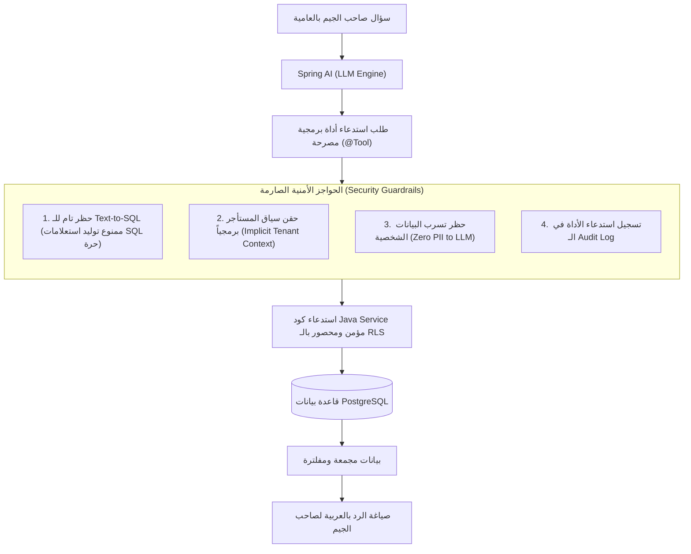

# 09 - خارطة طريق تكامل الذكاء الاصطناعي (AI Integration Roadmap & Governance)

> **مسار الملف:** `implementation-blueprint/09-ai-integration-roadmap.md`  
> **الحالة:** معتمد للتنفيذ (Approved for Implementation)  
> **المرجع:** [00-project-overview.md](./00-project-overview.md) · [02-features-breakdown.md](./02-features-breakdown.md) · [06-implementation-roadmap.md](./06-implementation-roadmap.md)

---

## 1. الموقف الاستراتيجي الصارم: منع الذكاء الاصطناعي في الـ MVP

> ⚠️ **قرار هندسي إلزامي:** يُحظر تضمين أي مكتبات ذكاء اصطناعي (Spring AI، نماذج لغوية LLMs، أو مكتبات Machine Learning) في مرحلة الـ MVP الأساسية (P0).

### 1.1 لماذا نؤجل الذكاء الاصطناعي لمرحلة ما بعد استقرار النظام؟
1. **انعدام البيانات السلوكية الحقيقية (Lack of Ground-Truth Data):** في بداية إطلاق النظام، لا توجد سجلات حضور متصلة أو تاريخ تجديدات موثق في قاعدة البيانات. أي نموذج ذكاء اصطناعي سيتم تدريبه أو استدعاؤه سيكون عديم الجدوى ويقدم تنبؤات عشوائية (Hallucinations).
2. **كفاءة القواعد الرياضية المفسرة (Explainable Rules First):** في مرحلة الـ MVP، توفر خوارزمية الـ Risk Score المبنية على القواعد الحسابية (Rule-Based Formula) نتائج دقيقة 100% ومفهومة لصاحب الجيم ("العضو مجاش بقاله 14 يوم واشتراكه هيخلص بعد 4 أيام") دون تكاليف استدعاء API أو تعقيد في السيرفرات.
3. **التركيز على اكتمال المنظومة التشغيلية:** قيمة كمّل الأساسية هي حل تسرب الإيرادات وانضباط الكاش وحصر التجديدات أولاً؛ الذكاء الاصطناعي هو عامل تسريع (Multiplier) لمنظومة تعمل بالفعل بنجاح.

---

## 2. الشروط الإلزامية قبل تفعيل الذكاء الاصطناعي (Prerequisites Gate)

لن يتم فتح فرع كودي خاص بالذكاء الاصطناعي إلا بعد استيفاء الشروط الخمسة التالية بالكامل:
1. عمل النظام في **3 جيمات حقيقية على الأقل** لمدة لا تقل عن **3 إلى 6 أشهر**.
2. وجود قاعدة بيانات تحتوي على ما لا يقل عن **1,000 عضو نشط** مع توثيق دورتين تجديد كاملتين على الأقل لكل عضو.
3. وجود بيانات حضور يومية حقيقية وتاريخ دقيق للأعضاء الذين انقطعوا بالفعل (Ground-Truth Churn Labels).
4. معايرة ومقارنة نتائج محرك الـ Risk Score الحالي بنسب الانقطاع الفعلية.
5. اجتياز اختبارات عزل المستأجرين (Tenant Isolation) بنسبة 100% لضمان عدم تسرب أي بيانات للـ LLM بين الجيمات.

---

## 3. المراحل الثلاث للتطوير الذكي (Three-Phase AI Roadmap)

---

## 4. المرحلة 2 (P2): التنبؤ بالانسحاب عبر نماذج ONNX المدمجة

بدلاً من بناء Microservice منفصل بلغة بايثون يستهلك موارد الخادم ويزيد من تعقيد الصيانة، سنعتمد نمط **Embedded Machine Learning**:

1. **التدريب الخارجي (Offline Training):** تدريب نموذج تصنيف ثنائي (Binary Classifier عبر LightGBM أو XGBoost) على جهاز التطوير باستخدام بيانات الجيم التاريخية المصدرة بدون أسماء (Anonymized).
2. **التصدير لمعيار ONNX:** تصدير النموذج المدرب بصيغة `churn_model.onnx`.
3. **التشغيل المباشر داخل الـ JVM:** تحميل الملف داخل Spring Boot عبر مكتبة `com.microsoft.onnxruntime:onnxruntime`:
   - تنفيذ التنبؤ في زمن فائق السرعة (**أقل من 5 مللي ثانية** لكل عضو).
   - استهلاك ذاكرة منخفض جداً دون الحاجة لأي Python Process خارجي.
   - تشغيل التنبؤ أوتوماتيكياً ضمن الوظيفة الليلية المجدولة مع تحديث جدول `risk_scores`.

---

## 5. المرحلة 3 (P3): المساعد الإداري بالعامية المصرية (Spring AI Assistant)

يتيح لصاحب الجيم توجيه أسئلة باللغة العربية عبر واتساب أو واجهة الويب (مثل: *"مين أكتر 5 أعضاء معرضين يقطعوا اشتراكهم الأسبوع ده؟"* أو *"دخلنا كام كاش النهاردة في فرع المعادي؟"*).

### 5.1 القواعد الأمنية الصارمة للمساعد الإداري (Strict Security Guardrails)

### 5.2 الضوابط الهندسية الإلزامية:
1. **الحظر المطلق لتوليد الـ SQL (Absolute Prohibition of Text-to-SQL):**  
   ممنوع منعاً باتاً السماح للذكاء الاصطناعي بتوليد استعلامات SQL حرة على قاعدة البيانات. أي وصول للبيانات يتم فقط عبر **دوال Java معرفة مسبقاً بـ `@Tool`**.
2. **الحقن التلقائي لهوية الجيم (Implicit Tenant Context Injection):**  
   دوال الـ `@Tool` لا تقبل `orgId` كمدخل من الـ LLM؛ بل تستخرجه حتماً من سياق جلسة المستخدم المسجلة (`TenantContext.getOrgId()`).
3. **حماية الخصوصية (Zero PII Leakage):**  
   لا يتم إرسال أرقام الهواتف أو الأسماء الكاملة أو التفاصيل الشخصية إلى خوادم مزودي الذكاء الاصطناعي؛ يتم فقط إرسال معرفات وأرقام إحصائية مجردة.
4. **مصفوفة اختبارات الردود (Regression Benchmark):**  
   تجهيز 50 سؤالاً مرجعياً بالعامية المصرية يتم اختبار دقة إجابات المساعد عليها في الـ CI قبل اعتماد أي ترقية لنموذج الذكاء الاصطناعي.
