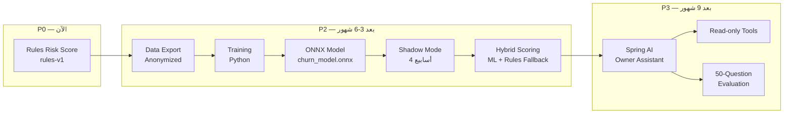
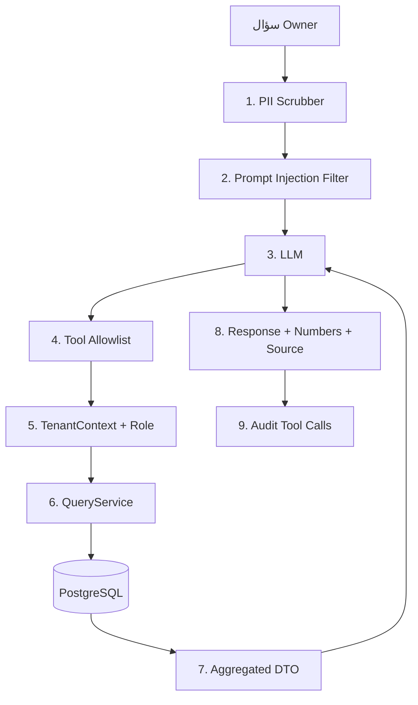

# خارطة طريق تكامل الـ AI (AI Integration Roadmap)

> **الحالة:** مؤجل بعد الـ MVP — P2 للـ ML وP3 للمساعد.  
> **المرتبط:** [ai-overview](./ai-overview.md) · [risk/domain-design](../features/risk/domain-design.md) · [integration-roadmap](../development-roadmap/integration-roadmap.md)

---

## 1. نظرة عامة



**قاعدة:** كل مرحلة ليها **Gate** مستقل. فشل Gate = توقف، مش تجاوز.

---

## 2. Phase A — تجهيز الداتا (P0.5)

> **الهدف:** نجمع داتا نظيفة وقابلة للتدريب من غير ما نلمس بيانات شخصية.

### 2.1 الشروط

- [ ] 3 جيمات حقيقية.
- [ ] 3–6 شهور تشغيل.
- [ ] ≥ 1,000 عضو نشط.
- [ ] دورتين تجديد.
- [ ] Churn Labels موثقة.

### 2.2 Data Export

**القاعدة:** التصدير **Offline** — مش API. بيتنفذ على Replica أو Backup.

```sql
-- export_churn_dataset.sql (Anonymized)
SELECT
    encode(digest(m.id::text, 'sha256'), 'hex') AS member_key,
    m.created_at::date                            AS member_since,
    EXTRACT(DAY FROM (s.start_date - m.created_at::date)) AS days_to_first_sub,
    s.price_minor_snapshot                        AS price_minor,
    p.duration_days,
    p.sessions_count,
    COUNT(DISTINCT c.checked_in_at::date)
        FILTER (WHERE c.checked_in_at >= s.end_date - INTERVAL '14 days') AS visits_last_14,
    COUNT(DISTINCT c.checked_in_at::date)
        FILTER (WHERE c.checked_in_at >= s.end_date - INTERVAL '28 days'
                  AND c.checked_in_at <  s.end_date - INTERVAL '14 days') AS visits_prev_14,
    EXTRACT(DAY FROM (s.end_date - MAX(c.checked_in_at::date))) AS days_since_last_visit,
    s.frozen_days_used,
    (SELECT COUNT(*) FROM subscriptions s2
      WHERE s2.member_id = m.id AND s2.start_date < s.start_date
        AND s2.status IN ('EXPIRED','CANCELLED')) AS previous_lapses,
    (s.end_date - s.start_date)                   AS term_days,
    CASE
        WHEN EXISTS (
            SELECT 1 FROM subscriptions s3
            WHERE s3.member_id = m.id
              AND s3.renewal_of = s.id
              AND s3.start_date <= s.end_date + INTERVAL '30 days'
        ) THEN 1 ELSE 0
    END AS renewed_within_30d
FROM subscriptions s
JOIN members m ON m.id = s.member_id
JOIN plans p ON p.id = s.plan_id
LEFT JOIN check_ins c ON c.member_id = m.id
WHERE s.status IN ('EXPIRED','ACTIVE','GRACE')
  AND s.end_date < now() - INTERVAL '30 days'
GROUP BY m.id, m.created_at, s.id, s.start_date, s.end_date,
         s.price_minor_snapshot, p.duration_days, p.sessions_count, s.frozen_days_used;
```

**ممنوع في الـ Export:**

- `phone`
- `full_name`
- `email`
- `notes`
- `photo_url`
- `qr_token`
- `address`
- `payment.idempotency_key`

### 2.3 Labeling

| المفهوم | التعريف |
|---|---|
| **Observation Point** | `subscription.end_date` |
| **Observation Window** | 30 يوم بعد `end_date` |
| **Positive (Churn)** | مفيش اشتراك جديد خلال 30 يوم |
| **Negative (Retained)** | فيه اشتراك جديد خلال 30 يوم |
| **Excluded** | `CANCELLED` بسبب نقل/وفاة، Freeze نشط وقت الانتهاء، اشتراك تجريبي |
| **Leakage Guard** | أي Feature بعد `end_date` ممنوعة |

### 2.4 جودة الداتا

- [ ] Duplicates ممنوعة.
- [ ] Missing values موثقة.
- [ ] Outliers مراجعة (اشتراك 10 سنين مثلاً).
- [ ] Class Balance مقاس.
- [ ] Temporal Split — مش Random.

---

## 3. Phase B — Machine Learning (P2)

### 3.1 B1 — Feature Parity

**القاعدة:** الموديل الجديد لازم يستخدم **نفس الإشارات** اللي القواعد بتستخدمها + إضافات مبررة.

| Feature | المصدر | موجود في Rules؟ |
|---|---|:---:|
| `days_since_last_visit` | `checkin` | ✅ |
| `visits_last_14` | `checkin` | ✅ |
| `visits_prev_14` | `checkin` | ✅ |
| `visit_trend` | `checkin` | ✅ |
| `days_remaining` | `subscription` | ✅ |
| `delayed_activations` | `subscription` | ✅ (Proxy) |
| `freeze_count` | `subscription` | ✅ |
| `tenure_days` | `member` | ✅ |
| `term_days` | `plan` | ❌ جديد |
| `previous_lapses` | `subscription` | ❌ جديد |
| `sessions_ratio` | `subscription` | ❌ جديد |
| `price_band` | `plan` | ❌ جديد |

> **أي Feature جديد لازم يتوثق في `feature-dictionary.md`** — P2.

### 3.2 B2 — Training

```text
1. Export → Parquet
2. Split:
   - Train: أول 70% زمنياً
   - Validation: 15%
   - Test: آخر 15%
3. Preprocessing:
   - Median imputation
   - Standard scaling
   - One-hot للـ plan category
4. Models:
   - Logistic Regression (Baseline)
   - LightGBM / XGBoost (Primary)
5. Class Imbalance:
   - scale_pos_weight
   - أو class weights
6. Metrics:
   - AUC-ROC
   - PR-AUC
   - Precision@20 / Recall@20
   - Brier Score
7. Calibration:
   - Isotonic / Platt
```

**ممنوع:**

- Random Split (بيسبب Leakage).
- استخدام `member_id` كـ Feature.
- استخدام `branch_id` كـ Feature (Overfit).
- تدريب على بيانات أقل من 1,000 عضو.

### 3.3 B3 — Evaluation Gate

| المقياس | الحد الأدنى |
|---|---|
| AUC-ROC | ≥ 0.75 |
| PR-AUC | > Baseline + 10% |
| Precision@20 | > Rules + 10% |
| Brier Score | ≤ 0.20 |
| Inference | < 5ms / عضو |
| Model Size | < 5 MB |

- [ ] الموديل بيتغلب على `rules-v1` على **Test Set**.
- [ ] النتيجة مستقرة عبر الـ 3 جيمات.
- [ ] مفيش Feature Leakage.
- [ ] التقرير مكتوب ومراجع.

> **لو فشل:** مفيش Rollout. نفضل على القواعد ونعيد التدريب بعد 3 شهور.

### 3.4 B4 — ONNX Export

```python
# train.py
import lightgbm as lgb
from skl2onnx import convert_sklearn
from skl2onnx.common.data_types import FloatTensorType

model = lgb.LGBMClassifier(...)
model.fit(X_train, y_train)

onnx_model = convert_sklearn(
    model,
    initial_types=[("features", FloatTensorType([None, len(FEATURES)]))]
)

with open("churn_model.onnx", "wb") as f:
    f.write(onnx_model.SerializeToString())
```

**الملفات:**

```text
models/
├── churn_model.onnx
├── feature_schema.json        ← ترتيب + أنواع + scaling
├── model_metadata.json        ← version, metrics, date
└── preprocessing.json         ← imputation + scaling
```

### 3.5 B5 — JVM Inference

```java
public interface RiskScoringEngine {
    RiskComputation compute(RiskFeatures features);
}

@Component
@ConditionalOnProperty(name = "kammel.ai.mode", havingValue = "onnx")
public class OnnxRiskScoringEngine implements RiskScoringEngine {

    private final OrtSession session;
    private final FeatureSchema schema;

    @Override
    public RiskComputation compute(RiskFeatures features) {
        float[] input = schema.toVector(features);
        try (OrtSession.Result result = session.run(
                Map.of("features", OnnxTensor.createTensor(env, new float[][]{input})))) {
            float probability = ((float[][]) result.get(0).getValue())[0][0];
            return RiskComputation.fromProbability(probability, features);
        } catch (OrtException e) {
            throw new ModelInferenceException(e);
        }
    }
}
```

- `model_version = "onnx-v1"`.
- `churn_probability` تتخزن في `risk_scores`.
- `reasons` تفضل من القواعد — عشان التفسير.
- لو `ONNX` فشل → Fallback `RulesRiskScoringEngine` + Alert.

### 3.6 B6 — Shadow Mode

**المدة:** 4 أسابيع.

```text
1. القواعد هي اللي بتحدد الـ Score المعروض.
2. الموديل بيحسب في الخلفية.
3. بنسجل:
   - rules_score
   - ml_probability
   - actual_outcome (بعد 30 يوم)
4. بنقارن:
   - Precision@20
   - Recall@20
   - Calibration
5. مفيش تغيير في الـ UI.
```

**Gate:** لو الموديل مش أحسن → مفيش تفعيل.

### 3.7 B7 — Rollout

| المرحلة | النطاق | المدة |
|---|---|---|
| Canary | 10% من الجيمات | أسبوع |
| Partial | 50% | أسبوعين |
| Full | 100% | — |

- **Kill Switch:** `kammel.ai.mode=rules` — رجوع فوري.
- **Feature Flag:** لكل Org.
- **Rollback:** أقل من 5 دقائق.
- **إشعار المالك:** «Risk Score بقى أدق» — مش «AI».

### 3.8 B8 — Monitoring

| المقياس | التكرار | Alert |
|---|---|---|
| Inference Latency | كل Job | > 50ms p95 |
| Missing Features | كل Job | > 1% |
| Score Distribution | يومي | انحراف > 20% |
| Drift (PSI) | أسبوعي | > 0.2 |
| Actual Churn Rate | شهري | فرق > 10% |
| Fallback Count | يومي | > 0 |

**إعادة التدريب:** كل 3 شهور أو عند Drift.

### 3.9 B9 — Schema إضافي (P2)

```sql
-- V26__create_ai_model_registry.sql
CREATE TABLE ai_model_registry (
    id              UUID PRIMARY KEY DEFAULT gen_random_uuid(),
    model_name      VARCHAR(100) NOT NULL,
    model_version   VARCHAR(50)  NOT NULL,
    model_type      VARCHAR(30)  NOT NULL CHECK (model_type IN ('RULES','ONNX','LLM')),
    artifact_path   VARCHAR(500),
    metrics         JSONB,
    active          BOOLEAN NOT NULL DEFAULT false,
    activated_at    TIMESTAMPTZ,
    created_at      TIMESTAMPTZ NOT NULL DEFAULT now(),
    CONSTRAINT uk_ai_model_version UNIQUE (model_name, model_version)
);

-- V27__add_risk_prediction_columns.sql
ALTER TABLE risk_scores
    ADD COLUMN churn_probability NUMERIC(5,4)
    CHECK (churn_probability IS NULL OR (churn_probability >= 0 AND churn_probability <= 1));
```

- `risk_scores.model_version` موجود بالفعل — بيتسجل `onnx-v1`.
- `ai_model_registry` مش Tenant-scoped — Global.

---

## 4. Phase C — المساعد الإداري (P3)

### 4.1 C1 — Tools (Read-Only)

```java
@Component
public class OwnerAssistantTools {

    private final ReportingQueryService reporting;
    private final RiskQueryService risk;
    private final PaymentQueryService payment;
    private final ShiftQueryService shift;

    @Tool(description = "عدد التجديدات وقيمتها في فترة")
    public RenewalSummary getRenewals(
            @ToolParam(description = "هذا الشهر، الشهر اللي فات، آخر 90 يوم") String period) {
        return reporting.getRenewals(period, TenantContext.requireOrgId());
    }

    @Tool(description = "أعلى الأعضاء المعرضين للانسحاب")
    public List<AtRiskMember> getAtRiskMembers(
            @ToolParam(description = "عدد من 1 إلى 50") int limit) {
        return risk.listAtRisk(new RiskFilter(limit, TenantContext.requireOrgId()));
    }

    @Tool(description = "الإيراد المحصل في فترة وفرع")
    public RevenueSummary getRevenue(String period, UUID branchId) {
        return reporting.getRevenue(period, branchId, TenantContext.requireOrgId());
    }

    @Tool(description = "فروق الورديات")
    public List<ShiftVariance> getCashVariance(String period) {
        return shift.getVariance(period, TenantContext.requireOrgId());
    }

    @Tool(description = "نسبة الحضور في فترة")
    public AttendanceSummary getAttendance(String period, UUID branchId) {
        return reporting.getAttendance(period, branchId, TenantContext.requireOrgId());
    }

    @Tool(description = "Timeline عضو — بدون بيانات شخصية")
    public MemberTimeline getMemberTimeline(UUID memberId) {
        return reporting.getMemberTimeline(memberId, TenantContext.requireOrgId());
    }
}
```

**قواعد صارمة:**

1. `orgId` **مش** Parameter من الـ LLM — من `TenantContext`.
2. كل Tool `@PreAuthorize` حسب الدور.
3. كل Tool Read-only.
4. مفيش `@Tool` بيرجع Entity.
5. مفيش Tool بياخد SQL أو اسم جدول.
6. `limit` له حد أقصى.
7. `period` من Enum — مش String حر.

### 4.2 C2 — Tools Matrix

| Tool | Owner | Manager | Receptionist | Trainer |
|---|:---:|:---:|:---:|:---:|
| `getRenewals` | ✅ | ✅ (فرعه) | ❌ | ❌ |
| `getAtRiskMembers` | ✅ | ✅ (فرعه) | ✅ (فرعه) | ❌ |
| `getRevenue` | ✅ | ❌ | ❌ | ❌ |
| `getCashVariance` | ✅ | ✅ (فرعه) | ❌ | ❌ |
| `getAttendance` | ✅ | ✅ (فرعه) | ✅ (فرعه) | ❌ |
| `getMemberTimeline` | ✅ | ✅ (فرعه) | ✅ (فرعه) | ✅ (عملاؤه) |

> الـ Receptionist ممنوع يسأل عن الإيراد — نفس `C-14`.

### 4.3 C3 — Guardrails



| Guardrail | التنفيذ |
|---|---|
| **No Text-to-SQL** | مفيش Tool بتاخد SQL — الـ LLM بيختار من Allowlist |
| **Implicit Tenant** | `TenantContext.requireOrgId()` — ممنوع Parameter |
| **Role Check** | `@PreAuthorize` على كل Tool |
| **PII Scrubber** | إزالة أرقام/إيميلات من الـ Prompt |
| **Prompt Injection** | System Prompt + Input Filter + Tool Allowlist |
| **Max Tool Calls** | 5 لكل سؤال |
| **Timeout** | 10 ثواني |
| **Token Budget** | 4,000 Input / 1,000 Output |
| **Audit** | `AI_TOOL_CALLED` + Tool + Args + Duration |
| **Rate Limit** | 30 سؤال / ساعة / Org |
| **No Writes** | كل الـ Tools Read-only |

### 4.4 C4 — System Prompt

```text
أنت مساعد صاحب جيم مصري.
- رد بالعامية المصرية.
- استخدم الأدوات المتاحة فقط.
- ممنوع تخترع أرقام.
- كل رقم لازم يكون من نتيجة أداة.
- لو الأداة رجعت خطأ، قول "مش قادر أجيب البيانات دلوقتي".
- لو السؤال عن بيانات عضو، استخدم ID فقط.
- ممنوع تعرض أرقام موبايل أو إيميلات.
- في الآخر، اذكر اسم الأداة والفترة.
- لو السؤال خارج نطاق الجيم، اعتذر.
```

### 4.5 C5 — Evaluation Dataset

**50 سؤال مرجعي** — كل سؤال له إجابة معروفة من DB Seed.

| النوع | عدد | مثال |
|---|---:|---|
| Renewals | 10 | «كام واحد جدد الشهر ده؟» |
| Revenue | 8 | «الإيراد قل ولا زاد؟» |
| At-Risk | 10 | «مين أعلى 10 معرضين للانسحاب؟» |
| Attendance | 8 | «نسبة الحضور الأسبوع ده؟» |
| Cash Variance | 6 | «فيه فرق في وردية النهارده؟» |
| Out-of-Scope | 8 | «إيه أفضل تمرين للصدر؟» |

**التشغيل:**

```bash
mvn test -Dtest=AssistantEvaluationTest
```

- CI بيفشل لو Accuracy < 90%.
- مفيش Deploy من غير Evaluation.
- أي تغيير Prompt أو Tool → إعادة تشغيل.

### 4.6 C6 — Observability

| المقياس | Alert |
|---|---|
| Tool Call Success Rate | < 95% |
| Hallucination Flags | > 0 |
| P95 Latency | > 8s |
| Cost / Day | > Budget |
| PII Detected | > 0 — Block |
| Prompt Injection Blocked | Spike |

### 4.7 C7 — Cost Control

| الإجراء | القيمة |
|---|---|
| Max Tokens | 5,000 / سؤال |
| Cache | إجابات متكررة 1 ساعة |
| Rate Limit | 30 / ساعة / Org |
| Model Tier | Small model للـ Routing |
| Daily Budget | Hard Stop |
| Fallback | Dashboard Links |

### 4.8 C8 — UI

- شات في الـ Dashboard (Owner فقط).
- كل إجابة معاها:
  - الأرقام.
  - الفترة.
  - لينك للقائمة/التقرير.
  - زر «دي غلط» → Feedback.
- ممنوع الشات يبعت رسائل أو يعدل بيانات.

---

## 5. Phase D — Copilot المدرب (P4)

> **خارج المدى القريب — توثيق فقط.**

- اقتراح تعديل برنامج بناءً على لوج التمارين.
- الكابتن يوافق — مفيش تطبيق تلقائي.
- Nutrition DB مصرية — مراجعة أخصائي.
- ممنوع تشخيص أو نصايح طبية.
- موافقة صريحة على البيانات الصحية.

---

## 6. المعمارية

```text
com.kammel.ai/
├── prediction/
│   ├── api/
│   │   └── AiModelAdminController.java
│   ├── application/
│   │   ├── RiskScoringEngine.java
│   │   ├── RulesRiskScoringEngine.java
│   │   └── OnnxRiskScoringEngine.java
│   ├── domain/
│   │   ├── RiskComputation.java
│   │   └── ModelMetadata.java
│   └── infrastructure/
│       ├── OnnxSessionFactory.java
│       └── ModelRegistryRepository.java
└── assistant/
    ├── api/
    │   └── AssistantController.java
    ├── application/
    │   ├── AssistantService.java
    │   ├── ToolGuard.java
    │   └── PiiScrubber.java
    ├── tools/
    │   └── OwnerAssistantTools.java
    └── infrastructure/
        └── SpringAiConfig.java
```

**Dependencies:**

- `ai` → `reporting`, `risk`, `payment`, `shift` (Read Contracts).
- مفيش Feature → `ai`.
- `ai` ممنوع Repository مباشر.

---

## 7. الاختبارات

### 7.1 ML

| # | الاختبار | المتوقع |
|---|---|---|
| ML-01 | Feature Schema | ترتيب مطابق |
| ML-02 | Inference | نفس نتيجة Python ± 0.01 |
| ML-03 | Missing Feature | Fallback Rules |
| ML-04 | Model Missing | Fallback Rules |
| ML-05 | Latency | < 5ms |
| ML-06 | Shadow Log | Rules + ML مسجلين |
| ML-07 | Kill Switch | رجوع فوري |
| ML-08 | Drift | Alert |

### 7.2 Assistant

| # | الاختبار | المتوقع |
|---|---|---|
| AS-01 | 50 سؤال | Accuracy ≥ 90% |
| AS-02 | Tool Call | 95% صحيح |
| AS-03 | PII | 0 |
| AS-04 | Prompt Injection | Blocked |
| AS-05 | SQL Injection | مفيش Tool |
| AS-06 | Receptionist Revenue | `403` |
| AS-07 | Manager فرع تاني | `404` |
| AS-08 | Org تانية | مفيش بيانات |
| AS-09 | Max Tool Calls | 5 |
| AS-10 | Timeout | Fallback |
| AS-11 | Hallucinated Number | 0 |
| AS-12 | Audit | كل Tool Call مسجل |

---

## 8. المخاطر

| المخاطرة | التخفيف |
|---|---|
| موديل Overfit | Temporal Split + 3 جيمات |
| Data Leakage | Feature Freeze قبل `end_date` |
| Drift | مراقبة أسبوعية + إعادة تدريب |
| LLM يخترع أرقام | Tools فقط + Evaluation |
| Prompt Injection | Allowlist + Filter + System Prompt |
| PII Leakage | Scrubber + No PII in Tools |
| تكلفة عالية | Token Budget + Rate Limit + Cache |
| Vendor Lock-in | Tools Contract + مزود قابل للتبديل |
| المالك مش واثق | Explainability + Source Links |
| Fallback يفشل | Rules دايماً متاحة |

---

## 9. الجدول الزمني

| المرحلة | المدة | يبدأ بعد |
|---|---|---|
| Phase A — Data | 2 أسابيع | 3–6 شهور تشغيل |
| Phase B — ML | 6–8 أسابيع | Phase A |
| Shadow | 4 أسابيع | Phase B |
| Rollout | 4 أسابيع | Shadow ناجح |
| Phase C — Assistant | 6–8 أسابيع | Rollout مستقر |
| Evaluation | مستمر | Phase C |
| Phase D — Copilot | P4 | بيانات كافية |

---

## 10. معايير النجاح النهائية

- [ ] الموديل بيتغلب على القواعد على Test Set.
- [ ] Shadow Mode أثبت تحسن.
- [ ] Rollout بدون Regression.
- [ ] Assistant Accuracy ≥ 90%.
- [ ] صفر PII.
- [ ] صفر Hallucinated Numbers.
- [ ] Fallback شغال.
- [ ] التكلفة ضمن الميزانية.
- [ ] المالك بيستخدم المساعد أسبوعياً.

---

## 11. مرتبط بـ

- [ai-overview](./ai-overview.md)
- [risk/domain-design](../features/risk/domain-design.md)
- [reporting/domain-design](../features/reporting/domain-design.md)
- [security-strategy](../architecture/security-strategy.md)
- [testing-strategy](../testing-strategy.md)
- [feature-dependencies](../architecture/feature-dependencies.md)
