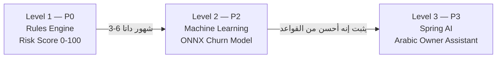

# نظرة عامة على الذكاء الاصطناعي (AI Overview)

> **القرار الاستراتيجي:** مفيش AI في الـ MVP. الـ Risk Score في الـ MVP **Rules Engine** مش Machine Learning.  
> **المرتبط:** [risk/domain-design](../features/risk/domain-design.md) · [ai-integration-roadmap](./ai-integration-roadmap.md) · [decisions-and-assumptions](../architecture/decisions-and-assumptions.md)

---

## 1. المبدأ

> **الـ AI مش ميزة بتتحط في آخر أسبوع. هو طبقة بتتبني فوق داتا تشغيلية حقيقية — وكل مرحلة لازم تثبت قيمتها قبل اللي بعدها.**

في الـ MVP:

- مفيش LLM.
- مفيش Spring AI.
- مفيش ONNX.
- مفيش Python Service.
- مفيش Vector Database.

اللي موجود: **Risk Score بقواعد مفهومة** + **سبب مكتوب** + **رسالة جاهزة**. ده **مش AI**، وده مقصود.

---

## 2. ليه مؤجل؟

| السبب | التفاصيل |
|---|---|
| **مفيش داتا** | أول 3 شهور مفيش تاريخ حضور/تجديد كافي. أي موديل هيكذب. |
| **القواعد أدق وأرخص** | «غاب 12 يوم، حضوره نزل 60%، اشتراكه بيخلص بعد 5 أيام» — مفهومة ومجانية. |
| **القيمة الأساسية مش AI** | القيمة هي **استرجاع الإيراد** و**انضباط الكاش** — مش chatbot. |
| **التكلفة** | LLM API + Observability + Evaluation + Privacy = تعقيد كبير قبل Product-Market Fit. |
| **المخاطرة** | LLM بيخترع أرقام. في فلوس، ده ممنوع. |
| **الأمانة** | تسمية قاعدة IF بسيطة «AI» بتضرّ المصداقية. |

> **نقطة أمانة:** في الـ CV والبيع، سمّيها **Risk Score** ووضّح إنها Rule-Based. ده قرار هندسي واعي، مش نقطة ضعف.

---

## 3. المستويات الثلاثة



### 3.1 Level 1 — Rules Engine (P0)

- 6 إشارات.
- Max 100 نقطة.
- `rules-v1`.
- `INSUFFICIENT_DATA` لو العضوية < 14 يوم.
- كل Score معاه **Reasons**.
- **مش AI** — Deterministic.

التفاصيل: [risk/domain-design](../features/risk/domain-design.md).

### 3.2 Level 2 — Machine Learning (P2)

- Binary Classifier: هيتجدد ولا لأ.
- تدريب Offline (Python / LightGBM / XGBoost).
- تصدير `churn_model.onnx`.
- تشغيل داخل JVM عبر `onnxruntime`.
- **Fallback إجباري** للقواعد لو الموديل مش متاح أو أداؤه أسوأ.
- **Shadow Mode** قبل التفعيل.

### 3.3 Level 3 — Spring AI Assistant (P3)

- Owner بيسأل بالعامية المصرية.
- **Function Calling** على Tools محددة — **ممنوع Text-to-SQL**.
- كل Tool Read-only + Tenant-scoped + Role-scoped.
- الإجابة معاها الأرقام ومصدرها.
- LLM مش مصدر الحقيقة — الـ DB والـ Business Logic هما المصدر.

---

## 4. شروط تفعيل الـ AI (Prerequisites Gate)

> **ممنوع أي كود AI قبل استيفاء الخمسة كلهم.**

- [ ] 3 جيمات حقيقية على الأقل.
- [ ] 3–6 شهور تشغيل متواصل.
- [ ] ≥ 1,000 عضو نشط.
- [ ] دورتين تجديد كاملتين موثقتين لكل عضو.
- [ ] Ground-Truth Churn Labels (نعرف مين ساب فعلاً).
- [ ] Risk Score الحالي اتعاير مع نسب الانقطاع الفعلية.
- [ ] Tenant Isolation 100% — ومفيش أي احتمال تسريب لـ LLM.
- [ ] Holdout Experiment اتحدد واتفق عليه مع المالك.

### 4.1 ليه الشروط دي؟

| الشرط | ليه |
|---|---|
| 3 جيمات | تنوع سلوك — موديل جيم واحد overfit |
| 1,000 عضو | عينة إحصائية معقولة |
| دورتين تجديد | نعرف الفرق بين «لسه جديد» و«مش هجدد» |
| Churn Labels | مفيش تعلّم من غير Ground Truth |
| Calibration | نقارن Rules vs ML بنفس المقياس |
| Isolation | تسريب بيانات جيم لـ LLM = كارثة |

---

## 5. حدود الاستخدام (Non-Goals)

| مش هنعمل | السبب |
|---|---|
| Chatbot للعضو | مش بيحل مشكلة — الاستقبال أسرع |
| تشخيص طبي / نصايح صحية | مسؤولية قانونية |
| توليد برامج تمرين أوتوماتيك | الكابتن مسؤول |
| Text-to-SQL | خطر أمني + هلوسة |
| AI يعدل بيانات | ممنوع — Read-only Tools |
| AI يبعت رسائل من نفسه | المالك/الموظف يوافق |
| Nutrition AI في المدى القريب | تعقيد + مسؤولية |
| توصيات مالية ملزمة | استشارة مش قرار |

---

## 6. مكان الـ AI في المعمارية

```text
com.kammel
├── features/
│   └── ... (P0)
├── ai/                          ← P2/P3
│   ├── prediction/              ← ONNX inference
│   │   ├── api/
│   │   ├── application/
│   │   ├── domain/
│   │   └── infrastructure/
│   └── assistant/               ← Spring AI
│       ├── api/
│       ├── application/
│       ├── tools/
│       └── infrastructure/
└── shared/
```

**قواعد:**

- `ai` **مش** Feature أساسية — طبقة فوق الـ Features.
- `ai` بتقرأ من الـ QueryServices فقط — ممنوع Repository مباشر.
- `ai` ممنوع تكون Dependency لأي Feature.
- مفيش Feature بتعرف إن فيه AI — الـ `risk_scores` هو الـ Contract.

---

## 7. مقاييس النجاح

### 7.1 Level 1 — Rules

| المقياس | الهدف |
|---|---|
| Precision@Top20 | ≥ 50% من الـ Top 20 عندهم Risk حقيقي |
| Message → Renewal | ≥ 10% خلال 7 أيام |
| Owner Usage | ≥ 3 مرات / أسبوع |
| False Positive | ≤ 30% |

### 7.2 Level 2 — ML

| المقياس | الهدف |
|---|---|
| AUC-ROC | ≥ 0.75 |
| Precision@Top20 | > Rules + 10% |
| Calibration | Brier Score ≤ 0.20 |
| Inference Latency | < 5ms / عضو |
| Model Drift | مراقبة أسبوعية |

> **قاعدة:** لو الموديل مش أحسن من القواعد → نفضل القواعد. مفيش مجاملة.

### 7.3 Level 3 — Assistant

| المقياس | الهدف |
|---|---|
| Answer Accuracy | ≥ 90% على 50 سؤال مرجعي |
| Tool Call Accuracy | ≥ 95% |
| PII Leakage | 0 |
| Hallucinated Numbers | 0 |
| p95 Latency | < 5 ثواني |
| Cost / Query | مراقبة شهرية |

---

## 8. الخصوصية والأخلاق

- **Zero PII to LLM** — أرقام، أسماء كاملة، ملاحظات حساسة ممنوعة.
- **Aggregates First** — الإجابات الإحصائية بأرقام مجمعة.
- **Consent** — المالك يوافق على أي Experiment (Holdout).
- **Right to Explanation** — كل Score معاه Reasons.
- **Human in the Loop** — أي إجراء (رسالة/خصم) بيتأكد بشرياً.
- **No Medical Advice** — حدود واضحة.
- **Data Retention** — Logs الـ AI تتخزن 90 يوم بس.
- **Vendor Lock-in** — الـ Tools هي الـ Contract، مزود الـ LLM قابل للتبديل.

---

## 9. التكلفة المتوقعة

| العنصر | P2 | P3 |
|---|---|---|
| ONNX Runtime | مجاني (JVM) | — |
| تدريب موديل | مرة كل 3 شهور — وقت مطور | — |
| LLM API | — | $20–100 / شهر |
| Embeddings | — | غير مطلوب |
| Observability | — | $0–30 / شهر |
| Evaluation | وقت مطور | وقت مطور |

> **قرار:** تكلفة الـ LLM تتغطى من اشتراك الـ Owner — مش من هامش كل جيم.

---

## 10. أسئلة مفتوحة

| السؤال | القرار المؤقت |
|---|---|
| مين يملك الموديل؟ | كمّل — التدريب على داتا مجهولة الهوية |
| هل نستخدم LLM Cloud ولا Local؟ | Cloud في P3 — Local مكلف |
| هل نسمح بتدريب على داتا الجيم؟ | بموافقة صريحة + Anonymization |
| هل الـ Assistant بيتكلم عامية؟ | نعم — نفس نبرة المنتج |
| هل ندعم Voice؟ | P3.5 — مش في أول إصدار |
| هل نستخدم RAG؟ | لا — Tools كافية |
| إيه اللي يحصل لو الـ LLM Down؟ | Fallback: الأرقام من الـ Dashboard |

---

## 11. مرتبط بـ

- [ai-integration-roadmap](./ai-integration-roadmap.md)
- [risk/domain-design](../features/risk/domain-design.md)
- [reporting/domain-design](../features/reporting/domain-design.md)
- [decisions-and-assumptions](../architecture/decisions-and-assumptions.md)
- [security-strategy](../architecture/security-strategy.md)
