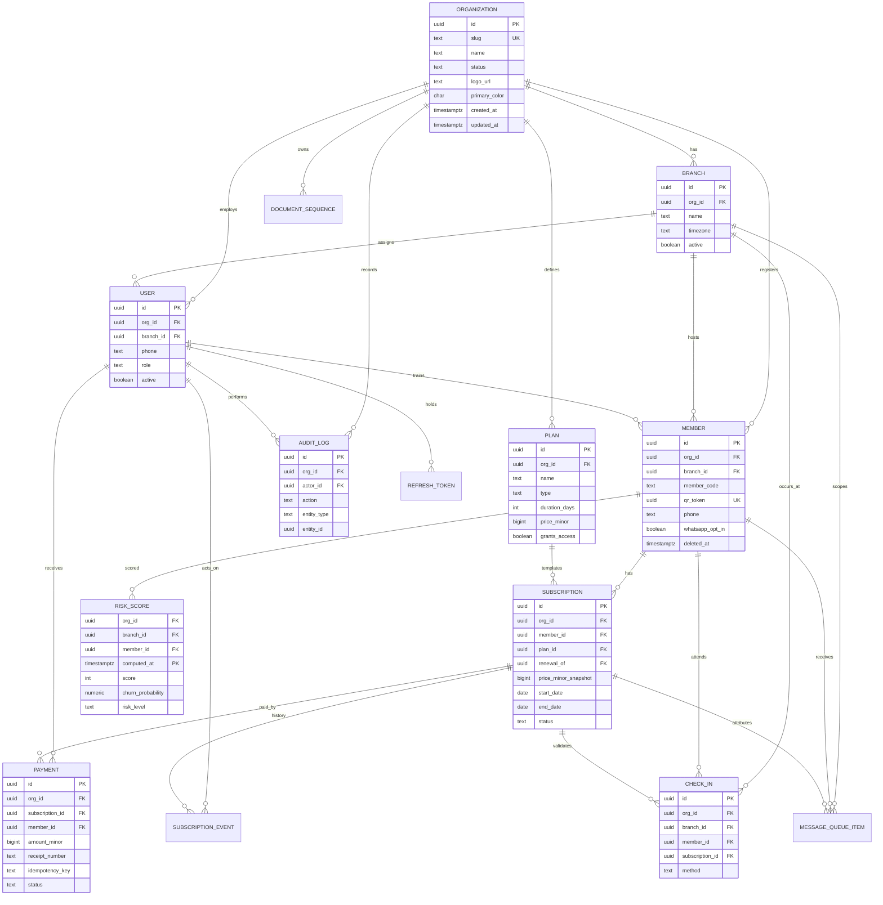

# الكيانات والعلاقات (Entity Relationships & Ownership)

> **المرجع:** [`../../Kammel_Project_Documentation/04_DOMAIN_MODEL.md`](../../Kammel_Project_Documentation/04_DOMAIN_MODEL.md) · [`../../Kammel_Project_Documentation/05_DATABASE_DESIGN.md`](../../Kammel_Project_Documentation/05_DATABASE_DESIGN.md)  
> **الملفات المرتبطة:** [project-structure](./project-structure.md) · [feature-dependencies](./feature-dependencies.md) · [database-strategy](./database-strategy.md) · [decisions-and-assumptions](./decisions-and-assumptions.md)

---

## 1. القواعد الحاكمة

| القاعدة | التفصيل |
|---|---|
| **ملكية واحدة** | كل Entity لها Feature واحدة مالكة. مفيش Entity مشتركة بين ميزتين. |
| **Tenant Isolation** | كل جدول بيزنس فيه `org_id NOT NULL` ما عدا `organizations` (هي المستأجر نفسه). |
| **المراجع بين الـ Features** | `UUID` Reference فقط. ممنوع `@ManyToOne` لكيان تابع لميزة تانية. |
| **الـ FK على مستوى الـ DB** | مسموح ومطلوب للـ Integrity، لكن بدون `ON DELETE CASCADE` على بيانات البيزنس. |
| **الـ Delete** | ممنوع Hard Delete للبيانات المالية والتشغيلية. الأعضاء فقط Soft Delete. |
| **الـ Mutability** | كل كيان له تصنيف واضح: `Mutable` / `State-Machine Only` / `Immutable` / `Append-Only`. |
| **الحسابات المالية** | `BIGINT` بالقروش. ممنوع `NUMERIC` للكسور العشرية أو `DOUBLE`. |
| **الوقت** | `TIMESTAMPTZ` بتوقيت UTC. العرض والحسابات اليومية بـ `Africa/Cairo`. |

---

## 2. الـ ERD العام

> الـ ERD يعرض كيانات الـ MVP. كيانات P1 (`cash_shifts`, `refunds`, `leads`, `member_portal_tokens`, `portal_renewal_requests`) موثقة في نهاية الملف ومش جزء من الـ Schema الأولي.

---

## 3. مصفوفة ملكية الكيانات (Entity Ownership Matrix)

| Entity | Owner Feature | Table | Tenant-Scoped | Mutability | Delete Policy |
|---|---|---|:---:|---|---|
| `Organization` | `tenancy` | `organizations` | ❌ (هي الـ Tenant) | Mutable | Never — `CLOSED` Status |
| `Branch` | `tenancy` | `branches` | ✅ | Mutable | Never — `active = false` |
| `User` | `identity` | `users` | ✅ | Mutable | Never — `active = false` |
| `RefreshToken` | `identity` | `refresh_tokens` | ✅ | Mutable (Revoke) | Purge بعد الانتهاء |
| `Member` | `member` | `members` | ✅ | Mutable | **Soft Delete** (`deleted_at`) |
| `Plan` | `plan` | `plans` | ✅ | Mutable | Never — `active = false` |
| `Subscription` | `subscription` | `subscriptions` | ✅ | **State-Machine Only** | Never |
| `SubscriptionEvent` | `subscription` | `subscription_events` | ✅ | **Immutable** | Never |
| `Payment` | `payment` | `payments` | ✅ | **Limited** (Status فقط) | Never |
| `DocumentSequence` | `payment` | `document_sequences` | ✅ | Mutable (Counter) | Never |
| `CheckIn` | `checkin` | `check_ins` | ✅ | **Immutable** بعد الإنشاء | Never |
| `MessageQueueItem` | `notification` | `message_queue` | ✅ | Mutable (Status فقط) | Never |
| `RiskScore` | `risk` | `risk_scores` | ✅ | **Append-Only** | Purge بعد 24 شهر (اختياري) |
| `AuditLog` | `audit` | `audit_log` | ✅ | **Immutable** | Never |
| `ShedLock` | `shared` | `shedlock` | ❌ | Mutable | Never |
| `CashShift` | `shift` (P1) | `cash_shifts` | ✅ | Immutable بعد الإغلاق | Never |
| `Refund` | `payment` (P1) | `refunds` | ✅ | Immutable | Never |
| `Lead` | `lead` (P1) | `leads` | ✅ | Mutable | Never |
| `MemberPortalToken` | `member-portal` (P1) | `member_portal_tokens` | ✅ | Limited (Use/Revoke) | Purge بعد 30 يوم من الانتهاء |
| `PortalRenewalRequest` | `member-portal` (P1) | `portal_renewal_requests` | ✅ | **Status-Machine Only** | Never |
| `AiModelRegistry` | `ai` (P2) | `ai_model_registry` | ❌ (Global) | Limited (Activate) | Never |

> **قاعدة المراجعة:** أي Entity جديدة لازم تظهر في الجدول ده وفي [database-strategy](./database-strategy.md) قبل كتابة الـ Migration.

---

## 4. كتالوج العلاقات (Relationship Catalog)

| Parent | Child | Cardinality | FK Column | On Delete | ملاحظات |
|---|---|---|---|---|---|
| `organizations` | `branches` | 1:N | `branches.org_id` | `RESTRICT` | Branch ممنوع يتعملها Delete. |
| `organizations` | `users` | 1:N | `users.org_id` | `RESTRICT` | — |
| `branches` | `users` | 1:N | `users.branch_id` | `RESTRICT` | `NULL` للـ `GYM_OWNER` فقط. |
| `organizations` | `members` | 1:N | `members.org_id` | `RESTRICT` | — |
| `branches` | `members` | 1:N | `members.branch_id` | `RESTRICT` | الفرع الأساسي للعضو. |
| `users` | `members` | 1:N | `members.assigned_trainer_id` | `SET NULL` | اختياري — Trainer يشوف عملاءه. |
| `organizations` | `plans` | 1:N | `plans.org_id` | `RESTRICT` | — |
| `members` | `subscriptions` | 1:N | `subscriptions.member_id` | `RESTRICT` | مسموح أكثر من اشتراك. |
| `plans` | `subscriptions` | 1:N | `subscriptions.plan_id` | `RESTRICT` | السعر Snapshot. |
| `subscriptions` | `subscriptions` | 1:N | `subscriptions.renewal_of` | `SET NULL` | التجديد بينشئ سجل جديد (SC-25). |
| `subscriptions` | `subscription_events` | 1:N | `subscription_events.subscription_id` | `RESTRICT` | Append-Only. |
| `users` | `subscription_events` | 1:N | `subscription_events.actor_id` | `SET NULL` | `NULL` لو System. |
| `subscriptions` | `payments` | 1:N | `payments.subscription_id` | `RESTRICT` | Partial Payments مسموحة. |
| `members` | `payments` | 1:N | `payments.member_id` | `RESTRICT` | Denormalized للقراءة. |
| `users` | `payments` | 1:N | `payments.received_by` | `RESTRICT` | الموظف اللي سجل الدفع. |
| `organizations` | `document_sequences` | 1:N | `document_sequences.org_id` | `RESTRICT` | Receipt Numbering. |
| `branches` | `check_ins` | 1:N | `check_ins.branch_id` | `RESTRICT` | — |
| `members` | `check_ins` | 1:N | `check_ins.member_id` | `RESTRICT` | — |
| `subscriptions` | `check_ins` | 1:N | `check_ins.subscription_id` | `SET NULL` | `NULL` لو Override. |
| `users` | `check_ins` | 1:N | `check_ins.overridden_by` | `SET NULL` | — |
| `branches` | `message_queue` | 1:N | `message_queue.branch_id` | `RESTRICT` | لفلترة طابور الفرع. |
| `members` | `message_queue` | 1:N | `message_queue.member_id` | `RESTRICT` | — |
| `users` | `message_queue` | 1:N | `message_queue.sent_by` | `SET NULL` | — |
| `subscriptions` | `message_queue` | 1:N | `message_queue.attributed_subscription_id` | `SET NULL` | Renewal Attribution. |
| `members` | `risk_scores` | 1:N | `risk_scores.member_id` | `RESTRICT` | Composite PK مع `computed_at`. |
| `branches` | `risk_scores` | 1:N | `risk_scores.branch_id` | `RESTRICT` | فلترة الفرع (SC-23). |
| `organizations` | `audit_log` | 1:N | `audit_log.org_id` | `RESTRICT` | — |
| `users` | `audit_log` | 1:N | `audit_log.actor_id` | `SET NULL` | `NULL` لو System Action. |
| `users` | `refresh_tokens` | 1:N | `refresh_tokens.user_id` | `RESTRICT` | Revoke بدل Delete. |
| `members` | `member_portal_tokens` | 1:N | `member_portal_tokens.member_id` | `RESTRICT` | P1 — Magic Link + Refresh. |
| `members` | `portal_renewal_requests` | 1:N | `portal_renewal_requests.member_id` | `RESTRICT` | P1 — طلب تجديد. |
| `subscriptions` | `portal_renewal_requests` | 1:N | `portal_renewal_requests.subscription_id` | `SET NULL` | الاشتراك وقت الطلب. |
| `branches` | `portal_renewal_requests` | 1:N | `portal_renewal_requests.branch_id` | `RESTRICT` | فلترة الفرع. |

### 4.1 قواعد إضافية للعلاقات

1. **ممنوع Cascade Delete** على أي جدول بيزنس — `CASCADE` مسموح فقط على `refresh_tokens` عند حذف المستخدم (ومش هنحذف مستخدم أصلاً).
2. **`subscription_id` في `check_ins` nullable** لأن الـ Override ممكن يحصل بدون اشتراك صالح.
3. **`payments.member_id` Denormalized** وممنوع يختلف عن `subscriptions.member_id` — بيتحقق في الـ Service + Test.
4. **`message_queue.branch_id`** مضاف للفلترة الأمنية (الفرع) ومشتق من `members.branch_id` وقت الإنشاء.
5. **`risk_scores` بدون `id`** — الـ PK مركّب `(member_id, computed_at)`. `org_id` مضاف للـ RLS.

---

## 5. حدود الـ Aggregates (Aggregate Boundaries)

| Aggregate Root | الكيانات الداخلية | حدود الـ Transaction |
|---|---|---|
| `Member` | `Member` فقط | تحديث العضو + Audit في نفس الـ Transaction. |
| `Plan` | `Plan` فقط | إنشاء/تعديل الباقة. |
| `Subscription` | `Subscription` + `SubscriptionEvent` | أي تغيير حالة + Event في **نفس** الـ Transaction. |
| `Payment` | `Payment` + `DocumentSequence` | تسجيل الدفع + استهلاك رقم الإيصال + Audit. |
| `CheckIn` | `CheckIn` + خصم `sessions_remaining` | تسجيل الحضور + خصم الجلسة + Audit. |
| `RiskScore` | `RiskScore` فقط | Batch Job لكل Org. |
| `MessageQueueItem` | `MessageQueueItem` فقط | تغيير الحالة فقط. |
| `AuditLog` | `AuditLog` فقط | Append داخل Transaction الميزة. |

> **مهم:** `Subscription` و`Payment` **مش Aggregate واحدة**. الترابط بينهم عبر `PaymentRecordedEvent` + `SubscriptionQueryService`، مش عبر تعديل مباشر من الـ Payment للـ Subscription Entity.

---

## 6. تصحيحات وتوسعات الـ Schema (Schema Corrections)

الجدول ده هو المرجع لأي اختلاف بين الوثيقة الأصلية والتنفيذ. كل بند مرتبط بـ ID في [requirements-traceability](./requirements-traceability.md) أو [decisions-and-assumptions](./decisions-and-assumptions.md).

| # | الكيان | التصحيح | السبب | المرجع |
|---|---|---|---|---|
| SC-01 | `risk_scores` | إضافة `org_id UUID NOT NULL` | RLS Policy محتاجة العمود | TR-01 / ASM-08 |
| SC-02 | `subscription_events` | إضافة `org_id UUID NOT NULL` | RLS Policy + تقارير الـ Timeline | TR-01 / ASM-08 |
| SC-03 | `payments` | `idempotency_key` Unique على `(org_id, idempotency_key)` مش Global | عزل المستأجرين | TR-02 / C-13 |
| SC-04 | `members` | إضافة `member_code VARCHAR(20) NOT NULL` Unique `(org_id, member_code)` | البحث بالكود في الاستقبال | TR-03 / D-14 |
| SC-05 | `members` | إضافة `qr_token UUID NOT NULL DEFAULT gen_random_uuid()` Unique | QR ثابت للـ Check-in | TR-03 / D-14 |
| SC-06 | `members` | إضافة `assigned_trainer_id UUID NULL` | Trainer يشوف عملاءه فقط | TR-04 / C-17 |
| SC-07 | `members` | إضافة `whatsapp_opt_in_at TIMESTAMPTZ NULL` | إثبات وقت الـ Consent | ASM-22 |
| SC-08 | `subscriptions` | إضافة `frozen_at`, `scheduled_unfreeze_date`, `freeze_reason` | حساب أيام التجميد الفعلية | TR-05 / C-05 |
| SC-09 | `subscriptions` | إضافة `cancelled_at`, `cancel_reason`, `grace_ends_at` | State Machine + Scheduler | C-04 / C-11 |
| SC-10 | `plans` | إضافة `grants_access BOOLEAN NOT NULL DEFAULT true` | التفرقة بين Membership وPT | TR-08 / D-15 |
| SC-11 | `payments` | إضافة `receipt_number VARCHAR(30) NOT NULL` Unique `(org_id, receipt_number)` | الإيصال المتسلسل مطلوب في الـ API | C-18 / ASM-06 |
| SC-12 | `payments` | إضافة `reversed_at`, `reversed_by` | تتبع الـ Reversal بدون حذف | C-16 |
| SC-13 | `message_queue` | إضافة `branch_id UUID NOT NULL` | فلترة الطابور بالفرع | BR-009 |
| SC-14 | `risk_scores` | `score` nullable + إضافة `risk_level VARCHAR(20)` | دعم `INSUFFICIENT_DATA` + فلترة أسرع | ASM-17 |
| SC-15 | `audit_log` | `actor_id` nullable + `actor_type VARCHAR(10)` | System Actions مالهاش User | BR-007 |
| SC-16 | `organizations` | إضافة `slug VARCHAR(50) NOT NULL UNIQUE` | Login يحتاج تحديد الـ Org قبل الـ JWT | C-19 |
| SC-17 | `users` | إضافة `last_login_at`, `failed_login_attempts`, `locked_until` | Account Lockout | ASM-23 |
| SC-18 | `refresh_tokens` | جدول جديد | Refresh Token Rotation | TR-06 / ASM-15 |
| SC-19 | `document_sequences` | جدول جديد | Receipt Numbering الذري | TR-07 / C-18 |
| SC-20 | `payments` | `shift_id` nullable **بدون FK** في الـ MVP | `cash_shifts` مؤجلة P1 | C-02 |
| SC-21 | `users` | إضافة `must_change_password BOOLEAN NOT NULL DEFAULT false` | إجبار تغيير كلمة المرور المؤقتة | ASM-23 |
| SC-22 | `plans` | `price_minor CHECK (> 0)` بدل `>= 0` | BR-002 بيشترط سعر > 0 | BR-002 |
| SC-23 | `risk_scores` | إضافة `branch_id UUID NOT NULL` + Index | فلترة الـ At-Risk بالفرع | BR-009 / RISK-09 |
| SC-24 | `message_queue` | إضافة `opened_at TIMESTAMPTZ` + `GRACE_EXPOSURE` في CHECK | تتبع `OPENED` + قالب فترة السماح | ASM-18 |
| SC-25 | `subscriptions` | إضافة `renewal_of UUID NULL` FK self | ربط التجديد بالاشتراك السابق | C-20 |
| SC-26 | `check_ins` | `method` CHECK يشمل `MEMBER_CODE` | البحث بكود العضو | BR-021 |
| SC-27 | `message_queue` | `wa_me_link TEXT` بدل `VARCHAR(500)` | روابط `wa.me` أطول من 500 | ASM-18 |
| SC-28 | `organizations` | إضافة `logo_url VARCHAR(500)` + `primary_color CHAR(7)` | White-label للـ Member Portal | 0-doc §10 |
| SC-29 | `message_queue` | إضافة `is_transactional BOOLEAN NOT NULL DEFAULT false` + `PORTAL_MAGIC_LINK` في CHECK | Magic Link بيتجاوز Cooldown/Window | MP-05 |
| SC-30 | `risk_scores` | إضافة `churn_probability NUMERIC(5,4) NULL` | P2 — ONNX Model | AI-P2 |

---

## 7. دورة حياة البيانات (Data Lifecycle)

| البيانات | الإنشاء | التعديل | الحذف | مدة الاحتفاظ |
|---|---|---|---|---|
| `organizations` | Provisioning CLI | Owner (Name فقط) / Admin (Status) | Never | دائم |
| `branches` | Owner | Owner | Deactivate | دائم |
| `users` | Owner | Owner / Self (Password) | Deactivate | دائم |
| `refresh_tokens` | Login | Rotation | Revoke + Purge | 7 أيام بعد الانتهاء |
| `members` | Reception/Import | Reception/Manager | Soft Delete | دائم |
| `plans` | Owner | Owner | Deactivate | دائم |
| `subscriptions` | Reception | State Machine | Never | دائم |
| `payments` | Reception | Status فقط (Reversal) | Never | دائم |
| `check_ins` | Reception | Never | Never | 24 شهر على الأقل |
| `message_queue` | Risk/Notification Job | Status فقط | Never | 12 شهر |
| `risk_scores` | Nightly Job | Never | Purge اختياري | 24 شهر |
| `audit_log` | كل Feature | Never | Never | 5 سنوات (مراجعة قانونية) |
| `member_portal_tokens` | Magic Link / Refresh | Use/Revoke | Purge | 30 يوم بعد الانتهاء (P1) |
| `portal_renewal_requests` | العضو | Status فقط | Never | دائم (P1) |
| `ai_model_registry` | تدريب / نشر | Activate | Never | دائم (P2) |

> **ملاحظة قانونية:** مدة الاحتفاظ النهائية تتأكد مع المراجعة القانونية (Law #151/2020) قبل الإطلاق — [Q-07](./decisions-and-assumptions.md#5-الأسئلة-المفتوحة-open-questions).

---

## 8. كيانات P1 (خارج الـ MVP)

| Entity | Feature | Table | العلاقة الأساسية | ملاحظات |
|---|---|---|---|---|
| `CashShift` | `shift` | `cash_shifts` | `branch_id`, `user_id` | وردية مفتوحة واحدة لكل User. |
| `Refund` | `payment` | `refunds` | `payment_id`, `approved_by` | Reverse Entry — ممنوع تعديل الدفع الأصلي. |
| `Lead` | `lead` | `leads` | `branch_id`, `assigned_to` | قمع مبيعات مستقل عن `Member`. |
| `MemberPortalToken` | `member-portal` | `member_portal_tokens` | `member_id` | Magic Link / Refresh — Token Hash فقط، ممنوع Raw. |
| `PortalRenewalRequest` | `member-portal` | `portal_renewal_requests` | `member_id`, `subscription_id`, `branch_id` | طلب تجديد — مش تجديد فعلي. |
| `AiModelRegistry` | `ai` (P2) | `ai_model_registry` | — | Global — يسجل `rules-v1` / `onnx-v1`. |

**FK المؤجلة:** `payments.shift_id` هيتم إضافة الـ FK بتاعها في Migration خاصة بـ P1 بعد إنشاء `cash_shifts`.

---

## 9. قواعد المراجعة قبل إضافة أي كيان

- [ ] الكيان له Feature مالكة واضحة.
- [ ] الجدول فيه `org_id` لو Tenant-owned.
- [ ] الـ RLS helper اتندست في نفس الـ Migration.
- [ ] الـ Indexes الأساسية موجودة وتبدأ بـ `org_id`.
- [ ] مفيش `ON DELETE CASCADE` على بيانات بيزنس.
- [ ] الـ Mutability مصنفة (Mutable / State-Machine / Immutable).
- [ ] الـ Audit مطلوب ولا لأ محدد.
- [ ] الكيان مضاف لجدول الملكية فوق ولـ [database-strategy](./database-strategy.md).
