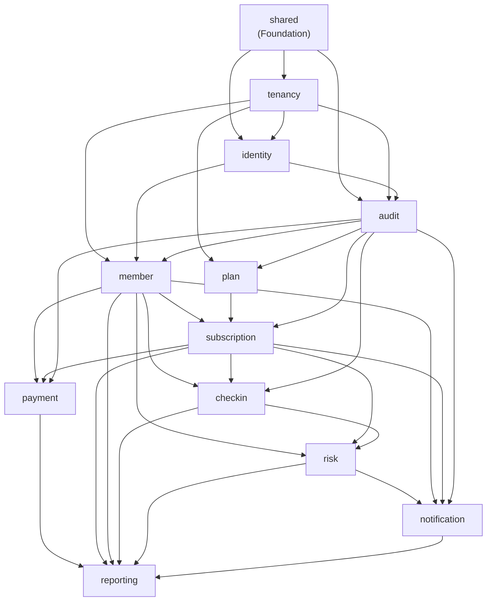
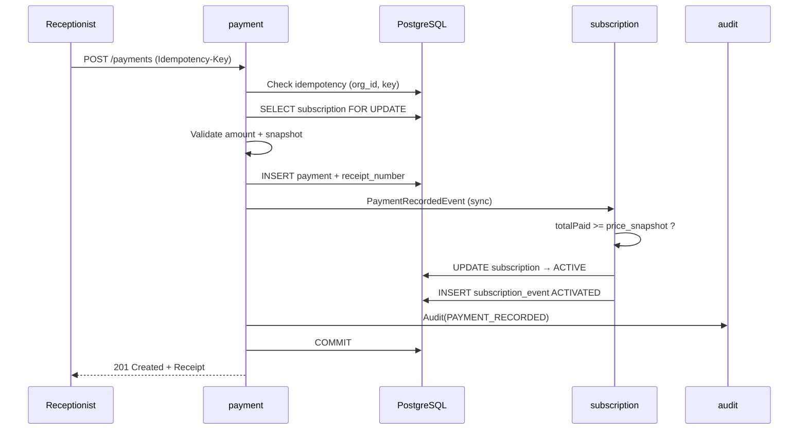
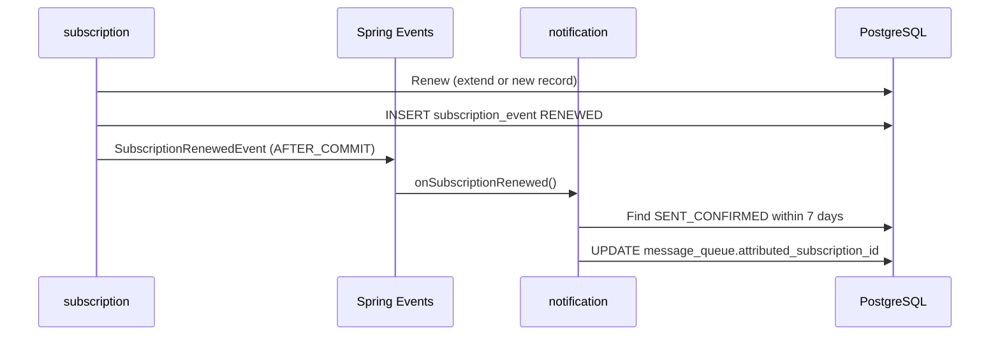
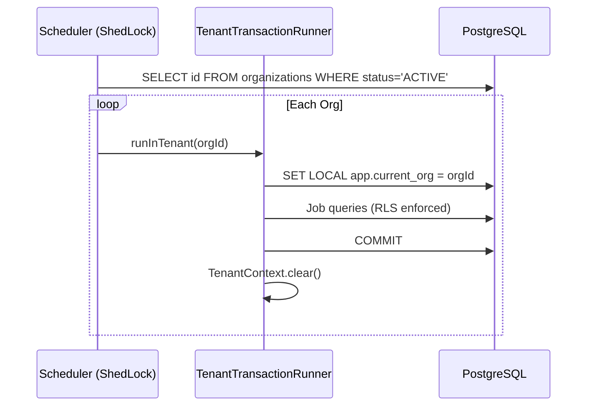

# اعتماديات الـ Features (Feature Dependencies & Build Order)

> **الهدف:** تحديد مين بيعتمد على مين، وإيه الـ Contracts بين الـ Features، وبأي ترتيب هنبني — عشان مفيش Circular Dependencies ومفيش Feature تتبني على أرض غير جاهزة.  
> **الملفات المرتبطة:** [project-structure](./project-structure.md) · [entity-relationships](./entity-relationships.md) · [implementation-phases](../development-roadmap/implementation-phases.md) · [integration-roadmap](../development-roadmap/integration-roadmap.md)

---

## 1. أنواع الاعتماديات

| النوع | الرمز | المعنى | مثال |
|---|:---:|---|---|
| **Compile Dependency** | 🟩 | Feature بتستدعي `Service Interface` بتاعة Feature تانية مباشرة. | `payment` → `SubscriptionQueryService` |
| **Event Dependency** | 🟦 | Feature بتسمع Integration Event من `shared/contracts/events`. | `subscription` تسمع `PaymentRecordedEvent` |
| **Read Contract** | 🟨 | Feature بتقرأ DTO/Projection من `QueryService` بدون تعديل. | `reporting` → `PaymentQueryService` |
| **No Dependency** | ⬜ | مفيش أي اتصال مباشر. | `plan` → `notification` |

### قواعد صارمة
1. **ممنوع** Feature تستدعي `Repository` بتاعة Feature تانية.
2. **ممنوع** حقن Entity من Feature تانية.
3. **ممنوع** Cycle — حتى لو عن طريق Events (الـ Event Graph لازم يكون DAG).
4. **مسموح** Feature تستدعي `{Feature}QueryService` أو `{Feature}Service` — بس الـ Interface يكون في `application/`.
5. **الأحداث** اللي بتعبر الحدود تتسجل في `shared/contracts/events` — مش في Feature.

---

## 2. مصفوفة الاعتماديات (Dependency Matrix)

> الصف = الـ Feature اللي **بتعتمد**. العمود = الـ Feature اللي **بتُعتمد عليها**.

| ↓ Depends on →   | tenancy | identity | audit | member | plan | subscription | payment | checkin | risk | notification | reporting |
| ---------------- | :-----: | :------: | :---: | :----: | :--: | :----------: | :-----: | :-----: | :--: | :----------: | :-------: |
| **tenancy**      |    —    |    ⬜     |   ⬜   |   ⬜    |  ⬜   |      ⬜       |    ⬜    |    ⬜    |  ⬜   |      ⬜       |     ⬜     |
| **identity**     |   🟩    |    —     |  🟩   |   ⬜    |  ⬜   |      ⬜       |    ⬜    |    ⬜    |  ⬜   |      ⬜       |     ⬜     |
| **audit**        |   🟩    |    ⬜     |   —   |   ⬜    |  ⬜   |      ⬜       |    ⬜    |    ⬜    |  ⬜   |      ⬜       |     ⬜     |
| **member**       |   🟩    |    🟩    |  🟩   |   —    |  ⬜   |      ⬜       |    ⬜    |    ⬜    |  ⬜   |      ⬜       |     ⬜     |
| **plan**         |   🟩    |    ⬜     |  🟩   |   ⬜    |  —   |      ⬜       |    ⬜    |    ⬜    |  ⬜   |      ⬜       |     ⬜     |
| **subscription** |   🟩    |    🟩    |  🟩   |   🟩   |  🟩  |      —       |    ⬜    |    ⬜    |  ⬜   |      ⬜       |     ⬜     |
| **payment**      |   🟩    |    🟩    |  🟩   |   🟨   |  🟨  |      🟩      |    —    |    ⬜    |  ⬜   |      ⬜       |     ⬜     |
| **checkin**      |   🟩    |    🟩    |  🟩   |   🟩   |  ⬜   |      🟩      |    ⬜    |    —    |  ⬜   |      ⬜       |     ⬜     |
| **risk**         |   🟩    |    ⬜     |   ⬜   |   🟨   |  ⬜   |      🟨      |    ⬜    |   🟨    |  —   |      ⬜       |     ⬜     |
| **notification** |   🟩    |    🟩    |  🟩   |   🟨   |  ⬜   |      🟨      |    ⬜    |    ⬜    |  🟩  |      —       |     ⬜     |
| **reporting**    |   🟩    |    ⬜     |  🟨   |   🟨   |  🟨  |      🟨      |   🟨    |   🟨    |  🟨  |      🟨      |     —     |

### ملاحظات على المصفوفة

- **`identity → audit`** و**`member → audit`** و**`plan → audit`** و**`subscription → audit`** و**`payment → audit`**: استدعاء `AuditService.record(...)` — Compile Dependency على الـ Interface فقط.
- **`payment → member`**: `MemberQueryService` للتأكد من وجود العضو وحالته. مش تعديل.
- **`payment → subscription`**: `SubscriptionQueryService` للتحقق من الملكية والـ Snapshot + `SubscriptionService.activateIfFullyPaid(...)` أو Event.
- **`checkin → subscription`**: `SubscriptionService.consumeSession(...)` و`SubscriptionQueryService.findAccessSubscription(...)`.
- **`risk → checkin`**: `CheckInQueryService` — قراءة فقط.
- **`notification → risk`**: `RiskQueryService` — قراءة أحدث Score + Draft Message.
- **`reporting → *`**: كله Read Contracts. **مفيش Feature تعتمد على reporting**.
- **`audit → tenancy`**: للتحقق من `org_id` في الـ Query API فقط؛ الـ Core مابيعتمدش على حد.

---

## 3. الـ Dependency Graph



> **تحقق آلي:** `ApplicationModules.of(KammelApplication.class).verify()` في CI بيمنع أي Cycle أو Dependency غير معلنة.

---

## 4. الترتيب التنفيذي المعتمد (Canonical Build Order)

| # | Feature | Phase | ليه بالترتيب ده؟ | Preconditions |
|:---:|---|:---:|---|---|
| 0 | `shared` | 1 | كل حاجة بتعتمد عليه. | — |
| 1 | `tenancy` | 1 | `Organization` + `Branch` أساس كل `org_id`. | Shared جاهز |
| 2 | `identity` | 1 | الـ `User` والـ JWT لازمين لكل Endpoint. | `tenancy` |
| 3 | `audit` | 1 (Core) | كل عملية حساسة بعد كده لازم تتسجل. | `identity` |
| 4 | `member` | 2 | الـ `Member` أساس الاشتراك والدفع والحضور. | `tenancy`, `identity`, `audit` |
| 5 | `plan` | 2 | الـ `Plan` أساس الـ `Subscription`. | `tenancy`, `audit` |
| 6 | `subscription` | 2 | قلب النظام — State Machine. | `member`, `plan`, `audit` |
| 7 | `payment` | 2 | بيكمل الاشتراك ويولد الإيصال. | `subscription`, `member`, `audit` |
| 8 | `checkin` | 3 | محتاج اشتراك نشط + خصم جلسات. | `subscription`, `member`, `audit` |
| 9 | `risk` | 3 | محتاج بيانات حضور + اشتراك. | `checkin`, `subscription`, `member` |
| 10 | `notification` | 3 | محتاج Risk + Member + Attribution. | `risk`, `subscription`, `member` |
| 11 | `reporting` | 3 | بيقرأ من كل حاجة — آخر واحد. | الكل |

> **ملاحظة:** ترتيب الـ Features في [README](../README.md#4-الـ-features-ونطاقها) اتوحد مع الجدول ده — **الترتيب الملزم هو الجدول ده** لو حصل أي اختلاف.

### 4.1 ترتيب P1 (بعد نجاح الـ Pilot)

| # | Feature | يعتمد على | ملاحظة |
|:---:|---|---|---|
| 12 | `shift` | `payment`, `identity`, `tenancy`, `audit` | `payments.shift_id` موجود من P0. |
| 13 | `lead` | `member`, `tenancy`, `audit` | Public Form بدون Login. |
| 14 | `member-portal` | `member`, `subscription`, `payment`, `checkin`, `notification`, `tenancy`, `identity`, `audit` | Read + Renewal Request فقط. |

**قواعد P1:**

- `member-portal` ممنوع تعدل أي Domain — `PortalRenewalRequest` هو الكيان الوحيد.
- `shift` ممنوع يغيّر `Payment` — بس بيقرأ Cash Totals.
- `lead` ممنوع يكتب في `members` مباشرة — بيستخدم `MemberService.create`.
- مفيش Feature P0 بتعتمد على P1.

---

## 5. الـ Integration Contracts

### 5.1 الأحداث (Events)

| Event | Publisher | Listeners | التوقيت | الـ Payload |
|---|---|---|---|---|
| `PaymentRecordedEvent` | `payment` | `subscription` | **Synchronous** داخل الـ Transaction | `paymentId`, `orgId`, `subscriptionId`, `memberId`, `amountMinor`, `totalPaidMinor`, `method`, `occurredAt` |
| `SubscriptionActivatedEvent` | `subscription` | `risk`, `reporting` (اختياري), `notification` | بعد الـ Commit | `subscriptionId`, `orgId`, `memberId`, `planId`, `startDate`, `endDate`, `occurredAt` |
| `SubscriptionRenewedEvent` | `subscription` | `notification` | بعد الـ Commit | `oldSubscriptionId`, `newSubscriptionId`, `orgId`, `memberId`, `renewalDate`, `occurredAt` |
| `SubscriptionExpiredEvent` | `subscription` | `risk`, `member` | بعد الـ Commit | `subscriptionId`, `orgId`, `memberId`, `expiredAt`, `occurredAt` |
| `MemberAccessChangedEvent` | `subscription` | `member` | بعد الـ Commit | `memberId`, `orgId`, `hasActiveMembership`, `occurredAt` |
| `MemberStatusChangedEvent` | `member` | `reporting` | بعد الـ Commit | `memberId`, `orgId`, `fromStatus`, `toStatus`, `occurredAt` |
| `MessageSentEvent` | `notification` | `reporting` | بعد الـ Commit | `messageId`, `orgId`, `memberId`, `template`, `sentAt` |

> **توقيت `SubscriptionRenewedEvent`:** بيتنشر بعد **تفعيل** الاشتراك الجديد (أو بعد الدفعة اللي بتفعله)، مش بعد إنشاء سجل `PENDING_PAYMENT`. كده الـ Attribution بيربط بتجديد حقيقي مدفوع.

#### قواعد الأحداث
```java
public record PaymentRecordedEvent(
    UUID paymentId,
    UUID orgId,
    UUID subscriptionId,
    UUID memberId,
    long amountMinor,
    long totalPaidMinor,
    PaymentMethod method,
    Instant occurredAt
) {}
```

1. **Records Immutable** — ممنوع Entity أو DTO متغير جوه الـ Event.
2. **كل Event فيه `orgId` + `occurredAt`** — عشان الـ Listener يقدر يضبط الـ Tenant Context.
3. **ممنوع Event يحمل PII** (Phone/Name) — الـ Listener يسأل الـ QueryService.
4. **الأحداث الحرجة Synchronous** — `PaymentRecordedEvent` لازم يخلص قبل الـ Commit عشان تفعيل الاشتراك يبقى Atomic.
5. **Side Effects Asynchronous** — Attribution / Reporting / Notifications بعد الـ Commit عبر `@TransactionalEventListener(phase = AFTER_COMMIT)`.
6. **At-Least-Once** — كل Listener لازم يكون **Idempotent** (يتحقق من الحالة قبل التطبيق).

### 5.2 الـ Query Services (Read Contracts)

| Contract | Owner | Method | المستخدم |
|---|---|---|---|
| `OrganizationQueryService` | `tenancy` | `getOrg(UUID)`, `findBySlug(String)`, `listActiveOrgIds()` | `identity`, `reporting`, Jobs |
| `BranchQueryService` | `tenancy` | `getBranch(UUID)`, `validateBranchInOrg(UUID, UUID)` | `identity`, `member`, `checkin` |
| `UserQueryService` | `identity` | `getUser(UUID)`, `existsActiveUser(UUID)` | `audit`, `member` |
| `MemberQueryService` | `member` | `getMember(UUID)`, `findByPhone(UUID, String)`, `isActive(UUID)` | `subscription`, `payment`, `checkin`, `risk`, `notification` |
| `PlanQueryService` | `plan` | `getPlan(UUID)`, `getActivePlan(UUID)` | `subscription` |
| `SubscriptionQueryService` | `subscription` | `getSubscription(UUID)`, `findAccessSubscription(UUID)`, `getPriceSnapshot(UUID)`, `countDelayedActivations(UUID)` | `payment`, `checkin`, `risk`, `notification`, `reporting` |
| `CheckInQueryService` | `checkin` | `getLastVisit(UUID)`, `countVisits(UUID, Range)`, `hasCheckedInToday(UUID)` | `risk`, `reporting` |
| `RiskQueryService` | `risk` | `getLatestScore(UUID)`, `listAtRisk(Filter)` | `notification`, `reporting` |
| `PaymentQueryService` | `payment` | `getPaidTotal(UUID)`, `listCollections(UUID)` | `subscription`, `reporting` |
| `NotificationQueryService` | `notification` | `findRecentSent(UUID, Template, Days)`, `getAttributionStats(...)` | `reporting` |

> **قاعدة:** أي QueryService بيرجع **DTO/Projection** — ممنوع يرجع Entity.

### 5.3 الـ Command Contracts

| Contract | Owner | Method | المستخدم | ملاحظة |
|---|---|---|---|---|
| `SubscriptionService.create(...)` | `subscription` | إنشاء اشتراك `PENDING_PAYMENT` | `payment` (اختياري) | — |
| `SubscriptionService.activateIfFullyPaid(...)` | `subscription` | تفعيل بعد الدفع | `payment` / Event Listener | Idempotent |
| `SubscriptionService.consumeSession(...)` | `subscription` | خصم جلسة | `checkin` | Throw `NoSessionsRemainingException` |
| `AuditService.record(...)` | `audit` | تسجيل عملية | كل الـ Features | Non-blocking? لا — نفس الـ Transaction |
| `DocumentNumberService.next(...)` | `payment` | رقم إيصال متسلسل | `payment` فقط | Row Lock |

---

## 6. تدفقات التكامل الحرجة (Critical Flows)

### 6.1 Payment → Subscription Activation



**فشل جزئي:** لو `subscription` رفض التفعيل، الـ Transaction كلها Rollback — مفيش Payment بدون أثر.

### 6.2 Subscription Renewal → Notification Attribution



### 6.3 Nightly Jobs → Tenant Scope



**قاعدة:** أي Job بيلف على أكتر من Org **لازم** يستخدم `TenantTransactionRunner`. ممنوع `@Transactional` واحد لكل الـ Orgs.

---

## 7. الاعتماديات الممنوعة (Forbidden Dependencies)

| من | إلى | ليه ممنوع | البديل |
|---|---|---|---|
| `plan` | `subscription` | الباقة متعرفش مين اشترك. | `subscription` تسأل `PlanQueryService`. |
| `subscription` | `payment` | الـ Subscription مالهاش حق تعدل الدفع. | Events + `PaymentQueryService`. |
| `member` | `subscription` | العضو مش مسؤول عن دورة الاشتراك. | `subscription` تسأل `MemberQueryService`. |
| `checkin` | `payment` | الحضور مش محتاج فلوس. | — |
| `notification` | `payment` | الرسائل مش بتقرأ مدفوعات. | Attribution عبر `SubscriptionRenewedEvent`. |
| `audit` | أي Feature | الـ Audit Core مايعرفش Features. | Features تبعت `AuditService.record(...)`. |
| `reporting` | أي Feature Command | التقارير Read-Only. | Query Services فقط. |
| `member-portal` | `member` (Write) | العضو مبيعدلش بياناته في P1. | `MemberQueryService` فقط. |
| `member-portal` | `subscription` (Write) | طلب التجديد مش تجديد. | `PortalRenewalRequest` + Staff Flow. |
| أي Feature | `shared/contracts/events` Publisher | ممنوع Feature تنشر Event ملك ميزة تانية. | الـ Owner هي اللي تنشره. |
| `shared` | أي Feature | الـ Shared ميعرفش Features. | Interface في الـ Feature، استخدام من بره. |

---

## 8. إزاي تضيف اعتمادية جديدة؟

1. ارسمها في المصفوفة والـ Graph.
2. تأكد إنها مش بتعمل Cycle — شغّل `ArchitectureBoundaryTests`.
3. حدد النوع (Compile / Event / Read Contract).
4. لو Compile → ضيف `{Feature}QueryService` أو `{Feature}Service` Interface.
5. لو Event → ضيف Record في `shared/contracts/events` + Publisher + Listener Idempotent.
6. حدّث [integration-roadmap](../development-roadmap/integration-roadmap.md) و[master-checklist](../development-roadmap/master-checklist.md).
7. اكتب Integration Test يثبت العقد.

---

## 9. أخطاء شائعة

| الخطأ | النتيجة | الصح |
|---|---|---|
| `@Autowired SubscriptionRepository` في `checkin` | كسر الحدود + RLS Bypass محتمل | `SubscriptionService` |
| `@ManyToOne Member` في `Subscription` | Lazy Loading + Coupling | `UUID memberId` |
| Listener بيعدل Entity مباشرة بدون Idempotency | تكرار التفعيل/الرسائل | تحقق من الحالة أولاً |
| `@Transactional` على Job بيلف كل الـ Orgs | RLS Context غلط | `TenantTransactionRunner` |
| Event فيه `Member` Entity | Serialization + PII | `memberId` فقط |
| Reporting بتستخدم Repository مباشرة | كسر Read Contract | QueryService |
