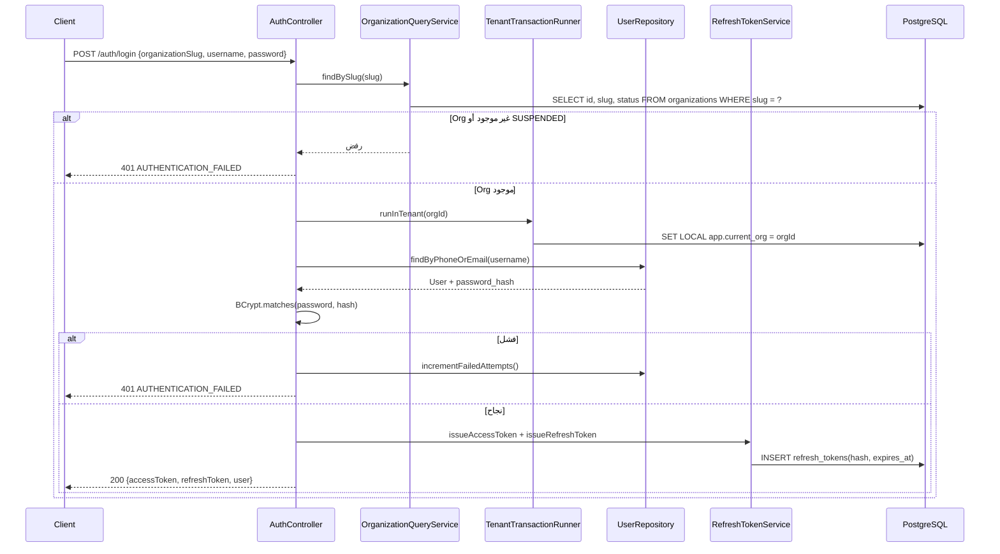

# استراتيجية الأمان (Security Strategy)

> **المرجع:** [`../../Kammel_Project_Documentation/06_SECURITY_AND_MULTI_TENANCY.md`](../../Kammel_Project_Documentation/06_SECURITY_AND_MULTI_TENANCY.md)  
> **الملفات المرتبطة:** [shared-foundation](./shared-foundation.md) · [database-strategy](./database-strategy.md) · [decisions-and-assumptions](./decisions-and-assumptions.md) · [testing-strategy](../testing-strategy.md)

---

## 1. المبادئ

1. **Defense in Depth** — 4 طبقات: Transport → Application → Database → Tests.
2. **Least Privilege** — كل Role أقل صلاحية ممكنة، والـ DB Role مش Superuser.
3. **Fail Closed** — لو الـ Context ناقص، مفيش بيانات ترجع.
4. **Zero Trust in Input** — `orgId` ممنوع ييجي من الـ Request Body.
5. **Auditability** — كل عملية حساسة لها أثر غير قابل للتعديل.
6. **No PII in Logs** — الـ Logs فيها IDs مش أرقام موبايل أو أسماء.
7. **Secure by Default** — الـ Endpoints مقفولة إلا اللي عليها `permitAll` صريح.

---

## 2. Threat Model (STRIDE)

| التهديد | السيناريو | الطبقة | Mitigation |
|---|---|---|---|
| **Spoofing** | سرقة JWT وإعادة استخدامه | Auth | Access TTL 15 دقيقة + Refresh Rotation + Revocation |
| **Tampering** | تعديل `orgId` في Body | API | الـ DTOs مفيهاش `orgId`؛ الـ TenantContext فقط |
| **Repudiation** | موظف ينكر إنه عمل Freeze/Refund | Audit | `audit_log` Immutable بـ `actor_id` + IP |
| **Information Disclosure** | Gym A يقرأ عضو عند Gym B | DB | RLS + 404 بدل 403 |
| **Denial of Service** | محاولات Login متكررة / رفع ملف ضخم | App | Rate Limit + Lockout + File Size Limit |
| **Elevation of Privilege** | Receptionist يعمل Refund | App | `@PreAuthorize` + Branch Scope + Tests |
| **Tenant Leakage** | Query من غير `WHERE org_id` | DB | RLS إجباري + Isolation Suite |
| **SQL Injection** | `search` فيه `' OR 1=1` | DB | Parameter Binding فقط |
| **File Upload Attack** | Excel فيه Macro / Zip Bomb | App | `.xlsx` فقط + POI بدون Formula + Size/Row Limit |
| **Secret Leakage** | `JWT_SECRET` في Git | Ops | Environment Variables + Secret Scanning |

---

## 3. المصادقة (Authentication)

### 3.1 تدفق الـ Login



**ليه `organizationSlug`؟** لأن `(org_id, phone)` مش Global Unique. الـ Slug بيحدد الـ Tenant قبل أي Query، وده أأمن وأوضح من تخمين الـ Org ([C-19](./decisions-and-assumptions.md#2-التعارضات-اللي-تم-حلها-resolved-conflicts) / [ASM-26](./decisions-and-assumptions.md#asm-26)).

### 3.2 كلمة المرور

| القاعدة | القيمة |
|---|---|
| Hashing | `BCryptPasswordEncoder` — Strength 12 (أو Argon2id) |
| الطول | 8–72 حرف |
| التعقيد | Uppercase + Lowercase + Digit + Special |
| Lockout | 5 محاولات فاشلة → قفل 15 دقيقة |
| Rate Limit | 5 محاولات/دقيقة لكل IP + لكل Account |
| Password Reset | الـ Owner بيعمل Reset للـ Staff — مفيش Email Flow في MVP |
| تغيير كلمة المرور | يلغي كل الـ Refresh Tokens للمستخدم |

### 3.3 الـ JWT

```json
{
  "sub": "b2c3d4e5-f6a7-4b8c-9d0e-1f2a3b4c5d6e",
  "org_id": "a1b2c3d4-e5f6-4a5b-8c9d-0e1f2a3b4c5d",
  "branch_id": null,
  "role": "GYM_OWNER",
  "name": "Ali Hassan",
  "jti": "9f8e7d6c-5b4a-3210-fedc-ba9876543210",
  "iat": 1730635200,
  "exp": 1730636100
}
```

| العنصر | القيمة |
|---|---|
| Algorithm | `HS256` في MVP (RS256 لو أكثر من Service) |
| Access TTL | 15 دقيقة |
| Refresh TTL | 7 أيام |
| Claims الإلزامية | `sub`, `org_id`, `branch_id`, `role`, `jti`, `iat`, `exp` |
| Secret | `JWT_SECRET` من Environment — 256-bit عشوائي على الأقل |
| Rotation | Secret Rotation كل 90 يوم مع دعم مفتاحين (kid) |
| Clock Skew | 30 ثانية |

> **ممنوع** تحط `orgId` أو `role` في الـ Request Body. الـ `JwtAuthenticationFilter` هو المصدر الوحيد.

### 3.4 Refresh Token

**الصيغة:** `v1.{orgId}.{random-256-bit}`

- الـ `orgId` ظاهر عشان نقدر نضبط الـ Tenant Context قبل الـ Query.
- الـ `random` **مش بيتخزن** — بيتخزن `SHA-256(random)` فقط في `refresh_tokens.token_hash`.
- **Rotation:** كل Refresh بيصدر Access + Refresh جديدين، والقديم `revoked_at = now()` و`replaced_by = newId`.
- **Reuse Detection:** لو Token ملغي اتستخدم تاني → إلغاء كل عائلة الـ Tokens للمستخدم + Audit `REFRESH_TOKEN_REUSE`.
- **Logout:** `revoked_at = now()` للـ Token الحالي.
- **Password Change:** إلغاء كل Tokens المستخدم.

```text
POST /auth/refresh { "refreshToken": "v1.<orgId>.<random>" }
  → Parse orgId → runInTenant(orgId) → hash random → lookup
  → لو revoked/expired → 401
  → rotate → 200
```

### 3.5 إلغاء الـ Access Tokens

- Access Tokens مش بتتخزن، فمفيش Denylist في الـ MVP (بدون Redis).
- أقصى نافذة خطر = 15 دقيقة.
- عند تعطيل مستخدم: الـ Refresh Tokens تتلغي فوراً، والـ Access Token بيموت خلال 15 دقيقة.
- **P1:** `jti` Denylist في Redis لو احتجنا إلغاء فوري.

### 3.6 Member Portal Authentication (P1)

البوابة **مش** جزء من RBAC الموظفين — لها مسار مصادقة منفصل تمامًا.

| العنصر | القرار |
|---|---|
| الدخول | Magic Link على WhatsApp — مفيش كلمة مرور |
| الرابط | `mpk1.{orgId}.{random-256-bit}` — صالح 15 دقيقة، Single-use |
| التخزين | `SHA-256(random)` فقط |
| Access | 15 دقيقة — `scope = MEMBER` |
| Refresh | 30 يوم — Rotation + Reuse Detection |
| Claims | `sub`, `org_id`, `member_id`, `scope`, `jti`, `iat`, `exp` |
| Role | **مفيش** |
| Logout | إلغاء Refresh Chain — الـ Access بيموت خلال 15 دقيقة |

**قواعد إلزامية:**

1. الـ Staff Filter **يرفض** أي Token فيه `scope = MEMBER`.
2. الـ Portal Filter **يرفض** أي Token مفيهوش `scope = MEMBER`.
3. `memberId` بيتاخد من الـ JWT فقط — ممنوع من Path/Body.
4. `app.current_member` GUC + Restrictive RLS على `members` / `subscriptions` / `payments` / `check_ins`.
5. `POST /portal/auth/request-link` بيرجع `202` دايماً — ممنوع Enumeration.
6. Rate Limit: 3 / 15 دقيقة لكل رقم، 10 / ساعة لكل IP.
7. ممنوع تسجيل الـ Token أو الرابط في الـ Logs.
8. Org `SUSPENDED/CLOSED` أو Member غير نشط → رفض + إلغاء الجلسات.

---

## 4. الصلاحيات (Authorization)

### 4.1 الأدوار في الـ MVP

| Role | النطاق | ملاحظات |
|---|---|---|
| `GYM_OWNER` | كل الفروع داخل الـ Org | `branch_id = NULL` |
| `BRANCH_MANAGER` | فرع واحد | `branch_id NOT NULL` |
| `RECEPTIONIST` | فرع واحد | `branch_id NOT NULL` |
| `TRAINER` | فرع واحد + عملاؤه فقط | `branch_id NOT NULL` + `assigned_trainer_id` |

> **`PLATFORM_ADMIN` مش موجود في الـ MVP** — Provisioning بـ CLI ([C-06](./decisions-and-assumptions.md#2-التعارضات-اللي-تم-حلها-resolved-conflicts)).

### 4.2 مصفوفة القدرات

| القدرة | Owner | Branch Manager | Receptionist | Trainer |
|---|:---:|:---:|:---:|:---:|
| إدارة الفروع | ✅ | ❌ | ❌ | ❌ |
| إدارة الباقات | ✅ | ❌ | ❌ | ❌ |
| إدارة الموظفين | ✅ | ❌ | ❌ | ❌ |
| تسجيل/تعديل الأعضاء | ✅ | ✅ (فرعه) | ✅ (فرعه) | ❌ |
| تسجيل الدفع | ✅ | ✅ (فرعه) | ✅ (فرعه) | ❌ |
| عرض الإيرادات | ✅ (كل الفروع) | ⚠️ فرعه فقط (Collections/Cash) | ❌ | ❌ |
| تجميد/إلغاء اشتراك | ✅ | ✅ (فرعه) | ❌ | ❌ |
| Check-in / Override | ✅ | ✅ (فرعه) | ✅ (فرعه) | ❌ |
| عرض عملاء Trainer | ✅ | ✅ (فرعه) | ✅ (فرعه) | ✅ (عملاؤه فقط) |
| إرسال رسائل WhatsApp | ✅ | ✅ (فرعه) | ✅ (فرعه) | ❌ |
| عرض Audit Log | ✅ | ❌ | ❌ | ❌ |
| Refund (P1) | ✅ | ✅ (فرعه) | ❌ | ❌ |
| Member Portal Queue (P1) | ✅ | ✅ (فرعه) | ✅ (فرعه) | ❌ |

> **⚠️ Manager Financial:** يشوف Collections وCash لفرعه فقط، مش Org Revenue ([C-14](./decisions-and-assumptions.md#2-التعارضات-اللي-تم-حلها-resolved-conflicts)).

### 4.3 التنفيذ

```java
@PreAuthorize("hasRole('GYM_OWNER')")
PlanResponse createPlan(CreatePlanRequest request);

@PreAuthorize("hasAnyRole('GYM_OWNER','BRANCH_MANAGER','RECEPTIONIST')")
MemberResponse registerMember(CreateMemberRequest request);

@PreAuthorize("hasRole('GYM_OWNER') or (hasRole('BRANCH_MANAGER') and @branchSecurity.canAccessBranch(#branchId))")
BranchDashboardResponse getBranchMetrics(UUID branchId);

@PreAuthorize("hasAnyRole('GYM_OWNER','BRANCH_MANAGER')")
SubscriptionResponse freeze(UUID subscriptionId, FreezeSubscriptionRequest request);
```

### 4.4 Branch Scoping

```java
@Component("branchSecurity")
public class BranchSecurityExpressionMethods {

    public boolean canAccessBranch(UUID targetBranchId) {
        UserPrincipal p = SecurityUtils.getCurrentUser();
        if (p.getRole() == Role.GYM_OWNER) return true;
        return p.getBranchId() != null && p.getBranchId().equals(targetBranchId);
    }
}
```

**قواعد:**
- الـ Branch Scope بيتحقق في **الـ Service Layer** كمان، مش في الـ Controller بس.
- أي Query على `members`, `check_ins`, `payments`, `message_queue` لازم تتفلتر بالـ Branch لو المستخدم مش Owner.
- `BranchSecurity` هو الـ Source of Truth — ممنوع تكرار المنطق.

### 4.5 Trainer Scoping

- `TRAINER` يشوف بس الأعضاء اللي `assigned_trainer_id = currentUserId`.
- ممنوع يشوف أي بيانات مالية (`payments`, `subscriptions` prices, dashboard revenue).
- `GET /members` بتضيف فلتر تلقائي للـ Trainer.
- `GET /members/{id}` لغير عميله → **404** مش 403.

### 4.6 Member Portal Authorization (P1)

- الـ Portal **مش** Role — هو Scope منفصل (`SCOPE_MEMBER`).
- كل Endpoint تحت `/api/v1/portal/**` بيتطلب `SCOPE_MEMBER` ما عدا الـ Public Auth.
- Trainers/Staff مالهمش أي وصول لـ `/portal/**`.
- العضو مالوش أي وصول لـ `/api/v1/**` العادية.
- Admin Queue (`/portal/admin/**`) بيتطلب Role موظف + Branch Scope — **مش** `SCOPE_MEMBER`.
- أي محاولة وصول متقاطع → `401` أو `403` — ومش بنكشف وجود المورد.

---

## 5. عزل المستأجرين (Tenant Isolation)

### 5.1 الطبقات الأربع

| الطبقة | الآلية | لو فشلت |
|---|---|---|
| **1. Transport** | JWT Claims + `organizationSlug` Login | 401 |
| **2. Application** | `TenantContext` + `@PreAuthorize` + Service Checks | 403/404 |
| **3. Database** | RLS + `SET LOCAL app.current_org` + Non-Superuser Role | صفر صفوف |
| **4. Tests** | Isolation Suite على كل PR | Build Fails |

### 5.2 قواعد الـ Tenant Context

```java
public final class TenantContext {
    private static final ThreadLocal<UUID> ORG = new ThreadLocal<>();
    private static final ThreadLocal<UUID> BRANCH = new ThreadLocal<>();
    private static final ThreadLocal<UUID> USER = new ThreadLocal<>();
    private static final ThreadLocal<Role> ROLE = new ThreadLocal<>();

    // set / get / clear
}
```

1. الـ `JwtAuthenticationFilter` بيضبطه من الـ Claims.
2. `TenantContextCleanupFilter` بينادي `clear()` في `finally`.
3. `TenantAwareJpaTransactionManager` بينفذ `SET LOCAL` عند بداية كل Transaction.
4. ممنوع `@Async` بدون نقل صريح للـ Context.
5. `SecurityUtils.getCurrentOrgId()` بترمي Exception لو مفيش Context — مش ترجع `null`.

### 5.3 الـ Background Jobs

```java
@Scheduled(cron = "0 0 2 * * *", zone = "Africa/Cairo")
@SchedulerLock(name = "processExpirations", lockAtMostFor = "30m")
public void executeDailyExpirations() {
    for (UUID orgId : organizationQueryService.listActiveOrgIds()) {
        try {
            tenantTransactionRunner.runInTenant(orgId, () -> {
                subscriptionService.processExpirationsForTenant();
            });
        } catch (Exception ex) {
            log.error("Job failed for org {}", orgId, ex); // بدون PII
        }
    }
}
```

**ممنوع:**
- Job واحد `@Transactional` بيلف كل الـ Orgs.
- `TenantContext` مش redirected جوه `@Async`.
- Job يعدل بيانات Org وهو في Context بتاع Org تانية.

### 5.4 استثناءات مقصودة

| العملية | الاستثناء | الضمان |
|---|---|---|
| Login | قراءة `organizations` بالـ Slug قبل الـ JWT | `SELECT` على أعمدة محدودة فقط |
| Provisioning | `kammel_owner` | خارج التطبيق |
| Migrations | `kammel_owner` | Flyway فقط |
| Refresh Token | `orgId` مستخرج من الـ Token نفسه | Hash + Revocation |

---

## 6. حماية الـ API

### 6.1 Headers

| Header | القيمة |
|---|---|
| `Strict-Transport-Security` | `max-age=31536000; includeSubDomains` |
| `X-Content-Type-Options` | `nosniff` |
| `X-Frame-Options` | `DENY` |
| `Referrer-Policy` | `no-referrer` |
| `Permissions-Policy` | `geolocation=(), microphone=(), camera=()` |
| `Cache-Control` | `no-store` للـ Auth Responses |

### 6.2 CORS

- Allowed Origins: الـ Frontend Domain فقط (من `CORS_ALLOWED_ORIGINS`).
- Methods: `GET, POST, PATCH, DELETE, OPTIONS`.
- Headers: `Authorization, Content-Type, Idempotency-Key`.
- **ممنوع** `*` في Production.

### 6.3 Rate Limiting (Caffeine — In-Memory)

| المسار | الحد |
|---|---|
| `POST /auth/login` | 5/دقيقة لكل IP + 5/دقيقة لكل Account |
| `POST /auth/refresh` | 20/دقيقة لكل IP |
| باقي الـ API | 100/دقيقة لكل User |
| رفع Excel | 5/ساعة لكل Org |
| `POST /portal/auth/request-link` | 3/15 دقيقة لكل `(org, phone)` + 10/ساعة لكل IP (P1) |
| `POST /portal/auth/verify` | 10/15 دقيقة لكل IP (P1) |
| `POST /portal/auth/refresh` | 20/دقيقة لكل IP (P1) |
| باقي `/portal/**` | 120/دقيقة لكل Member (P1) |

> **ملاحظة:** In-Memory كافي لـ Instance واحدة في الـ MVP ([ASM-21](./decisions-and-assumptions.md#asm-21)). Redis في P1.

### 6.4 Idempotency

- Header `Idempotency-Key` إلزامي على `POST /payments`.
- Unique `(org_id, idempotency_key)`.
- نفس الـ Key بنفس الـ Payload → نفس الـ Response (200).
- نفس الـ Key بـ Payload مختلف → `409 IDEMPOTENCY_CONFLICT`.
- مدة الاحتفاظ بالـ Key: 24 ساعة على الأقل (الـ Payment نفسه دائم).

### 6.5 File Upload

| القاعدة | القيمة |
|---|---|
| النوع | `.xlsx` فقط (MIME + Extension + Magic Bytes) |
| الحجم | ≤ 10 MB |
| عدد الصفوف | ≤ 5,000 صف |
| POI | `XSSFWorkbook` بدون Formula Evaluation |
| Zip Bomb | حد أقصى لعدد الـ Entries + Uncompressed Size |
| التخزين | مش بيتخزن — Processing في الذاكرة أو Temp File محذوف فوراً |
| الاسم | مش بيتستخدم في أي Path — `UUID` مؤقت |

---

## 7. الـ Audit والـ PII

### 7.1 العمليات اللي بتتسجل إجبارياً

| العملية | Action |
|---|---|
| تسجيل/تعديل/حذف عضو | `MEMBER_CREATED`, `MEMBER_UPDATED`, `MEMBER_DELETED` |
| تجميد/فك تجميد/إلغاء اشتراك | `SUBSCRIPTION_FROZEN`, `SUBSCRIPTION_UNFROZEN`, `SUBSCRIPTION_CANCELLED` |
| Override Check-in | `CHECKIN_OVERRIDDEN` |
| تسجيل دفع / عكس دفع | `PAYMENT_RECORDED`, `PAYMENT_REVERSED` |
| تغيير باقة/سعر | `PLAN_CREATED`, `PLAN_UPDATED` |
| تغيير صلاحيات/تعطيل موظف | `USER_ROLE_CHANGED`, `USER_DEACTIVATED` |
| إعادة تعيين كلمة مرور | `PASSWORD_RESET` |
| Refresh Token Reuse | `REFRESH_TOKEN_REUSE` |
| طلب Magic Link (P1) | `PORTAL_LINK_REQUESTED`, `PORTAL_LINK_SUPPRESSED` |
| Refresh Reuse للبوابة (P1) | `PORTAL_REFRESH_REUSE` |
| طلب تجديد من البوابة (P1) | `PORTAL_RENEWAL_REQUESTED`, `PORTAL_RENEWAL_HANDLED` |
| تعديل Branding (P1) | `ORGANIZATION_BRANDING_UPDATED` |

### 7.2 شكل الـ Audit

```json
{
  "actorType": "USER",
  "actorId": "b2c3d4e5-...",
  "action": "SUBSCRIPTION_FROZEN",
  "entityType": "SUBSCRIPTION",
  "entityId": "77777777-...",
  "beforeState": { "status": "ACTIVE", "endDate": "2026-12-10" },
  "afterState": { "status": "FROZEN", "endDate": "2026-12-17" },
  "reason": "Traveling for work",
  "ipAddress": "197.xx.xx.xx"
}
```

### 7.3 قواعد الـ PII

| ممنوع | البديل |
|---|---|
| Log رقم موبايل | `memberId` |
| Log اسم عضو | `memberId` |
| Log Password/Token | لا شيء |
| Log Request Body كامل | `traceId` + `orgId` + `userId` |
| PII في Sentry | `beforeSend` Scrubbing |

- `audit_log` هو المكان الآمن الوحيد اللي ممكن يحتوي بيانات حساسة — والوصول له restricted.
- `ErrorResponse` ممنوع فيه Stack Trace أو SQL.
- الـ `traceId` بيتربط بين الـ Log والـ Error بدون كشف البيانات.

---

## 8. الأسرار والإعدادات (Secrets & Config)

| Secret | المصدر | Rotation |
|---|---|---|
| `JWT_SECRET` | Environment / Vault | 90 يوم |
| `DB_PASSWORD` | Environment | 90 يوم |
| `GPG_BACKUP_KEY` | Offline / Vault | سنوي |
| `SENTRY_DSN` | Environment | عند الحاجة |
| `CORS_ALLOWED_ORIGINS` | Environment | عند تغيير الدومين |

**قواعد:**
- ممنوع أي Secret في Git — `.env` في `.gitignore`.
- `application-prod.yml` فيه Placeholders فقط.
- CI بيعمل Secret Scanning (Gitleaks/TruffleHog).
- الـ Secrets بتتحقن كـ Docker Secrets أو Environment Variables — مش ملفات على السيرفر.

---

## 9. الخصوصية والامتثال (Privacy — Law #151/2020)

| البند | التنفيذ |
|---|---|
| **الموافقة** | `whatsapp_opt_in` صريح + `whatsapp_opt_in_at` |
| **الغرض** | الرسائل للتجديد والاسترجاع فقط |
| **الحد الأدنى** | مفيش حقول مش لازمة (مفيش National ID) |
| **حق الوصول** | العضو يطلب بياناته من الجيم — الـ Owner يصدّرها |
| **حق الحذف** | Soft Delete + إخفاء الـ PII بعد فترة احتفاظ (P1) |
| **الاحتفاظ** | Audit 5 سنوات / Check-ins 24 شهر / Risk 24 شهر |
| **النقل خارج مصر** | VPS خارج مصر مؤقتاً — مراجعة قانونية قبل الإطلاق ([Q-07](./decisions-and-assumptions.md#5-الأسئلة-المفتوحة-open-questions)) |
| **التشفير** | TLS 1.2+ في النقل، Backup مشفر، Disk Encryption على السيرفر |
| **الوصول الداخلي** | مفيش وصول لمطور للبيانات إلا بإذن مكتوب + Audit |

> **Disclaimer:** ده مش رأي قانوني. لازم مراجعة محامي قبل الإطلاق التجاري.

---

## 10. الاستجابة للحوادث (Incident Response)

| المرحلة | الإجراء |
|---|---|
| **Detect** | Sentry Alert + Actuator + Logs + تقرير من الجيم |
| **Contain** | تعطيل الحساب/الـ Org + إلغاء Refresh Tokens + Block IP |
| **Eradicate** | إصلاح الثغرة + Rotation للـ Secrets |
| **Recover** | Restore من Backup لو لازم + مراقبة |
| **Review** | Post-mortem بدون لوم + تحديث الـ Threat Model + Test جديد |

**أمثلة:**
- تسريب بيانات بين مستأجرين → إيقاف النشر + RLS Coverage Test + مراجعة كل الـ Queries.
- سرقة جهاز موظف → إلغاء كل Tokens + تغيير كلمة المرور.
- تسريب `JWT_SECRET` → Rotation فوري + إلغاء كل الـ Refresh Tokens.

---

## 11. قائمة اختبارات الأمان (Security Test Checklist)

- [ ] Login بـ Org غلط → 401 بدون كشف وجود الحساب.
- [ ] Login بـ Org `SUSPENDED` → 401.
- [ ] 5 محاولات فاشلة → Account Lockout.
- [ ] Access Token منتهي → 401.
- [ ] Refresh Token ملغي → 401 + Reuse Detection.
- [ ] Refresh Token بعته Org تانية → 401.
- [ ] Receptionist يعمل `POST /plans` → 403.
- [ ] Receptionist يعمل `POST /subscriptions/{id}/freeze` → 403.
- [ ] Manager يفتح فرع تاني → 403/404.
- [ ] Trainer يفتح عضو مش بتاعه → 404.
- [ ] Trainer يفتح `/payments` → 403.
- [ ] Org A يقرأ Member عند Org B → 404.
- [ ] Org A يعدل Subscription عند Org B → 404.
- [ ] Body فيه `orgId` → يتجاهل / 400.
- [ ] `UPDATE audit_log` مباشرة → Exception.
- [ ] `DELETE payments` مباشرة → Exception.
- [ ] `UPDATE payments.amount_minor` → Exception.
- [ ] رفع ملف `.xlsm` → 400.
- [ ] رفع ملف 20MB → 413.
- [ ] SQL Injection في `search` → مفيش تأثير.
- [ ] Logs مفيهاش Phone/Name/Token.
- [ ] CORS من Origin غير مسموح → Blocked.
- [ ] Headers الأمنية موجودة في الـ Response.
- [ ] Portal Token على `/api/v1/members` → 401/403 (P1).
- [ ] Staff Token على `/portal/me` → 401/403 (P1).
- [ ] Member A يفتح إيصال Member B → 404 (P1).
- [ ] Magic Link مستخدم مرتين → 401 (P1).
- [ ] Magic Link منتهي → 401 (P1).
- [ ] Magic Link لجيم تاني → 401 (P1).
- [ ] رقم غير مسجل → 202 بدون كشف (P1).
- [ ] `app.current_member` RLS → صفر صفوف لغيره (P1).

---

## 12. المخاطر المقبولة في الـ MVP

| المخاطرة | القبول | التخفيف | متى نعالجها |
|---|---|---|---|
| مفيش 2FA | مقبول لمدة الـ Pilot | Password Policy + Lockout | P1 |
| Access Token مش قابل للإلغاء الفوري | نافذة 15 دقيقة | TTL قصير | P1 (Redis Denylist) |
| Rate Limit In-Memory | Instance واحدة | Caffeine | P1 |
| مفيش WAF | VPS مباشر | Nginx + Rate Limit + UFW | P1 |
| WhatsApp يدوي | مفيش API Tokens | `wa.me` | P1 |
| مفيش Encryption at Rest للـ DB | Disk Encryption فقط | Backup مشفر | P1 |

---

## 13. مرتبط بـ

- [shared-foundation](./shared-foundation.md) — المكونات الأمنية المشتركة.
- [database-strategy](./database-strategy.md) — RLS وGrants وTriggers.
- [testing-strategy](../testing-strategy.md) — Isolation Suite.
- [decisions-and-assumptions](./decisions-and-assumptions.md) — القرارات الأمنية.
