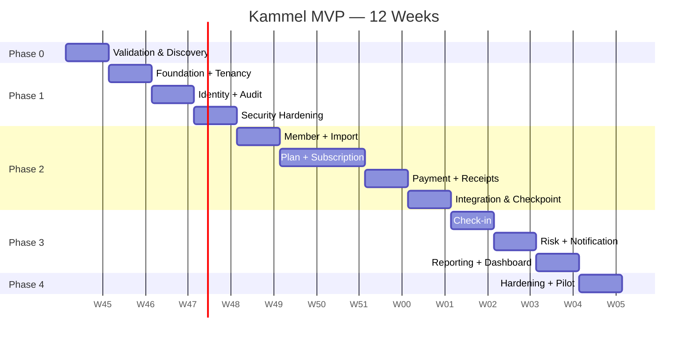

# مراحل التنفيذ (Implementation Phases)

> **الهدف:** تحويل الخطة لـ **12 أسبوع تنفيذ** بترتيب ملزم، مع Checkpoint بعد كل مرحلة يمنع الانتقال لو معايير الخروج مش متحققة.  
> **المرتبط:** [README](../README.md) · [feature-dependencies](../architecture/feature-dependencies.md) · [integration-roadmap](./integration-roadmap.md) · [master-checklist](./master-checklist.md)

---

## 1. الفرضيات والجدول الزمني

### 1.1 فرضيات الـ 12 أسبوع

| الفرضية | القيمة |
|---|---|
| فريق التنفيذ | 1 Backend Senior (Full-time) + 1 Frontend (Part-time) + مراجعة QA أسبوعية |
| أيام العمل | 5 أيام / أسبوع — 8 ساعات |
| الـ Stack | Java 21 + Spring Boot 3 + PostgreSQL 16 + React للـ Admin |
| خارج النطاق | Payment Gateway، WhatsApp Cloud API، تطبيق موبايل، AI/ML |
| البيئة | Staging على VPS + PostgreSQL مُدار أو Docker |
| Buffer | 15% من كل Phase — متوزع على المهام مش في الآخر |

> **تحذير:** 12 أسبوع **مضغوطة**. لو الفريق فرد واحد من غير Frontend مساعد، الخطط الواقعية 14–16 أسبوع. القرار: **نقص النطاق مش نمدد الجدول** — أول حاجة تتأجل هي تحسينات الـ Dashboard.

### 1.2 تسلسل المراحل

> الـ Phase 0 **قبل** الـ 12 أسبوع. لو اتأخرت، الـ 12 أسبوع بتتأخر معاها — ممنوع نبدأ كود قبل CP0.

---

## 2. Definition of Done

### 2.1 على مستوى الـ Feature

أي Feature متعتبرش خلصت غير لما:

- [ ] Migration موجودة وبتشتغل من DB نضيفة + `flyway repair` مش محتاج.
- [ ] Entity + Repository + Service + Controller + DTOs.
- [ ] `org_id` + RLS + Indexes.
- [ ] Validation + Error Codes موثقة.
- [ ] `@PreAuthorize` + Branch Scope.
- [ ] Audit للعمليات الحساسة.
- [ ] Unit + Integration + Isolation Tests.
- [ ] OpenAPI محدث.
- [ ] Feature `testing-plan.md` متغطي.
- [ ] Master Checklist محدثة.

### 2.2 على مستوى الـ Phase

- [ ] كل Features المرحلة خضراء.
- [ ] `mvn verify` + `ArchitectureBoundaryTests` + Isolation Suite.
- [ ] Demo End-to-End على Staging.
- [ ] Migration Rollback Plan مكتوب.
- [ ] Checkpoint معتمد — مفيش انتقال بدون توقيع.

### 2.3 Gates ثابتة في كل Phase

| Gate | الشرط |
|---|---|
| **Build** | `mvn clean verify` أخضر — Testcontainers مش H2 |
| **Architecture** | مفيش Cycle + مفيش Dependency غير معلنة |
| **Isolation** | 100% من اختبارات العزل خضراء |
| **Migrations** | Clean DB + Upgrade من نسخة سابقة |
| **Security** | مفيش `permitAll` غير مبرر + مفيش Secret في Git |
| **API** | OpenAPI Valid + Error Envelope موحد |
| **Coverage** | ≥ 70% للـ Domain/Application — مش رقم تعسفي للـ Controllers |

---

## 3. Phase 0 — التحقق قبل الكود (أسبوع)

> **الهدف:** نتأكد إن الوجع حقيقي وإن الناس هتدفع. **ممنوع سطر كود منتج** قبل ما الـ CP0 يعدي.

### 3.1 الأنشطة

| # | النشاط | المخرج |
|---|---|---|
| 1 | 5–7 مقابلات مع أصحاب جيمات (مستقل + سلسلة صغيرة) | Notes + Quotes |
| 2 | قياس الوجع: نسبة التجديد، طرق التحصيل، وقت المتابعة | Baseline Metrics |
| 3 | عرض Prototype (Figma / Clickable) | Feedback |
| 4 | تحديد السعر المقترح ونموذج الاشتراك | Pricing Hypothesis |
| 5 | توقيع 2 Line-of-Intent للـ Pilot | Signed LOI |
| 6 | مراجعة الـ Assumptions ASM-01..ASM-26 | تأكيد/تعديل |
| 7 | تجهيز بيانات Pilot (أعضاء + اشتراكات) | Sample Excel |

### 3.2 أسئلة لازم تتجاوب

- مين هيدفع؟ Owner ولا Manager؟
- هل التحصيل أهم من الـ Retention ولا العكس؟
- هل الجيم عنده Branch واحدة ولا أكتر؟
- هل بيستخدم Excel ولا دفتر؟
- هل عنده WhatsApp Business؟
- هل يقبل إن الرسائل تتبعت يدوي في الـ MVP؟
- إيه أعلى 3 أسباب إن العضو بيسيب؟

### 3.3 معايير الخروج — CP0

- [ ] 5 مقابلات على الأقل.
- [ ] 2 LOI موقعة للـ Pilot.
- [ ] 3 Assumptions أساسية اتأكدت أو اتعدلت.
- [ ] Prototype اتعرض على 3 أصحاب جيمات على الأقل.
- [ ] قرار Go / No-Go مكتوب.

> **لو CP0 فشل:** مفيش كود. نعيد تعريف المشكلة أو نلغي. ده أرخص من 12 أسبوع ضايعة.

---

## 4. Phase 1 — الأساس والهوية (أسابيع 1–3)

> **الهدف:** نظام فيه Login آمن، Org + Branch، RLS شغال، Audit Core، وCI/CD.  
> **الـ Features:** `shared` → `tenancy` → `identity` → `audit` (Core).

### 4.1 الأسبوع 1 — Foundation + Tenancy

| اليوم | المهمة |
|---|---|
| 1 | Repo + `pom.xml` + Java 21 + Profiles + Docker Compose |
| 2 | `BaseEntity`, `TenantScoped`, `ApiResponse`, `PageResponse`, `GlobalExceptionHandler` |
| 3 | `TenantContext`, `TenantContextCleanupFilter`, `MoneyUtil`, `PhoneUtil`, `@ValidPhone` |
| 4 | `tenancy` Migrations + `Organization` + `Branch` + RLS Helpers |
| 5 | Provisioning CLI + Seed + أول Isolation Test + CI Pipeline |

**مخرج الأسبوع:** `docker compose up` → DB + Migrations + `/actuator/health` + Org/Branch Seed.

### 4.2 الأسبوع 2 — Identity + Audit

| اليوم | المهمة |
|---|---|
| 1 | `User` + `RefreshToken` Migrations + Entities |
| 2 | Login + JWT + Refresh Rotation + Lockout |
| 3 | User Management + Change/Reset Password + Logout |
| 4 | `AuditLog` + `AuditService.record` + Audit Core Tests |
| 5 | Branch Scope + `@PreAuthorize` + Security Tests |

**مخرج الأسبوع:** Owner يقدر يعمل Login، ينشئ Manager/Receptionist، والـ Manager مقفول على فرعه.

### 4.3 الأسبوع 3 — Hardening + Audit API

| اليوم | المهمة |
|---|---|
| 1 | Rate Limiting + Security Headers + CORS |
| 2 | Tenant Isolation Suite كامل + Concurrency Tests |
| 3 | Audit Query API (Owner فقط) + Pagination |
| 4 | OpenAPI + Postman Collection + Error Catalog |
| 5 | Staging Deploy + Backup/Restore Drill + CP1 Demo |

### 4.4 معايير الخروج — CP1

- [ ] Login + Refresh + Logout شغالين.
- [ ] 4 Roles + Branch Scope.
- [ ] RLS على كل جداول الـ Tenant.
- [ ] Isolation Suite 100% خضراء.
- [ ] Audit Core بيسجل كل عملية حساسة.
- [ ] CI/CD بينشر Staging تلقائي.
- [ ] Backup/Restore اتجرب.
- [ ] **Demo:** Owner ينشئ فرع + موظف، والموظف يدخل ويشوف فرعه فقط.

---

## 5. Phase 2 — النواة التشغيلية (أسابيع 4–8)

> **الهدف:** دورة كاملة: عضو → باقة → اشتراك → دفع → إيصال.  
> **الـ Features:** `member` → `plan` → `subscription` → `payment`.

### 5.1 الأسبوع 4 — Member + Import

| اليوم | المهمة |
|---|---|
| 1 | `members` Migration + Entity + Member Code + QR Token |
| 2 | CRUD + Search + Lookup + Soft Delete |
| 3 | Excel Import (POI) + Dry Run + Error Report |
| 4 | Import Template + Validation + Duplicate Handling |
| 5 | Member Tests + Isolation + Frontend List/Form |

**مخرج:** استقبال يسجل عضو ويستورد 300 عضو من Excel بدون Data Loss.

### 5.2 الأسبوع 5 — Plan + Subscription Core

| اليوم | المهمة |
|---|---|
| 1 | `plans` Migration + Entity + Pricing + Duration |
| 2 | `subscriptions` Migration + Entity + State Machine |
| 3 | Create Subscription + `PENDING_PAYMENT` + Events |
| 4 | `SubscriptionEvent` + Timeline + Snapshot |
| 5 | Plan/Subscription Tests + Frontend Screens |

### 5.3 الأسبوع 6 — Subscription Lifecycle

| اليوم | المهمة |
|---|---|
| 1 | Renewal + `renewal_of` (SC-25) + Price Snapshot |
| 2 | Freeze / Unfreeze + Actual Days |
| 3 | Cancel + Expiry Job + `EXPIRING_SOON` |
| 4 | `MemberAccessChangedEvent` + Member Cache Projection |
| 5 | Lifecycle Tests + Concurrency (`FOR UPDATE`) |

### 5.4 الأسبوع 7 — Payment + Receipts

| اليوم | المهمة |
|---|---|
| 1 | `payments` + `document_sequences` Migrations |
| 2 | Record Payment + Idempotency + Allocation |
| 3 | Partial Payments + Outstanding + Overpayment Reject |
| 4 | Receipt PDF (OpenPDF) + Reversal |
| 5 | Payment Tests + Frontend Cash Screen |

### 5.5 الأسبوع 8 — Integration + Collections

| اليوم | المهمة |
|---|---|
| 1 | `PaymentRecordedEvent` → Subscription Activation |
| 2 | Collections Queue + Aging Buckets |
| 3 | Member Timeline (Reporting) + Member 360 |
| 4 | E2E: عضو → اشتراك → دفع جزئي → تفعيل |
| 5 | CP2 Demo + Performance Baseline |

### 5.6 معايير الخروج — CP2

- [ ] 350 عضو مستوردين من Excel.
- [ ] اشتراك `PENDING_PAYMENT → ACTIVE` بعد دفع كامل.
- [ ] دفعة جزئية → Outstanding صحيح.
- [ ] Overpayment مرفوض.
- [ ] إيصال PDF بأرقام متسلسلة.
- [ ] التجديد بينشئ سجل جديد ويحافظ على السعر.
- [ ] Freeze يمدد بعدد الأيام الفعلية.
- [ ] Collections Queue بتطلع المتأخرات.
- [ ] **Demo:** دورة كاملة في أقل من 3 دقائق.

---

## 6. Phase 3 — الاحتفاظ والتشغيل (أسابيع 9–11)

> **الهدف:** حضور → Risk → رسالة → Dashboard.  
> **الـ Features:** `checkin` → `risk` → `notification` → `reporting`.

### 6.1 الأسبوع 9 — Check-in

| اليوم | المهمة |
|---|---|
| 1 | `check_ins` Migration + Entity + Immutability |
| 2 | Search by Phone/Name/Code + Static QR |
| 3 | Subscription Validation + Grace + Frozen |
| 4 | Duplicate Warning + Override + Audit |
| 5 | Check-in Tests + Reception Screen + < 500ms |

### 6.2 الأسبوع 10 — Risk + Notification

| اليوم | المهمة |
|---|---|
| 1 | `risk_scores` Migration + Signals |
| 2 | Scoring Job + ShedLock + Idempotent Upsert |
| 3 | Risk API + Reasons + Draft Message |
| 4 | `message_queue` + Templates + `wa.me` |
| 5 | Cooldown + Send Window + Attribution |

### 6.3 الأسبوع 11 — Reporting + Dashboard

| اليوم | المهمة |
|---|---|
| 1 | KPI Queries + Owner Summary |
| 2 | Renewal Rate + Attribution + Collections |
| 3 | Attendance + Branch Comparison |
| 4 | Dashboard UI + Filters + Export |
| 5 | Reporting Tests + CP3 Demo |

### 6.4 معايير الخروج — CP3

- [ ] Check-in بالبحث/QR في < 500ms.
- [ ] Duplicate Warning + Override بسبب.
- [ ] Risk Score لكل عضو + سبب مكتوب.
- [ ] Job يومي 03:00 Cairo بيعيد التشغيل بأمان.
- [ ] Queue رسائل + Cooldown + Send Window.
- [ ] Attribution خلال 7 أيام.
- [ ] Dashboard المالك: تجديدات، متأخرات، حضور، Risk.
- [ ] **Demo:** عضو غايب 12 يوم → Risk مرتفع → رسالة → تجديد → Attribution.

---

## 7. Phase 4 — التجهيز للـ Pilot (أسبوع 12)

### 7.1 الأنشطة

| اليوم | المهمة |
|---|---|
| 1 | Security Review + Dependency Scan + Secrets Audit |
| 2 | Load Test (350 عضو / 50 Check-in متزامن) + Index Tuning |
| 3 | Backup/Restore + Disaster Recovery Runbook |
| 4 | Pilot Data Import + Training Session + دليل الاستخدام |
| 5 | Go-Live Checklist + CP4 Demo + Retrospective |

### 7.2 معايير الخروج — CP4 (Pilot-Ready)

- [ ] Security Review مكتمل — مفيش High/Critical.
- [ ] Load Test: p95 < 500ms للـ Check-in، < 1s للـ Dashboard.
- [ ] Backup/Restore ناجح على Staging.
- [ ] Monitoring + Alerts (DB، Errors، Disk).
- [ ] دليل استخدام عربي للاستقبال.
- [ ] بيانات الجيم الحقيقي مستوردة ومطابقة.
- [ ] Rollback Plan مكتوب.
- [ ] **Go/No-Go** موقّع.

---

## 8. ما بعد الـ MVP — Pilot و P1

### 8.1 Pilot (14 يوم)

| اليوم | المتابعة |
|---|---|
| 1–3 | مرافقة يومية للاستقبال + إصلاح فوري |
| 4–7 | قياس: Check-in Coverage، Messages Sent، Renewals |
| 8–10 | مقابلة Owner + Receptionist |
| 11–14 | تثبيت + تجهيز تقرير النتائج |

**معايير النجاح:**

- [ ] 14 يوم استخدام متواصل بدون رجوع للدفتر.
- [ ] ≥ 70% من الحضور متسجل.
- [ ] تجديد واحد على الأقل مربوط برسالة.
- [ ] Owner بيستخدم Dashboard أسبوعياً.
- [ ] NPS ≥ 8 من Owner.

### 8.2 P1 — بعد نجاح الـ Pilot

| الترتيب | Feature | المدة | يعتمد على |
|:---:|---|---|---|
| 1 | `shift` | 3–4 يوم | `payment` |
| 2 | `lead` | 4–5 يوم | `member` |
| 3 | `member-portal` | 9–12 يوم | `notification`, `reporting` |
| 4 | WhatsApp Cloud API | 1 أسبوع | `notification` |
| 5 | Refunds + Shift Reconciliation | 1 أسبوع | `payment`, `shift` |
| 6 | AI Layer (Phase 1) | 2–3 أسابيع | بيانات 3 شهور |

> **قاعدة:** مفيش P1 قبل ما الـ Pilot يثبت إن الـ P0 بيتستخدم فعلاً.

---

## 9. إدارة المخاطر والـ Buffer

| المخاطرة | الاحتمال | التأثير | التخفيف |
|---|:---:|:---:|---|
| Phase 0 يفشل | متوسط | مرتفع | No-Go واضح — ممنوع كود |
| RLS معقد | متوسط | مرتفع | Helper Functions + Isolation Suite من أول يوم |
| Excel Import فوضوي | مرتفع | متوسط | Dry Run + تقرير أخطاء + حد 5000 صف |
| Payment Idempotency | متوسط | مرتفع | Advisory Lock + Unique + Tests |
| Risk Score بلا قيمة | متوسط | متوسط | Holdout + مقارنة قبل/بعد |
| Dashboard بيأكل وقت | مرتفع | متوسط | KPI أساسي فقط — الباقي P1 |
| WhatsApp `wa.me` مش مقبول | متوسط | متوسط | Cloud API في P1 + إثبات القيمة |
| Scope Creep | مرتفع | مرتفع | Master Checklist + Change Request |
| فرد واحد في الفريق | مرتفع | مرتفع | نقص النطاق — مش تمديد الوقت |

**Buffer:**

- 15% من كل أسبوع — يوم الجمعة للـ Hardening/الدين التقني.
- أسبوع 12 كامل للـ Stabilization.
- لو Phase اتأخرت > 3 أيام → نقص ميزة P1 من الـ MVP، مش تمديد.

---

## 10. مرتبط بـ

- [README](../README.md)
- [feature-dependencies](../architecture/feature-dependencies.md)
- [integration-roadmap](./integration-roadmap.md)
- [master-checklist](./master-checklist.md)
- [testing-strategy](../testing-strategy.md)
- [database-strategy](../architecture/database-strategy.md)
