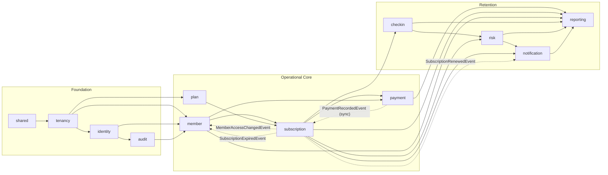
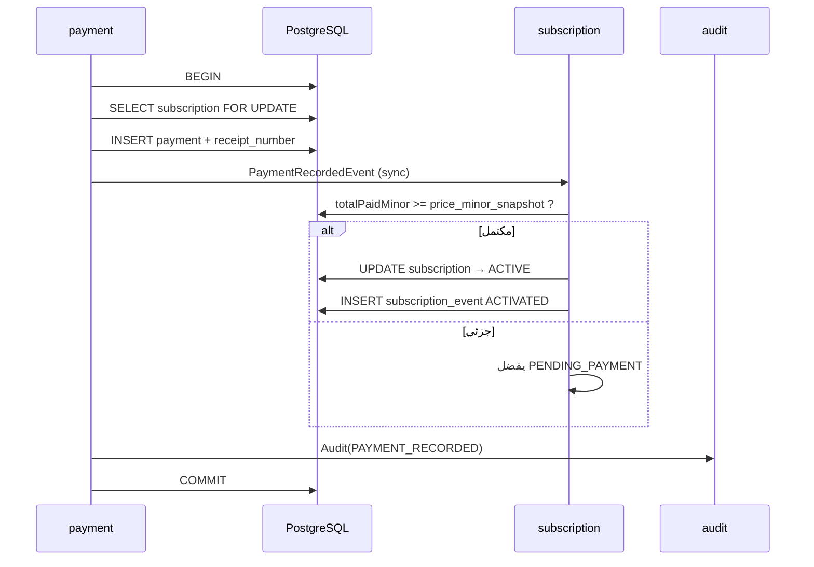
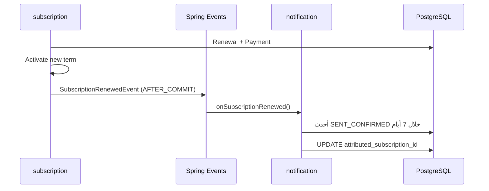

# خريطة التكامل (Integration Roadmap)

> **الهدف:** كل نقطة تكامل بين ميزتين لها **عقد واضح**، **اتجاه واحد**، **اختبار**، و**سلوك عند الفشل** — قبل ما الكود يتكتب.  
> **المرتبط:** [feature-dependencies](../architecture/feature-dependencies.md) · [implementation-phases](./implementation-phases.md) · [shared-foundation](../architecture/shared-foundation.md)

---

## 1. المبادئ

1. **اتجاه واحد** — الـ Dependency Graph DAG. مفيش Feature بتسأل Feature بتسألها.
2. **مفيش Entity يعبر الحدود** — DTO / Projection / Event فقط.
3. **الـ Event مش بديل عن الـ Transaction** — الأحداث الحرجة Synchronous.
4. **كل Listener Idempotent** — At-Least-Once هو الافتراضي.
5. **كل Integration له Test** — مش بس Unit.
6. **مفيش Shared Table** — كل جدول له Owner واحد.
7. **الـ Read Model مسؤولية القارئ** — مفيش Joins على جداول Feature تانية إلا في `reporting`.

---

## 2. خريطة التكامل



---

## 3. مراحل التكامل (Integration Checkpoints)

### IC-01 — `shared` → `tenancy`

| العنصر | التفاصيل |
|---|---|
| **النوع** | Compile |
| **العقد** | `TenantContext`, `TenantScoped`, `BaseEntity`, `ApiResponse` |
| **الاتجاه** | `tenancy` → `shared` |
| **الاختبار** | Org/Branch CRUD + RLS من غير Context → صفر صفوف |

**نقاط الفشل:**

- `TenantContext` مش متضبط → كل Query ترجع فاضي (Fail Closed).
- `BaseEntity` فيه `@GeneratedValue` غلط → Migration مش متوافقة.

---

### IC-02 — `tenancy` → `identity`

| العنصر | التفاصيل |
|---|---|
| **النوع** | Compile |
| **العقد** | `OrganizationQueryService.findBySlug`, `BranchQueryService.validateBranchInOrg` |
| **الاتجاه** | `identity` → `tenancy` |
| **الاختبار** | Login بـ Slug غلط → `401`؛ Manager بفرع مش بتاعه → `403` |

**تسلسل Login:**

```text
POST /auth/login {organizationSlug, username, password}
  → OrganizationQueryService.findBySlug
  → Org ACTIVE؟
  → TenantContext(orgId)
  → UserRepository.findByPhoneOrEmail
  → BCrypt.matches
  → issueAccess + issueRefresh
```

**نقطة فشل حرجة:** لو `findBySlug` اتنفذت **بعد** ضبط الـ TenantContext → RLS هتمنع القراءة. الترتيب ملزم.

---

### IC-03 — `identity` → `audit`

| العنصر | التفاصيل |
|---|---|
| **النوع** | Compile |
| **العقد** | `AuditService.record(actorId, action, entityType, entityId, before, after, reason, ip)` |
| **الاتجاه** | كل Feature → `audit` |
| **الاختبار** | `MEMBER_DELETED` بيتسجل بنفس الـ Transaction |

**القاعدة:** الـ Audit مش Best-Effort في العمليات المالية/الأمنية. لو فشل التسجيل → العملية Rollback.

**استثناء:** `PORTAL_LINK_REQUESTED` ممكن يكون Non-blocking لو الـ Audit Down — لكن يتسجل في Application Log كـ Fallback مع `traceId`.

---

### IC-04 — `tenancy` + `identity` + `audit` → `member`

| العنصر | التفاصيل |
|---|---|
| **النوع** | Compile |
| **العقد** | `BranchQueryService.validateBranchInOrg`, `AuditService.record` |
| **الاتجاه** | `member` → الثلاثة |
| **الاختبار** | عضو بفرع من Org تانية → `404` + مفيش صف |

**Member Code:**

- `pg_advisory_xact_lock(hashtext('member_code:' || org_id))`
- `SELECT max(suffix)` → `+1` → `M-000124`.
- **مش** `document_sequences` — لأن ده خاص بالـ Payments (قرار C-17 / SC-14).

**Excel Import:**

- كل صف → Member + Optional Operational Subscription.
- صف فاشل → ميتسجلش، والباقي يكمل.
- Commit واحد → أي خطأ DB → Rollback كامل.

---

### IC-05 — `plan` → `subscription` — **Read Contract**

| العنصر | التفاصيل |
|---|---|
| **النوع** | Read Contract |
| **العقد** | `PlanQueryService.getActivePlan(planId)` → `PlanSnapshot` |
| **الاتجاه** | `subscription` → `plan` |
| **الاختبار** | Plan متعطل → `422 PLAN_INACTIVE` |

```java
public record PlanSnapshot(
    UUID id,
    String name,
    long priceMinor,
    int durationDays,
    Integer sessionsCount,
    int freezeMaxDays,
    boolean active
) {}
```

**قاعدة:** السعر بيتنسخ في `subscriptions.price_minor_snapshot` وقت الإنشاء. تغيير سعر الباقة **مبيأثرش** على الاشتراكات القديمة.

---

### IC-06 — `member` → `subscription` — **Read Contract**

| العنصر | التفاصيل |
|---|---|
| **النوع** | Read Contract |
| **العقد** | `MemberQueryService.getMember(memberId)` + `isActive` |
| **الاتجاه** | `subscription` → `member` |
| **الاختبار** | Member محذوف → `422 MEMBER_INACTIVE` |

**ممنوع:** `@ManyToOne Member` — `UUID memberId` فقط.

---

### IC-07 — `payment` → `subscription` — **Synchronous Event**

| العنصر | التفاصيل |
|---|---|
| **النوع** | Event (Sync) |
| **Event** | `PaymentRecordedEvent` |
| **Publisher** | `payment` |
| **Listener** | `subscription` |
| **التوقيت** | جوه نفس الـ Transaction — قبل الـ Commit |
| **الاختبار** | دفع كامل → `ACTIVE`؛ دفع جزئي → `PENDING_PAYMENT` |

```java
public record PaymentRecordedEvent(
    UUID paymentId,
    UUID orgId,
    UUID subscriptionId,
    UUID memberId,
    long amountMinor,
    long totalPaidMinor,
    PaymentMethod method,
    Instant occurredAt
) {}
```

**التسلسل:**



**قواعد:**

- `totalPaidMinor` **إلزامي** في الـ Event — عشان الـ Listener ميحتاجش يرجع لـ `payment`.
- `totalPaidMinor` = مجموع الدفعات `COMPLETED` للاشتراك **بعد** إدخال الدفعة الحالية.
- لو الـ Listener رمى Exception → الـ Payment كله Rollback.
- Idempotency: `payment` بتستخدم `(org_id, idempotency_key)` + Advisory Lock.

**فشل جزئي:**

| السيناريو | النتيجة |
|---|---|
| Payment اتسجل، Subscription Listener فشل | Rollback كامل — مفيش Payment |
| Payment اتسجل مرتين بنفس الـ Key | الثاني `200` بنفس الـ Response |
| Payment اتسجل، الـ Commit فشل | مفيش أثر |

---

### IC-08 — `subscription` → `member` — **Event**

| العنصر | التفاصيل |
|---|---|
| **النوع** | Event (After Commit) |
| **Event** | `MemberAccessChangedEvent` |
| **Publisher** | `subscription` |
| **Listener** | `member` |
| **التوقيت** | `@TransactionalEventListener(AFTER_COMMIT)` |
| **الاختبار** | تفعيل → `members.status = ACTIVE`؛ انتهاء → `EXPIRED` |

```java
public record MemberAccessChangedEvent(
    UUID memberId,
    UUID orgId,
    boolean hasActiveMembership,
    Instant occurredAt
) {}
```

**ليه Event مش Compile؟**

- `member` مش مسموح تعتمد على `subscription` (Forbidden Dependency).
- الـ `members.status` هو **Cached Projection** — المصدر الحقيقي هو `subscription`.
- لو الـ Event ضاع → Job يومي `member-status-reconciliation` بيعيد الحساب من `subscription`.

> **ملاحظة:** الـ Listener بيستخدم `TenantTransactionRunner` لضبط الـ Context — لأن الـ Event بعد الـ Commit.

---

### IC-09 — `subscription` → `checkin` — **Command + Read**

| العنصر | التفاصيل |
|---|---|
| **النوع** | Compile |
| **العقد** | `SubscriptionQueryService.findAccessSubscription`, `SubscriptionService.consumeSession` |
| **الاتجاه** | `checkin` → `subscription` |
| **الاختبار** | FROZEN → `422`؛ GRACE → `GRACE_WARNING`؛ آخر جلسة → `NO_SESSIONS_REMAINING` |

**تسلسل Check-in:**

```text
1. resolve member (phone/name/code/qr)
2. Branch scope
3. findAccessSubscription(memberId)
4. لو FROZEN → 422
5. لو EXPIRED خارج Grace → 422
6. لو sessionsRemaining == 0 → 422
7. duplicate check (نفس اليوم)
8. لو duplicate → Warning (مش Block)
9. INSERT check_in
10. consumeSession (لو Plan بالحصص)
11. Audit لو Override
```

**قاعدة:** `checkin` **ممنوع** تعدل `subscriptions` مباشرة — كل خصم عبر `SubscriptionService.consumeSession`.

---

### IC-10 — `checkin` + `subscription` + `member` → `risk` — **Read**

| العنصر | التفاصيل |
|---|---|
| **النوع** | Read Contract |
| **العقد** | `CheckInQueryService.getLastVisit`, `countVisits`, `SubscriptionQueryService.findByMember`, `MemberQueryService.getMember` |
| **الاتجاه** | `risk` → الثلاثة |
| **الاختبار** | عضو جديد < 14 يوم → `INSUFFICIENT_DATA` |

**الإشارات الست:**

| # | الإشارة | المصدر |
|:---:|---|---|
| 1 | أيام منذ آخر حضور | `checkin` |
| 2 | تغير معدل الحضور (14 يوم مقابل 14) | `checkin` |
| 3 | الأيام المتبقية | `subscription` |
| 4 | تأخر الدفع | `subscription.countDelayedActivations` (Proxy موثق) |
| 5 | عدد مرات التجميد | `subscription` |
| 6 | عمر العضوية | `member` |

**قرار:** `risk` **مش** بتعتمد على `payment` مباشرة — عشان مفيش Cycle. `countDelayedActivations` هو Proxy موثق.

**Job:**

- 03:00 Cairo — ShedLock.
- Upsert على `(member_id, computed_at)`.
- Idempotent — إعادة التشغيل مش بتعمل Duplicates.

---

### IC-11 — `risk` + `subscription` + `member` → `notification`

| العنصر | التفاصيل |
|---|---|
| **النوع** | Compile / Read |
| **العقد** | `RiskQueryService.getLatestScore`, `MemberQueryService.getMember`, `SubscriptionQueryService` |
| **الاتجاه** | `notification` → الثلاثة |
| **الاختبار** | Cooldown 3 أيام، نافذة 09:00–21:00، Opt-in فقط |

**قواعد التوليد:**

| القالب | الشرط |
|---|---|
| `RENEWAL_REMINDER` | `EXPIRING_SOON` (≤ 7 أيام) |
| `GRACE_EXPOSURE` | `GRACE` |
| `MISS_YOU` | Risk مرتفع + آخر حضور > 14 يوم |
| `COLLECTION` | P1 — متأخرات |
| `PORTAL_MAGIC_LINK` | P1 — Transactional |

**Attribution:**



**توقيت `SubscriptionRenewedEvent`:**

- بعد **تفعيل** الاشتراك الجديد (أو تسجيل الدفعة اللي بتفعله).
- مش بعد إنشاء السجل `PENDING_PAYMENT` — عشان الـ Attribution يربط بدفعة حقيقية.
- لو التجديد دفع جزئي → الـ Event مش بيتنشر غير عند الاكتمال.

---

### IC-12 — الكل → `reporting` — **Read Only**

| العنصر | التفاصيل |
|---|---|
| **النوع** | Read |
| **العقد** | كل الـ QueryServices + `ReportingQueryRepository` |
| **الاتجاه** | `reporting` → الكل |
| **الاختبار** | Branch Scope + Org Scope + مفيش Write |

**استثناء موثق:** `reporting` مسموح لها بـ Native/JPQL Projections عبر الجداول — عشان الأداء. **بشرط:**

- `org_id` إجباري في كل Query.
- `branch_id` إجباري لغير الـ Owner.
- RLS مفعّلة — الاستثناء مش Bypass.
- مفيش Write.

**KPIs الأساسية:**

| KPI | المصدر |
|---|---|
| Active Members | `member` + `subscription` |
| Renewal Rate | `subscription` |
| Attributed Revenue | `notification` + `payment` |
| Collections Outstanding | `payment` |
| Attendance Rate | `checkin` |
| At-Risk Count | `risk` |

---

### IC-13 — `member-portal` → الكل (P1)

| العنصر | التفاصيل |
|---|---|
| **النوع** | Read + Compile |
| **العقد** | `MemberQueryService`, `SubscriptionQueryService`, `PaymentQueryService`, `CheckInQueryService`, `NotificationService.enqueueTransactional` |
| **الاتجاه** | `member-portal` → الخمسة |
| **الاختبار** | Member A ميشوفش B + Portal Token ميعملش على Staff API |

**قاعدة إضافية:**

- `app.current_member` GUC + Restrictive RLS.
- كل Repository Method فيها `memberId` صريح.
- `member-portal` **مش** بتعدل أي Domain — Read + `PortalRenewalRequest` فقط.

---

## 4. كتالوج الأحداث

| Event | Publisher | Listener | التوقيت | Idempotency |
|---|---|---|---|---|
| `PaymentRecordedEvent` | `payment` | `subscription` | Sync — داخل Transaction | Unique `idempotency_key` |
| `SubscriptionActivatedEvent` | `subscription` | `risk`, `notification` | After Commit | فحص `status` |
| `SubscriptionRenewedEvent` | `subscription` | `notification` | After Commit — بعد التفعيل | `attributed_subscription_id IS NULL` |
| `SubscriptionExpiredEvent` | `subscription` | `risk`, `member` | After Commit | فحص `status` |
| `MemberAccessChangedEvent` | `subscription` | `member` | After Commit | تحديث Cache Projection |
| `MemberStatusChangedEvent` | `member` | `reporting` | After Commit | Upsert Projection |
| `MessageSentEvent` | `notification` | `reporting` | After Commit | `sent_at IS NULL` |

### 4.1 قواعد الـ Event

```java
// كل Event: orgId + occurredAt + مفيش PII
public record SubscriptionRenewedEvent(
    UUID oldSubscriptionId,
    UUID newSubscriptionId,
    UUID orgId,
    UUID memberId,
    LocalDate renewalDate,
    Instant occurredAt
) {}
```

1. Record Immutable.
2. `orgId` إجباري.
3. مفيش Phone/Name/Entity.
4. الـ Listener بيضبط الـ Tenant Context بنفسه.
5. مفيش Event Sync غير `PaymentRecordedEvent` — أي Side Effect تاني After Commit.
6. كل Listener بيتحقق من الحالة قبل التطبيق.

---

## 5. الـ Jobs الليلية — تكامل غير مباشر

| Job | التوقيت | Owner | بيعتمد على | ShedLock |
|---|---|---|---|---|
| Subscription Expiry | 00:05 Cairo | `subscription` | `subscriptions` | ✅ |
| Risk Scoring | 03:00 Cairo | `risk` | `checkin`, `subscription`, `member` | ✅ |
| Message Generation | 06:00 Cairo | `notification` | `risk`, `subscription` | ✅ |
| Member Status Reconciliation | 02:00 Cairo | `member` | `subscription` | ✅ |
| Portal Token Cleanup | 04:00 Cairo | `member-portal` (P1) | `member_portal_tokens` | ✅ |
| Attribution Expiry | 04:30 Cairo | `notification` | `message_queue` | ✅ |

**قاعدة:** أي Job بيلف على أكتر من Org → `TenantTransactionRunner` لكل Org. ممنوع `@Transactional` واحد.

---

## 6. مصفوفة الفشل

| نقطة الفشل | التأثير | السلوك | الاسترداد |
|---|---|---|---|
| `PaymentRecordedEvent` Listener فشل | Payment Rollback | Transaction | إعادة المحاولة من العميل بنفس Key |
| `MemberAccessChangedEvent` ضاع | `members.status` قديم | Job مصالحة يومي | تلقائي |
| `SubscriptionRenewedEvent` ضاع | Attribution ناقص | Job إعادة Attribution | يدوي/تلقائي P1 |
| Risk Job فشل | مفيش Scores جديدة | آخر Score يفضل | إعادة تشغيل يدوي |
| Notification Queue Item فشل | رسالة مش اتبعتت | `FAILED` + إعادة | يدوي |
| RLS Context مش متضبط | صفر بيانات | Fail Closed | Bug — يتصلح |
| Excel Import فشل في صف | صف واحد ناقص | تقرير أخطاء | إعادة رفع الصفوف |

---

## 7. اختبارات التكامل الإلزامية

| # | الاختبار | النوع |
|---|---|---|
| INT-01 | Login → Org Context → User | Integration |
| INT-02 | Member بفرع تاني → `404` | Isolation |
| INT-03 | Plan Snapshot لا يتأثر بتغيير السعر | Integration |
| INT-04 | دفع كامل → `ACTIVE` | Integration |
| INT-05 | دفع جزئي → `PENDING_PAYMENT` + Outstanding | Integration |
| INT-06 | دفع زائد → `422` | Integration |
| INT-07 | Payment Rollback عند فشل Subscription | Integration |
| INT-08 | تجديد → سجل جديد + Snapshot قديم محفوظ | Integration |
| INT-09 | Freeze 10 أيام → EndDate +10 | Integration |
| INT-10 | Check-in FROZEN → `422` | Integration |
| INT-11 | Check-in GRACE → Warning + تسجيل | Integration |
| INT-12 | Risk عضو جديد → `INSUFFICIENT_DATA` | Integration |
| INT-13 | Risk Job مرتين → صف واحد | Concurrency |
| INT-14 | Notification Cooldown → مفيش رسالة | Integration |
| INT-15 | Attribution خلال 7 أيام | Integration |
| INT-16 | Reporting Branch Scope | Isolation |
| INT-17 | Portal Member A → B | Isolation (P1) |
| INT-18 | Architecture Boundaries | Modulith |

---

## 8. إدارة تغيير العقود

أي تغيير في Contract أو Event:

1. افتح **Change Request** في [master-checklist](./master-checklist.md).
2. حدّث [feature-dependencies](../architecture/feature-dependencies.md).
3. حدّث الـ Event Record في `shared/contracts/events`.
4. أضف/عدّل Integration Test.
5. تأكد إن الـ Change **Backward Compatible** — أو اعمل Version جديد.
6. حدّث [api-design](../api-design.md) لو الـ API اتأثر.
7. سجّل القرار في [decisions-and-assumptions](../architecture/decisions-and-assumptions.md).

**قواعد التوافق:**

- إضافة حقل Optional → متوافقة.
- حذف/تغيير نوع حقل → Breaking — يحتاج Version.
- تغيير توقيت Event (Sync ↔ Async) → Breaking — يحتاج مراجعة Transaction.

---

## 9. مرتبط بـ

- [feature-dependencies](../architecture/feature-dependencies.md)
- [implementation-phases](./implementation-phases.md)
- [master-checklist](./master-checklist.md)
- [database-strategy](../architecture/database-strategy.md)
- [security-strategy](../architecture/security-strategy.md)
- [testing-strategy](../testing-strategy.md)
