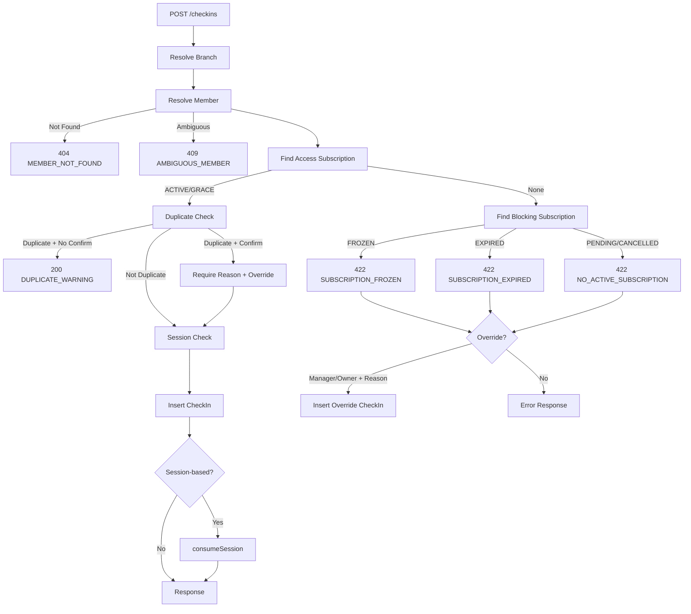

# Check-in — تصميم الـ Domain

> **الـ Package:** `com.kammel.features.checkin.domain`  
> **المرتبط:** [`README.md`](./README.md) · [entity-relationships](../../architecture/entity-relationships.md) · [database-strategy](../../architecture/database-strategy.md)

---

## 1. `CheckIn`

| الحقل | النوع | القيود | ملاحظات |
|---|---|---|---|
| `id` | `UUID` | PK | — |
| `orgId` | `UUID` | `NOT NULL` | RLS |
| `branchId` | `UUID` | `NOT NULL` | الفرع اللي حصل فيه الدخول |
| `memberId` | `UUID` | `NOT NULL` | — |
| `subscriptionId` | `UUID` | `NULL` | `NULL` في Override بدون اشتراك |
| `method` | `CheckInMethod` | `NOT NULL` | 5 قيم |
| `checkedInAt` | `Instant` | `NOT NULL` | UTC |
| `overriddenBy` | `UUID` | `NULL` | Manager/Owner |
| `overrideReason` | `String` | `NULL`, ≤ 500 | إلزامي مع Override |
| `createdAt` | `Instant` | `NOT NULL` | — |

```java
@Entity
@Table(name = "check_ins")
@Getter
@NoArgsConstructor(access = AccessLevel.PROTECTED)
public class CheckIn extends BaseEntity implements TenantScoped {

    @Column(name = "org_id", nullable = false)
    private UUID orgId;

    @Column(name = "branch_id", nullable = false)
    private UUID branchId;

    @Column(name = "member_id", nullable = false)
    private UUID memberId;

    @Column(name = "subscription_id")
    private UUID subscriptionId;

    @Enumerated(EnumType.STRING)
    @Column(nullable = false, length = 20)
    private CheckInMethod method;

    @Column(name = "checked_in_at", nullable = false)
    private Instant checkedInAt;

    @Column(name = "overridden_by")
    private UUID overriddenBy;

    @Column(name = "override_reason", length = 500)
    private String overrideReason;

    @Column(name = "created_at", nullable = false)
    private Instant createdAt;

    public static CheckIn record(
        UUID orgId, UUID branchId, UUID memberId, UUID subscriptionId,
        CheckInMethod method, Instant now, UUID overriddenBy, String overrideReason
    ) {
        // Validation + إنشاء الكيان
    }

    public boolean isOverridden() {
        return overriddenBy != null;
    }
}
```

> **ممنوع Setters** — الكيان Immutable بعد الإنشاء.
> ممنوع `UPDATE` / `DELETE` — Trigger + Grants.

---

## 2. الـ Enums

```java
public enum CheckInMethod {
    PHONE_SEARCH,
    MEMBER_CODE,
    NAME_SEARCH,
    STATIC_QR,
    DYNAMIC_QR   // P1 — مش مستخدم في MVP
}

public enum CheckInResultStatus {
    SUCCESS,
    EXPIRING_SOON_ALERT,
    GRACE_WARNING,
    DUPLICATE_WARNING
}
```

> **SC-26:** الـ `chk_checkin_method` في الـ DB لازم تشمل `MEMBER_CODE` — الوثيقة الأصلية فيها 4 قيم بس، والـ API بيسمح بالبحث بكود العضو.

---

## 3. ترتيب التحقق (Validation Pipeline)



---

## 4. الـ Branch Resolution

| المستخدم | `branchId` في الـ Request | النتيجة |
|---|---|---|
| Owner | مطلوب | لازم يكون فرع نشط تابع للـ Org. |
| Manager | ممنوع/متجاهل | بيتاخد من الـ JWT. لو مختلف → `403`. |
| Receptionist | ممنوع/متجاهل | بيتاخد من الـ JWT. لو مختلف → `403`. |
| Trainer | — | `403`. |

- `BranchQueryService.getBranch(branchId)` + `validateBranchInOrg`.
- ممنوع Check-in على فرع غير نشط → `422 BRANCH_INACTIVE`.

---

## 5. الـ Member Resolution

### 5.1 ترتيب البحث

| الشكل | الطريقة | الاستعلام |
|---|---|---|
| UUID | `STATIC_QR` | `members.qr_token` |
| `M-000123` | `MEMBER_CODE` | `(org_id, member_code)` |
| `01012345678` | `PHONE_SEARCH` | `(org_id, phone)` |
| غير كده | `NAME_SEARCH` | بحث بالاسم |

### 5.2 قواعد

1. العضو لازم يكون `deleted_at IS NULL` و`status = ACTIVE`.
2. لو العضو محذوف → `404 MEMBER_NOT_FOUND` (مش بنقول إنه محذوف).
3. `NAME_SEARCH`:
   - لو نتيجة واحدة → كمّل.
   - لو أكتر من واحدة → `409 AMBIGUOUS_MEMBER` مع قائمة مختصرة (ID + Name + Phone masked).
   - لو صفر → `404`.
4. الـ `method` في الـ Request **بيتتحقق** مع شكل الـ `identifier`. لو مش متطابق → `400 INVALID_IDENTIFIER_METHOD`.
5. الـ QR Token ثابت في MVP — ممنوع يتغير إلا بإعادة تسجيل.

---

## 6. اختيار الاشتراك

### 6.1 الاشتراك اللي يمنح الدخول

```java
subscriptionQueryService.findAccessSubscription(memberId)
```

- `status IN (ACTIVE, GRACE)`.
- `plan.grants_access = true`.
- الأقرب في `end_date`.
- لو فيه أكتر من واحد → الأقرب انتهاءً (ASM-19).

### 6.2 الاشتراك المانع

لو مفيش Access Subscription:

```java
subscriptionQueryService.findBlockingSubscription(memberId)
```

| الحالة | الرسالة | HTTP |
|---|---|:---:|
| `FROZEN` | "الاشتراك مجمد لحد {date}. السبب: {reason}" | `422 SUBSCRIPTION_FROZEN` |
| `EXPIRED` | "الاشتراك انتهى يوم {date}. تحب نجدده؟" | `422 SUBSCRIPTION_EXPIRED` |
| `PENDING_PAYMENT` | "الاشتراك لسه مستني دفع. المتبقي {amount}" | `422 NO_ACTIVE_SUBSCRIPTION` |
| `CANCELLED` | "الاشتراك ملغي. تواصل مع الاستقبال." | `422 NO_ACTIVE_SUBSCRIPTION` |
| مفيش اشتراك | "مفيش اشتراك نشط. تحب نسجلك باقة؟" | `422 NO_ACTIVE_SUBSCRIPTION` |

> **BR-014:** كل الرسائل ودّية، ومفيش ذكر لأي تفاصيل مالية حساسة في الشاشة العامة.

### 6.3 `grants_access`

- `PT_PACKAGE` مثلاً `grants_access = false` → مش بيمنح دخول الجيم.
- لو العضو عنده `PT_PACKAGE` بس → يعتبر `NO_ACTIVE_SUBSCRIPTION` للدخول.
- الـ Check-in مش بيسأل عن الـ `PlanType` مباشرة — بيسأل `grants_access`.

---

## 7. التكرار (Duplicate Check-in)

### 7.1 التعريف

```text
Duplicate = EXISTS check_in
            WHERE org_id = :orgId
              AND member_id = :memberId
              AND checked_in_at >= startOfDay(Cairo)
              AND checked_in_at <  startOfNextDay(Cairo)
```

- على مستوى الـ **Org**، مش الفرع — لو دخل فرع تاني نفس اليوم يفضل Duplicate.
- الحساب بـ `Africa/Cairo` مش UTC.

### 7.2 السلوك

| الطلب | النتيجة |
|---|---|
| أول Check-in | `SUCCESS` / `GRACE_WARNING` / `EXPIRING_SOON_ALERT` |
| تاني Check-in بدون `confirmDuplicate` | `200 DUPLICATE_WARNING` — **مفيش سجل جديد** |
| تاني Check-in مع `confirmDuplicate=true` + `overrideReason` | `200 SUCCESS` + `duplicateConfirmed=true` |
| تالت Check-in | نفس القاعدة — Warning جديدة |

- الـ Response في حالة الـ Warning بيحتوي:
  - `checkInId: null`
  - `firstCheckInAt`
  - `requiresConfirmation: true`
  - `message: "Ahmed checked in at 10:15 AM today. Confirm again if this is intentional."`
- الـ Confirm بيسجل `overridden_by` + `override_reason` + Audit `CHECKIN_OVERRIDDEN` مع `metadata.type = DUPLICATE`.
- ممنوع `confirmDuplicate=true` من غير `overrideReason` → `400`.

> **BR-018:** Warning مش Block. الـ Receptionist بيقرر.

### 7.3 الـ Concurrency

- ممكن طلبين يعدّوا الـ Duplicate Check في نفس اللحظة.
- الحل: `pg_advisory_xact_lock` على:

```text
checkin:{orgId}:{memberId}:{cairoDate}
```

- القفل بيتحرر بعد الـ Commit.
- ده بيمنع كمان خصم جلسة مرتين بالتوازي.

---

## 8. خصم الجلسات

### 8.1 الشروط

```text
لو subscription.sessionsRemaining != null:
    لو sessionsRemaining <= 0 → 422 NO_SESSIONS_REMAINING
    subscriptionService.consumeSession(subscriptionId)
```

- `consumeSession` بتعمل `SELECT ... FOR UPDATE` على الاشتراك.
- بتنقص `sessions_remaining` وتنشر `SubscriptionExpiredEvent` لو وصلت صفر.
- لو الـ Check-in فشل بعد الخصم → الـ Transaction Rollback — مفيش خصم.
- الـ Check-in بيتم حفظه **قبل** النداء، والـ Rollback بيشيل الاتنين لو حصل خطأ.

### 8.2 Override

- الـ Access Override **مش** بيخصم جلسة — لأن مفيش اشتراك صالح.
- الـ Duplicate Confirm **بيخصم** جلسة عادية — لأنه دخول حقيقي.
- لو الباقة خلصت جلسات، الاشتراك المفروض يكون `EXPIRED` بالفعل — لو لسه `ACTIVE` → `422`.

---

## 9. الـ Override

### 9.1 الحالات المسموحة

| الحالة | من يقدر | Subscription ID | Session Deduction |
|---|---|---|---|
| `DUPLICATE` | Owner, Manager, Receptionist | الاشتراك الحالي | ✅ |
| `EXPIRED` | Owner, Manager | الاشتراك المنتهي | ❌ |
| `FROZEN` | Owner, Manager | الاشتراك المجمد | ❌ |
| `NO_ACTIVE_SUBSCRIPTION` | Owner, Manager | `NULL` | ❌ |

- الـ Request بيستخدم `override=true` + `overrideReason`.
- لو المستخدم Receptionist → `403 OVERRIDE_NOT_ALLOWED`.
- لو `override=true` بدون سبب → `400`.

### 9.2 Audit

```json
{
  "action": "CHECKIN_OVERRIDDEN",
  "entityType": "CHECK_IN",
  "entityId": "44444444-...",
  "afterState": {
    "memberId": "a0b1c2d3-...",
    "subscriptionId": "77777777-...",
    "type": "FROZEN",
    "branchId": "99999999-..."
  },
  "reason": "Member insisted, manager approved one-time entry"
}
```

> الـ Audit هو المصدر الوحيد لمعرفة نوع الـ Override. الـ `check_ins` row مش فيه `override_type`.

---

## 10. الـ Response

### 10.1 الحقول

| الحقل | ملاحظات |
|---|---|
| `checkInId` | `NULL` في حالة الـ Warning. |
| `status` | `CheckInResultStatus`. |
| `memberId` / `memberName` | — |
| `planName` | اسم الباقة. |
| `daysRemaining` | `endDate - today` — `NULL` لو مفيش اشتراك. |
| `sessionsRemaining` | `NULL` لو مش Session-based. |
| `warning` | نص عربي ودّي أو `NULL`. |
| `requiresConfirmation` | `true` في الـ Duplicate Warning. |
| `firstCheckInAt` | وقت أول حضور اليوم. |
| `duplicateConfirmed` | `true` بعد التأكيد. |
| `overridden` | `true` لو Access Override. |

### 10.2 أولوية الـ Status

```text
لو Duplicate Warning → DUPLICATE_WARNING
لو GRACE → GRACE_WARNING
لو EXPIRING_SOON (<= 7 أيام) → EXPIRING_SOON_ALERT
غير كده → SUCCESS
```

- لو أكتر من حالة تنطبق، الـ Warning الأعلى أولوية بيظهر، والباقي في `warnings[]` (اختياري P1).
- الـ MVP بيرجع Warning واحد.

---

## 11. الـ Query Service

```java
public interface CheckInQueryService {

    Optional<Instant> getLastVisit(UUID memberId);

    Optional<Instant> getFirstVisit(UUID memberId);

    long countVisits(UUID memberId, Instant fromInclusive, Instant toExclusive);

    boolean hasCheckedInToday(UUID memberId);

    PageResponse<CheckInSummary> list(CheckInFilter filter, Pageable pageable);
}

public record CheckInSummary(
    UUID id,
    UUID memberId,
    String memberName,
    UUID branchId,
    String branchName,
    UUID subscriptionId,
    CheckInMethod method,
    Instant checkedInAt,
    boolean overridden
) {}
```

- `getLastVisit` / `countVisits` مطلوبين لـ `risk` (14 يوم / 14 يوم اللي قبلهم).
- `hasCheckedInToday` مطلوب للـ Duplicate Check — لكن الـ Check-in Service بيستخدم Repository داخلياً للسرعة.
- `list` مطلوب لـ `reporting` وصفحة الحضور.
- ممنوع ترجع `CheckIn` Entity.

---

## 12. الـ Invariants

| # | الـ Invariant | مكان التحقق |
|:---:|---|---|
| INV-CHK-01 | `branchId` تابع للـ Org ونشط | Service |
| INV-CHK-02 | `memberId` تابع للـ Org وغير محذوف | RLS + Query |
| INV-CHK-03 | `subscriptionId` تابع لنفس العضو | Service |
| INV-CHK-04 | `checkedInAt` UTC | Service |
| INV-CHK-05 | ممنوع `UPDATE` / `DELETE` | Trigger + Grants |
| INV-CHK-06 | Override → `overriddenBy` + `overrideReason` | DB CHECK + Service |
| INV-CHK-07 | `overrideReason` ≤ 500 | DTO + DB |
| INV-CHK-08 | ممنوع Check-in على `FROZEN` بدون Override | Service |
| INV-CHK-09 | الجلسة تخصم مرة واحدة | Advisory Lock + Transaction |
| INV-CHK-10 | الـ Duplicate Warning لا ينشئ Row | Service |
| INV-CHK-11 | `orgId` من الـ Context | Service |
| INV-CHK-12 | كل Override له Audit | Service |

---

## 13. الأخطاء

| Exception | HTTP | متى |
|---|:---:|---|
| `MemberNotFoundException` | 404 | عضو مش موجود / Org تانية |
| `AmbiguousMemberException` | 409 | الاسم بيطابق أكتر من عضو |
| `InvalidIdentifierMethodException` | 400 | Method مش متطابقة مع الشكل |
| `BranchInactiveException` | 422 | فرع غير نشط |
| `NoActiveSubscriptionException` | 422 | مفيش اشتراك يمنح دخول |
| `SubscriptionFrozenException` | 422 | `FROZEN` |
| `SubscriptionExpiredException` | 422 | `EXPIRED` |
| `NoSessionsRemainingException` | 422 | الجلسات خلصت |
| `OverrideNotAllowedException` | 403 | Receptionist يحاول Override |
| `DuplicateCheckInException` | 409 | لو الـ Client بيحاول يتجاهل الـ Warning بدون Confirm |

> **ملاحظة:** الـ Duplicate Warning مش Exception في المسار العادي — هو `200` مع `requiresConfirmation`. الـ Exception للـ Client اللي بيبعت `confirmDuplicate=false` صراحةً مع `force=true` (مش موجود في MVP).

---

## 14. مرتبط بـ

- [`implementation-plan.md`](./implementation-plan.md)
- [`api-design.md`](./api-design.md)
- [`testing-plan.md`](./testing-plan.md)
- [subscription/domain-design](../subscription/domain-design.md)
