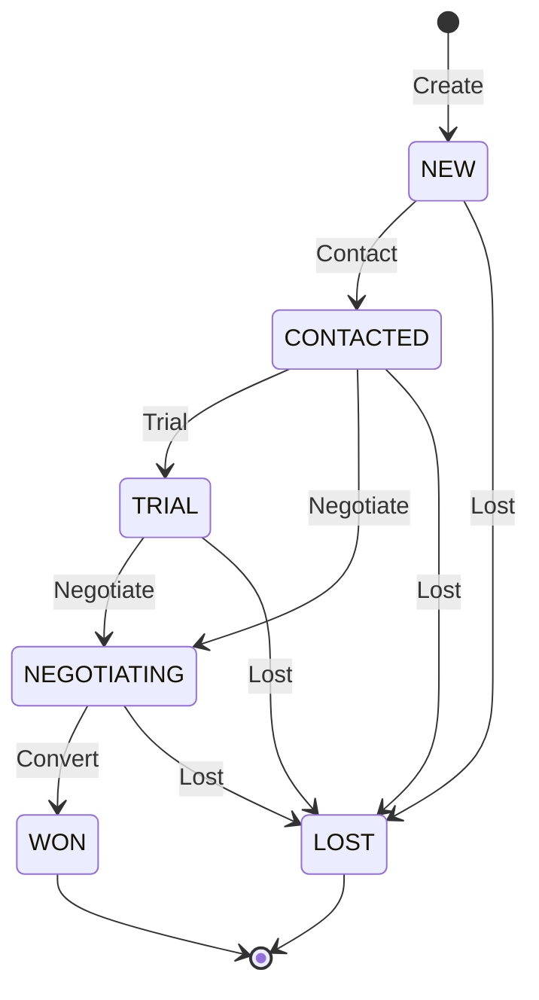

# Lead — خطة التنفيذ (P1)

> **الـ Phase:** Post-MVP · **المدة:** 4–5 أيام · **المرتبط:** [`README.md`](./README.md)

---

## 1. الـ Domain

### 1.1 `Lead`

| الحقل | النوع | القيود |
|---|---|---|
| `id` | `UUID` | PK |
| `orgId` | `UUID` | `NOT NULL` |
| `branchId` | `UUID` | `NOT NULL` |
| `fullName` | `String` | `NOT NULL`, 2–100 |
| `phone` | `String` | `NOT NULL`, Egyptian |
| `source` | `LeadSource` | `NOT NULL` |
| `status` | `LeadStatus` | `NOT NULL` |
| `assignedTo` | `UUID` | `NULL` |
| `notes` | `String` | `NULL`, ≤ 1000 |
| `nextFollowUpAt` | `Instant` | `NULL` |
| `convertedMemberId` | `UUID` | `NULL` |
| `convertedAt` | `Instant` | `NULL` |
| `lostReason` | `String` | `NULL`, ≤ 500 |
| `createdAt` / `updatedAt` | `Instant` | `NOT NULL` |

```java
@Entity
@Table(name = "leads")
@Getter
@NoArgsConstructor(access = AccessLevel.PROTECTED)
public class Lead extends BaseEntity implements TenantScoped {

    private UUID orgId;
    private UUID branchId;
    private String fullName;
    private String phone;

    @Enumerated(EnumType.STRING)
    private LeadSource source;

    @Enumerated(EnumType.STRING)
    private LeadStatus status;

    private UUID assignedTo;
    private String notes;
    private Instant nextFollowUpAt;
    private UUID convertedMemberId;
    private Instant convertedAt;
    private String lostReason;

    public void transitionTo(LeadStatus target, UUID actorId, String reason) {
        // State Machine + Validation
    }

    public void markConverted(UUID memberId, Instant now) {
        if (convertedMemberId != null) throw new LeadAlreadyConvertedException();
        this.status = LeadStatus.WON;
        this.convertedMemberId = memberId;
        this.convertedAt = now;
    }
}
```

### 1.2 `LeadFollowUp`

| الحقل | النوع | القيود |
|---|---|---|
| `id` | `UUID` | PK |
| `orgId` | `UUID` | `NOT NULL` |
| `leadId` | `UUID` | `NOT NULL` |
| `userId` | `UUID` | `NOT NULL` |
| `note` | `String` | `NOT NULL`, ≤ 1000 |
| `followUpAt` | `Instant` | `NOT NULL` |
| `createdAt` | `Instant` | `NOT NULL` |

- Append-Only — ممنوع `UPDATE` / `DELETE`.
- `followUpAt` ممكن يكون في الماضي (تسجيل متابعة حصلت) أو المستقبل (موعد).

### 1.3 الـ Enums

```java
public enum LeadSource {
    INSTAGRAM, FACEBOOK, WALK_IN, REFERRAL, WHATSAPP, OTHER
}

public enum LeadStatus {
    NEW, CONTACTED, TRIAL, NEGOTIATING, WON, LOST
}
```

### 1.4 الـ State Machine



| From | To | Actor | Preconditions |
|---|---|---|---|
| `NEW` | `CONTACTED` | Owner/Manager/Receptionist | — |
| `NEW` | `LOST` | Owner/Manager/Receptionist | `lostReason` |
| `CONTACTED` | `TRIAL` | Owner/Manager/Receptionist | — |
| `CONTACTED` | `NEGOTIATING` | Owner/Manager/Receptionist | — |
| `CONTACTED` | `LOST` | Owner/Manager/Receptionist | `lostReason` |
| `TRIAL` | `NEGOTIATING` | Owner/Manager/Receptionist | — |
| `TRIAL` | `LOST` | Owner/Manager/Receptionist | `lostReason` |
| `TRIAL` | `WON` | — | **Convert فقط** |
| `NEGOTIATING` | `WON` | — | **Convert فقط** |
| `NEGOTIATING` | `LOST` | Owner/Manager/Receptionist | `lostReason` |
| `WON` / `LOST` | أي | — | ❌ `422` |

### 1.5 الـ Indexes + Constraints

```sql
CREATE UNIQUE INDEX uk_leads_active_phone
    ON leads (org_id, phone)
    WHERE status NOT IN ('WON','LOST');

CREATE INDEX idx_leads_org_branch_status
    ON leads (org_id, branch_id, status, created_at DESC);

CREATE INDEX idx_leads_org_assigned
    ON leads (org_id, assigned_to, next_follow_up_at);
```

- Partial Unique بيمنع Lead مكرر نشط.
- لو الـ Lead اتقفل `LOST`، نفس الرقم يقدر ييجي تاني.

---

## 2. الـ Conversion

### 2.1 الخطوات

```java
@Transactional
public ConvertLeadResponse convert(UUID leadId, ConvertLeadRequest request) {
    Lead lead = leadRepository.findByIdForUpdate(leadId)
        .orElseThrow(LeadNotFoundException::new);

    if (lead.getStatus() == WON || lead.getStatus() == LOST) {
        throw new LeadAlreadyFinalException();
    }
    if (lead.getConvertedMemberId() != null) {
        throw new LeadAlreadyConvertedException();
    }

    MemberResponse member = memberService.create(new CreateMemberRequest(
        lead.getFullName(), lead.getPhone(), request.gender(),
        request.birthDate(), lead.getBranchId(), lead.getSource().name(),
        request.notes(), request.whatsappOptIn()
    ));

    SubscriptionResponse sub = null;
    if (request.planId() != null) {
        sub = subscriptionService.create(new CreateSubscriptionRequest(
            member.id(), request.planId(), request.startDate()
        ));
    }

    lead.markConverted(member.id(), now);
    auditService.record(new AuditCommand(
        "LEAD_CONVERTED", "LEAD", lead.getId(),
        Map.of("status", "NEGOTIATING"),
        Map.of("status", "WON", "memberId", member.id()),
        request.reason()
    ));

    return new ConvertLeadResponse(member, sub);
}
```

### 2.2 القواعد

1. `planId` اختياري — لو موجود، الاشتراك يبدأ `PENDING_PAYMENT`.
2. لو رقم الهاتف موجود كعضو بالفعل → `409 DUPLICATE_MEMBER`.
3. الـ Lead بيتحول `WON` في نفس الـ Transaction.
4. لو فشل إنشاء العضو/الاشتراك → Rollback — الـ Lead يفضل زي ما هو.
5. `SELECT ... FOR UPDATE` بيمنع تحويلين متزامنين.
6. ممنوع تحويل Lead من فرع تاني.
7. Audit `LEAD_CONVERTED`.

---

## 3. الـ API

| Method | Path | Roles | الوصف |
|---|---|---|---|
| POST | `/leads` | Owner, Manager, Receptionist | إنشاء |
| GET | `/leads` | Owner, Manager, Receptionist | قائمة |
| GET | `/leads/{id}` | Owner, Manager, Receptionist | تفاصيل |
| PATCH | `/leads/{id}/status` | Owner, Manager, Receptionist | تغيير الحالة |
| POST | `/leads/{id}/follow-ups` | Owner, Manager, Receptionist | إضافة متابعة |
| GET | `/leads/{id}/follow-ups` | Owner, Manager, Receptionist | متابعات |
| POST | `/leads/{id}/convert` | Owner, Manager, Receptionist | تحويل لعضو |
| GET | `/leads/funnel` | Owner, Manager | قمع المبيعات |

### 3.1 `POST /leads`

```json
{
  "fullName": "Omar Hassan",
  "phone": "01122334455",
  "source": "INSTAGRAM",
  "branchId": "99999999-...",
  "assignedTo": "b2c3d4e5-...",
  "notes": "Interested in evening plan",
  "nextFollowUpAt": "2026-11-05T17:00:00Z"
}
```

- `phone` Egyptian regex.
- Duplicate Active Lead → `409 LEAD_ALREADY_EXISTS`.
- Response `201 Created`.

### 3.2 `PATCH /leads/{id}/status`

```json
{
  "status": "CONTACTED",
  "lostReason": null,
  "nextFollowUpAt": "2026-11-06T17:00:00Z"
}
```

- Transition Matrix.
- `LOST` requires `lostReason`.
- Response `200 OK`.

### 3.3 `POST /leads/{id}/convert`

```json
{
  "gender": "MALE",
  "birthDate": "1996-03-14",
  "planId": "33333333-...",
  "startDate": "2026-11-05",
  "whatsappOptIn": true,
  "notes": "Converted from Instagram lead",
  "reason": "Paid deposit"
}
```

Response:
```json
{
  "success": true,
  "message": "Lead converted",
  "data": {
    "leadId": "aaaaaaaa-...",
    "status": "WON",
    "member": {
      "id": "a0b1c2d3-...",
      "memberCode": "M-000124",
      "fullName": "Omar Hassan",
      "phone": "01122334455"
    },
    "subscription": {
      "id": "77777777-...",
      "status": "PENDING_PAYMENT",
      "priceMinorSnapshot": 70000
    }
  }
}
```

- `subscription` = `null` لو مفيش `planId`.
- `409` لو متحول قبل كده.
- `409 DUPLICATE_MEMBER` لو الرقم موجود.

### 3.4 `GET /leads/funnel`

```json
{
  "success": true,
  "message": "OK",
  "data": {
    "from": "2026-10-01",
    "to": "2026-10-31",
    "total": 120,
    "byStatus": {
      "NEW": 30,
      "CONTACTED": 25,
      "TRIAL": 18,
      "NEGOTIATING": 12,
      "WON": 20,
      "LOST": 15
    },
    "conversionRate": 16.7,
    "bySource": [
      { "source": "INSTAGRAM", "count": 50, "won": 12 },
      { "source": "WALK_IN", "count": 30, "won": 8 }
    ]
  }
}
```

- `conversionRate = WON / total * 100`.
- Manager → فرعه.

---

## 4. الـ Tasks

### TSK-LED-001 — Migrations + Entities

- `V22__create_leads.sql` (يضم `leads` + `lead_followups`) + Partial Unique + Immutability Trigger + RLS.
- Indexes.

### TSK-LED-002 — State Machine

- `LeadStateMachine`.
- Transitions + Exceptions.
- Unit Tests.

### TSK-LED-003 — Service

- `create`, `updateStatus`, `addFollowUp`, `list`, `get`.
- `assignTo`.
- `nextFollowUpAt` validation.
- Audit.

### TSK-LED-004 — Conversion

- `convert` + Row Lock.
- Member + Subscription Integrations.
- Audit.
- Duplicate Phone Check.

### TSK-LED-005 — Funnel

- Counts by Status + Source.
- Conversion Rate.
- Branch Scope.

### TSK-LED-006 — API + Tests

- 8 Endpoints.
- Tests.

---

## 5. الاختبارات

| # | الاختبار | المتوقع |
|---|---|---|
| TS-LED-01 | إنشاء Lead | `NEW` |
| TS-LED-02 | نفس Phone نشط | `409` |
| TS-LED-03 | نفس Phone بعد `LOST` | مسموح |
| TS-LED-04 | `NEW → CONTACTED` | ✅ |
| TS-LED-05 | `NEW → WON` | `422` |
| TS-LED-06 | `WON → LOST` | `422` |
| TS-LED-07 | `LOST` بدون Reason | `400` |
| TS-LED-08 | تحويل | Member + `WON` |
| TS-LED-09 | تحويل مع `planId` | Subscription `PENDING_PAYMENT` |
| TS-LED-10 | تحويل مرتين | `409` |
| TS-LED-11 | تحويل برقم موجود | `409 DUPLICATE_MEMBER` |
| TS-LED-12 | فشل الاشتراك | Rollback — Lead زي ما هو |
| TS-LED-13 | 10 تحويلات متزامنة | واحد ينجح |
| TS-LED-14 | Manager فرع B | `404` |
| TS-LED-15 | Follow-up Immutable | DB يرفض التعديل |
| TS-LED-16 | Funnel | Counts + Rate صحيحة |
| TS-LED-17 | Audit | `LEAD_CREATED`, `LEAD_STATUS_CHANGED`, `LEAD_CONVERTED` |

---

## 6. معايير القبول

- [ ] `leads` + `lead_followups` + RLS.
- [ ] Partial Unique.
- [ ] State Machine.
- [ ] Follow-ups.
- [ ] Conversion + Rollback.
- [ ] Funnel.
- [ ] Audit.
- [ ] Branch Scope.
- [ ] Tests.

---

## 7. المخاطر

| المخاطرة | التخفيف |
|---|---|
| Lead مكرر | Partial Unique |
| تحويل مرتين | Row Lock + `convertedMemberId` |
| عضو مكرر | Phone Check |
| Rollback ناقص | Transaction واحدة |
| State Machine مرن زيادة | Matrix + Tests |
| Funnel غلط | Definition + Tests |
| Receptionist يشوف فرع تاني | Branch Scope |

---

## 8. مرتبط بـ

- [`README.md`](./README.md)
- [member/api-design](../member/api-design.md)
- [subscription/api-design](../subscription/api-design.md)
