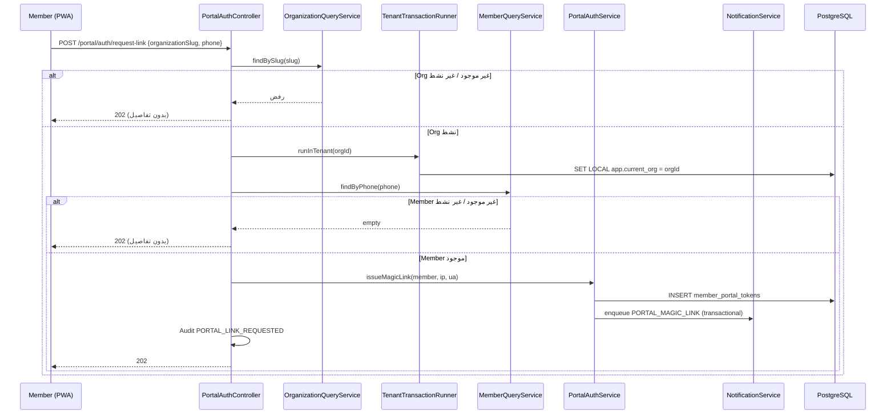
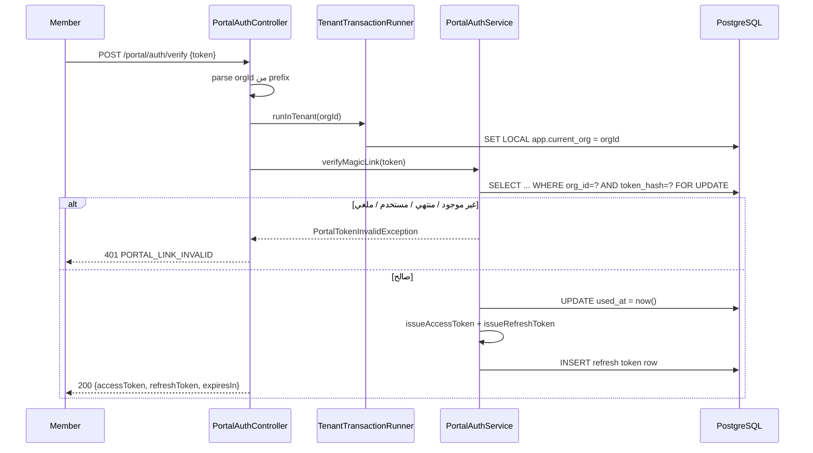

# Member Portal — خطة التنفيذ (P1)

> **الـ Phase:** Post-MVP · **المدة:** 9–12 يوم · **الترتيب:** بعد `notification` و`reporting`  
> **المرتبط:** [`README.md`](./README.md) · [identity/domain-design](../identity/domain-design.md) · [subscription/api-design](../subscription/api-design.md)

---

## 1. الـ Domain

### 1.1 `MemberPortalToken`

| الحقل | النوع | القيود | ملاحظات |
|---|---|---|---|
| `id` | `UUID` | PK | — |
| `orgId` | `UUID` | `NOT NULL` | RLS |
| `memberId` | `UUID` | `NOT NULL` | صاحب التوكن |
| `tokenHash` | `String` | `NOT NULL`, `CHAR(64)`, Unique `(org_id, token_hash)` | `SHA-256` — التوكن الخام **مش** بيتخزن |
| `tokenType` | `PortalTokenType` | `NOT NULL` | `MAGIC_LINK` / `REFRESH` |
| `expiresAt` | `Instant` | `NOT NULL` | Magic 15m / Refresh 30d |
| `usedAt` | `Instant` | `NULL` | Single-use |
| `revokedAt` | `Instant` | `NULL` | Logout / Reuse / Deactivation |
| `replacedBy` | `UUID` | `NULL` | سلسلة الـ Refresh Rotation |
| `createdAt` | `Instant` | `NOT NULL` | — |
| `createdIp` | `Inet` | `NULL` | للتدقيق |
| `userAgent` | `String` | `NULL`, ≤ 500 | للتدقيق |

```java
@Entity
@Table(name = "member_portal_tokens")
@Getter
@NoArgsConstructor(access = AccessLevel.PROTECTED)
public class MemberPortalToken extends BaseEntity implements TenantScoped {

    @Column(name = "org_id", nullable = false)
    private UUID orgId;

    @Column(name = "member_id", nullable = false)
    private UUID memberId;

    @Column(name = "token_hash", nullable = false, length = 64)
    private String tokenHash;

    @Enumerated(EnumType.STRING)
    @Column(name = "token_type", nullable = false, length = 20)
    private PortalTokenType tokenType;

    @Column(name = "expires_at", nullable = false)
    private Instant expiresAt;

    @Column(name = "used_at")
    private Instant usedAt;

    @Column(name = "revoked_at")
    private Instant revokedAt;

    @Column(name = "replaced_by")
    private UUID replacedBy;

    @Column(name = "created_at", nullable = false)
    private Instant createdAt;

    @Column(name = "created_ip", columnDefinition = "inet")
    private InetAddress createdIp;

    @Column(name = "user_agent", length = 500)
    private String userAgent;

    public boolean isUsable(Instant now) {
        return revokedAt == null && usedAt == null && expiresAt.isAfter(now);
    }

    public void markUsed(Instant now) {
        if (!isUsable(now)) throw new PortalTokenInvalidException();
        this.usedAt = now;
    }

    public void revoke(Instant now) {
        if (this.revokedAt == null) this.revokedAt = now;
    }

    public void replaceWith(UUID nextTokenId, Instant now) {
        this.usedAt = now;
        this.replacedBy = nextTokenId;
    }
}
```

> **ممنوع Setters.** الحقول دي بتتغير من خلال Methods بس، والـ DB Trigger بيمنع تعديل `token_hash` / `member_id` / `token_type`.

### 1.2 `PortalRenewalRequest`

| الحقل | النوع | القيود | ملاحظات |
|---|---|---|---|
| `id` | `UUID` | PK | — |
| `orgId` | `UUID` | `NOT NULL` | RLS |
| `branchId` | `UUID` | `NOT NULL` | من العضو |
| `memberId` | `UUID` | `NOT NULL` | — |
| `subscriptionId` | `UUID` | `NULL` | الاشتراك الحالي وقت الطلب |
| `note` | `String` | `NULL`, ≤ 500 | رسالة العضو |
| `status` | `RenewalRequestStatus` | `NOT NULL` | `NEW → CONTACTED → CONVERTED / DISMISSED` |
| `handledBy` | `UUID` | `NULL` | موظف |
| `handledAt` | `Instant` | `NULL` | — |
| `outcomeNote` | `String` | `NULL`, ≤ 500 | إلزامي مع `DISMISSED` |
| `createdAt` | `Instant` | `NOT NULL` | — |

```java
@Entity
@Table(name = "portal_renewal_requests")
@Getter
@NoArgsConstructor(access = AccessLevel.PROTECTED)
public class PortalRenewalRequest extends BaseEntity implements TenantScoped {

    private UUID orgId;
    private UUID branchId;
    private UUID memberId;
    private UUID subscriptionId;

    @Column(length = 500)
    private String note;

    @Enumerated(EnumType.STRING)
    @Column(nullable = false, length = 20)
    private RenewalRequestStatus status = RenewalRequestStatus.NEW;

    private UUID handledBy;
    private Instant handledAt;

    @Column(length = 500)
    private String outcomeNote;

    @Column(nullable = false)
    private Instant createdAt;

    public void markContacted(UUID actorId, Instant now) {
        requireStatus(RenewalRequestStatus.NEW);
        this.status = RenewalRequestStatus.CONTACTED;
        this.handledBy = actorId;
        this.handledAt = now;
    }

    public void convert(UUID actorId, Instant now) {
        requireStatus(RenewalRequestStatus.CONTACTED);
        this.status = RenewalRequestStatus.CONVERTED;
        this.handledBy = actorId;
        this.handledAt = now;
    }

    public void dismiss(UUID actorId, String reason, Instant now) {
        if (status == RenewalRequestStatus.CONVERTED) {
            throw new InvalidRenewalRequestStateException(status, "DISMISS");
        }
        if (reason == null || reason.isBlank()) {
            throw new BusinessException("Dismiss reason is required");
        }
        this.status = RenewalRequestStatus.DISMISSED;
        this.handledBy = actorId;
        this.handledAt = now;
        this.outcomeNote = reason.trim();
    }

    private void requireStatus(RenewalRequestStatus expected) {
        if (status != expected) {
            throw new InvalidRenewalRequestStateException(status, expected.name());
        }
    }
}
```

### 1.3 Branding — SC-28

`organizations` بتاخد حقلين للـ White-label:

| الحقل | النوع | القيود |
|---|---|---|
| `logo_url` | `String` | `NULL`, ≤ 500, HTTPS فقط |
| `primary_color` | `String` | `NOT NULL`, `CHAR(7)`, Default `#0F766E`, Regex `^#[0-9A-Fa-f]{6}$` |

- الـ `name` الموجود أصلاً بيستخدم كاسم الجيم في البوابة.
- ممنوع رفع لوجو في P1 — `logo_url` رابط خارجي فقط.
- تعديلهم من `PATCH /organizations/current` (Owner فقط) — موجود في `tenancy`.

### 1.4 الـ Enums

```java
public enum PortalTokenType {
    MAGIC_LINK,
    REFRESH
}

public enum RenewalRequestStatus {
    NEW,
    CONTACTED,
    CONVERTED,
    DISMISSED
}

public enum PortalDeliveryStatus {
    PENDING,
    QUEUED,
    SENT_CONFIRMED,
    FAILED
}
```

### 1.5 الـ Invariants

| # | الـ Invariant | مكان التحقق |
|:---:|---|---|
| INV-MP-01 | التوكن الخام مبيتخزنش أبداً | Service |
| INV-MP-02 | Magic Link صالح 15 دقيقة وSingle-use | Domain + DB |
| INV-MP-03 | Refresh صالح 30 يوم وRotation إجباري | Service |
| INV-MP-04 | كل `memberId` من الـ JWT — ممنوع من الـ Request | Filter + DTO |
| INV-MP-05 | `memberId` لازم يطابق `orgId` | FK + RLS |
| INV-MP-06 | مفيش طلب تجديد `NEW` مكرر لنفس العضو | Partial Unique + Service |
| INV-MP-07 | `DISMISSED` لازم `outcome_note` | Domain + DB CHECK |
| INV-MP-08 | Org غير نشط → ممنوع إصدار توكن | Service |
| INV-MP-09 | Member غير نشط/محذوف → ممنوع إصدار أو استخدام توكن | Service |
| INV-MP-10 | ممنوع تعديل/حذف `portal_renewal_requests` — Status فقط | Triggers |

---

## 2. قاعدة البيانات

### 2.1 `V23__create_member_portal_tokens.sql`

```sql
CREATE TABLE member_portal_tokens (
    id              UUID PRIMARY KEY DEFAULT gen_random_uuid(),
    org_id          UUID NOT NULL REFERENCES organizations(id),
    member_id       UUID NOT NULL REFERENCES members(id),
    token_hash      CHAR(64) NOT NULL,
    token_type      VARCHAR(20) NOT NULL
                    CHECK (token_type IN ('MAGIC_LINK','REFRESH')),
    expires_at      TIMESTAMPTZ NOT NULL,
    used_at         TIMESTAMPTZ,
    revoked_at      TIMESTAMPTZ,
    replaced_by     UUID REFERENCES member_portal_tokens(id),
    created_at      TIMESTAMPTZ NOT NULL DEFAULT now(),
    created_ip      INET,
    user_agent      VARCHAR(500),
    CONSTRAINT uk_mpt_hash UNIQUE (org_id, token_hash)
);

CREATE INDEX idx_mpt_lookup
    ON member_portal_tokens (org_id, token_hash)
    WHERE revoked_at IS NULL;

CREATE INDEX idx_mpt_member_active
    ON member_portal_tokens (org_id, member_id, token_type)
    WHERE revoked_at IS NULL;

CREATE INDEX idx_mpt_expiry
    ON member_portal_tokens (expires_at)
    WHERE revoked_at IS NULL;

ALTER TABLE member_portal_tokens ENABLE ROW LEVEL SECURITY;
ALTER TABLE member_portal_tokens FORCE ROW LEVEL SECURITY;

CREATE POLICY mpt_tenant_isolation ON member_portal_tokens
    USING (org_id = app.current_org_id())
    WITH CHECK (org_id = app.current_org_id());
```

### 2.2 `V24__create_portal_renewal_requests.sql`

```sql
CREATE TABLE portal_renewal_requests (
    id               UUID PRIMARY KEY DEFAULT gen_random_uuid(),
    org_id           UUID NOT NULL REFERENCES organizations(id),
    branch_id        UUID NOT NULL REFERENCES branches(id),
    member_id        UUID NOT NULL REFERENCES members(id),
    subscription_id  UUID REFERENCES subscriptions(id),
    note             VARCHAR(500),
    status           VARCHAR(20) NOT NULL DEFAULT 'NEW'
                     CHECK (status IN ('NEW','CONTACTED','CONVERTED','DISMISSED')),
    handled_by       UUID REFERENCES users(id),
    handled_at       TIMESTAMPTZ,
    outcome_note     VARCHAR(500),
    created_at       TIMESTAMPTZ NOT NULL DEFAULT now(),
    CONSTRAINT chk_renewal_dismiss_reason
        CHECK (status <> 'DISMISSED' OR outcome_note IS NOT NULL)
);

CREATE UNIQUE INDEX uk_portal_renewal_open
    ON portal_renewal_requests (org_id, member_id)
    WHERE status = 'NEW';

CREATE INDEX idx_portal_renewal_queue
    ON portal_renewal_requests (org_id, branch_id, status, created_at DESC);

ALTER TABLE portal_renewal_requests ENABLE ROW LEVEL SECURITY;
ALTER TABLE portal_renewal_requests FORCE ROW LEVEL SECURITY;

CREATE POLICY prr_tenant_isolation ON portal_renewal_requests
    USING (org_id = app.current_org_id())
    WITH CHECK (org_id = app.current_org_id());
```

### 2.3 `V25__add_organization_branding.sql`

```sql
ALTER TABLE organizations
    ADD COLUMN logo_url VARCHAR(500),
    ADD COLUMN primary_color CHAR(7) NOT NULL DEFAULT '#0F766E';

ALTER TABLE organizations
    ADD CONSTRAINT chk_org_primary_color
    CHECK (primary_color ~ '^#[0-9A-Fa-f]{6}$');
```

### 2.4 Member Isolation — GUC إضافي

الـ RLS الحالي بيحمي **بين الجيمات**. البوابة محتاجة حماية **بين أعضاء نفس الجيم** كمان:

```sql
-- V23
CREATE OR REPLACE FUNCTION app.current_member_id()
RETURNS UUID
LANGUAGE sql STABLE AS $$
    SELECT NULLIF(current_setting('app.current_member', true), '')::UUID
$$;

CREATE POLICY portal_member_scope ON members AS RESTRICTIVE FOR SELECT
    USING (
        app.current_member_id() IS NULL
        OR id = app.current_member_id()
    );

CREATE POLICY portal_member_scope ON subscriptions AS RESTRICTIVE FOR SELECT
    USING (
        app.current_member_id() IS NULL
        OR member_id = app.current_member_id()
    );

CREATE POLICY portal_member_scope ON payments AS RESTRICTIVE FOR SELECT
    USING (
        app.current_member_id() IS NULL
        OR member_id = app.current_member_id()
    );

CREATE POLICY portal_member_scope ON check_ins AS RESTRICTIVE FOR SELECT
    USING (
        app.current_member_id() IS NULL
        OR member_id = app.current_member_id()
    );
```

- `RESTRICTIVE` معناها إنها تتطبق **مع** الـ Permissive Policies (AND)، مش بدل عنها.
- لما `app.current_member` مش متضبط (طلبات الموظفين) → `NULL` → الـ Policy بتسمح، والـ Org Policy هي الحاكمة.
- لما Portal Context شغال → كل استعلام بيتقيد بالعضو.
- **كل** Repository في البوابة لازم كمان يحط `member_id = :memberId` صريح — الـ RLS دفاع إضافي مش بديل.

### 2.5 Triggers

```sql
-- ممنوع تغيير هوية التوكن
CREATE OR REPLACE FUNCTION app.guard_portal_token_update()
RETURNS TRIGGER LANGUAGE plpgsql AS $$
BEGIN
    IF NEW.token_hash <> OLD.token_hash
       OR NEW.member_id <> OLD.member_id
       OR NEW.token_type <> OLD.token_type
       OR NEW.org_id <> OLD.org_id THEN
        RAISE EXCEPTION 'portal token identity is immutable';
    END IF;
    RETURN NEW;
END;
$$;

CREATE TRIGGER trg_guard_portal_token_update
    BEFORE UPDATE ON member_portal_tokens
    FOR EACH ROW EXECUTE FUNCTION app.guard_portal_token_update();

-- طلب التجديد: Status + Handler فقط
CREATE OR REPLACE FUNCTION app.guard_renewal_request_update()
RETURNS TRIGGER LANGUAGE plpgsql AS $$
BEGIN
    IF NEW.member_id <> OLD.member_id
       OR NEW.org_id <> OLD.org_id
       OR NEW.branch_id <> OLD.branch_id
       OR NEW.created_at <> OLD.created_at THEN
        RAISE EXCEPTION 'renewal request identity is immutable';
    END IF;
    RETURN NEW;
END;
$$;

CREATE TRIGGER trg_guard_renewal_request_update
    BEFORE UPDATE ON portal_renewal_requests
    FOR EACH ROW EXECUTE FUNCTION app.guard_renewal_request_update();
```

### 2.6 التنظيف

- Job يومي 04:00 Cairo: `DELETE FROM member_portal_tokens WHERE expires_at < now() - interval '30 days'`.
- بيتنفذ بـ ShedLock — Instance واحدة.
- ممنوع حذف توكن لسه صالح.

---

## 3. المصادقة (Magic Link)

### 3.1 صيغة التوكن

| النوع | الصيغة | التخزين |
|---|---|---|
| Magic Link | `mpk1.{orgId}.{random-256-bit}` | `SHA-256(random)` في `token_hash` |
| Refresh | `mpr1.{orgId}.{random-256-bit}` | `SHA-256(random)` في `token_hash` |

- الـ `orgId` ظاهر عشان نضبط الـ Tenant قبل الـ Query — نفس فلسفة Refresh Token بتاع الموظفين.
- الـ `random` بـ `SecureRandom` — 32 byte — Base64URL بدون Padding.
- ممنوع Log للتوكن أو الـ Hash.

### 3.2 تدفق `request-link`



**قواعد:**

- الـ Response **دايمًا** `202 Accepted` — نفس الشكل ونفس التوقيت التقريبي.
- لو `whatsappOptIn = false` → مفيش Queue Item، ويتسجل `PORTAL_LINK_SUPPRESSED` في الـ Audit.
- لو فيه طلب خلال آخر 60 ثانية لنفس العضو → مفيش توكن جديد، ونفس الـ `202`.
- التوكن القديم غير المستخدم **مش** بيتلغي — لكن الجديد بيشتغل، والقديم لسه صالح لحد انتهاء الـ 15 دقيقة. ده مقصود عشان لو الرسالة اتأخرت.
- أقصى 3 توكنات Magic Link نشطين لنفس العضو — الأقدم بيتلغي تلقائياً.

### 3.3 تدفق `verify`



- `SELECT ... FOR UPDATE` بيمنع استخدام نفس الرابط مرتين تحت التزامن.
- بعد الاستخدام → `401 PORTAL_LINK_INVALID` (مش بنقول «مستخدم» عشان مفيش Enumeration).
- لو الـ Member اتغير لـ `INACTIVE` بعد إصدار الرابط → `401 PORTAL_ACCESS_DENIED`.

### 3.4 Portal JWT

```json
{
  "sub": "a0b1c2d3-e4f5-6a7b-8c9d-0e1f2a3b4c5d",
  "org_id": "11111111-2222-3333-4444-555555555555",
  "member_id": "a0b1c2d3-e4f5-6a7b-8c9d-0e1f2a3b4c5d",
  "scope": "MEMBER",
  "jti": "9f8e7d6c-5b4a-3210-fedc-ba9876543210",
  "iat": 1730635200,
  "exp": 1730636100
}
```

| العنصر | القيمة |
|---|---|
| Algorithm | `HS256` — نفس الـ Secret |
| Access TTL | 15 دقيقة |
| Refresh TTL | 30 يوم |
| Claims | `sub`, `org_id`, `member_id`, `scope`, `jti`, `iat`, `exp` |
| Role | **مفيش** — ممنوع `role` أو `branch_id` |
| Audience | `kammel-portal` (اختياري P1) |

- الـ Staff `JwtAuthenticationFilter` **لازم** يرفض أي Token فيه `scope = MEMBER` حتى لو التوقيع صحيح.
- الـ Portal Filter **لازم** يرفض أي Token مفيهوش `scope = MEMBER`.

### 3.5 Refresh Rotation

```text
1. parse orgId من mpr1.{orgId}.{random}
2. SET LOCAL app.current_org
3. SELECT ... FOR UPDATE BY (org_id, token_hash)
4. لو مش موجود / منتهي / revoked → 401 PORTAL_SESSION_INVALID
5. لو used_at != null → Reuse Detected:
   - revoke كل توكنات العضو النشطة
   - Audit PORTAL_REFRESH_REUSE
   - 401 PORTAL_SESSION_INVALID
6. أنشئ Refresh جديد + Access جديد
7. old.used_at = now(); old.replaced_by = new.id
8. 200 {accessToken, refreshToken, expiresIn}
```

- Refresh Reuse بيلغي **كل** الجلسات — نفس مبدأ `identity`.
- Logout: `revoke` للـ Refresh المقدّم + كل الـ Chain. الـ Access Token بيفضل صالح لحد 15 دقيقة (مفيش Denylist).

### 3.6 Filter Chains

```java
@Bean
@Order(1)
SecurityFilterChain portalChain(HttpSecurity http) throws Exception {
    http.securityMatcher("/api/v1/portal/**")
        .csrf(csrf -> csrf.disable())
        .sessionManagement(s -> s.sessionCreationPolicy(STATELESS))
        .authorizeHttpRequests(auth -> auth
            .requestMatchers(
                "/api/v1/portal/auth/request-link",
                "/api/v1/portal/auth/verify",
                "/api/v1/portal/auth/refresh",
                "/api/v1/portal/branding"
            ).permitAll()
            .anyRequest().hasAuthority("SCOPE_MEMBER"))
        .addFilterBefore(portalJwtFilter, UsernamePasswordAuthenticationFilter.class);
    return http.build();
}

@Bean
@Order(2)
SecurityFilterChain staffChain(HttpSecurity http) throws Exception {
    // نفس السلسلة الحالية — مع رفض scope=MEMBER جوه JwtAuthenticationFilter
}
```

- البوابة **مش** بتستخدم `@PreAuthorize("hasRole(...)")` — الـ Authority الوحيدة `SCOPE_MEMBER`.
- كل Controllers البوابة تحت `/api/v1/portal/**` — مفيش استثناءات.

---

## 4. الـ API

**Base Path:** `/api/v1/portal`

### 4.1 Public

| Method | Path | Auth | الوصف |
|---|---|---|---|
| GET | `/portal/branding` | Public | هوية الجيم لصفحة الدخول |
| POST | `/portal/auth/request-link` | Public + Rate Limit | طلب Magic Link |
| POST | `/portal/auth/verify` | Public + Rate Limit | استبدال الرابط بجلسة |
| POST | `/portal/auth/refresh` | Public | تدوير الجلسة |

### 4.2 Member

| Method | Path | Auth | الوصف |
|---|---|---|---|
| POST | `/portal/auth/logout` | Member | إنهاء الجلسة |
| GET | `/portal/me` | Member | بيانات العضو + الجيم |
| GET | `/portal/subscription` | Member | الحالي + التاريخ |
| GET | `/portal/qr` | Member | بيانات QR |
| GET | `/portal/qr/image` | Member | QR PNG |
| GET | `/portal/checkins` | Member | سجل الحضور + Streak |
| GET | `/portal/payments` | Member | المدفوعات |
| GET | `/portal/payments/{id}/receipt` | Member | إيصال PDF |
| POST | `/portal/renewal-requests` | Member | طلب تجديد |
| GET | `/portal/renewal-requests` | Member | طلباته |

### 4.3 Staff

| Method | Path | Roles | الوصف |
|---|---|---|---|
| GET | `/portal/admin/renewal-requests` | Owner, Manager, Receptionist | Queue طلبات التجديد |
| PATCH | `/portal/admin/renewal-requests/{id}` | Owner, Manager, Receptionist | تحديث الحالة |

---

### 4.4 `GET /portal/branding`

**Query:** `slug` (إلزامي).

```json
{
  "success": true,
  "message": "OK",
  "data": {
    "organizationName": "Iron Gym Maadi",
    "logoUrl": "https://cdn.example.com/iron-gym.png",
    "primaryColor": "#0F766E",
    "portalEnabled": true
  }
}
```

- Public — بيستخدم قبل الدخول.
- `404 ORGANIZATION_NOT_FOUND` لو الـ Slug غلط أو الـ Org غير نشطة.
- Cache-Control: `public, max-age=300`.

### 4.5 `POST /portal/auth/request-link`

```json
{
  "organizationSlug": "iron-gym-maadi",
  "phone": "01012345678"
}
```

**Response `202 Accepted` — دايمًا:**

```json
{
  "success": true,
  "message": "If this number is registered, a login link will be sent on WhatsApp.",
  "data": null
}
```

**Rules:**

- ممنوع نكشف هل الرقم موجود.
- `phone` بيتطبع قبل البحث.
- Rate Limit: `3 / 15m` لكل `(org, phone)` و`10 / h` لكل IP.
- لو الـ Member موجود و`whatsappOptIn = true`:
  - `PortalAuthService.issueMagicLink`.
  - `NotificationService.enqueueTransactional(PORTAL_MAGIC_LINK)`.
  - Audit `PORTAL_LINK_REQUESTED`.
- لو `whatsappOptIn = false`:
  - مفيش إرسال.
  - Audit `PORTAL_LINK_SUPPRESSED`.

**Delivery — قرار P1:**

- الـ Magic Link بيتسلم من خلال `notification` كـ **Transactional Message** — بيتجاوز:
  - الـ 3-Day Cooldown.
  - نافذة 09:00–21:00.
- القالب `PORTAL_MAGIC_LINK` **جديد** (SC-29) وبيتعامل كـ Transactional.
- في P1 الـ Channel هو `WA_ME`: الرسالة بتظهر في Queue الاستقبال، والموظف بيبعت الرابط بضغطة.
- لو WhatsApp Cloud API متاح → نفس الـ Queue Item بيتبعت تلقائي (`CLOUD_API`).
- الرابط صالح 15 دقيقة — عشان كده الـ Queue Item بياخد `priority = HIGH` و`due_at = now`.

### 4.6 `POST /portal/auth/verify`

```json
{
  "token": "mpk1.11111111-2222-3333-4444-555555555555.7f3c2a1b..."
}
```

**Response `200 OK`:**

```json
{
  "success": true,
  "message": "Welcome Ahmed",
  "data": {
    "accessToken": "eyJhbGciOiJIUzI1NiIs...",
    "refreshToken": "mpr1.11111111-...",
    "expiresIn": 900,
    "member": {
      "id": "a0b1c2d3-...",
      "fullName": "Ahmed Tarek",
      "memberCode": "M-000123"
    }
  }
}
```

**Errors:**

| الحالة | Error |
|---|---|
| `401` | `PORTAL_LINK_INVALID` |
| `401` | `PORTAL_ACCESS_DENIED` |
| `429` | `RATE_LIMIT_EXCEEDED` |

### 4.7 `POST /portal/auth/refresh`

```json
{ "refreshToken": "mpr1.11111111-..." }
```

**Response `200 OK`:** نفس شكل `verify` بدون `member`.

**Errors:** `401 PORTAL_SESSION_INVALID`.

### 4.8 `POST /portal/auth/logout`

- Body: `{ "refreshToken": "..." }`.
- `204 No Content`.
- Idempotent — لو التوكن مش موجود يرجع `204`.

### 4.9 `GET /portal/me`

```json
{
  "success": true,
  "message": "OK",
  "data": {
    "memberId": "a0b1c2d3-...",
    "memberCode": "M-000123",
    "fullName": "Ahmed Tarek",
    "phone": "01012345678",
    "branchName": "Maadi",
    "memberSince": "2026-01-12",
    "status": "ACTIVE",
    "organization": {
      "name": "Iron Gym Maadi",
      "logoUrl": "https://cdn.example.com/iron-gym.png",
      "primaryColor": "#0F766E"
    }
  }
}
```

- مفيش `orgId` ولا `notes` ولا `assignedTrainerId`.
- الـ `branchName` من `tenancy`.

### 4.10 `GET /portal/subscription`

```json
{
  "success": true,
  "message": "OK",
  "data": {
    "current": {
      "id": "77777777-...",
      "planName": "Gold 3-Month",
      "status": "ACTIVE",
      "startDate": "2026-09-05",
      "endDate": "2026-12-03",
      "daysRemaining": 30,
      "expiringSoon": true,
      "sessionsRemaining": null,
      "frozenUntil": null,
      "freezeReason": null,
      "priceFormatted": "1,800.00 EGP"
    },
    "history": [
      {
        "id": "66666666-...",
        "planName": "Silver 1-Month",
        "status": "EXPIRED",
        "startDate": "2026-08-01",
        "endDate": "2026-08-31",
        "priceFormatted": "700.00 EGP"
      }
    ],
    "renewalPriceHint": "1,800.00 EGP"
  }
}
```

- `current = null` لو مفيش اشتراك `ACTIVE/GRACE/FROZEN` — البوابة بتعرض «تواصل مع الاستقبال».
- `renewalPriceHint` = سعر الباقة الحالية **الحالي** — مش Snapshot. معناها «ابتدائي».
- `history` بترجع آخر 10 اشتراكات — الأحدث أولاً.

### 4.11 `GET /portal/qr`

```json
{
  "success": true,
  "message": "OK",
  "data": {
    "payload": "7f3c2a1b-9d4e-4c8a-b1f2-3e5d6c7b8a90",
    "memberCode": "M-000123",
    "imageUrl": "/api/v1/portal/qr/image"
  }
}
```

- الـ `payload` هو `members.qr_token`.
- الثابت ده هو اللي الاستقبال بيقرأه في `STATIC_QR`.
- ممنوع يتغير من البوابة.

### 4.12 `GET /portal/qr/image`

- `Content-Type: image/png`.
- `Cache-Control: no-store` — عشان الـ Token ميتخزنش في Cache.
- الحجم 512×512، Quiet Zone 4 Modules.
- المكتبة: ZXing (`com.google.zxing:core` + `javase`).

### 4.13 `GET /portal/checkins`

**Query:** `page` (default 0), `size` (default 20, max 50).

```json
{
  "success": true,
  "message": "OK",
  "data": {
    "streakDays": 4,
    "thisMonthCount": 11,
    "lastVisitAt": "2026-11-03T18:15:00Z",
    "content": [
      {
        "id": "44444444-...",
        "branchName": "Maadi",
        "checkedInAt": "2026-11-03T18:15:00Z",
        "method": "PHONE_SEARCH"
      }
    ],
    "page": 0,
    "size": 20,
    "totalElements": 47,
    "totalPages": 3,
    "first": true,
    "last": false
  }
}
```

**Streak:**

- عدد الأيام **المتتالية** اللي فيها Check-in واحد على الأقل.
- بيبدأ من **آخر يوم حضور** وليس بالضرورة اليوم.
- لو آخر حضور قبل أكتر من يوم → الـ Streak لسه بيتحسب من آخر حضور، لكن `streakActive = false`.
- الحساب بـ `Africa/Cairo`.

```java
public int calculateStreak(List<LocalDate> distinctVisitDates, LocalDate today) {
    if (distinctVisitDates.isEmpty()) return 0;
    LocalDate cursor = distinctVisitDates.get(0);
    if (cursor.isBefore(today.minusDays(1))) {
        // آخر زيارة قديمة — السلسلة انتهت
        return 1;
    }
    int streak = 1;
    for (int i = 1; i < distinctVisitDates.size(); i++) {
        if (distinctVisitDates.get(i).equals(cursor.minusDays(1))) {
            streak++;
            cursor = distinctVisitDates.get(i);
        } else {
            break;
        }
    }
    return streak;
}
```

> الـ Query بتجيب آخر 90 يوم Distinct Dates بس — كافي لحساب Streak واقعي.

### 4.14 `GET /portal/payments`

**Query:** `page`, `size`.

```json
{
  "success": true,
  "message": "OK",
  "data": {
    "totalPaidFormatted": "5,400.00 EGP",
    "content": [
      {
        "id": "88888888-...",
        "amountFormatted": "1,800.00 EGP",
        "method": "CASH",
        "status": "COMPLETED",
        "receiptNumber": "KM-2026-000421",
        "paidAt": "2026-09-05T11:20:00Z",
        "receiptAvailable": true
      }
    ],
    "page": 0,
    "size": 20,
    "totalElements": 3,
    "totalPages": 1,
    "first": true,
    "last": true
  }
}
```

- `REVERSED` تظهر لكن `receiptAvailable = false`.
- ممنوع `idempotencyKey` أو `orgId`.

### 4.15 `GET /portal/payments/{id}/receipt`

- `Content-Type: application/pdf`.
- **Ownership Check:** `payment.memberId == currentMemberId` وإلا `404`.
- يعيد استخدام `ReceiptService` من `payment` — ممنوع Logic جديد.
- `Cache-Control: no-store`.

### 4.16 `POST /portal/renewal-requests`

```json
{
  "note": "عايز أجدد 3 شهور، ممكن أدفع يوم 10؟"
}
```

**Response `201 Created`:**

```json
{
  "success": true,
  "message": "Renewal request sent",
  "data": {
    "id": "bbbbbbbb-...",
    "status": "NEW",
    "createdAt": "2026-11-03T20:10:00Z"
  }
}
```

**Rules:**

- لو فيه `NEW` موجود → `200 OK` بنفس الطلب (Idempotent) — مش `409`.
- `subscriptionId` = `findAccessSubscription(memberId)` — ممكن `null`.
- `branchId` من الـ Member.
- Audit `PORTAL_RENEWAL_REQUESTED`.
- بيعمل Notification داخلي للاستقبال؟ **لا** — بيظهر في Queue الخاصة بالبوابة + `reporting`.

### 4.17 `GET /portal/renewal-requests`

- آخر 10 طلبات للعضو.
- الحقول: `id`, `status`, `note`, `createdAt`, `handledAt`.

### 4.18 `GET /portal/admin/renewal-requests`

**Query:** `status` (default `NEW`), `branchId` (Owner), `page`, `size`.

**Response:** `PageResponse<RenewalRequestSummary>`.

```json
{
  "id": "bbbbbbbb-...",
  "memberId": "a0b1c2d3-...",
  "memberName": "Ahmed Tarek",
  "memberPhone": "01012345678",
  "memberCode": "M-000123",
  "branchId": "99999999-...",
  "planName": "Gold 3-Month",
  "subscriptionEndDate": "2026-12-03",
  "note": "عايز أجدد 3 شهور",
  "status": "NEW",
  "createdAt": "2026-11-03T20:10:00Z"
}
```

- Manager/Receptionist → فرعهم فقط.
- Trainer → `403`.

### 4.19 `PATCH /portal/admin/renewal-requests/{id}`

```json
{
  "status": "CONTACTED",
  "outcomeNote": null
}
```

**Allowed Transitions:**

| من | إلى | ملاحظة |
|---|---|---|
| `NEW` | `CONTACTED` | — |
| `NEW` | `DISMISSED` | `outcomeNote` إلزامي |
| `CONTACTED` | `CONVERTED` | يتم بعد إنشاء التجديد فعلياً |
| `CONTACTED` | `DISMISSED` | `outcomeNote` إلزامي |

- `CONVERTED` ممنوع يدوي قبل وجود `Subscription` جديد لنفس العضو بعد `createdAt` — فحص في الـ Service.
- Audit `PORTAL_RENEWAL_HANDLED`.

---

## 5. الـ PWA (Frontend)

> الـ Backend هو الأساس، لكن البوابة محتاجة قرارات واضحة عشان التنفيذ يبقى كامل.

### 5.1 التقنية

| العنصر | الاختيار |
|---|---|
| Framework | React 18 + TypeScript + Vite |
| Routing | React Router |
| State/Data | TanStack Query |
| Styling | Tailwind CSS + RTL |
| PWA | `vite-plugin-pwa` (Workbox) |
| QR Display | Canvas (بيانات من الـ API) |
| Deploy | Nginx / CDN — `portal.kammel.app` |

### 5.2 الشاشات

| Route | الشاشة |
|---|---|
| `/:slug` | Login — رقم الموبايل + طلب رابط |
| `/:slug/verify?token=` | Verify + Redirect |
| `/app/home` | اشتراكي + أيام متبقية |
| `/app/qr` | كود الدخول |
| `/app/checkins` | الحضور + Streak |
| `/app/payments` | المدفوعات + الإيصالات |
| `/app/renew` | طلب تجديد |

### 5.3 White-label

- `/portal/branding?slug=` قبل الدخول → `document.title`, Logo, `--color-primary`.
- بعد الدخول → `/portal/me` بيرجع نفس الهوية.
- Manifest **ديناميكي**:

```ts
const manifest = {
  name: `${org.name} — عضو`,
  short_name: org.name,
  start_url: `/${slug}/app/home`,
  display: 'standalone',
  background_color: '#ffffff',
  theme_color: org.primaryColor,
  icons: [{ src: '/icons/192.png', sizes: '192x192', type: 'image/png' }]
};
const blob = new Blob([JSON.stringify(manifest)], { type: 'application/manifest+json' });
document.querySelector('#manifest')!.setAttribute('href', URL.createObjectURL(blob));
```

- الاسم واللون بيتغيروا بدون Build — نفس الـ Bundle لكل الجيمات.

### 5.4 الـ Caching

| المورد | السياسة |
|---|---|
| App Shell (`/`, JS, CSS, Fonts) | `CacheFirst` — Versioned |
| `/portal/me`, `/portal/subscription` | `NetworkOnly` |
| `/portal/qr/image` | `NetworkOnly` + `no-store` |
| `/portal/payments/*` | `NetworkOnly` |
| `/portal/checkins` | `NetworkOnly` |
| `/portal/branding` | `StaleWhileRevalidate` — 5 دقائق |

- **ممنوع** Cache لأي Response فيه بيانات عضو.
- Service Worker بيمسح الـ Caches القديمة عند الـ Activate.
- Logout بيمسح TanStack Query Cache + Service Worker Caches.

### 5.5 الأمان في المتصفح

- الـ Access Token في **Memory** فقط — مش `localStorage`.
- الـ Refresh Token في `HttpOnly; Secure; SameSite=Strict` Cookie لو نفس الدومين، أو Memory + Silent Refresh.
- **قرار P1:** البوابة على نفس الدومين (`/portal`) → Refresh Cookie `HttpOnly`.
- CSP: `default-src 'self'; img-src 'self' https:; connect-src 'self'`.
- ممنوع `dangerouslySetInnerHTML` في رسائل التجديد.

---

## 6. الـ Tasks

### TSK-MP-001 — Migrations + Entities (1.5 يوم)

- `V23__create_member_portal_tokens.sql` + RLS + Restrictive Policies + Trigger.
- `V24__create_portal_renewal_requests.sql` + Partial Unique + Trigger.
- `V25__add_organization_branding.sql`.
- `MemberPortalToken`, `PortalRenewalRequest`.
- Repositories.

### TSK-MP-002 — Portal Auth (2 يوم)

- `PortalAuthService`: `requestLink`, `verify`, `refresh`, `logout`.
- `PortalTokenGenerator`: prefix + SecureRandom + SHA-256.
- `PortalJwtService`: issue/parse + scope.
- `MemberPortalAuthFilter`.
- `PortalSecurityConfig` — Filter Chain order 1.
- Rate Limiter (Caffeine) — مفاتيح `org:phone` و`ip`.
- Audit.

### TSK-MP-003 — Notification Integration (0.5 يوم)

- `MessageTemplate.PORTAL_MAGIC_LINK`.
- `message_queue.is_transactional` (SC-29) + Bypass Cooldown/Window.
- `NotificationService.enqueueTransactional(...)`.
- `PortalLinkRenderer` — نص الرسالة + `wa_me_link` بآخر 15 دقيقة.

### TSK-MP-004 — Member Read APIs (2 يوم)

- `PortalQueryService`.
- `/portal/me`, `/portal/subscription`, `/portal/checkins`, `/portal/payments`.
- `PortalScope` — يستخرج `memberId` من الـ JWT.
- `PortalRepository` contract — كل Method فيها `memberId`.
- Streak Calculator.
- QR Generation (ZXing).

### TSK-MP-005 — Renewal Requests (1 يوم)

- `PortalRenewalService` — create (idempotent) + list.
- `RenewalRequestAdminService` — queue + transitions + branch scope.
- Audit.

### TSK-MP-006 — PWA (2–3 يوم)

- React App + Routes + RTL.
- Login + Verify.
- Home + QR + Check-ins + Payments + Renewal.
- Dynamic Manifest + Service Worker.
- Token Storage Strategy.
- Empty/Error/Loading States.

### TSK-MP-007 — Isolation + Tests (1.5 يوم)

- Isolation Suite للبوابة.
- Concurrency Tests.
- E2E Flow.
- Security Review.

---

## 7. الاختبارات

### 7.1 Unit

| # | الاختبار | المتوقع |
|---|---|---|
| UT-MP-01 | توليد Magic Link | Prefix + Org + Random |
| UT-MP-02 | تخزين Hash | `SHA-256` — مفيش Raw |
| UT-MP-03 | Token منتهي | `isUsable = false` |
| UT-MP-04 | Token مستخدم | `markUsed` يرمي Exception |
| UT-MP-05 | Refresh Rotation | `replaced_by` + `used_at` |
| UT-MP-06 | Streak 4 أيام متتالية | `4` |
| UT-MP-07 | Streak بعد فجوة | يتوقف عند الفجوة |
| UT-MP-08 | Renewal `DISMISSED` بدون سبب | Exception |
| UT-MP-09 | Membership Level Mapping | `GRACE` → `current` |

### 7.2 Integration

| # | الاختبار | المتوقع |
|---|---|---|
| IT-MP-01 | رقم غير مسجل | `202` — مفيش Token |
| IT-MP-02 | رقم مسجل + Opt-in | Token + Queue Item |
| IT-MP-03 | Opt-out | `202` + مفيش Queue + Audit Suppressed |
| IT-MP-04 | Org `SUSPENDED` | `202` + مفيش Token |
| IT-MP-05 | Verify صالح | `200` + Tokens |
| IT-MP-06 | Verify مرتين | الثاني `401` |
| IT-MP-07 | Verify منتهي | `401` |
| IT-MP-08 | Refresh صالح | Tokens جديدة + القديم مستخدم |
| IT-MP-09 | Refresh Reuse | كل الجلسات ملغية |
| IT-MP-10 | Logout | Refresh ملغي |
| IT-MP-11 | Member اتعمل له Deactivate | `401` |
| IT-MP-12 | QR payload | يطابق `members.qr_token` |
| IT-MP-13 | Receipt عضو تاني | `404` |
| IT-MP-14 | Renewal مكرر | نفس الطلب — `200` |
| IT-MP-15 | Renewal Transition غلط | `422` |
| IT-MP-16 | Manager فرع تاني | `404` |

### 7.3 Isolation

| # | الاختبار | المتوقع |
|---|---|---|
| ISO-MP-01 | Member A يقرأ `/portal/me` | بيانات A فقط |
| ISO-MP-02 | Member A يفتح إيصال B | `404` |
| ISO-MP-03 | Member A يعدل طلب B | `404` |
| ISO-MP-04 | Portal Token على `/api/v1/members` | `401/403` |
| ISO-MP-05 | Staff Token على `/portal/me` | `401/403` |
| ISO-MP-06 | Token بجيم تاني | `401` |
| ISO-MP-07 | RLS Restrictive مع `app.current_member` | صفر صفوف لغيره |
| ISO-MP-08 | Query من غير `member_id` | Isolation Test يفشل البناء |

### 7.4 Concurrency

| # | الاختبار | المتوقع |
|---|---|---|
| CC-MP-01 | Verify متزامن ×2 | واحد ينجح |
| CC-MP-02 | Refresh متزامن ×2 | واحد ينجح + Reuse Detection |
| CC-MP-03 | Renewal متزامن ×2 | صف واحد |
| CC-MP-04 | 3 Magic Links نشطين | الأقدم يتلغي |

### 7.5 E2E

```text
1. العضو يطلب رابط من /{slug}
2. الاستقبال يشوف Queue Item ويبعت الرابط
3. العضو يفتح الرابط → Verify → Home
4. يشوف الاشتراك + QR
5. يشوف 3 حضور + Streak
6. يحمّل إيصال
7. يبعت طلب تجديد
8. الاستقبال يشوف الطلب ويعلّمه CONTACTED
```

---

## 8. معايير القبول

- [ ] Magic Link Flow كامل (Request → Delivery → Verify → Refresh → Logout).
- [ ] مفيش Enumeration — نفس الـ `202` في كل الحالات.
- [ ] Rate Limit شغال.
- [ ] Portal JWT منفصل تماماً عن Staff JWT.
- [ ] Member Isolation على مستوى Repository + RLS.
- [ ] `/portal/me` + `/portal/subscription` + `/portal/qr`.
- [ ] `/portal/checkins` + Streak صحيح.
- [ ] `/portal/payments` + Receipt Ownership.
- [ ] Renewal Request + Staff Queue.
- [ ] Branding + Dynamic Manifest.
- [ ] مفيش Tokens في الـ Logs.
- [ ] Tests خضراء (Unit + Integration + Isolation + Concurrency).
- [ ] E2E يدوي على Android Chrome + iOS Safari.

---

## 9. المخاطر

| المخاطرة | التخفيف |
|---|---|
| WhatsApp Cloud API غير متاح | Fallback `WA_ME` + Queue للاستقبال (الافتراضي في P1) |
| الموظف يشوف Magic Link | صلاحية 15 دقيقة + Single-use + Audit + إلغاء عند الشك |
| تخزين التوكن في المتصفح | Access في Memory + Refresh HttpOnly Cookie |
| PWA Cache يسرب بيانات | NetworkOnly لكل APIs + مسح Cache عند Logout |
| Enumeration بالرد | `202` ثابت + Rate Limit + نفس التوقيت |
| رقم مشترك بين أفراد | Unique `(org_id, phone)` — نفس قيد `member` |
| تغيير رقم العضو | الجلسات الحالية شغالة بـ `memberId` — الرقم الجديد للطلبات الجديدة |
| Streak يحسب غلط عبر التوقيت | حساب بـ `Africa/Cairo` + Test |
| Refresh Reuse | Rotation + إلغاء العائلة + Audit |
| RLS Restrictive تنسى جدول | Isolation Test لكل Endpoint + مراجعة الـ Migrations |
| iOS PWA limitations | اختبار Safari + Fallback Web |
| رابط البوابة في رسالة WhatsApp | `wa.me` بيشفّر الرسالة في الرابط — مقبول P1 |

---

## 10. مرتبط بـ

- [`README.md`](./README.md)
- [security-strategy](../../architecture/security-strategy.md)
- [database-strategy](../../architecture/database-strategy.md)
- [identity/domain-design](../identity/domain-design.md)
- [subscription/api-design](../subscription/api-design.md)
- [payment/api-design](../payment/api-design.md)
- [checkin/api-design](../checkin/api-design.md)
- [notification/domain-design](../notification/domain-design.md)
