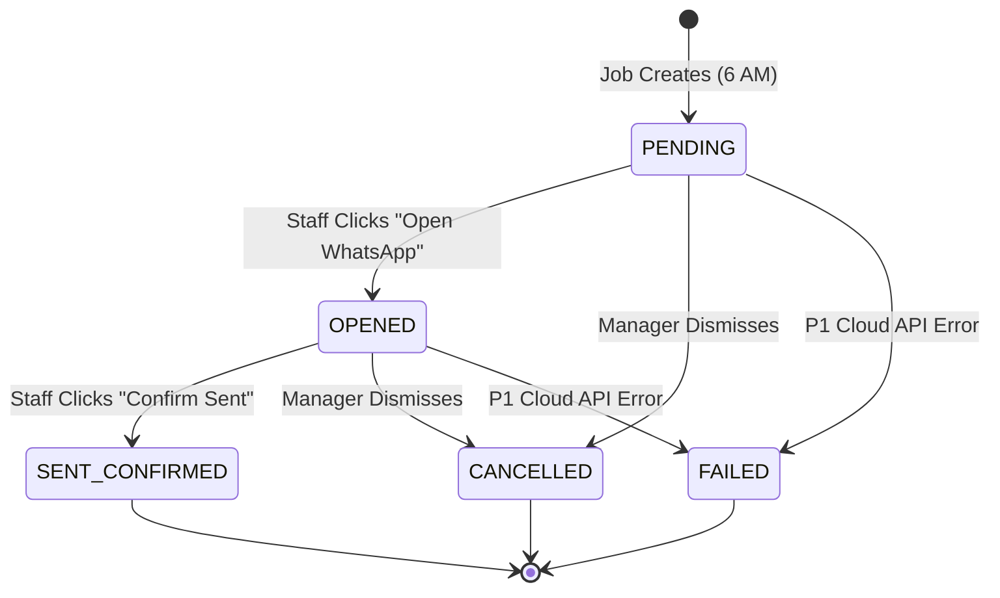

# Notification — تصميم الـ Domain

> **الـ Package:** `com.kammel.features.notification.domain`  
> **المرتبط:** [`README.md`](./README.md) · [entity-relationships](../../architecture/entity-relationships.md) · [database-strategy](../../architecture/database-strategy.md)

---

## 1. `MessageQueueItem`

| الحقل | النوع | القيود | ملاحظات |
|---|---|---|---|
| `id` | `UUID` | PK | — |
| `orgId` | `UUID` | `NOT NULL` | RLS |
| `branchId` | `UUID` | `NOT NULL` | **SC-13** — فلترة الفرع |
| `memberId` | `UUID` | `NOT NULL` | — |
| `template` | `MessageTemplate` | `NOT NULL` | 5 قيم |
| `renderedText` | `String` | `NOT NULL` | `TEXT` |
| `status` | `MessageStatus` | `NOT NULL` | Lifecycle |
| `dueDate` | `LocalDate` | `NOT NULL` | Cairo |
| `waMeLink` | `String` | `NULL` | **SC-27:** `TEXT` |
| `openedAt` | `Instant` | `NULL` | **SC-24** |
| `isTransactional` | `boolean` | `NOT NULL`, Default `false` | **SC-29** — بيتجاوز Cooldown/Window |
| `sentAt` | `Instant` | `NULL` | — |
| `sentBy` | `UUID` | `NULL` | — |
| `attributedSubscriptionId` | `UUID` | `NULL` | — |
| `createdAt` | `Instant` | `NOT NULL` | — |

```java
@Entity
@Table(name = "message_queue")
@Getter
@NoArgsConstructor(access = AccessLevel.PROTECTED)
public class MessageQueueItem extends BaseEntity implements TenantScoped {

    @Column(name = "org_id", nullable = false)
    private UUID orgId;

    @Column(name = "branch_id", nullable = false)
    private UUID branchId;

    @Column(name = "member_id", nullable = false)
    private UUID memberId;

    @Enumerated(EnumType.STRING)
    @Column(nullable = false, length = 30)
    private MessageTemplate template;

    @Column(name = "rendered_text", nullable = false, columnDefinition = "text")
    private String renderedText;

    @Enumerated(EnumType.STRING)
    @Column(nullable = false, length = 20)
    private MessageStatus status;

    @Column(name = "due_date", nullable = false)
    private LocalDate dueDate;

    @Column(name = "wa_me_link", columnDefinition = "text")
    private String waMeLink;

    @Column(name = "opened_at")
    private Instant openedAt;

    @Column(name = "is_transactional", nullable = false)
    private boolean transactional = false;

    @Column(name = "sent_at")
    private Instant sentAt;

    @Column(name = "sent_by")
    private UUID sentBy;

    @Column(name = "attributed_subscription_id")
    private UUID attributedSubscriptionId;

    @Column(name = "created_at", nullable = false)
    private Instant createdAt;

    public void markOpened(Instant now) {
        if (status == MessageStatus.OPENED) return;
        if (status != MessageStatus.PENDING) {
            throw new InvalidMessageStateException(status, "OPEN");
        }
        this.status = MessageStatus.OPENED;
        this.openedAt = now;
    }

    public void markSent(UUID actorId, Instant now) {
        if (status == MessageStatus.SENT_CONFIRMED) return;
        if (status != MessageStatus.OPENED) {
            throw new InvalidMessageStateException(status, "SENT");
        }
        this.status = MessageStatus.SENT_CONFIRMED;
        this.sentAt = now;
        this.sentBy = actorId;
    }

    public void cancel() {
        if (status != MessageStatus.PENDING && status != MessageStatus.OPENED) {
            throw new InvalidMessageStateException(status, "CANCEL");
        }
        this.status = MessageStatus.CANCELLED;
    }

    public void attributeTo(UUID subscriptionId) {
        if (attributedSubscriptionId == null) {
            this.attributedSubscriptionId = subscriptionId;
        }
    }
}
```

> **ممنوع Setters** على `renderedText` / `template` / `memberId` / `dueDate` / `waMeLink`.
> الـ DB Trigger بيمنع تعديل المحتوى، والـ Service بيمنع أي Transition غلط.

---

## 2. الـ Enums

```java
public enum MessageTemplate {
    RENEWAL_REMINDER,
    GRACE_EXPOSURE,
    MISS_YOU,
    WELCOME,       // P1 — معرّف لكن مش بيتولد في MVP
    COLLECTION     // P1 — محتاج Payment Read Contract
    PORTAL_MAGIC_LINK // P1 — Transactional
}

public enum MessageStatus {
    PENDING,
    OPENED,
    SENT_CONFIRMED,
    CANCELLED,
    FAILED          // P1 — Cloud API
}

public enum NotificationChannelType {
    WA_ME,
    CLOUD_API       // P1
}
```

> **SC-24:** `chk_message_template` لازم تشمل `GRACE_EXPOSURE` — الوثيقة الأصلية فيها 4 قيم بس، والقالب موجود في §5 من نفس الوثيقة.

---

## 3. الـ Lifecycle



### 3.1 جدول الـ Transitions

| From | Action | To | Actor | Preconditions |
|---|---|---|---|---|
| — | `Generate` | `PENDING` | Job | Opt-in + Cooldown + Trigger |
| `PENDING` | `Open` | `OPENED` | Staff | داخل وقت الإرسال |
| `PENDING` | `Cancel` | `CANCELLED` | Manager/Owner | — |
| `OPENED` | `Confirm Sent` | `SENT_CONFIRMED` | Staff | داخل وقت الإرسال |
| `OPENED` | `Cancel` | `CANCELLED` | Manager/Owner | — |
| `SENT_CONFIRMED` | أي Action | — | — | ❌ `409` |
| `CANCELLED` | أي Action | — | — | ❌ `409` |

> **BR-033:** `OPENED` مش إرسال. لو الاستقبال فتح الرابط وقفل واتساب بدون إرسال، الرسالة تفضل `OPENED` وتظهر كـ Pending Confirm.

---

## 4. القوالب

### 4.1 `RENEWAL_REMINDER`

**الاستخدام:** `ACTIVE` و`endDate` = `today + 7` / `+3` / `+1`.

```text
أهلاً يا {memberName} 👋
اشتراكك في {gymName} هينتهي يوم {endDate}.
جدّد دلوقتي عشان تحتفظ بسعرك وماتخسرش أي أيام تمرين.
تحب نجهّزلك كارت التجديد؟ 💪
```

### 4.2 `GRACE_EXPOSURE`

**الاستخدام:** `GRACE` — أي يوم داخل الـ Grace.

```text
أهلاً يا {memberName}،
اشتراكك انتهى، لكن إحنا في فترة السماح بتاعتك لحد {graceEndDate}.
تقدر تشرفنا في أي وقت لتجديد الاشتراك وتكمل مشوارك الرياضي!
```

### 4.3 `MISS_YOU`

**الاستخدام:** `risk_level IN (HIGH, CRITICAL)`.

```text
يا {memberName}، وحشتنا في {gymName}! 🏋️‍♂️
لاحظنا إنك بقالك {daysAbsent} يوم مجتش.
كابتن الجيم مستنيك، تحب نظبّطلك ميعاد تمرين الأسبوع ده؟
```

### 4.4 `WELCOME` — P1

```text
أهلاً يا {memberName} في {gymName}! 💪
اشتراكك جاهز، وأول تمرين هو بداية التغيير.
```

### 4.5 `COLLECTION` — P1

```text
أهلاً يا {memberName}،
فاضل على اشتراكك {outstandingAmount}.
تحب نرتبلك طريقة السداد؟
```

### 4.6 `PORTAL_MAGIC_LINK` — P1 (Transactional)

**الاستخدام:** طلب دخول Member Portal.

```text
أهلاً يا {memberName}،
دي رابط دخولك لتطبيق {gymName}:
{magicLink}

الرابط صالح 15 دقيقة وممكن تستخدمه مرة واحدة بس.
لو مش إنت اللي طلبته، تجاهل الرسالة.
```

- `isTransactional = true`.
- بيتجاوز الـ Cooldown ونافذة 09:00–21:00.
- ممنوع يتأجل — `dueDate = today` و`priority = HIGH`.
- ممنوع يتعمله Batch أو Marketing.

> `WELCOME` و`COLLECTION` معرّفين في الـ Enum والـ DB، لكن الـ Job مش بيولدهم في الـ MVP.

---

## 5. الـ Rendering

```java
public interface MessageTemplateRenderer {
    RenderedMessage render(MessageTemplate template, Map<String, String> variables);
}

public record RenderedMessage(String text) {}
```

### 5.1 المتغيرات

| المتغير | المصدر |
|---|---|
| `{memberName}` | `MemberQueryService` |
| `{gymName}` | `OrganizationQueryService` |
| `{endDate}` | `SubscriptionQueryService` |
| `{graceEndDate}` | `SubscriptionQueryService` |
| `{daysAbsent}` | `RiskQueryService` / `CheckInQueryService` |
| `{outstandingAmount}` | P1 — `PaymentQueryService` |

### 5.2 القواعد

1. كل المتغيرات لازم تكون موجودة — ممنوع `{unknown}` في النص.
2. المتغير الفاضي → `IllegalArgumentException` + Log — مفيش رسالة ناقصة.
3. النص النهائي ≤ 1000 حرف (قبل URL Encoding).
4. الـ Emojis مسموحة — UTF-8.
5. ممنوع إدراج أي مبلغ مالي في `RENEWAL_REMINDER` / `MISS_YOU` — عشان السعر بيتغير.
6. الـ `renderedText` **Immutable** بعد الحفظ.

---

## 6. الـ `wa.me` Link

```java
public final class WaMeLinkBuilder {

    public static String build(String egyptianPhone, String text) {
        String e164 = PhoneUtil.toE164Egypt(egyptianPhone); // 201012345678
        String encoded = URLEncoder.encode(text, StandardCharsets.UTF_8);
        return "https://wa.me/" + e164 + "?text=" + encoded;
    }
}
```

- `01012345678` → `201012345678`.
- ممنوع `+` أو `00` في الـ Path.
- الـ Link بيتخزن في `wa_me_link` (`TEXT` — SC-27).
- الـ Frontend بيفتحه في تاب جديد.
- ممنوع `target="_blank"` بدون `rel="noopener"`.

---

## 7. الـ Generation Job

### 7.1 الإعداد

```java
@Scheduled(cron = "0 0 6 * * *", zone = "Africa/Cairo")
@SchedulerLock(name = "messageQueueJob", lockAtMostFor = "15m")
public void run() {
    List<UUID> orgIds = organizationQueryService.listActiveOrgIds();
    for (UUID orgId : orgIds) {
        tenantTransactionRunner.runInTenant(orgId, this::generateForTenant);
    }
}
```

### 7.2 خطوات الـ Tenant

1. `listMembersWithAccess()` من `subscription`.
2. لكل عضو:
   - `whatsappOptIn == true` وإلا Skip.
   - العضو غير محذوف/نشط.
   - Global Cooldown Check.
   - تحديد الـ Trigger.
   - Render + Link.
   - حفظ `PENDING`.
3. Commit.

### 7.3 تحديد الـ Trigger

```text
accessSub = findAccessSubscription(memberId)

لو accessSub.status == GRACE:
    template = GRACE_EXPOSURE
غير كده لو accessSub.status == ACTIVE
         و endDate in {today+7, today+3, today+1}:
    template = RENEWAL_REMINDER
غير كده لو riskLevel in {HIGH, CRITICAL}:
    template = MISS_YOU
غير كده:
    Skip
```

**الأولوية:** `GRACE_EXPOSURE` > `RENEWAL_REMINDER` > `MISS_YOU`.

- لو العضو هياخد `RENEWAL_REMINDER` النهارده، مش هنبعت `MISS_YOU` كمان.
- لو عضو `CRITICAL` واشتراكه لسه 20 يوم → `MISS_YOU`.
- لو عضو `CRITICAL` واشتراكه بينتهي خلال 3 أيام → `RENEWAL_REMINDER` (الأهم).

### 7.4 الـ Cooldown

```java
boolean onCooldown = messageQueryService
    .findLastCreatedAt(memberId)
    .map(last -> last.isAfter(now.minus(3, DAYS)))
    .orElse(false);
```

- Global على كل القوالب — NOT-04.
- الحالات اللي بتمنع: `PENDING`, `OPENED`, `SENT_CONFIRMED`.
- `CANCELLED` / `FAILED` مش بتمنع — عشان لو Manager ألغى رسالة غلط، يقدر يولد غيرها.
- **الـ Job Idempotent:** إعادة التشغيل نفس اليوم → Cooldown بيمنع التكرار.
- **استثناء Transactional (P1):** `is_transactional = true` بيتجاوز الـ Cooldown — Magic Link لازم يوصل فوراً.

### 7.5 مفيش رسالة مكررة

- مفيش Unique Constraint على `(member_id, due_date)` لأن الـ Cooldown بيمنع.
- لو حصل Race (Job على Instance‑ين) → ShedLock بيمنع.
- لو الـ Job اتشغل يدوياً بالغلط → Cooldown بيمنع.

---

## 8. وقت الإرسال

### 8.1 النافذة

```text
09:00 <= now(Cairo) < 21:00
```

### 8.2 التطبيق

| المكان | السلوك |
|---|---|
| `GET /queue` | بره النافذة → `content: []` + `availableAt: next 09:00`. |
| `PATCH /opened` | بره النافذة → `422 OUTSIDE_SEND_WINDOW`. |
| `PATCH /sent` | بره النافذة → `422 OUTSIDE_SEND_WINDOW`. |
| Job | بيشتغل 6:00 — بيولّد بس مش بيبعت. |

- **استثناء Transactional (P1):** `is_transactional = true` بيتجاوز النافذة — لأن رابط الدخول بي expire خلال 15 دقيقة.
- الـ `Clock` بيتحقن — Testable.
- ممنوع الاعتماد على `LocalTime.now()` مباشرة.
- لو الـ Branch في Timezone مختلف → MVP كله `Africa/Cairo` (ASM-20).

---

## 9. الـ Opt-in

- `members.whatsapp_opt_in = true` شرط أساسي.
- لو `false`:
  - الـ Job مش بيولّد.
  - `PATCH /opened` / `/sent` → `422 MEMBER_OPTED_OUT`.
- لو العضو طلب Opt-out:
  - الاستقبال بيعمل `PATCH /members/{id}` → `whatsappOptIn = false`.
  - الرسائل الـ `PENDING` بتفضل — لكن مش هتتبعت.
  - يفضل Manager يلغيها → `CANCELLED`.
- ممنوع إرسال لأرقام غير مصرية في MVP.

---

## 10. Attribution

### 10.1 الحدث

```java
@TransactionalEventListener(phase = AFTER_COMMIT)
public void onSubscriptionRenewed(SubscriptionRenewedEvent event) {
    messageAttributionService.attribute(event);
}
```

> `SubscriptionRenewedEvent` بيتنشر **بعد تفعيل** اشتراك التجديد (بعد الدفع) — مش عند إنشاء سجل `PENDING_PAYMENT`.

### 10.2 الخوارزمية

```sql
SELECT *
FROM message_queue
WHERE org_id = :orgId
  AND member_id = :memberId
  AND status = 'SENT_CONFIRMED'
  AND sent_at >= :renewalDate - INTERVAL '7 days'
  AND attributed_subscription_id IS NULL
ORDER BY sent_at DESC
LIMIT 1;
```

- لو موجودة → `attributed_subscription_id = :newSubscriptionId`.
- لو مفيش → مفيش Attribution.
- ممنوع ربط رسالة واحدة بأكتر من تجديد — الـ `NULL` Check.
- ممنوع ربط رسالة `PENDING` / `OPENED`.

### 10.3 الـ Report

- `GET /notifications/attribution`:
  - `sentCount` — `SENT_CONFIRMED` في الفترة.
  - `attributedCount` — فيها `attributed_subscription_id`.
  - `attributedValueMinor` — مجموع `price_minor_snapshot` للتجديدات المربوطة.
  - `attributionRate` — `attributedCount / sentCount`.
  - `byTemplate` — Breakdown.

---

## 11. الـ Channel Abstraction

```java
public interface NotificationChannel {
    NotificationChannelType getType();
    PreparedMessage prepare(MessageQueueItem item);
    DispatchResult dispatch(MessageQueueItem item);
    boolean supportsAutomatedDeliveryReceipts();
}

public record PreparedMessage(String text, String link) {}
public record DispatchResult(boolean automated, String externalId, Instant dispatchedAt) {}
```

| Channel | P0 | P1 |
|---|:---:|:---:|
| `WaMeChannel` | ✅ | ✅ |
| `CloudApiChannel` | ❌ | ✅ |

- `WaMeChannel.dispatch` بيرجع `automated = false` — الإرسال يدوي.
- `CloudApiChannel` في P1 بيبعت فعلياً وبيستقبل Webhooks.
- الـ Business Logic مش بيتغير — بس الـ Channel.

---

## 12. الـ Query Service

```java
public interface NotificationQueryService {

    Optional<Instant> findLastCreatedAt(UUID memberId);

    PageResponse<MessageQueueSummary> listQueue(MessageFilter filter, Pageable pageable);

    Optional<MessageQueueSummary> getMessage(UUID messageId);

    AttributionStats getAttributionStats(LocalDate from, LocalDate to, UUID branchId);
}

public interface NotificationCommandService {
    UUID enqueueTransactional(TransactionalMessageCommand command);
}

public record MessageQueueSummary(
    UUID id,
    UUID memberId,
    String memberName,
    String memberPhone,
    UUID branchId,
    MessageTemplate template,
    String renderedText,
    String waMeLink,
    MessageStatus status,
    LocalDate dueDate,
    Instant openedAt,
    Instant sentAt,
    UUID sentBy,
    String sentByName,
    UUID attributedSubscriptionId,
    Instant createdAt
) {}

public record AttributionStats(
    long sentCount,
    long attributedCount,
    long attributedValueMinor,
    String attributedValueFormatted,
    double attributionRate,
    List<TemplateAttribution> byTemplate
) {}
```

- `listQueue` Default `status = PENDING` + `dueDate = today`.
- Manager/Receptionist → فرعهم فقط.
- ممنوع ترجع Entity.

---

## 13. الـ Invariants

| # | الـ Invariant | مكان التحقق |
|:---:|---|---|
| INV-NOT-01 | `renderedText` Immutable | Trigger + No Setter |
| INV-NOT-02 | `template` / `memberId` / `dueDate` Immutable | Trigger |
| INV-NOT-03 | ممنوع `DELETE` | Trigger + Grants |
| INV-NOT-04 | `SENT_CONFIRMED` نهائية | State Machine |
| INV-NOT-05 | `SENT_CONFIRMED` → `sentAt` + `sentBy` | DB CHECK + Service |
| INV-NOT-06 | `OPENED` → `openedAt` | Service |
| INV-NOT-07 | Cooldown 3 أيام | Service + Job |
| INV-NOT-08 | Opt-in | Service |
| INV-NOT-09 | 9–21 Cairo | Service |
| INV-NOT-10 | `branchId` = فرع العضو | Job |
| INV-NOT-11 | Attribution خلال 7 أيام | Service |
| INV-NOT-12 | `is_transactional = true` بيتجاوز Cooldown + Send Window | Service |
| INV-NOT-13 | `PORTAL_MAGIC_LINK` ممنوع يتأجل أو يتعمله Batch | Service |
| INV-NOT-12 | رسالة واحدة لكل تجديد | `NULL` Check |
| INV-NOT-13 | `orgId` من الـ Context | Service |

---

## 14. الأخطاء

| Exception | HTTP | متى |
|---|:---:|---|
| `MessageNotFoundException` | 404 | رسالة مش موجودة / Org تانية |
| `InvalidMessageStateException` | 409 | Transition غلط |
| `OutsideSendWindowException` | 422 | بره 9–21 |
| `MemberOptedOutException` | 422 | `whatsapp_opt_in = false` |
| `MessageAlreadySentException` | 409 | محاولة إلغاء/تعديل بعد الإرسال |
| `TemplateRenderException` | 500 | متغير ناقص |

---

## 15. مرتبط بـ

- [`implementation-plan.md`](./implementation-plan.md)
- [`api-design.md`](./api-design.md)
- [`testing-plan.md`](./testing-plan.md)
- [risk/domain-design](../risk/domain-design.md)
