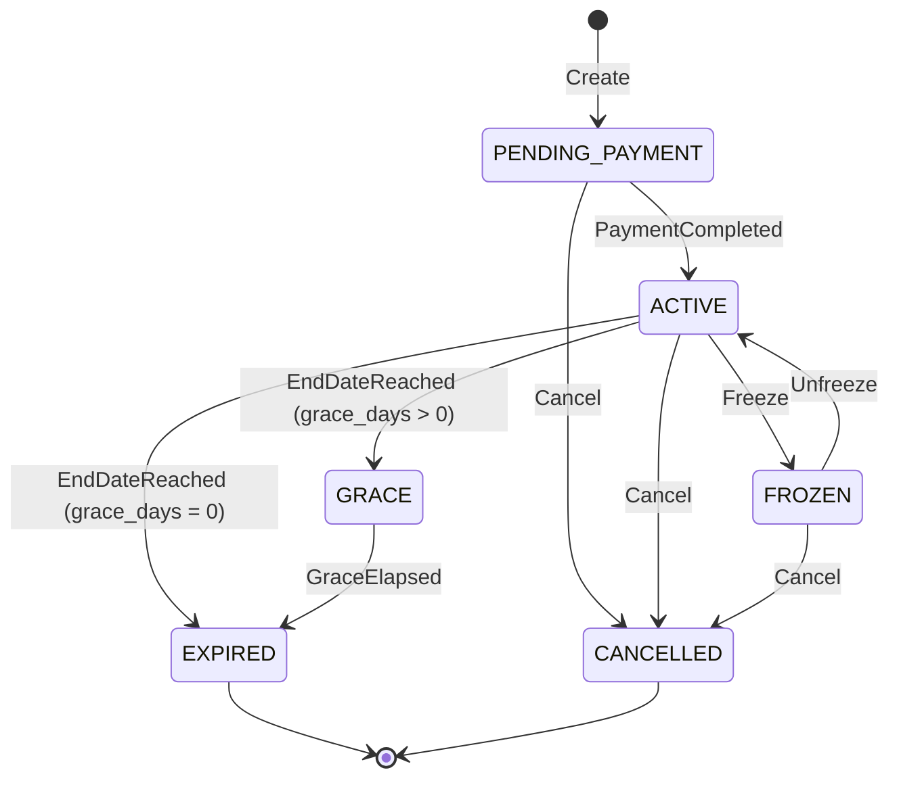

# Subscription — تصميم الـ Domain

> **الـ Package:** `com.kammel.features.subscription.domain`  
> **المرتبط:** [`README.md`](./README.md) · [entity-relationships](../../architecture/entity-relationships.md) · [decisions-and-assumptions](../../architecture/decisions-and-assumptions.md)

---

## 1. `Subscription`

| الحقل | النوع | القيود | ملاحظات |
|---|---|---|---|
| `id` | `UUID` | PK | — |
| `orgId` | `UUID` | `NOT NULL` | Tenant |
| `memberId` | `UUID` | `NOT NULL` | — |
| `planId` | `UUID` | `NOT NULL` | — |
| `renewalOf` | `UUID` | `NULL` | **SC-25** — الاشتراك السابق عند التجديد |
| `priceMinorSnapshot` | `long` | `> 0` | ثابت |
| `startDate` | `LocalDate` | `NOT NULL` | — |
| `endDate` | `LocalDate` | `>= startDate` | — |
| `status` | `SubscriptionStatus` | `NOT NULL` | State Machine |
| `sessionsRemaining` | `Integer` | `NULL` أو `>= 0` | — |
| `frozenDaysUsed` | `int` | `>= 0` | — |
| `frozenAt` | `Instant` | `NULL` | — |
| `scheduledUnfreezeDate` | `LocalDate` | `NULL` | — |
| `freezeReason` | `String` | `NULL`, ≤ 500 | — |
| `graceEndsAt` | `LocalDate` | `NULL` | — |
| `cancelledAt` | `Instant` | `NULL` | — |
| `cancelReason` | `String` | `NULL`, ≤ 500 | — |
| `createdAt` / `updatedAt` | `Instant` | `NOT NULL` | — |

```java
@Entity
@Table(name = "subscriptions")
@Getter
@NoArgsConstructor(access = AccessLevel.PROTECTED)
public class Subscription extends BaseEntity implements TenantScoped {

    @Column(name = "org_id", nullable = false)
    private UUID orgId;

    @Column(name = "member_id", nullable = false)
    private UUID memberId;

    @Column(name = "plan_id", nullable = false)
    private UUID planId;

    @Column(name = "renewal_of")
    private UUID renewalOf;

    @Column(name = "price_minor_snapshot", nullable = false)
    private long priceMinorSnapshot;

    @Column(name = "start_date", nullable = false)
    private LocalDate startDate;

    @Column(name = "end_date", nullable = false)
    private LocalDate endDate;

    @Enumerated(EnumType.STRING)
    @Column(nullable = false, length = 20)
    private SubscriptionStatus status;

    @Column(name = "sessions_remaining")
    private Integer sessionsRemaining;

    @Column(name = "frozen_days_used", nullable = false)
    private int frozenDaysUsed;

    @Column(name = "frozen_at")
    private Instant frozenAt;

    @Column(name = "scheduled_unfreeze_date")
    private LocalDate scheduledUnfreezeDate;

    @Column(name = "freeze_reason", length = 500)
    private String freezeReason;

    @Column(name = "grace_ends_at")
    private LocalDate graceEndsAt;

    @Column(name = "cancelled_at")
    private Instant cancelledAt;

    @Column(name = "cancel_reason", length = 500)
    private String cancelReason;

    public boolean isExpiringSoon(LocalDate today) {
        return status == SubscriptionStatus.ACTIVE
            && !today.isBefore(endDate.minusDays(7))
            && !today.isAfter(endDate);
    }

    public boolean isAccessAllowed() {
        return status == SubscriptionStatus.ACTIVE || status == SubscriptionStatus.GRACE;
    }

    public boolean isSessionBased() {
        return sessionsRemaining != null;
    }
}
```

> **ممنوع Setters عامة على `status`.** التغيير عبر `SubscriptionStateMachine` فقط.

---

## 2. `SubscriptionEvent`

| الحقل | النوع | القيود | ملاحظات |
|---|---|---|---|
| `id` | `UUID` | PK | — |
| `orgId` | `UUID` | `NOT NULL` | RLS |
| `subscriptionId` | `UUID` | `NOT NULL` | — |
| `type` | `SubscriptionEventType` | `NOT NULL` | 8 أنواع |
| `fromStatus` | `SubscriptionStatus` | `NULL` | — |
| `toStatus` | `SubscriptionStatus` | `NOT NULL` | — |
| `actorId` | `UUID` | `NULL` | `NULL` للـ System |
| `reason` | `String` | `NULL`, ≤ 500 | إلزامي لبعض العمليات |
| `metadata` | `JsonNode` | `NULL` | JSONB |
| `createdAt` | `Instant` | `NOT NULL` | — |

```java
@Entity
@Table(name = "subscription_events")
@Getter
@NoArgsConstructor(access = AccessLevel.PROTECTED)
public class SubscriptionEvent {

    @Id
    private UUID id;

    @Column(name = "org_id", nullable = false)
    private UUID orgId;

    @Column(name = "subscription_id", nullable = false)
    private UUID subscriptionId;

    @Enumerated(EnumType.STRING)
    @Column(nullable = false, length = 30)
    private SubscriptionEventType type;

    @Enumerated(EnumType.STRING)
    @Column(name = "from_status", length = 20)
    private SubscriptionStatus fromStatus;

    @Enumerated(EnumType.STRING)
    @Column(name = "to_status", nullable = false, length = 20)
    private SubscriptionStatus toStatus;

    @Column(name = "actor_id")
    private UUID actorId;

    @Column(length = 500)
    private String reason;

    @JdbcTypeCode(SqlTypes.JSON)
    @Column(columnDefinition = "jsonb")
    private JsonNode metadata;

    @Column(name = "created_at", nullable = false)
    private Instant createdAt;

    public static SubscriptionEvent of(
        Subscription sub, SubscriptionEventType type,
        SubscriptionStatus from, UUID actorId,
        String reason, JsonNode metadata
    ) { ... }
}
```

> **Append-Only** — ممنوع `UPDATE`/`DELETE`.

---

## 3. الـ Enums

```java
public enum SubscriptionStatus {
    PENDING_PAYMENT, ACTIVE, FROZEN, GRACE, EXPIRED, CANCELLED
}

public enum SubscriptionEventType {
    CREATED, ACTIVATED, RENEWED, FROZEN,
    UNFROZEN, GRACE_ENTERED, EXPIRED, CANCELLED
}
```

> `EXPIRING_SOON` **مش** Status — Computed ([C-04](../../architecture/decisions-and-assumptions.md#2-التعارضات-اللي-تم-حلها-resolved-conflicts)).

---

## 4. الـ State Machine



> **Renewal مش Transition** — بينشئ `Subscription` جديد. القديم بيفضل `ACTIVE` (لو لسه ما انتهاش) أو `EXPIRED` (لو انتهى/في Grace).

### 4.1 جدول الـ Transitions

| From | Trigger | To | Actor | Preconditions |
|---|---|---|---|---|
| — | `Create` | `PENDING_PAYMENT` | Owner/Manager/Receptionist | Member active + Plan active |
| `PENDING_PAYMENT` | `PaymentCompleted` | `ACTIVE` | System | `totalPaid >= priceSnapshot` |
| `PENDING_PAYMENT` | `Cancel` | `CANCELLED` | Manager/Owner | Reason + مفيش Payments |
| `ACTIVE` | `Freeze` | `FROZEN` | Manager/Owner | `frozenDaysUsed + days <= freezeMaxDays` |
| `FROZEN` | `Unfreeze` | `ACTIVE` | Manager/Owner/System | Extend `endDate` by actual days |
| `ACTIVE` | `EndDateReached` | `GRACE` | Scheduler | `graceDays > 0` |
| `ACTIVE` | `EndDateReached` | `EXPIRED` | Scheduler | `graceDays = 0` |
| `GRACE` | `GraceElapsed` | `EXPIRED` | Scheduler | `today > graceEndsAt` |
| `ACTIVE` | `Cancel` | `CANCELLED` | Manager/Owner | Reason |
| `FROZEN` | `Cancel` | `CANCELLED` | Manager/Owner | Reason |
| `EXPIRED` | `Renew` | — | — | **ممنوع** — سجل جديد |
| `CANCELLED` | `Renew` | — | — | **ممنوع** — سجل جديد |

### 4.2 Transitions ممنوعة

| Transition | Exception |
|---|---|
| `EXPIRED → ACTIVE` | `InvalidStateTransitionException` |
| `CANCELLED → ACTIVE` | `InvalidStateTransitionException` |
| `PENDING_PAYMENT → FROZEN` | `InvalidStateTransitionException` |
| `FROZEN → FROZEN` | `InvalidStateTransitionException` |
| `GRACE → FROZEN` | `InvalidStateTransitionException` |
| `ACTIVE → PENDING_PAYMENT` | `InvalidStateTransitionException` |

---

## 5. حسابات التواريخ

### 5.1 الإنشاء

```text
startDate = request.startDate ?? today(Cairo)
endDate   = startDate + plan.durationDays
sessionsRemaining = plan.sessionCount (لو Session-based)
priceMinorSnapshot = plan.priceMinor
status = PENDING_PAYMENT
```

### 5.2 التجديد قبل الانتهاء (`today <= endDate`)

```text
newStartDate = old.endDate
newEndDate   = newStartDate + newPlan.durationDays
status = PENDING_PAYMENT
renewalOf = old.id
priceMinorSnapshot = newPlan.priceMinor   // لقطة جديدة — مش سعر القديم
old.status = ACTIVE (يفضل)
```

### 5.3 التجديد بعد الانتهاء / في الـ Grace

```text
newStartDate = today(Cairo)   // أو payment date
newEndDate   = newStartDate + newPlan.durationDays
status = PENDING_PAYMENT
renewalOf = old.id
priceMinorSnapshot = newPlan.priceMinor
old.status = EXPIRED (لو لسه ACTIVE/GRACE)
```

### 5.4 التجميد

```text
requestedDays = request.days   // > 0
لو frozenDaysUsed + requestedDays > plan.freezeMaxDays → رفض
status = FROZEN
frozenAt = now
scheduledUnfreezeDate = today(Cairo) + requestedDays
freezeReason = request.reason
```

### 5.5 فك التجميد

```text
actualDays = DAYS.between(frozenAt(Cairo), today(Cairo))
actualDays = min(actualDays, requestedDays)   // لو رجع بدري
actualDays = max(actualDays, 0)

endDate = endDate + actualDays
frozenDaysUsed += actualDays
status = ACTIVE
frozenAt = null
scheduledUnfreezeDate = null
freezeReason = null
```

> **مثال:** تجميد 7 أيام يوم 1، فك يوم 4 → `actualDays = 3` → `endDate += 3`.

### 5.6 الـ Grace

```text
graceEndsAt = endDate + plan.graceDays
status = GRACE
```

- الـ Check-in مسموح في `GRACE`.
- لو `today > graceEndsAt` → `EXPIRED`.

### 5.7 انتهاء الجلسات

```text
sessionsRemaining -= 1
لو sessionsRemaining == 0 → status = EXPIRED + Event(EXPIRED, reason = SESSIONS_EXHAUSTED)
```

### 5.8 `EXPIRING_SOON`

```java
boolean expiringSoon = status == ACTIVE
    && !today.isBefore(endDate.minusDays(7))
    && !today.isAfter(endDate);
```

- مش متخزن.
- بيتحسب في الـ Response.

---

## 6. الـ Invariants

| # | الـ Invariant | مكان التحقق |
|:---:|---|---|
| INV-SUB-01 | `endDate >= startDate` | DB CHECK |
| INV-SUB-02 | `status` من الـ State Machine فقط | Service + No Setter |
| INV-SUB-03 | `priceMinorSnapshot` ثابت | No Setter |
| INV-SUB-04 | `frozenDaysUsed <= plan.freezeMaxDays` | Service |
| INV-SUB-05 | `sessionsRemaining >= 0` | DB CHECK + Service |
| INV-SUB-06 | كل تغيير حالة → `SubscriptionEvent` | Service |
| INV-SUB-07 | `reason` إلزامي للـ Freeze/Cancel | DTO + Service |
| INV-SUB-08 | `EXPIRED`/`CANCELLED` ممنوع يرجعوا `ACTIVE` | State Machine |
| INV-SUB-09 | `FROZEN` ممنوع Check-in | `checkin` |
| INV-SUB-10 | `GRACE` مسموح Check-in | `checkin` |
| INV-SUB-11 | ممنوع Delete | Grants |
| INV-SUB-12 | `orgId` من الـ Context | Service |
| INV-SUB-13 | `renewalOf` لازم يشير لاشتراك نفس العضو ونفس الـ Org | Service + FK |

---

## 7. الـ Query Service

```java
public interface SubscriptionQueryService {
    SubscriptionSummary getSubscription(UUID subscriptionId);
    List<SubscriptionSummary> findByMember(UUID memberId);
    Optional<SubscriptionSummary> findAccessSubscription(UUID memberId);
    boolean hasActiveMembership(UUID memberId);
    long getPriceSnapshot(UUID subscriptionId);
}

public record SubscriptionSummary(
    UUID id,
    UUID memberId,
    UUID planId,
    String planName,
    long priceMinorSnapshot,
    LocalDate startDate,
    LocalDate endDate,
    SubscriptionStatus status,
    Integer sessionsRemaining,
    int frozenDaysUsed,
    boolean grantsAccess,
    boolean expiringSoon
) {}
```

- `findAccessSubscription` بترجع الاشتراك اللي `grantsAccess = true` و`status IN (ACTIVE, GRACE)` — الأقرب انتهاءً.
- `hasActiveMembership` = فيه `ACTIVE`/`FROZEN`/`GRACE`.
- ممنوع ترجع Entity.

---

## 8. الـ Command Service

```java
public interface SubscriptionService {
    SubscriptionResponse create(CreateSubscriptionRequest request);
    SubscriptionResponse renew(UUID subscriptionId, RenewSubscriptionRequest request);
    SubscriptionResponse freeze(UUID subscriptionId, FreezeSubscriptionRequest request);
    SubscriptionResponse unfreeze(UUID subscriptionId, String reason);
    SubscriptionResponse cancel(UUID subscriptionId, CancelSubscriptionRequest request);
    void activateIfFullyPaid(UUID subscriptionId, long totalPaidMinor);
    void consumeSession(UUID subscriptionId);
    void processExpirationsForTenant();
    void processAutoUnfreezeForTenant();
}
```

- `consumeSession` بترمي `NoSessionsRemainingException` لو خلصت.
- `processExpirationsForTenant` بتشتغل جوه Tenant Scope.

---

## 9. الأحداث

| Event | متى | Listener |
|---|---|---|
| `SubscriptionActivatedEvent` | بعد التفعيل | `risk`, `notification`, `member` |
| `SubscriptionRenewedEvent` | بعد **تفعيل** الاشتراك الجديد — مش بعد إنشاء `PENDING_PAYMENT` | `notification`, `member` |
| `SubscriptionExpiredEvent` | بعد الانتهاء | `risk`, `member` |
| `MemberAccessChangedEvent` | بعد أي تغيير يؤثر على العضوية | `member` |
| `SubscriptionCancelledEvent` | بعد الإلغاء | `member`, `reporting` |

**قواعد:**
- النشر بعد الـ Commit (`@TransactionalEventListener(AFTER_COMMIT)`).
- `MemberAccessChangedEvent` بيتنشر من `subscription` — مش من `member` — عشان مفيش Compile Cycle.
- `SubscriptionRenewedEvent` بيتنشر بعد التفعيل/الدفعة المكتملة — عشان الـ Attribution يربط بتجديد حقيقي.
- الـ Listener Idempotent.
- كل Event فيه `orgId` + `occurredAt`.

---

## 10. الأخطاء

| Exception | HTTP | متى |
|---|:---:|---|
| `SubscriptionNotFoundException` | 404 | مش موجود / Org تانية |
| `InvalidStateTransitionException` | 422 | Transition ممنوعة |
| `FreezeLimitExceededException` | 422 | تجاوز `freeze_max_days` |
| `NoSessionsRemainingException` | 422 | خلصت الجلسات |
| `SubscriptionNotActiveException` | 422 | عملية على غير النشط |
| `PlanInactiveException` | 422 | باقة معطلة |
| `MemberInactiveException` | 422 | عضو غير نشط |

---

## 11. مرتبط بـ

- [`implementation-plan.md`](./implementation-plan.md)
- [`api-design.md`](./api-design.md)
- [database-strategy](../../architecture/database-strategy.md)
