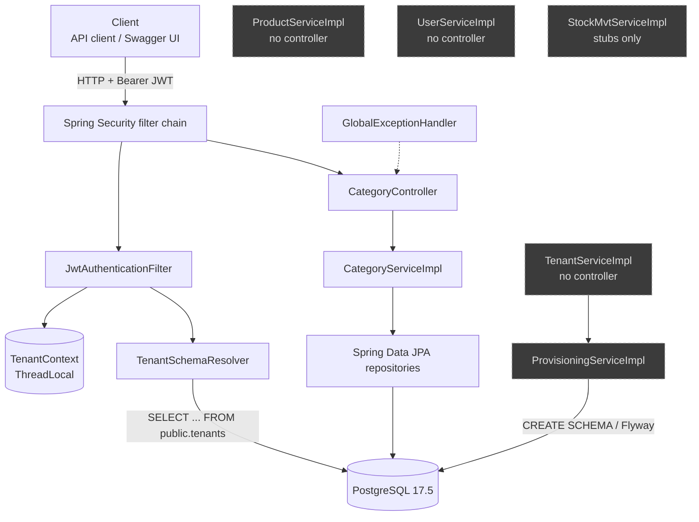
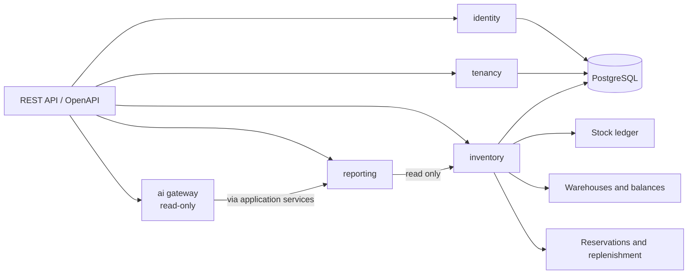

# 5. Architecture Overview
⬅️ [[04 - Technology Stack]] | ➡️ [[06 - Multi-Tenancy Strategy]]

## 5.1 الـ Architectural Style
المشروع **layered monolith** بتنظيم **package-by-layer**:

```text
ali.ragab.saas_multi_tennant_app
├── common/        AbstractEntity, PageResponse
├── config/        TenantContext, TenantFilter (disabled),
│                  TenantHibernateFilter (disabled), TenantSchemaResolver
├── controllers/   CategoryController (the only controller)
├── entities/      Tenant, User, Category, Product, StockMvt, enums
├── exceptions/    Domain exceptions + GlobalExceptionHandler
├── mappers/       Manual entity ↔ DTO mappers
├── properties/    JwtProperties
├── repositories/  Spring Data JPA interfaces
├── requests/      Inbound DTOs
├── responses/     Outbound DTOs
├── security/      SecurityConfig, JwtAuthenticationFilter, JwtTokenService
└── services/      Service interfaces + impl/
```

نقطة بداية معقولة لفريق صغير، **لكنه مش Clean Architecture بالمعنى الصارم**:

- مفيش **domain layer** مستقل عن Spring/JPA.
- الـ **entities anemic** (data bags)؛ الـ business invariants مش متفرضة في الـ model.
- الـ services معتمدة على **concrete mappers** وعلى **Spring Data repositories**.
- الـ DTOs جزء من الـ service interface (`BasicService<I, O>`)، فاهتمامات الـ transport بتتسرّب للـ application layer.
- عقد `BasicService` العام **واسع زيادة** على الـ aggregates المتخصصة.

## 5.2 الـ Runtime Architecture الحالية



> [!info] ليه الـ services دي مفصولة في الرسم؟
> لأن الـ services اللي ملهاش controller **مفصولة عن الـ HTTP path** عمدًا. هي Spring beans، لكن **مفيش طريق ليها** من الـ API.

## 5.3 رحلة الـ Request للـ API الوحيد المكشوف

طلب **category** بيمشي كده:

1. `JwtAuthenticationFilter` بيستخرج الـ **Bearer token**.
2. `JwtTokenService.validateToken(...)` بيتحقق من **RS256 signature** والـ expiry.
3. الـ filter بيحط `tenant_id` في `TenantContext` وبيحل اسم الـ schema.
4. Spring Security بيتأكد إن الـ request authenticated.
5. `CategoryController` بيعمل validate للـ body وبينادي `CategoryService`.
6. `CategoryServiceImpl` بيعمل **duplicate check** وبيحوّل الـ DTO لـ entity وبيستخدم `CategoryRepository`.
7. **Hibernate** بيبعت SQL على **default schema** بتاع الـ connection.
8. `CategoryMapper` بيحوّل الـ entity لـ response.
9. `GlobalExceptionHandler` بيتعامل مع **جزء** من الـ exceptions.

> [!bug] الخطوتين 3 و 7 مقطوعين عن بعض
> الـ schema اللي اتحلّ بيتخزّن في `ThreadLocal` **ومفيش أي Hibernate component بيقراه**.

## 5.4 تقييم المعمارية

| الاهتمام | التقييم | ملاحظات |
|---|---|---|
| **Separation of concerns** | 🟡 Fair | الطبقات موجودة، لكن الـ domain logic في الـ services والـ entities anemic |
| **SOLID — SRP** | 🟡 Mixed | `TenantServiceImpl` بيخلط lifecycle و provisioning orchestration و mapping وكود admin-user ميت |
| **SOLID — Open/Closed** | 🔴 Weak | `TypeMvt` (`IN`, `OUT`) هيحتاج branching للـ transfers والـ adjustments والـ reversals. **movement strategy / polymorphic model** هيتوسّع أحسن |
| **SOLID — Liskov / ISP** | 🔴 Weak | `StockMvtService` بيورّث `update` و `delete` من `BasicService` رغم إن الحركات المترحّلة المفروض تكون **immutable** |
| **SOLID — DIP** | 🟡 Fair | الـ repositories interfaces (كويس)، لكن الـ services معتمدة على concrete mappers وframework types |
| **Transaction boundaries** | 🟠 Inconsistent | بعض الـ services بتستخدم `jakarta.transaction.Transactional` على مستوى الكلاس؛ `TenantServiceImpl` مفيهوش؛ الـ provisioning بيعدّي على DDL وكتابات التطبيق من غير boundary واضحة |
| **Error handling** | 🟡 Partial | فيه handler، لكن exception types مهمة بتقع في 500 |
| **API design** | 🟠 Early | Verb-style paths (`/create`, `/update/{id}`, `/delete/{id}`)، مفيش `Location` header، مفيش filtering/sorting، ومفيش versioning policy غير `/api/v1` |
| **Testability** | 🔴 Low | full-context test بس؛ مفيش seams بتتجرّب |
| **Observability** | 🔴 Absent | مفيش health ولا metrics ولا tracing ولا correlation IDs |
| **Multi-tenancy** | 🚨 **Critical gap** | شوف [[06 - Multi-Tenancy Strategy]] |

## 5.5 💡 الـ Target Modular Architecture (Proposed)

الـ layered structure ممكن يتطور **من غير rewrite**. الموصى بيه: **modular monolith** بحدود features واضحة.



| Module | المسؤوليات | **ممنوع** يعمل |
|---|---|---|
| `identity` | Users, roles, invitations, authentication, sessions/tokens | يقرا جداول المخزون مباشرة |
| `tenancy` | Tenant lifecycle, provisioning, plans, usage limits | يحتوي business rules للمخزون |
| `inventory` | Products, categories, warehouses, ledger, balances, reservations | يطلّع HTTP responses أو يعرف الـ DTOs |
| `reporting` | Read models, aggregates, exports | يعدّل المخزون |
| `ai` | Intent parsing, tools, orchestration, guardrails | يكتب في المخزون أو يتخطى الـ application services |

> [!tip] داخل `inventory`
> افصل **Commands** (post movement, transfer, adjust) عن **Queries** (balances, history, reports). ده بيخلّي حدود الـ transaction واضحة وبيسهّل اختبار الـ ledger.

## 5.6 🧭 مبادئ هندسية لازم تتبناها

1. **الـ Invariants قريبة من الـ data.** الـ stock balance ما ينفعش يبقى سالب؛ ده مكانه domain service، وفي الـ database constraint لو أمكن.
2. **الحركات المترحّلة (posted) immutable.** التصحيحات بتبقى **reversal entries** جديدة، مش update أو delete.
3. **الـ Transactions ملك الـ use case.** **Command واحد = transaction واحد.** الاستدعاءات الخارجية (email, AI, provisioning) بتتم بره أو عن طريق **outbox**.
4. **هوية الـ Tenant عمرها ما بتتاخد من request body أو query string.** بتيجي من الـ **authenticated principal** وبتتفرض على طبقة الـ data-access.
5. **القراءة والكتابة بتتمدّلوا بشكل مختلف.** الـ reporting queries بتستخدم projections و read-only transactions؛ الكتابة بتستخدم locking وinvariants صريحة.
6. **Fail closed.** غياب الـ tenant context أو tenant مجهول أو فشل schema lookup لازم **يرفض الـ request**، ومينفعش يرجع لـ shared schema.

---
⬅️ [[04 - Technology Stack]] | ➡️ [[06 - Multi-Tenancy Strategy]]
