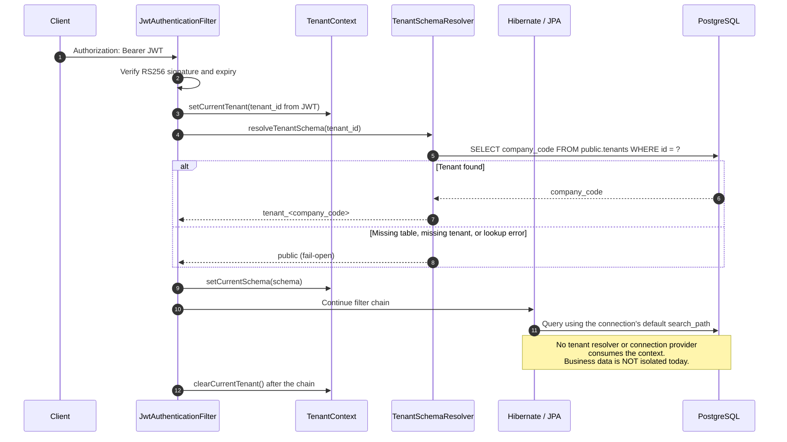
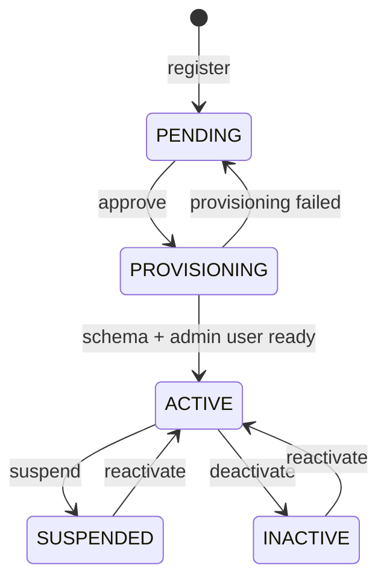

# 6. Multi-Tenancy Strategy
⬅️ [[05 - Architecture Overview]] | ➡️ [[07 - Authentication and Authorization]]

> [!danger] أهم قرار معماري في المشروع
> الـ **Multi-tenancy** هو أهم قرار معماري، وهو حاليًا **مش مُنفَّذ** رغم وجود scaffolding بيوحي إنه موجود.

## 6.1 الـ Model المقصود

الكود وتنظيم المجلدات بيدلّوا على **hybrid model**:

- **Shared `public` schema** لبيانات الـ platform: `tenants` و `users` و Flyway history.
- **Schema لكل tenant** لبيانات الـ business: `tenant_<company_code>` فيها `categories` و `products` و `stock_mvts`.
- الـ **JWT claim** `tenant_id` بيحدد الـ tenant.
- `TenantContext` بيخزّن الـ tenant الحالي والـ schema المحلول في `ThreadLocal`s.
- `TenantSchemaResolver` بيحوّل tenant ID لاسم schema باستخدام `public.tenants.company_code`.
- `ProvisioningServiceImpl` بيعمل الـ schema وبيشغّل Flyway migrations من `db/migration/tenant` وقت approval الـ tenant.

ده تصميم **"silo per tenant"** مشروع لبيانات الـ business: عزل قوي، وبيسهّل الـ backup/restore لكل tenant وتخصيص الـ schema. لكن له تكاليف حقيقية: الـ migrations لازم تتشغّل **مرة لكل tenant**، والـ connections لازم تتوجّه صح، والـ cross-tenant analytics بتبقى أصعب.

## 6.2 إيه اللي متفرض فعلًا النهاردة؟

| الآلية | Status | الدليل |
|---|---|---|
| **Tenant ID في الـ JWT** | ✅ Implemented | `JwtTokenService.generateAccessToken` بيضيف `tenant_id` والـ filter بيقراه |
| **Tenant context** | 🧱 Scaffolded | `TenantContext` بيخزّن القيم في `ThreadLocal` |
| **Schema resolution** | 🟡 Partial, **unsafe** | `TenantSchemaResolver` بيستعلم `public.tenants` و **بيرجّع `public` عند أي فشل (fail-open)**. الـ `@Cacheable` مالوش تأثير لأن الـ caching مش مفعّل |
| **Hibernate schema routing** | ❌ Not implemented | مفيش `CurrentTenantIdentifierResolver` ولا `MultiTenantConnectionProvider` ولا تبديل `search_path` |
| **Hibernate filter / discriminator** | ❌ Not implemented | `TenantHibernateFilter` متعمله comment، وبيشاور على filter اسمه `tenantFilter` عمره ما اتعرّف بـ `@FilterDef` / `@Filter` |
| **عمود `tenant_id` على جداول الـ business** | ❌ Not present | الـ tenant migration مفيهاش `tenant_id` |
| **PostgreSQL Row-Level Security** | ❌ Not present | مفيش RLS policies |
| **Tenant-aware repositories** | ❌ Not present | `CategoryRepository.findAll()` و `ProductRepository.findAll()` و `StockMvtRepository` كلها **unscoped** |
| **Tenant isolation tests** | ❌ Not present | مفيش test بيتأكد إن tenant A ما يقدرش يقرا بيانات tenant B |
| **Tenant status enforcement** | ❌ Not present | الـ tenants الـ suspended أو inactive لسه بيقدروا يستخدموا JWT صالح |

> [!bug] إعداد `application.yml` ده **مش بيفعّل** schema multi-tenancy
> ```yaml
> spring:
>   jpa:
>     properties:
>       hibernate:
>         multi_tenancy: SCHEMA   # routing configuration — not a recognised Hibernate 6 property
> ```
> **Hibernate 6** محتاج **tenant identifier resolver** و **multi-tenant connection provider** (أو discriminator / `@TenantId` model). الـ property لوحدها ما تقدرش توجّه الـ connections، وفي الـ codebase مفيش beans زي دي.

## 6.3 دورة الـ Request الحالية



> [!warning] مشكلتين إضافيتين ظاهرين في الـ flow ده
> 1. **Fail-open fallback:** لو `public.tenants` مش موجودة (وده الوضع في DB جديدة لأن الـ common migration فاضية)، الـ resolver بيمسك الـ exception وبيرجّع `public`. يعني أي misconfiguration **بتقفل الـ isolation بصمت** بدل ما ترفض الـ request.
> 2. **الـ cleanup مش في `finally` block.** لو الـ filter chain رمى exception، `TenantContext.clearCurrentTenant()` بيتخطّى والـ `ThreadLocal` ممكن **يتسرّب** لـ request thread تاني في الـ pool.

## 6.4 ليه ده أخطر خطر؟

لو التطبيق اشتغل على DB فيها جداول الـ business في `public`:

- كل **category و product queries** لأي tenant هترجّع **صفوف كل الـ tenants**.
- أي مستخدم authenticated يقدر **يقرا أو يعدّل منتجات tenant تاني** بالـ ID.
- الـ fallback في الـ resolver هيخلّي الفشل **شكله زي التشغيل الطبيعي**.
- أي **AI assistant** مستقبلي مبني على الـ repositories دي هيسرّب بيانات بين الـ tenants **by design**.

> [!danger] ده مش edge case نظري
> ده **السلوك الافتراضي** للكود الحالي. **مفيش feature جديد يتبني قبل ما ده يتصلح.**

## 6.5 اختيار الـ Isolation Model

فيه موديلين ممكنين. المشروع لازم **يختار واحد** ويشيل بقايا التاني.

| المعيار | **Schema-per-tenant** (النية الحالية) | **Shared schema + `tenant_id` + RLS** |
|---|---|---|
| قوة العزل | قوية (جداول منفصلة) | قوية لو الـ RLS والـ predicates صح |
| تعقيد الـ migration | عالي (per-tenant Flyway, locking, version drift) | منخفض (migration واحدة) |
| تكلفة الـ onboarding | أعلى (DDL لكل tenant) | منخفضة (insert tenant row) |
| Cross-tenant platform analytics | أصعب (aggregate عبر schemas) | سهلة (جدول واحد) |
| Per-tenant customisation | كويسة | محدودة |
| Backup/restore لكل tenant | سهل | أصعب (row-level export) |
| تعقيد connection/schema routing | عالي | مفيش |
| خطر نسيان predicate | منخفض (schema boundary) | متوسط (كل query لازم تفلتر) |
| مناسب لفريق صغير | متوسط | عالي |

> [!success] التوصية
> **كمّل schema-per-tenant** لبيانات الـ business، لأن أساس الـ provisioning والـ migration موجود، والعزل القوي نقطة بيع حقيقية لبيانات المخزون. **خلّي الـ identity في `public`.** لكن اعتبر ده **التزام معماري مقصود**:
> - ضيف الـ **Hibernate resolver/provider** الناقصين.
> - خلّي الـ schema resolution **fail closed**.
> - **Validate** لأسماء الـ schemas.
> - ضيف **tenant isolation tests**.
> - اقبل تكلفة التشغيل لـ per-tenant migrations.
>
> لو **time-to-market** بقى أهم من العزل الفيزيائي، **حوّل بدري** لـ **shared schema + `tenant_id` + PostgreSQL RLS**. **ماتكملش بالـ hybrid الحالي**، لأنه ليه تكاليف schema-per-tenant من غير عزل أي من الموديلين.

## 6.6 ✅ Checklist تنفيذ schema-per-tenant

### 1️⃣ Tenant identifier resolver
- نفّذ `CurrentTenantIdentifierResolver<String>` يقرا من `TenantContext.getCurrentTenant()`.
- **ارمي exception** لو الـ tenant غايب في عملية tenant-scoped؛ **ماترجّعش `public` أبدًا** لبيانات الـ business.

### 2️⃣ Connection provider
- نفّذ `MultiTenantConnectionProvider` (مثلًا بتوسيع `AbstractMultiTenantConnectionProvider`) يضبط PostgreSQL `search_path` على schema الـ tenant طول مدة الـ lease (مثلًا `SET LOCAL search_path TO tenant_x, public` جوه الـ transaction، أو `SET` على leased connection).
- اتأكد إن الـ `search_path` **بيتعمله reset** لما الـ connection يرجع للـ pool.
- خلّي استعلامات الـ platform/identity **schema-qualified** صراحة (`public.users`, `public.tenants`).

### 3️⃣ Fail-closed resolver
- بدّل سلوك "امسك واعمل return لـ `public`" بـ `TenantNotFoundException` / `TenantResolutionException`.
- **ماتعملش cache للنتائج السلبية** لأجل غير محدد.
- فعّل الـ caching بشكل مقصود (`@EnableCaching`) واعمل **eviction** عند تغيير اسم أو status الـ tenant.

### 4️⃣ Schema name safety
- اعمل validate لـ `companyCode` بـ pattern صارم زي `^[a-z][a-z0-9_]{2,40}$`.
- فرض **uniqueness غير حساسة لحالة الأحرف**؛ حاليًا `Acme` و `acme` بيتحوّلوا لنفس الـ schema.
- اعمل quote للـ identifiers أو استخدم schema name مولَّد ومتحقق منه.
- حدّ أقصى للطول **أقل من 63 byte** (حد PostgreSQL للـ identifier).

### 5️⃣ Provisioning safety
- استخدم **per-tenant advisory lock** أو **provisioning state machine** لمنع الـ provisioning المتزامن.
- **ماتستخدمش** `CREATE SCHEMA IF NOT EXISTS` متبوعة بـ `DROP SCHEMA ... CASCADE` عند الفشل؛ ممكن **تمسح schema حي موجود من قبل**.
- سجّل ملكية الـ schema ونسخة الـ migration.
- شغّل الـ provisioning **asynchronously** مع retries وstatus ظاهر للـ operator.

### 6️⃣ Tenant status checks
- ارفض الـ requests للـ tenants بحالة `PENDING` و `INACTIVE` و `SUSPENDED`، ما عدا الـ endpoints المسموحة صراحة.
- افحص الـ status مع **كل request** أو استخدم **short-lived tokens + revocation mechanism**.

### 7️⃣ Data-access rules
- الـ business repositories **ما تتنادى أبدًا من غير tenant context**.
- أي platform-level query بتعدّي على tenants لازم تكون في component مخصص ومتراجَع، وما تكشفش بيانات tenant للمستخدمين العاديين.

### 8️⃣ Tests
- اعمل provision لـ **tenantين**، اكتب بيانات كـ tenant A، اتصدّق كـ tenant B، وتأكد إن B **ما يقدرش يقرا أو يعدّل أو يمسح** سجلات A بالـ ID أو الـ list أو الـ filter.
- اختبر: missing context, unknown tenant, suspended tenant, stale cache.

> [!info] لو اخترت الـ shared-schema بدل كده
> المتطلبات المقابلة: `tenant_id NOT NULL` على كل business table، composite indexes بتبدأ بـ `tenant_id`، استراتيجية Hibernate `@TenantId` / filter أو repository predicates إجبارية، **PostgreSQL RLS** بـ session variable، ونفس الـ isolation test suite.

## 6.7 قواعد نشر الـ Tenant Context

| المسار | القاعدة |
|---|---|
| **HTTP request** | اضبطه من الـ **verified JWT principal**، **ماتستخدمش** `X-TenantID` ولا query parameters ولا request bodies. امسحه في `finally` |
| **Service layer** | خد `tenantId` كـ argument صريح أو اقراه من trusted context؛ ماتثقش في tenant جاي من الـ caller للـ authorization |
| **Async / `@Async`** | التقط الـ tenant ID قبل الـ submit؛ الـ `ThreadLocal` مش بيتنقل. استخدم `TaskDecorator` أو مرّره صراحة |
| **Scheduled jobs** | لف على الـ tenants صراحة؛ ماتعتمدش على ambient context |
| **Messaging / outbox** | حط `tenant_id` في الـ event envelope واتحقق منه عند الاستهلاك |
| **Caching** | خلّي الـ cache keys بـ **namespace للـ tenant**؛ ماتشاركش business objects مخزّنة بين tenants |
| **AI / tools** | احقن الـ tenant ID من الـ authenticated principal؛ **ماتسمحش للموديل يختاره** |
| **Logging** | سجّل الـ tenant ID والـ correlation ID، ولا تسجّل أسرار أو بيانات شخصية كاملة |
| **Tests** | افشل لو عملية tenant-scoped اشتغلت من غير context |

## 6.8 دورة حياة الـ Tenant

الدورة المقصودة: `PENDING → ACTIVE → SUSPENDED/INACTIVE`، مع **provisioning كخطوة منفصلة وقابلة للمراقبة**. الـ enum الحالي مفيهوش حالة `PROVISIONING` وmethods الـ service غير متسقة.



> [!note] الرسم ده **مقترح**
> الـ enum الحالي: `PENDING`, `ACTIVE`, `INACTIVE`, `SUSPENDED`. مفيش `PROVISIONING`، و `activateTenant` ممكن ينقل tenant لـ `ACTIVE` **من غير** ما يعمل provisioning لـ schema.

الـ lifecycle المفروض يكون **state machine** بانتقالات مسموحة صريحة، و **idempotent provisioning**، و **audit record** لكل انتقال، ورسالة خطأ واضحة للـ operator لو الـ provisioning فشل.

---
⬅️ [[05 - Architecture Overview]] | ➡️ [[07 - Authentication and Authorization]]
