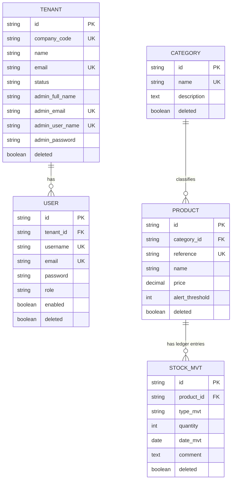

# 8. Database Design
⬅️ [[07 - Authentication and Authorization]] | ➡️ [[09 - Stock Movement Lifecycle]]

## 8.1 Schema Strategy

| Schema | بيحتوي على | Migration | Status |
|---|---|---|---|
| `public` | `tenants`, `users`, بيانات الـ platform | `db/migration/common` | ❌ الـ migration **ناقصة** |
| `tenant_<company_code>` | `categories`, `products`, `stock_mvts` | `db/migration/tenant` | ✅ موجودة |
| Per-schema Flyway history | `flyway_schema_history` | Programmatic Flyway | 🟡 Runs during provisioning |

> [!danger] Release blocker
> ملف الـ common migration `V1__init_Common_tables.sql` حجمه **0 bytes**. الـ tenant migration `V1__init_DB_For_Tenant.sql` موجودة وبتعمل الـ 3 business tables.

## 8.2 الـ Entity Model الحالي



> [!info] الرسم بيعكس العلاقات المقصودة في الـ entities. في DB جديدة، جداول `tenants` و `users` **مش موجودة** لأن الـ common migration فاضية.

## 8.3 تفاصيل الجداول

### 🏢 `tenants` (public — migration مفقودة)

| Column | Type | Constraints | ملاحظات |
|---|---|---|---|
| `id` | varchar(255) | PK | UUID string |
| `company_code` | varchar(255) | NOT NULL, UNIQUE | بيتشتق منه اسم الـ schema؛ حاليًا **case-sensitive وبدون validation** |
| `name` | varchar(255) | NOT NULL | بيتحوّل لـ `companyName` |
| `email` | varchar(255) | NOT NULL, UNIQUE | Company contact email |
| `status` | varchar(255) | NOT NULL | `ACTIVE`, `INACTIVE`, `PENDING`, `SUSPENDED` |
| `admin_full_name` | varchar(255) | NOT NULL | مكرر من اسم الـ admin user |
| `admin_email` | varchar(255) | NOT NULL, UNIQUE | مكرر، **globally unique** |
| `admin_user_name` | varchar(255) | NOT NULL, UNIQUE | مكرر، **globally unique** |
| `admin_password` | varchar(255) | NOT NULL | **تخزين credential مكرر؛ المفروض ما يكونش موجود** |
| `created_at`, `updated_at` | timestamp(6) | NOT NULL | Auditing |
| `created_by`, `updated_by` | varchar(255) | `created_by` NOT NULL | مفيش `AuditorAware` بيدّي قيم |
| `deleted` | boolean | NOT NULL | مش متفرض في الـ queries |

> [!warning] تكرار هوية وباسورد الـ admin بين `tenants` و `users` بيعمل **مصدرين للحقيقة**. جدول `tenants` المفروض يخزّن metadata الـ tenant/business، **مش credentials**.

### 👤 `users` (public — migration مفقودة)

| Column | Type | Constraints | ملاحظات |
|---|---|---|---|
| `id` | varchar(255) | PK | UUID string |
| `tenant_id` | varchar(255) | FK → `tenants.id` | Nullable؛ الـ platform admins ممكن مايبقاش ليهم tenant |
| `username` | varchar(255) | NOT NULL, UNIQUE | **Globally unique**، مش per tenant |
| `email` | varchar(255) | NOT NULL, UNIQUE | Globally unique |
| `password` | varchar(255) | NOT NULL | BCrypt hash |
| `first_name`, `last_name` | varchar(255) | NOT NULL | |
| `role` | varchar(255) | NOT NULL | Role واحد |
| `enabled` | boolean | Nullable | المستخدمين الجداد default = `false` في Java |
| `deleted` | boolean | NOT NULL | Soft delete مستخدم في الـ service |

> [!bug] الـ **global uniqueness** للـ username والـ email بيمنع tenantين من إن يبقى عندهم نفس الـ username أو الـ email. في SaaS المفروض تكون `(tenant_id, username)` و `(tenant_id, email)`، مع قاعدة منفصلة للـ platform administrators.

### 🗂️ `categories` (tenant schema)

| Column | Type | Constraints | ملاحظات |
|---|---|---|---|
| `id` | varchar(255) | PK | UUID string |
| `name` | varchar(255) | NOT NULL, UNIQUE | Uniqueness case-sensitive؛ الـ service بيفحص **case-insensitive** |
| `description` | text | | |
| audit columns | | `created_by` NOT NULL | الـ insert هيفشل من غير `AuditorAware` |
| `deleted` | boolean | NOT NULL | عمود soft-delete **مش مستخدم** في الـ queries |

### 🏷️ `products` (tenant schema)

| Column | Type | Constraints | ملاحظات |
|---|---|---|---|
| `id` | varchar(255) | PK | UUID string |
| `reference` | varchar(255) | NOT NULL, UNIQUE | Business reference / SKU |
| `name` | varchar(255) | NOT NULL | |
| `description` | text | | |
| `alert_threshold` | integer | NOT NULL | الإشارة الوحيدة للـ replenishment؛ مفيش min/max/reorder point |
| `price` | numeric(38,2) | NOT NULL | سعر البيع؛ مفيش cost price ولا currency |
| `category_id` | varchar(255) | FK → `categories.id` | Nullable؛ مفيش index |
| `deleted` | boolean | NOT NULL | غير متفرض |

### 📦 `stock_mvts` (tenant schema)

| Column | Type | Constraints | ملاحظات |
|---|---|---|---|
| `id` | varchar(255) | PK | UUID string |
| `type_mvt` | varchar(255) | NOT NULL, CHECK (`IN`, `OUT`) | نوعين حركة بس |
| `quantity` | integer | NOT NULL | مفيش check `> 0`؛ الإشارة مفهومة من النوع |
| `date_mvt` | date | NOT NULL | Business date؛ مفيش timezone/timestamp |
| `comment` | text | | نص حر؛ مفيش reason code ولا source document |
| `product_id` | varchar(255) | FK → `products.id` | مفيش index |
| `deleted` | boolean | NOT NULL | **المفروض مايبقاش موجود في immutable ledger** |
| audit columns | | `created_by` NOT NULL | مفيش `AuditorAware` |

## 8.4 ❌ البيانات الناقصة المطلوبة لرؤية المنتج

الـ schema الحالي **مش بيقدر يدعم منتج inventory حقيقي**. مش موجود:

- `warehouses` (مع status/address/timezone).
- `warehouse_id` على الحركات والـ balances.
- `stock_balances` (on-hand, reserved, available, version).
- Movement status/state (`DRAFT`, `POSTED`, `REVERSED`)، source document، reason code، idempotency key.
- Transfer header/lines والربط بين الـ outgoing والـ incoming legs.
- Reservations (sales order, expiry, status).
- Reorder points و min/max و safety stock و lead time.
- Batch/lot و serial numbers و expiry dates.
- Cost layers و valuation method.
- Cycle counts و reconciliation adjustments.
- Audit/activity log و outbox events و notifications و subscriptions و usage counters.
- Supplier/customer entities.

## 8.5 Indexes و Constraints

الـ indexes الحالية = الـ primary keys والـ unique constraints المعرّفة في الـ migration **بس**. PostgreSQL **ما بيعملش index تلقائي للـ foreign keys**، يعني:

- lookups والـ joins على `stock_mvts.product_id` بتعمل **table scan**.
- joins على `products.category_id` بتعمل scan.
- الفلترة بـ `users.tenant_id` بتعمل scan.
- تاريخ الحركات بالـ product/date **مفيش index يدعمه**.

### Indexes الموصى بيها (بـ migration جديدة بعد تثبيت الـ schema)

```sql
-- Current model, safe to add now
CREATE INDEX idx_stock_mvts_product_date
  ON stock_mvts (product_id, date_mvt DESC);
CREATE INDEX idx_products_category
  ON products (category_id);

-- Public schema, after the common migration exists
CREATE INDEX idx_users_tenant
  ON users (tenant_id)
  WHERE deleted = false;

-- After warehouses are introduced
CREATE INDEX idx_stock_mvts_warehouse_product_date
  ON stock_mvts (warehouse_id, product_id, date_mvt DESC);
CREATE INDEX idx_stock_balances_warehouse_product
  ON stock_balances (warehouse_id, product_id);
```

### Integrity constraints إضافية

- `CHECK (quantity > 0)` على سطور الحركات.
- `CHECK (price >= 0)` و `CHECK (alert_threshold >= 0)`.
- **Uniqueness case-insensitive** لأسماء الـ categories ومراجع الـ products داخل الـ tenant، مثلًا unique index على `lower(name)` / `lower(reference)`.
- `ON DELETE RESTRICT` أو قواعد soft-delete للإشارات بين category/product.
- `CHECK (status IN (...))` أو PostgreSQL enum لحالات الـ tenant/movement.
- Constraint بعدم السالب على صفوف الـ balance لو ينطبق.

## 8.6 💡 إضافات الـ Schema المقترحة (Conceptual)

| Table | الغرض | Key columns | Phase |
|---|---|---|---|
| `warehouses` | مواقع تخزين فيزيائية/منطقية | `id`, `code`, `name`, `active` | 1 |
| `stock_balances` | **Projection** سريع وقابل للـ lock لـ on-hand/reserved | `warehouse_id`, `product_id`, `on_hand`, `reserved`, `version` | 1 |
| `stock_movements` | Immutable ledger header | `id`, `type`, `status`, `warehouse_id`, `reason_code`, `idempotency_key`, `posted_at`, `created_by` | 1 |
| `stock_movement_lines` | سطور product/quantity للحركة | `movement_id`, `product_id`, `quantity`, `unit_cost` | 1 |
| `stock_transfers` | Transfer header وحالة الـ approval | `id`, `from_warehouse_id`, `to_warehouse_id`, `status` | 1–2 |
| `reservations` | مخزون محجوز للأوردرات | `id`, `warehouse_id`, `product_id`, `quantity`, `expires_at`, `status` | 2 |
| `reorder_policies` | Min/max, reorder point, safety stock, lead time | `warehouse_id`, `product_id`, `reorder_point`, `safety_stock` | 2 |
| `stock_counts` / `stock_count_lines` | Cycle counts و reconciliation | counted vs system quantity, variance | 3 |
| `lots`, `serials` | تتبّع Batch/expiry و serial | lot code, expiry, serial number | 3 |
| `inventory_valuations` | Cost layers أو periodic valuation snapshots | method, unit cost, value | 3 |
| `audit_log` | Security/business activity trail | actor, action, entity, before/after, tenant | 1 |
| `outbox_events` | نشر events بشكل موثوق | aggregate, type, payload, status | 2–3 |
| `subscription_plans`, `tenant_subscriptions`, `usage_counters` | خطط SaaS وحدودها | plan, limits, period, usage | 4–5 |

> [!note] ده **target conceptual** مش schema منفَّذ. كل إضافة محتاجة migration خاصة بيها وconstraints وindexes وتراجع tenancy.

## 8.7 استراتيجية الـ Migration

1. اعمل **الـ common migration الناقصة** لتعريف `tenants` و `users` قبل أي شغل authentication.
2. قرّر هل تصحح **عدم التطابق في `updated_at` nullability** (الـ entity بتقول `nullable = false` والـ migration بتسمح بـ null).
3. ضيف **V2 migrations** للـ warehouses والـ balances وحقول الحركات **بدل** تعديل `V1`.
4. شغّل الـ tenant migrations عبر **pipeline provisioning واحد متحكَّم فيه** بـ lock ونسخة migration مسجّلة.
5. **ماتستخدمش** `ddl-auto` غير `none`؛ هو already `none` وده صح.
6. خلّي ملفات الـ migration **immutable** بعد ما تتطبّق على أي بيئة.
7. اعمل **backup** للـ schema قبل أي تغييرات هدّامة؛ `clean` في Flyway متقفّل للـ tenant migrations (كويس)، لكن مسار `DROP SCHEMA ... CASCADE` المخصص لازم **يتشال أو يتقيّد بشدة**.

---
⬅️ [[07 - Authentication and Authorization]] | ➡️ [[09 - Stock Movement Lifecycle]]
