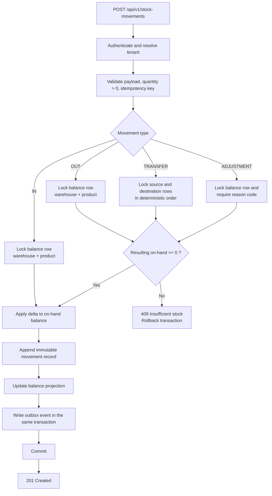

# 9. Stock Movement Lifecycle
⬅️ [[08 - Database Design]] | ➡️ [[10 - API Documentation]]

## 9.1 الوضع الحالي

> [!failure] مفيش أي stock movement functionality موجودة
> **الدليل:**
> - `StockMvtServiceImpl.create` و `update` و `findById` و `delete` و `findAll` كلها **فاضية أو بترجّع `null`**.
> - مفيش `StockMvtController`.
> - `StockMvtRequest` مفيهوش validation.
> - `StockMvtResponse` مفيهوش id ولا product id ولا warehouse ولا user.
> - `TypeMvt` فيه `IN` و `OUT` بس؛ مفيش transfer ولا adjustment ولا reversal ولا reservation.
> - مفيش balance table ولا balance query ولا **insufficient-stock check**.
> - مفيش concurrency control.
> - عقد `BasicService` العام بيكشف `update` و `delete`، وده **بيتعارض** مع تصميم الـ immutable ledger.

اللي جاي هو **design target**، مش وصف لسلوك منفَّذ.

## 9.2 الـ Target Domain Model

استخدم **immutable ledger + balance projection**:

- **Ledger** (`stock_movements` + `stock_movement_lines`): سجل **append-only** لكل تغيير في المخزون. **عمره ما بيتعدّل أو بيتمسح** بعد الـ posting.
- **Balance projection** (`stock_balances`): صف لكل `(warehouse, product)` فيه `on_hand` و `reserved` و `version`. بيتحدّث **في نفس الـ transaction** بتاعة إدخال الـ ledger، ويمكن **إعادة بناءه من الـ ledger**.

### أنواع المستندات (Document types)

| النوع | الاستخدام |
|---|---|
| `IN` | استلام من supplier أو return أو production |
| `OUT` | صرف لعميل أو consumption أو scrap |
| `TRANSFER` | **ساقين ledger مربوطين** (خروج من المصدر، دخول للوجهة) في **transaction واحدة** |
| `ADJUSTMENT` | تصحيح بعد جرد أو تحقيق؛ **محتاج reason code** |
| `REVERSAL` | حركة جديدة **بتلغي** حركة مترحّلة قبل كده؛ **الأصلية بتفضل زي ما هي** |

**الـ Status:** `DRAFT` ← `POSTED` ← `REVERSED`. الـ `POSTED` **بس** هو اللي بيأثر على الـ balances.

## 9.3 ✅ الـ Invariants

كل عملية posting لازم تفرض:

1. `quantity > 0` (النوع هو اللي بيحدد الإشارة).
2. الـ product موجود وتابع للـ tenant وactive.
3. الـ warehouse موجود وتابع للـ tenant وactive.
4. `on_hand >= 0` **بعد** تطبيق الـ delta.
5. `available = on_hand - reserved >= 0` للعمليات الخارجة، حسب سياسة الـ reservation.
6. الـ source والـ destination في الـ transfer **مختلفين** وكلاهما تابع للـ tenant.
7. الـ **idempotency key** unique لكل tenant؛ الـ retry بيرجّع **النتيجة الأصلية** بدل ما يعمل posting مرتين.
8. الحركة المترحّلة **ما تتعدّلش ولا تتمسحش**.
9. الـ reversal بيشاور على حركة posted موجودة، و**ما ينفعش يتعمل reverse مرتين**.
10. الـ balance projection **بيساوي مجموع الـ ledger في أي وقت** (reconciliation check).

## 9.4 💡 Posting Workflow المقترح



## 9.5 Transactional Pseudocode

> [!note] ده **pseudocode توضيحي**، مش كود موجود.

```java
@Transactional
public MovementResult post(PostMovementCommand command) {
    String tenantId = TenantContext.requireCurrentTenant();

    // 1. Idempotency: return the original result for a repeated key.
    Optional<Movement> existing =
        movements.findByIdempotencyKey(tenantId, command.key());
    if (existing.isPresent()) {
        return MovementResult.from(existing.get());
    }

    // 2. Validate references within the tenant.
    Product product = products.get(tenantId, command.productId());
    Warehouse warehouse = warehouses.get(tenantId, command.warehouseId());

    // 3. Lock the balance row(s) in a deterministic order.
    StockBalance balance = balances.lock(tenantId, warehouse.id(), product.id());

    // 4. Apply the domain rule.
    int delta = switch (command.type()) {
        case IN -> command.quantity();
        case OUT -> -command.quantity();
        case ADJUSTMENT -> command.signedQuantity(); // requires reason + permission
        case TRANSFER -> throw new IllegalArgumentException("Use the transfer use case");
    };
    if (balance.onHand() + delta < 0) {
        throw new InsufficientStockException(product.id(), warehouse.id());
    }

    // 5. Append the ledger entry and update the projection atomically.
    Movement movement = movements.append(tenantId, product, warehouse, command, delta);
    balance.apply(delta);
    balances.save(balance);

    // 6. Publish an event through the outbox in the same transaction.
    outbox.append(tenantId, "StockMovementPosted", movement.id(), movement.payload());
    return MovementResult.from(movement);
}
```

### 🔑 الخصائص الأساسية
- الـ **Transaction ملك الـ use case**، مش الـ controller.
- **الـ Locking بيحصل قبل قراءة الـ balance الحالي.**
- الـ ledger والـ projection **بيتغيّروا مع بعض**.
- صف الـ **outbox** بيعمل commit أو rollback مع التغيير التجاري.
- **مفيش external call** (email, AI, webhook) جوه الـ transaction.

## 9.6 حساب الـ Balance

طريقتين مكمّلتين لبعض:

1. **Balance projection** (الموصى بيها للقراءة الأونلاين): `stock_balances` بتحتفظ بـ `on_hand` و `reserved` الحاليين لكل `(warehouse, product)`. بتتحدّث transactionally ويمكن إعادة بناءها من الـ ledger.
2. **Ledger aggregation** (للـ reconciliation والتقارير):

```sql
SELECT COALESCE(SUM(CASE WHEN type_mvt = 'IN' THEN quantity ELSE quantity END), 0)
FROM stock_mvts
WHERE product_id = :productId
  AND deleted = false;
```

> [!bug] ملاحظة على الـ query (من عندي)
> الـ query منقولة **زي ما هي من التقرير الأصلي**. لاحظ إن فرع `ELSE` بيرجّع `quantity` موجبة برضو، يعني الـ `OUT` هتتجمّع كـ `IN`. غالبًا المقصود `-quantity`، فراجعها قبل ما تعتمد عليها.

> [!info] الـ `deleted` predicate بيعكس الـ schema الحالي. الـ **immutable ledger** ما ينفعش يستخدم soft delete؛ بعد تنفيذ الـ target model بدّله بشرط status = `POSTED`. وبعد إضافة warehouses لازم الـ query تفلتر بـ `warehouse_id` كمان.
> **للأداء:** **ماتعملش aggregation على التاريخ كله في الـ hot path**؛ استخدم الـ projection وراجعها مقابل الـ ledger بـ **scheduled reconciliation job**.

## 9.7 Concurrency و Locking

> [!warning] هنا بتنكسر أنظمة المخزون الساذجة.

| الأسلوب | المميزات | العيوب | التوصية |
|---|---|---|---|
| اقرا الـ balance، احسب في Java، احفظ | بسيط | **Lost updates** تحت الـ concurrency؛ مخزون سالب | ❌ **ماتستخدمهوش** |
| **Pessimistic lock** (`SELECT ... FOR UPDATE`) على صف الـ balance | صحيح ومتوقع | Contention على الـ SKUs الساخنة؛ lock waits | ✅ **الـ default لعمليات الكتابة** |
| **Atomic conditional update** (`UPDATE ... SET on_hand = on_hand - :q WHERE on_hand >= :q`) | صحيح من غير read-modify-write race | محتاج فحص دقيق لـ affected-rows ومنطق projection منفصل | ✅ كويس لعمليات `OUT` عالية الـ contention |
| **Optimistic locking** (`@Version`) | كويس للـ contention المنخفض | محتاج retries؛ مش كفاية لوحده لفحص المخزون السالب | 🟡 استخدمه كـ **guard إضافي** |

### القواعد
- اعمل lock للصفوف **بترتيب ثابت** (مثلًا `warehouse_id` تصاعدي ثم `product_id`) لتجنب **deadlocks** في الـ transfers.
- خلّي الجزء المقفول **قصير**؛ ماتنادّيش external services وانت ماسك lock.
- استخدم `READ_COMMITTED` كـ default، وأعد المحاولة (**retry**) عند serialization/deadlock failures لما يكون مناسب.
- ضيف **database constraint أو trigger** كـ guard أخير ضد الـ balances السالبة لو البزنس محتاج كده.
- اختبر بـ **requests كتير متزامنة** لـ `OUT` على نفس الـ product، وتأكد إن الـ balance النهائي مش سالب وعدد الـ postings الناجحة صحيح.

## 9.8 Insufficient Stock والمخزون السالب

- رجّع **`409 Conflict`** (أو `422 Unprocessable Entity`) بكود مقروء للآلة زي `INSUFFICIENT_STOCK` وكميات الـ product/warehouse/available/requested.
- **ماتقصّش** الكمية لصفر بصمت.
- **ماتسمحش** بكتابة في الـ DB بتنتج balance سالب.
- فرّق بين **on hand** و **reserved** و **available**. الـ `OUT` ممكن يتمنع بسبب الـ reservations حتى لو `on_hand > 0`.
- للـ adjustments: اسمح بكمية سالبة موقّعة **فقط** عن طريق **adjustment permission** صريحة و**reason code**؛ ولسه فرض invariant الـ balance النهائي.

## 9.9 التاريخ والـ Audit Trail

النظام الصحيح لازم يجاوب: **مين غيّر إيه، ومتى، من أنهي مستند، وليه؟**

### الـ Ledger لازم يسجّل
- Tenant و movement id والنوع والـ status.
- Product و warehouse والكمية والـ **signed delta**.
- Business date و posting timestamp.
- Actor user id و actor role و request correlation id.
- Source document type/id (purchase receipt, sales order, transfer, count).
- Reason code وcomment للـ adjustments.
- Reversal link (`reversed_movement_id`, `reversal_of_id`).
- Before/after balance snapshot للـ audit (اختياري لكن مفيد).

> [!important] الـ ledger **append-only**. الـ authorization لازم تمنع update/delete على مستوى **التطبيق والـ database**. لو حصل غلط: اعمل **reversal** ثم اعمل الحركة المصحّحة.

## 9.10 Transfers و Adjustments

### 🔄 Transfer
1. اتحقق من مخزني المصدر والوجهة.
2. اقفل صفّي الـ balance **بترتيب ثابت**.
3. افحص توفّر المصدر (بما فيه الـ reservations).
4. أضف **ساق OUT** و **ساق IN** مربوطين بـ transfer id.
5. اعمل commit للساقين **atomically**.
6. اختياريًا: ادعم draft/approval workflow وحالة **in-transit**.

### ⚖️ Adjustment
1. اطلب **reason code** (count variance, damage, theft, data correction).
2. اطلب **permission** مناسبة.
3. اختياريًا: اطلب **approval** فوق threshold معين.
4. سجّل الكمية الفعلية المجرودة وكمية النظام والـ variance.
5. اعمل **adjustment movement**؛ **عمرك ما تعدّل الـ balance الأصلي مباشرة.**

## 9.11 🚫 ماتعملش كده

- ❌ **ماتخلّيش LLM أو أي process خارجي يكتب في stock balances.**
- ❌ ماتحسبش الـ balances بـ `SUM` في كل request بس.
- ❌ ماتكشفش `update` / `delete` للحركات المترحّلة.
- ❌ ماتستخدمش **floating-point** للكميات أو الفلوس؛ استخدم integers أو `BigDecimal` بـ scale صريح.
- ❌ ماتثقش في tenant أو warehouse أو user identity جاية من الـ client.
- ❌ ماتنشرش events **قبل** الـ transaction commit.

## 9.12 Stock APIs المقترحة

> [!note] كل الـ endpoints دي **مقترحة ومش منفَّذة**.

| Method | Path | الغرض |
|---|---|---|
| `POST` | `/api/v1/stock-movements` | ترحيل `IN` أو `OUT` أو `ADJUSTMENT` مع `Idempotency-Key` |
| `GET` | `/api/v1/stock-movements` | فلترة بـ product, warehouse, type, status, date range, actor |
| `GET` | `/api/v1/stock-movements/{id}` | جلب حركة وسطورها |
| `POST` | `/api/v1/stock-movements/{id}/reverse` | ترحيل reversal؛ الأصلية تفضل immutable |
| `POST` | `/api/v1/stock-transfers` | إنشاء/ترحيل transfer بين مخزنين |
| `GET` | `/api/v1/stock-balances` | استعلام on-hand/reserved/available بالـ warehouse/product |
| `GET` | `/api/v1/products/{id}/stock` | ملخص مخزون المنتج عبر المخازن |
| `POST` | `/api/v1/stock-counts` | بدء cycle count |
| `PATCH` | `/api/v1/stock-counts/{id}` | تسجيل الكميات المجرودة |
| `POST` | `/api/v1/stock-counts/{id}/post` | ترحيل الفروقات كـ adjustments |

---
⬅️ [[08 - Database Design]] | ➡️ [[10 - API Documentation]]
