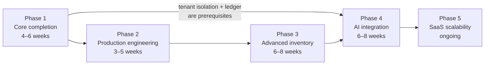

# 16. Project Roadmap
⬅️ [[15 - Deployment Instructions]] | ➡️ [[17 - Future Enhancements]]

## 16.1 مبادئ الترتيب

1. **صلّح الأساسات قبل الـ features.** build مابيعملش compile وـ tenancy model مابيعزلش مش "ديون تقنية"؛ دي **blockers**.
2. **سلّم Vertical slices.** كل phase تنتهي بـ **flow شغّال ومختبر**، مش كومة entities.
3. **مفيش AI قبل العزل والداتا النضيفة.** طبقة AI فوق repositories غير معزولة **هتضاعف** الخطر الأمني الحالي.
4. **فضّل البساطة التشغيلية.** **Modular monolith** بـ PostgreSQL و Flyway و database-backed outbox كفاية للسوق المستهدف. ضيف brokers و vector databases و microservices **لما يظهر احتياج مُقاس**.
5. **التقديرات نطاقات، مش التزامات.** بتفترض **مهندس backend واحد خبير** مع مدخلات منتج.

## 16.2 اعتماديات الـ Phases

---

## 16.3 🧱 Phase 1 — Core Product Completion

> [!tip] **الهدف:** inventory core شغّال ومعزول per-tenant، بـ stock ledger صحيح وAuthentication flow قابل للاستخدام.
> **المدة التقديرية:** **4–6 أسابيع**.

| Feature | ليه مهم | Dependencies | النتيجة المتوقعة |
|---|---|---|---|
| **استعادة الـ build ومسار الـ startup** | مفيش حاجة تتحقق قبل ما التطبيق يعمل compile ويقوم | None | `./mvnw verify` ينجح؛ المفاتيح والـ migrations صالحة |
| **كتابة الـ common schema migration** (`tenants`, `users`) | الـ auth والـ provisioning مالهمش جداول | None | database نظيفة بتتهيّأ صح |
| **إضافة `AuditorAware`** | الـ inserts بتفشل بسبب `created_by NOT NULL` | Security context | Inserts مُدقَّقة بتشتغل |
| **إكمال Tenant isolation** | بيمنع تسرّب البيانات بين tenants؛ **أكبر خطر في المنتج** | Common migration، قرار الـ tenancy | Tenant يشوف بياناته بس، والـ tests بتثبت ده |
| **Authentication API و RBAC** | مفيش token يتاخد؛ الـ roles مش متفرضة | Tenant isolation، common schema | Login/refresh/logout؛ role matrix متفرضة |
| **Warehouse model** | المخزون ماينفعش يتحدد مكانه من غير warehouses | Tenant isolation | Warehouses لكل tenant؛ المنتج يتخزّن per warehouse |
| **Stock ledger والـ balances** | القدرة الأساسية للمنتج | Warehouses, products | `IN/OUT/ADJUSTMENT/TRANSFER` بتاريخ immutable |
| **Insufficient-stock وـ concurrency control** | يمنع المخزون السالب والـ lost updates | Ledger | `409` عند النقص؛ postings متزامنة آمنة |
| **Idempotency للـ postings** | الـ retries ماتعملش double-post | Ledger | المفتاح المتكرر بيرجّع النتيجة الأصلية |
| **Product, tenant, user, و stock controllers** | الـ services حاليًا unreachable | Auth/RBAC, ledger | API surface كاملة للنواة |
| **Validation و error model** | سلوك متوقّع للـ clients | Controllers | `400/404/409` بـ codes مقروءة للآلة |
| **Test foundation** | أخطر منطق محتاج دليل آلي | كل اللي فوق | Testcontainers وـ isolation وـ concurrency وـ security tests |

### 🎯 Exit criteria
- Tenant جديد يقدر **يتسجّل ويتوافق عليه ويستلم schema ويعمل login** كـ admin مفعّل.
- Tenant A **مايقدرش يقرا أو يعدّل** بيانات tenant B عبر **أي endpoint**.
- ترحيلات `IN/OUT/transfer/adjustment` **atomic وقابلة للـ audit**.
- طلبات `OUT` المتزامنة **ماتقدرش** تنزّل balance تحت الصفر.
- الـ **CI** بيبني ويشغّل الـ test suite مع كل push.

---

## 16.4 🏭 Phase 2 — Production-Ready Engineering

> [!tip] **الهدف:** النواة قابلة للـ deploy والمراقبة والتشغيل.
> **المدة التقديرية:** **3–5 أسابيع**.

| Feature | ليه مهم | Dependencies | النتيجة | التعقيد |
|---|---|---|---|---|
| **Actuator, Micrometer, structured logs, correlation IDs** | ماتقدرش تشغّل اللي مابتشوفوش | Phase 1 | Health, metrics, traces, logs مفيدة | Medium |
| **Production profiles و configuration** | إعدادات الـ dev (`show-sql`, wildcard CORS) غير آمنة | Phase 1 | فصل dev/test/prod | Low–Medium |
| **Secrets management و key rotation** | المفاتيح حاليًا فاضية ومتتبّعة | Auth | مفاتيح من secret store؛ rotation موثّق | Medium |
| **Container image و deployment pipeline** | مفيش app image ولا CI | Phase 1 | Image قابل للتكرار؛ deployment آلي | Medium |
| **Rate limiting و perimeter hardening** | يحمي الـ login والتقارير الغالية | Auth, reporting | مقاومة إساءة؛ CORS allowlisted؛ headers | Medium |
| **Idempotency و retry hardening** | الشبكات الحقيقية بتعمل retry | Ledger | Retries آمنة عبر postings والـ provisioning | Medium |
| **Query tuning, indexes, pagination caps** | يمنع الاستعلامات البطيئة مع نمو البيانات | Ledger | Query plans متحقق منها؛ أحجام responses محدودة | Medium |
| **Backup, restore, و migration runbooks** | فقدان البيانات غير مقبول | Database | إجراء recovery مختبر | Medium |
| **Security scanning و SBOM** | خطر الـ supply-chain | CI | Vulnerability gates آلية | Low–Medium |

### 🎯 Exit criteria
- التطبيق يشتغل في **بيئة شبه-production** بـ TLS وأسرار و health checks و backups.
- Dashboards وـ alerts بتغطي latency والأخطاء و pool saturation و lock waits وفشل الـ provisioning.
- **Restore drill** ناجح.
- **Security scans** جزء من الـ CI.

---

## 16.5 📚 Phase 3 — Advanced Inventory Features

> [!tip] **الهدف:** تحويل الـ ledger لمنتج inventory مفيد تجاريًا.
> **المدة التقديرية:** **6–8 أسابيع**.

| Feature | ليه مهم | Dependencies | النتيجة | التعقيد |
|---|---|---|---|---|
| **Reorder points, min/max, low-stock alerts** | يمنع stockouts ويقلّل المراقبة اليدوية | Ledger, warehouses | سياسات قابلة للضبط وإشعارات | Medium |
| **Stock reservations** | يمنع بيع المخزون المحجوز مرتين | Ledger | `Available = on-hand − reserved`؛ دورة حياة الـ reservation | Medium–High |
| **Cycle counting و reconciliation** | يبقّي مخزون النظام مطابق للواقع | Ledger, adjustments | جلسات جرد وفروقات وتسويات مُتحكَّم فيها | Medium |
| **Batch/lot, serial numbers, expiry** | مطلوب للأغذية والأدوية والقطاعات المنظّمة | Ledger, products | تتبّع lot/serial ودعم FEFO | High |
| **Inventory valuation (FIFO / weighted average)** | المالية محتاجة قيمة المخزون مش الكمية بس | Cost data, ledger | تقارير وsnapshots للـ valuation | High |
| **Movement analytics و reports** | المديرين محتاجين trends واستثناءات | Ledger, reporting views | Turnover، fast/slow movers، dead stock، أداء المخازن | Medium–High |
| **CSV/Excel/PDF exports** | اعتماد تشغيلي | Reporting | Exports **async ومتسجّلة** | Medium |
| **Audit/activity log** | الامتثال والتحقيقات | Auth, ledger | سجل **who-did-what** قابل للبحث | Medium |
| **Transfer approvals و in-transit state** | المخازن الحقيقية محتاجة تحكّم | Warehouses, ledger | Transfers محكومة | Medium |

### 🎯 Exit criteria
- مدير المخزون يقدر **يضبط الـ replenishment ويراجع الـ alerts ويجرد المخزون ويسوّي الفروقات ويصدّر التقارير**.
- بيانات lot/serial/expiry **قابلة للتتبّع end-to-end** لما تتفعّل.
- الـ Valuation **قابلة للتكرار ومطابقة للـ ledger**.

---

## 16.6 🤖 Phase 4 — AI Integration

> [!tip] **الهدف:** طبقة ذكاء **read-only وآمنة per-tenant** بقيمة قابلة للقياس.
> **المدة التقديرية:** **6–8 أسابيع**.

| Feature | ليه مهم | Dependencies | النتيجة | التعقيد |
|---|---|---|---|---|
| **Read-only inventory assistant بـ tool calling** | إجابات سريعة للمستخدمين التشغيليين | عزل Phase 1، reporting services | أسئلة بلغة طبيعية على بيانات حية | Medium |
| **Natural-language reporting عبر semantic layer** | يشيل احتكاك الـ report-builder | Reporting views, query DSL | تقارير متحقق منها من غير تعرّض لـ raw SQL | High |
| **Rule-based anomaly detection مع شرح** | يكتشف الـ shrinkage والأخطاء بدري | Ledger, audit log | Queue anomalies قابلة للشرح وإشعارات | Medium |
| **Forecasting baseline و backtesting** | قرارات replenishment أحسن | Clean demand history, warehouses | Forecasts بـ accuracy metrics | High |
| **Reorder و redistribution recommendations** | بيحوّل التحليل لفعل | Forecasts, balances, costs | اقتراحات مرتبة وقابلة للشرح | Medium |
| **Guardrails, evaluation, و AI audit** | يمنع التسرّب والـ regressions | Auth, observability | Golden dataset، tenant-isolation tests، ضوابط تكلفة | Medium |

### 🎯 Exit criteria
- الـ assistant **مايقدرش يوصل لبيانات tenant تاني** تحت أي prompt أو tool argument تم اختباره.
- الإجابات الرقمية **تطابق الـ deterministic queries**.
- **مفيش AI path يقدر يعدّل المخزون.**
- دقة الـ forecast **مقاسة وظاهرة**.
- استخدام الـ AI **متسجّل ومحدود (rate-limited) لكل tenant**.

---

## 16.7 🚀 Phase 5 — SaaS Scalability and Advanced Capabilities

> [!tip] **الهدف:** دعم النمو التجاري والـ tenants الأكبر ومتطلبات الـ enterprise.
> **المدة التقديرية:** **مستمرة (ongoing)**.

| Feature | ليه مهم | Dependencies | النتيجة | التعقيد |
|---|---|---|---|---|
| **Subscription plans, entitlements, usage limits** | تحقيق دخل وضبط تكلفة | Tenancy, usage metering | حدود واعية بالخطة وhooks للـ billing | High |
| **Team invitations, SSO/SAML, SCIM, MFA** | اعتماد الـ enterprise | Auth/RBAC | Onboarding self-service وهوية enterprise | High |
| **Outbox, async jobs, email/webhook notifications** | Side effects موثوقة على نطاق واسع | Ledger, observability | Events وإشعارات durable | Medium–High |
| **Redis caching, distributed rate limits, locks** | كفاءة multi-instance | Phase 2 | latency أقل وcontention متحكَّم فيه | Medium |
| **Read replicas, partitioning, archival** | أحجام بيانات كبيرة | Reporting, ledger | أداء متوقّع مع نمو التاريخ | High |
| **Multi-region / disaster recovery** | التزامات availability | Infrastructure | RTO/RPO موثّقين وfailover | High |
| **Platform admin console و support tooling** | عمليات tenant آمنة | Tenancy, audit | Onboarding و suspension و support workflows | Medium |
| **Data warehouse / tenant analytics** | رؤى منتج عبر الـ tenants | Privacy review | Analytics مجمّعة وبموافقة | High |

### 🎯 Exit criteria
- الخطط والحدود **متفرضة server-side**.
- Onboarding و offboarding الـ tenants **self-service وقابلة للـ audit**.
- المنصة بتحقق أهداف الـ availability والـ recovery المحددة.
- نمو الـ tenants وحجم الحركات **مايخليش p95 latency يتجاوز الهدف**.

## 16.8 ⏳ إيه اللي نأجّله؟

> [!warning] ماتبنيش ده قبل ما النواة تستقر:
> - Microservices و service mesh.
> - **Kafka** أو أي broker تاني قبل ما الـ outbox يتشبّع.
> - Vector database قبل وجود document corpus حقيقي.
> - Multi-agent AI frameworks.
> - Forecasting platform مخصصة قبل قياس statistical baseline.
> - Multi-currency و multi-entity accounting.
> - Mobile app قبل ما الـ API والـ workflows يستقروا.

---
⬅️ [[15 - Deployment Instructions]] | ➡️ [[17 - Future Enhancements]]
