# 10 - Fault Tolerance & High Availability

> **Definition:**  
Fault Tolerance هي قدرة النظام على الاستمرار في العمل حتى لو جزء منه تعطل، وهي من أهم الطرق لتحقيق High Availability.

---

# لماذا نهتم بالـ Fault Tolerance ؟

في الواقع:

```txt
Failures are inevitable
```

مهما:

- حسّنت الكود
- كتبت Tests
- استخدمت Hardware قوي
- عملت Monitoring

الأعطال ستحصل في مرحلة ما.

الهدف ليس:

```txt
منع الأعطال نهائيًا
```

الهدف الحقيقي:

```txt
التعامل مع الأعطال بأقل تأثير ممكن
```

---

# Sources of Failure

الأعطال تأتي من 3 مصادر رئيسية:

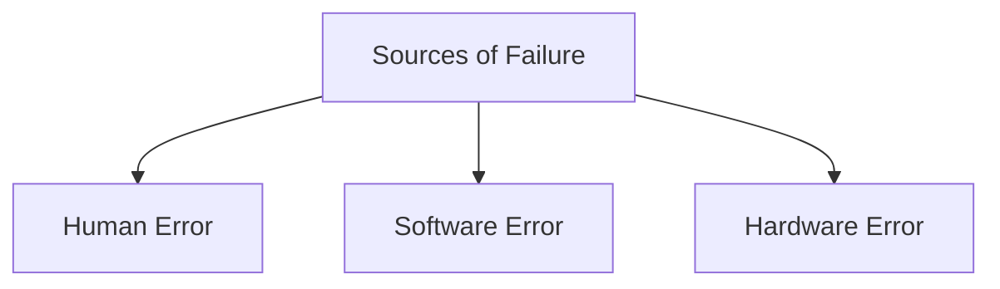

---

## 1. Human Error (الأكثر شيوعًا)

أشهر سبب للمشاكل في Production 😄

أمثلة:

- دفع config خاطئ للـ Production
- تشغيل Script غلط
- حذف Database بالخطأ
- Deploy نسخة غير مختبرة

مثال:

```bash
DROP DATABASE production;
```

😵

---

## 2. Software Errors

أخطاء تحدث داخل التطبيق نفسه.

أمثلة:

- Out Of Memory Exception
- NullPointer Exception
- Infinite Loop
- Long Garbage Collection

مثال:

```java
String name = null;

name.length();
```

---

## 3. Hardware Errors

مشاكل في البنية التحتية نفسها.

أمثلة:

- Server Failure
- Router Failure
- Storage Failure
- Hard Disk Crash

---

# Fault Tolerance Strategies

الـ Fault Tolerance تعتمد على 3 تكتيكات رئيسية:

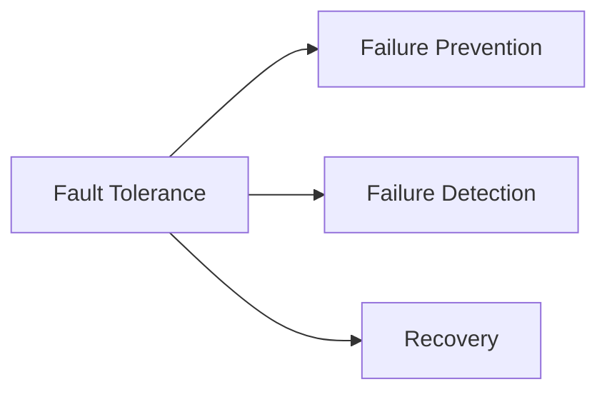

---

# 1) Failure Prevention

## الهدف

منع حدوث الأعطال قبل حدوثها.

---

## المشكلة الأساسية

وجود:

```txt
Single Point Of Failure (SPOF)
```

---

## يعني اي Single Point Of Failure ؟

أي Component لو وقع:

```txt
النظام كله يقع معه
```

---

### مثال سيئ ❌

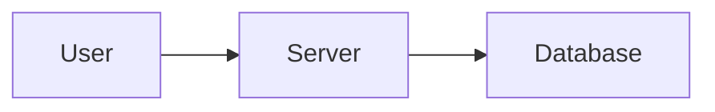

لو:

```txt
Server وقع
```

النظام كله يتوقف.

---

## الحل

استخدام:

- Redundancy
- Replication

---

## Redundancy

تعني:

```txt
تكرار المكونات
```

مثال:

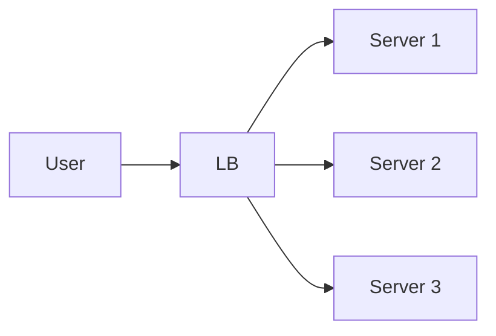

---

## Replication

تعني:

```txt
نسخ البيانات على أكثر من مكان
```

مثال:

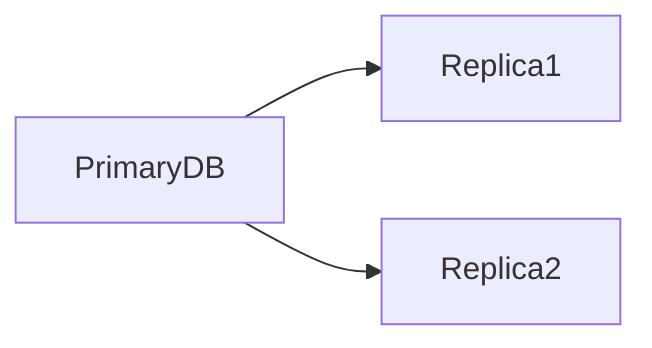

---

# Active-Active Architecture

كل الـ instances تعمل وتستقبل Traffic.

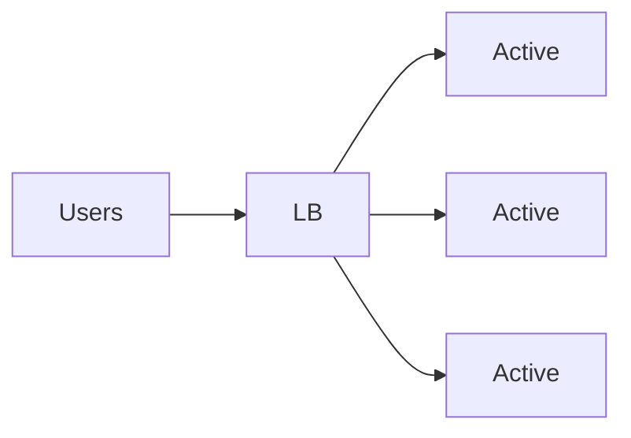

---

### المميزات

✅ استخدام كامل للموارد

✅ Failover سريع

✅ Scalability أفضل

---

### العيوب

❌ أصعب في Data Consistency

---

# Active-Passive Architecture

يوجد Server واحد Active والباقي Standby.

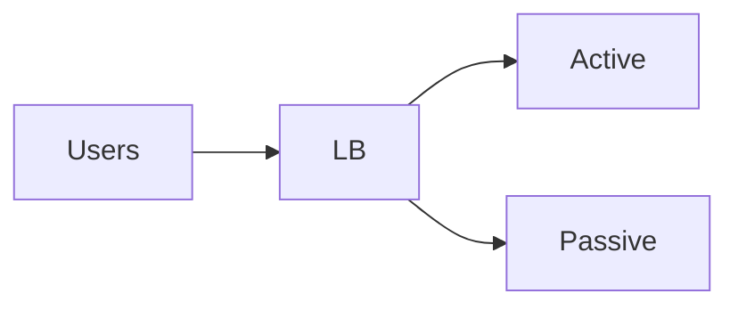

---

### المميزات

✅ أبسط

✅ Data Consistency أسهل

---

### العيوب

❌ إهدار للموارد

---

# 2) Failure Detection & Isolation

## الهدف

اكتشاف الأعطال بسرعة وعزلها.

---

## كيف تعمل ؟

Monitoring System تقوم بعمل:

```txt
Health Checks
```

بشكل دوري.

---

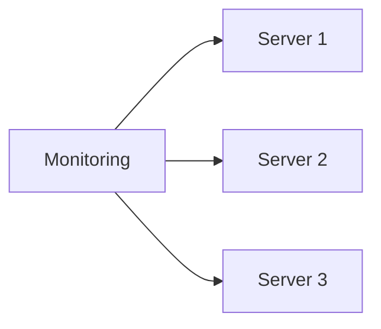

---

لو فشل Server:

```txt
Marked as Failed
```

ثم:

```txt
Load Balancer stops traffic
```

---

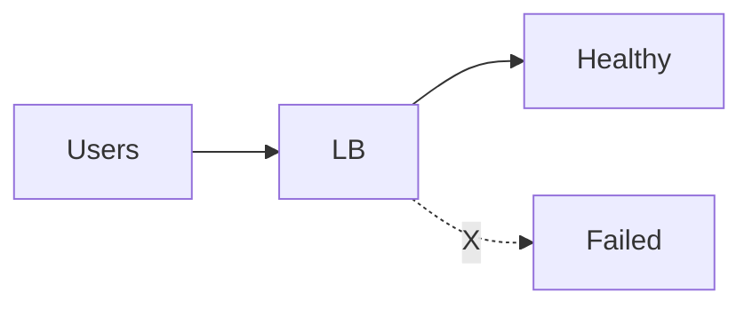

---

## Health Check أمثلة

### HTTP Check

```http
GET /health
```

---

Response:

```json
{
   "status":"ok"
}
```

---

في NestJS:

```ts
@Get('/health')
check(){

   return {

      status:'ok'

   };

}
```

---

# False Negative ⚠️

من أخطر المشاكل.

---

معناه:

```txt
النظام يعتقد أن الـ instance سليمة
لكنها في الحقيقة معطلة
```

---

النتيجة:

```txt
Users continue receiving failed requests
```

---

# 3) Recovery

## الهدف

استعادة النظام بسرعة بعد حدوث العطل.

---

## أمثلة Recovery

- إعادة تشغيل Service تلقائيًا
- تحويل Traffic
- تشغيل Passive Server
- استرجاع البيانات

---

مثال:

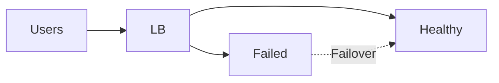

---

# Failover

> التحويل التلقائي للطلبات إلى Instance سليمة عند فشل Instance أخرى.

---

# مثال كامل للحياة الواقعية

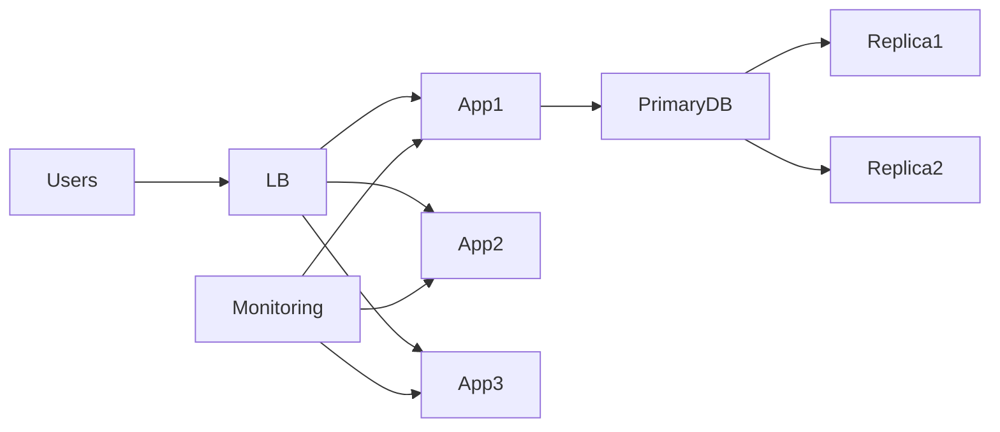

---

# المعادلة النهائية

```txt
Fault Tolerance

=

Failure Prevention

+

Failure Detection

+

Recovery
```

---

# مصطلحات مهمة

| المصطلح | المعنى |
|---|---|
| SPOF | مكون إذا فشل يفشل النظام بالكامل |
| Redundancy | تكرار المكونات |
| Replication | نسخ البيانات |
| Health Check | فحص دوري للحالة |
| False Negative | فشل لم يتم اكتشافه |
| Failover | التحويل التلقائي |
| Active-Active | كل الـ instances تعمل |
| Active-Passive | واحدة تعمل والباقي standby |

---

# Key Takeaways

✅ الأعطال حتمية

✅ أزل Single Point of Failure

✅ استخدم Redundancy و Replication

✅ استخدم Health Checks

✅ اعمل Recovery سريع

✅ الهدف ليس منع الأعطال بل تقليل تأثيرها

---

> "Systems don't fail because failures happen; they fail because they weren't designed to handle failures."
