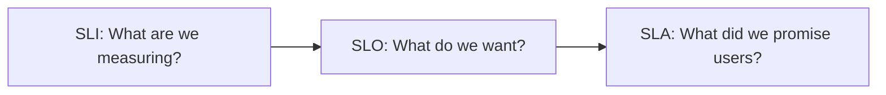
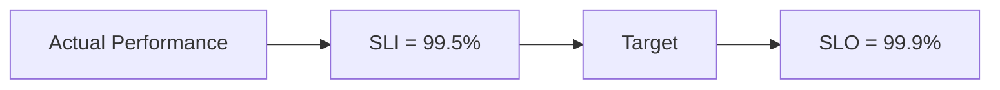
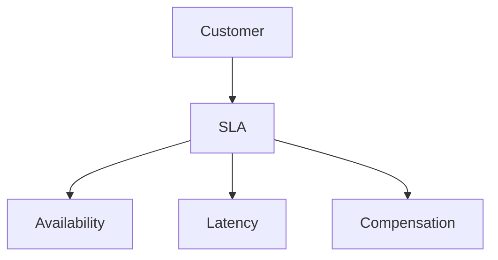
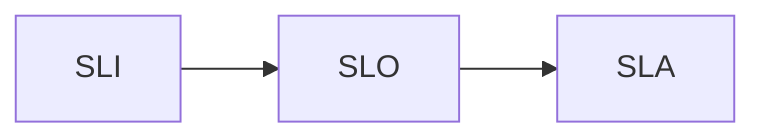

## SLA, SLI, SLO — ببساطة

---

**SLI** — _Service Level Indicator_

> **قياس حقيقي** لأداء النظام دلوقتي

مثال: "الـ availability دلوقتي 99.95%"

---

**SLO** — _Service Level Objective_

> **الهدف** اللي إنت عايز توصله

مثال: "عايزين الـ availability تكون 99.9% على الأقل"

---

**SLA** — _Service Level Agreement_

> **عقد رسمي** مع العميل — لو ما حققتش الـ SLO فيه جزاء

مثال: "لو الـ availability نزلت تحت 99.9% هنرد للعميل فلوس"

---

## العلاقة بينهم

```
SLI  →  بتقيس الواقع
SLO  →  هدفك الداخلي
SLA  →  وعدك للعميل
```

---

**بمثال واحد:**

- SLI = "النظام كان شغال 99.96% الشهر ده"
- SLO = "هدفنا 99.9%"
- SLA = "لو نزلنا تحت 99.9% هنديك discount"

---
---
---
# SLI / SLO / SLA — شرح System Design بالطريقة اللي بتتشرح في الشركات

دي من أهم الحاجات في الـ System Design والـ Production Systems، وناس كتير تحفظ التعريفات وتتلخبط بينهم. خلينا نمشي من المشكلة نفسها.

---

# المشكلة

تخيل إنك عملت API:

```txt
POST /login
```

والـ CEO سألك:

> "هل النظام شغال كويس؟"

مش هتعرف تقول:

```txt
أيوه شغال 😄
```

لازم يكون عندك أرقام.

مثلاً:

- متوسط الـ response = 150ms
    
- نسبة نجاح الطلبات = 99.95%
    
- Downtime = 10 دقائق بالشهر
    

هنا تبدأ تظهر:

- SLI
    
- SLO
    
- SLA
    

---

# الصورة الكبيرة



---

# 1) SLI (Service Level Indicator)

## التعريف

> Metric بنقيس بها أداء النظام.

بمعنى:

```txt
الأرقام الفعلية للنظام
```

---

# أمثلة SLI

### Availability

```txt
نسبة الوقت اللي النظام شغال فيه
```

---

مثال:

```txt
99.95%
```

---

### Latency

```txt
زمن الاستجابة
```

مثال:

```txt
200ms
```

---

### Error Rate

```txt
نسبة الطلبات الفاشلة
```

مثال:

```txt
0.2%
```

---

### Throughput

```txt
عدد الطلبات في الثانية
```

مثال:

```txt
5000 req/sec
```

---

# مثال حقيقي

نفترض خلال ساعة:

```txt
Total Requests = 10000

Successful Requests = 9950
```

---

نحسب Availability:

SLI=\frac{9950}{10000}\times100

الناتج:

```txt
99.5%
```

دي اسمها:

```txt
SLI
```

---

# إذًا:

```txt
SLI = What are we measuring?
```

---

# 2) SLO (Service Level Objective)

## التعريف

> الهدف المطلوب تحقيقه.

يعني:

```txt
إحنا عايزين نوصل لإيه؟
```

---

# مثال

النظام الحالي:

```txt
Availability = 99.5%
```

لكن الشركة تريد:

```txt
Availability >= 99.9%
```

---

يبقى:

```txt
99.9%
```

ده اسمه:

```txt
SLO
```

---

# مثال آخر

```txt
95% من الـ requests لازم تخلص أقل من 200ms
```

ده SLO.

---

# Diagram



---

# SLO مهم ليه؟

عشان:

- الفريق يعرف هدفه
    
- نعرف هل النظام اتحسن أو لا
    
- نعرف إمتى فيه مشكلة
    

---

# 3) SLA (Service Level Agreement)

## التعريف

> اتفاق رسمي بين الشركة والعميل.

---

ده غالبًا يكون عقد أو التزام رسمي.

مثال:

```txt
نضمن توفر الخدمة بنسبة 99.99%
```

ولو كسرنا الاتفاق:

```txt
العميل يحصل على تعويض
```

---

# مثال

شركة Cloud تقول:

```txt
Availability = 99.99%
```

ولو أصبحت:

```txt
99%
```

يحصل:

```txt
Refund
```

---

# Diagram



---

# مثال واقعي كامل

تخيل إن عندك منصة فيديو:

---

### SLI

```txt
Current availability = 99.92%
Current latency = 180ms
```

---

### SLO

```txt
Availability >= 99.95%

Latency < 200ms
```

---

### SLA

```txt
We guarantee:

99.9% uptime monthly

Otherwise:

10% service credit
```

---

# العلاقة بينهم



---

بمعنى:

نقيس:

```txt
SLI
```

↓

نحدد الهدف:

```txt
SLO
```

↓

نوعد العميل:

```txt
SLA
```

---

# مثال من الحياة اليومية 😄

تخيل شركة توصيل:

---

## SLI

الوقت الحقيقي:

```txt
25 دقيقة
```

---

## SLO

الهدف الداخلي:

```txt
20 دقيقة
```

---

## SLA

الوعد للعميل:

```txt
لو الطلب اتأخر أكثر من 30 دقيقة
هتاخد كوبون
```

---

# Production Notes ⭐

### لا تجعل SLO قريب جدًا من 100%

❌

```txt
100%
```

---

لأن:

```txt
Failures are inevitable
```

---

غالبًا الشركات تستخدم:

```txt
99.9%
99.95%
99.99%
```

---

# Error Budget ⭐

دي مرتبطة جدًا بالـ SLO.

لو:

```txt
SLO = 99.9%
```

فمسموح:

```txt
0.1%
```

فشل.

اسمها:

```txt
Error Budget
```

---

# الخلاصة

|المصطلح|المعنى|
|---|---|
|SLI|ما الذي نقيسه؟|
|SLO|ما الهدف المطلوب؟|
|SLA|ما الذي وعدنا به العميل؟|

---

# Mental Model سريع

```txt
SLI → Measurement

SLO → Goal

SLA → Promise
```

احفظ الجملة دي وهتفهم الثلاثة في أي انترفيو أو كورس System Design.