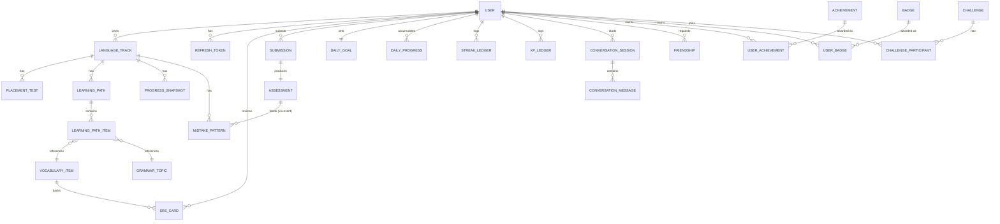
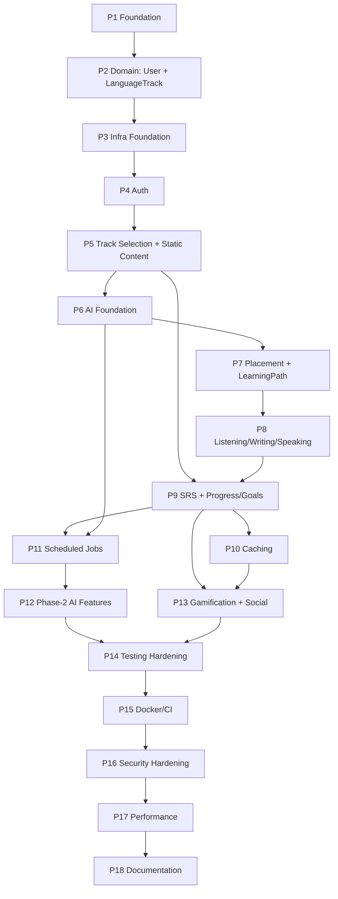

# AI-Powered Language Learning Platform — Architecture & Implementation Blueprint

**Stack:** Java 21 · Spring Boot 3.x · Spring Security · Spring Data JPA · PostgreSQL · Redis · Spring AI · Flyway · Docker · WebSocket · Spring Scheduler **Source of truth:** _AI-Powered Language Learning Platform — Complete Implementation Plan_ (uploaded PDF) **Purpose:** Turn the plan into an implementation-ready blueprint: reviewed architecture, complete domain/database/API design, full CQRS inventory, exhaustive project structure, dependency-ordered phases, ADRs, risks, and checklists. No code is written yet — this is the design contract.

---

## 1. Executive Summary

The source plan is already unusually mature for a first pass: it correctly separates Domain/Application/Infrastructure/API per feature, commits to CQRS without an unnecessary bus abstraction, treats XP/streak as append-only ledgers, isolates AI behind ports, and defers real-time voice streaming to a stretch goal. It does not need to be reinvented.

What it needs is **hardening in exactly four places** that are expensive to change mid-build:

1. **Repository port location** — the plan already puts ports in `application/port`. This blueprint keeps that decision and states the reason explicitly (Section 6.1) so it isn't re-litigated later.
2. **Aggregate boundaries** — several "entities" in the plan (`LearningPathItem`, `Submission`, `Assessment`) are not aggregate roots; this blueprint reclassifies them (Section 9).
3. **Cross-feature communication** — the plan has 20 features that will inevitably need to call each other (Placement → LanguageTrack, Assessment → MistakePattern, SRS creation from Vocabulary). Section 14 makes every one of these explicit so no feature reaches into another's internals.
4. **Polymorphic content references** (`LearningPathItem.contentUnitId`) — the plan already avoids a fake JPA inheritance hierarchy; this blueprint formalizes the discriminator pattern as an ADR.

Everything else in the plan — the table design, the Redis strategy, the phase order, the ledger pattern — is adopted as-is with justification attached, because it is already correct.

This blueprint is written for **one developer**, optimized for stable foundations before AI features, minimal rework, and a portfolio-credible incremental build.

---

## 2. PDF Requirements Extraction (Summary)

**Actors:** Anonymous, RegisteredUser (learner). No admin/teacher role in MVP scope.

**Core concepts (as defined in the source):** Learner, Language Track, Placement Test, Learning Path, Content Unit (vocab/grammar/listening/speaking-writing prompt), Submission, Assessment, SRS Card, Conversation Session, Progress Snapshot, Gamification Ledger.

**Explicit business rules extracted:**

- A user may run multiple concurrent Language Tracks (one per target language).
- Placement is optional; self-declared level unlocks content immediately.
- Learning Path regenerates on: placement completion, weekly weakness analysis, explicit re-plan — and regeneration must be **idempotent per (track, week)**, superseding not duplicating.
- Every AI-graded submission persists raw input **and** structured AI feedback — never a bare score.
- Streaks evaluate against the user's **stored timezone**, not server time.
- SRS scheduling runs independently of the Learning Path (separate cadence).
- XP/Coins/Streak are **append-only ledgers with reason codes** — no direct balance mutation.
- Content generation is parameterizable by `learner_interest_tags` (e.g., "backend developer" → programming vocabulary).
- AI usage requires **per-user daily quota**, enforced in Redis, from Phase 4/6 onward.
- Real-time voice is explicitly **upload-then-transcribe** for MVP; true streaming STT/TTS is out of scope until after Phase 1 ships.

**Implicit/necessary requirements not stated outright but required for production:** refresh-token reuse detection, email-verification gating, idempotent AI-content generation, malformed-AI-JSON fallback, audit columns, soft-delete only where user-facing deletion matters, rate limiting, structured logging with correlation IDs, ArchUnit-enforced boundaries, AI cost/quota observability.

**Ambiguities resolved by the plan (adopted here):**

|#|Ambiguity|Resolution|
|---|---|---|
|1|Single vs multi-track|Multi-track from day one|
|2|Placement mandatory?|Optional; self-declared level unlocks content|
|3|AI cost control|Per-user daily Redis quota from Phase 6|
|4|Voice: streaming vs upload|Upload-then-transcribe for MVP|

No contradictions were found between sections of the source plan.

---

## 3. Architecture Review

Systematic pass against the areas most likely to cause rework:

|Area|Plan's decision|Verdict|Notes|
|---|---|---|---|
|Layering|Feature-based Clean Architecture|**Keep**|Correct for a 20-feature solo project; avoids the "one giant `service/` package" failure mode.|
|CQRS mechanism|No bus; one Command/Query + one Handler per use case|**Keep**|Right call for one developer, zero plugin requirement.|
|Repository port location|`application/port`|**Keep, formalized as ADR-004**|See Section 6.1 for the full trade-off.|
|Aggregate modeling|Treats several child/value concepts as top-level "entities"|**Revise**|`LearningPathItem` is not an aggregate root; `Assessment` is 1:1-owned by `Submission`'s bounded context but should not be inside the `Submission` aggregate boundary itself (different lifecycle — see Section 9).|
|Polymorphic content reference|Discriminator (`content_type` + `content_unit_id`), resolved in application layer|**Keep**|Correct rejection of fake JPA inheritance.|
|Ledger pattern|Append-only, reason-coded, Postgres source of truth, Redis for hot reads|**Keep**|Already textbook; carried over verbatim.|
|AI isolation|Ports in `application/port/ai`, built in a dedicated phase before first AI feature|**Keep**|This is the single highest-leverage decision in the whole plan — confirmed, not touched.|
|Cross-feature calls|Implied but not enumerated|**Gap — filled**|Section 14 adds the missing matrix.|
|WebSocket scope|Used only for speaking-assessment completion push|**Keep**|Right-sized; not overextended to chat/notifications in MVP.|
|Scheduling|`@Scheduled` only, ShedLock deferred to multi-instance phase|**Keep**|Correct — do not add distributed locking before it's needed.|

No changes are made to functional requirements. All changes are structural/architectural.

---

## 4. Recommended Architecture

**Feature-Based Clean Architecture + explicit CQRS**, exactly as proposed in the source plan:

```text
feature/
├── api/            # controllers, request/response DTOs, exception mapping
├── application/    # commands, queries, handlers, ports (repository + AI)
├── domain/         # entities, value objects, domain services, domain events — zero framework deps
└── infrastructure/ # JPA entities/repos, AI adapters, Redis, mappers
```

## 5. Architectural Principles

1. Domain has zero framework dependencies — no Spring, no JPA, no Lombok annotations that leak framework behavior into business rules.
2. Application defines ports; it never imports an infrastructure package.
3. Infrastructure implements ports; it is the only layer allowed to know about Postgres, Redis, or the AI provider SDK.
4. API never touches a JPA repository or a persistence entity directly.
5. Every use case is exactly one Command or one Query — never both.
6. AI is a port, never a direct dependency of business logic.
7. State-changing balances (XP, streak, coins) are never mutated in place — only appended to.
8. Cross-feature calls are always through an explicit, listed mechanism (Section 14) — never a raw repository reach-through.

## 6. Dependency Rules

```text
DOMAIN ← APPLICATION ← INFRASTRUCTURE
              ↑
             API
```

|From \ To|Domain|Application|Infrastructure|API|
|---|---|---|---|---|
|Domain|—|❌|❌|❌|
|Application|✅|—|❌ (interfaces only, owned by Application)|❌|
|Infrastructure|✅|✅ (implements ports)|—|❌|
|API|❌ (DTOs only)|✅|❌|—|

### 6.1 ADR — Repository Port Location

**Decision: `application/port/`, not `domain/repository/`.**

- **Context:** Ports could live in `domain/repository` (traditional DDD) or `application/port` (hexagonal/ports-and-adapters framing).
- **Why `application/port` wins here:** every port in this system (repository _and_ AI) sits next to the Command/Query Handlers that consume it. Keeping repository ports and AI ports in the same conceptual location (`application/port/...`) means a developer scanning one folder sees _every_ external dependency a feature has, not just the persistence ones. Splitting repository ports into `domain/` while AI ports stay in `application/` would fragment that view for no benefit, since Domain here has no use for a repository port itself (Domain methods take data, not repositories, as arguments).
- **Trade-off accepted:** slightly less "pure" DDD (some schools insist repository contracts belong to the domain layer as an expression of aggregate lifecycle). This is a stylistic loss, not a correctness one — Application still owns the interface and Infrastructure still cannot leak into Domain.
- **This is now fixed project-wide.** Do not mix conventions between features.

---

## 7. Bounded Contexts

|Context|Owns|Notes|
|---|---|---|
|Identity & Access|User, auth, tokens|Also owns `timezone`, `learner_interest_tags`|
|Language Track|LanguageTrack, PlacementTest|One per (user, language)|
|Curriculum|LearningPath, LearningPathItem, VocabularyItem, GrammarTopic, ListeningClip|Shared content pool, not per-user|
|Practice & Assessment|Submission, Assessment|Writing/Speaking/Quiz all funnel here|
|Spaced Repetition|SrsCard|Independent cadence from Curriculum|
|Progress & Gamification|DailyGoal, DailyProgress, StreakLedgerEntry, XpLedgerEntry, ProgressSnapshot, Achievement, Badge|Ledger-based|
|Conversation|ConversationSession, ConversationMessage|Phase 2|
|Mistake Intelligence|MistakePattern|Reads Assessment events, feeds LearningPath and Curriculum prompts|
|Social|Friendship, Challenge|Lowest technical risk, last phase|

Contexts map 1:1 to top-level feature packages, except Curriculum, which is split into `vocabulary/`, `grammar/`, `listening/` sub-features sharing one bounded context conceptually but separate code packages (they don't share aggregates, only the "content pool" idea).

---

## 8–9. Domain Model, Aggregates & Boundaries

|Aggregate Root|Child entities / owned data|Invariant|Repository|
|---|---|---|---|
|**User**|—|Email unique; password hash nullable only if OAuth-only|`UserRepository`|
|**LanguageTrack**|—|Unique `(userId, targetLanguage)` while active|`LanguageTrackRepository`|
|**PlacementTest**|transcript (JSONB, owned)|Max question count enforced before forcing a result|`PlacementTestRepository`|
|**LearningPath**|`LearningPathItem[]`|Only one `ACTIVE` path per `(languageTrackId, weekNumber)`; regeneration supersedes|`LearningPathRepository`|
|**VocabularyItem**|—|Shared pool, not owned by any track|`VocabularyRepository`|
|**GrammarTopic**|—|Shared pool|`GrammarRepository`|
|**SrsCard**|—|One card per `(userId, vocabularyItemId)`|`SrsCardRepository`|
|**Submission**|—|Immutable once created|`SubmissionRepository`|
|**Assessment**|—|_Not_ a child of Submission's aggregate — 1:1 by FK but separate lifecycle/repository, because Assessment is written asynchronously (often by a different process/thread than the one that created the Submission) and reprocessing (regrade) must be possible without reloading the Submission aggregate.|`AssessmentRepository`|
|**DailyGoal**|—|One per user|`DailyGoalRepository`|
|**DailyProgress**|—|Unique `(userId, date)`|`DailyProgressRepository`|
|**StreakLedgerEntry**|—|Append-only|`StreakLedgerRepository`|
|**XpLedgerEntry**|—|Append-only|`XpLedgerRepository`|
|**ConversationSession**|`ConversationMessage[]`|Messages ordered, immutable once written|`ConversationRepository`|
|**MistakePattern**|—|Upserted by event listener on Assessment creation|`MistakePatternRepository`|
|**Achievement / Badge**|—|Rule-evaluated, not user-mutable|`AchievementRepository`|
|**Friendship / Challenge**|—|Standard bidirectional relationship + participants table|`FriendshipRepository`, `ChallengeRepository`|

**Explicit reclassification vs. the source plan:** `LearningPathItem` is **not** an aggregate root — it is owned by and only reachable through `LearningPath` (matches the plan's own "(VO-ish, owned by LearningPath)" note; this blueprint just makes the modeling consequence explicit: no standalone `LearningPathItemRepository`, only `LearningPath.items` accessed via the owning aggregate).

`Database Table = Aggregate` is explicitly rejected for: `learning_path_items` (owned, no repository), `assessments` (separate aggregate despite 1:1 FK, for the async-lifecycle reason above).

---

## 10. Value Objects

|VO|Fields|Invariant|
|---|---|---|
|`Email`|value|RFC-valid format|
|`CefrLevel`|enum A1–C2|Ordinal-comparable|
|`Score`|value 0–100|Cannot construct out of range|
|`AudioRef`|storageKey, durationSeconds, mimeType|durationSeconds > 0|
|`PasswordHash`|value|Never logged, never equals-by-string in domain code|
|`ContentType`|enum VOCAB/GRAMMAR/SPEAKING/LISTENING|Drives polymorphic resolution|
|`LanguageCode`|ISO 639-1 value|Validated against supported-languages set|
|`Timezone`|IANA zone id|Validated against `ZoneId`|
|`ReasonCode`|enum per ledger type|Closed set, not free text|

All VOs are immutable Java `record`s with compact-constructor validation.

## 11. Domain Services

Only where logic doesn't naturally belong to one entity:

- **SrsScheduler** — SM-2 next-review computation from a review grade. Spans SrsCard + review-grade input, no single entity owns "what's the next due date."
- **StreakCalculator** — needs "today in user's timezone" plus yesterday's streak state; doesn't belong on `User` because it's a _policy_, not user data.
- **LevelProgressionPolicy** — decides whether a `ProgressSnapshot` should change `LanguageTrack.currentLevel`; spans two aggregates.

Rejected as domain services (kept as entity methods instead): anything that only needs the fields of one entity (e.g., `Assessment.isLowConfidence()` stays on `Assessment`).

## 12. Domain Events

|Event|Raised by|Consumed by|
|---|---|---|
|`SubmissionAssessedEvent`|Assessment creation|MistakePattern listener, Progress recorder|
|`LanguageTrackLevelChangedEvent`|LevelProgressionPolicy|LearningPath (triggers regeneration)|
|`LearningPathGeneratedEvent`|GenerateLearningPathHandler|Progress dashboard cache invalidation|
|`ActivityCompletedEvent`|Any content-completion handler|Progress/Gamification (XP + streak + daily progress)|
|`PlacementCompletedEvent`|Placement handler|LanguageTrack (sets level), LearningPath (triggers first generation)|

Implemented via Spring's `ApplicationEventPublisher`, wrapped in `shared/event/`, `@TransactionalEventListener(phase = AFTER_COMMIT)` for anything that must not fire on a rolled-back write.

---

## 13. Complete Feature Map

_(Condensed — full per-endpoint detail in Section 15 API Architecture and Section 16 CQRS Inventory.)_

|Feature|Phase|Aggregates|AI?|Endpoints|Async?|
|---|---|---|---|---|---|
|Authentication|4|User|No|6|No|
|Language Track|5|LanguageTrack|No|2|No|
|Vocabulary|5|VocabularyItem, SrsCard|No|3|No|
|Grammar|5|GrammarTopic|Yes (rendering)|1|No|
|AI Foundation|6|—|Infra only|0|No|
|Placement Test|7|PlacementTest, LanguageTrack|Yes|3|No|
|Learning Path|7|LearningPath|Yes|2|No|
|Listening|8|Submission, Assessment|Yes|2|No|
|Writing|8|Submission, Assessment|Yes|2|No|
|Speaking|8|Submission, Assessment|Yes|2|**Yes (STT pipeline)**|
|SRS|9|SrsCard|No|2|No|
|Progress/Goals|9|DailyGoal, DailyProgress, ledgers|No|3|No|
|Conversation/Roleplay|12|ConversationSession|Yes|2|No|
|AI Content Generators|12|VocabularyItem, story/quiz cache|Yes|3|No|
|Mistake Intelligence|12|MistakePattern|Yes (enrichment)|0 (internal)|No|
|Weakness Analyzer|11|ProgressSnapshot|Yes|0 (job)|Scheduled|
|Gamification|13|Achievement, Badge, ledgers|No|2|No|
|Social|13|Friendship, Challenge|No|4|No|

---

## 14. Cross-Feature Communication Matrix

Every cross-feature interaction, and how it is allowed to happen — this is the gap the source plan left implicit.

|From|To|Interaction|Mechanism|Reason|
|---|---|---|---|---|
|Vocabulary|SRS|Create SrsCard on "mark learned"|Application-layer orchestration inside `MarkVocabularyLearnedHandler` (constructor-injects `SrsCardRepository` port)|Same transaction, same request — no need for eventing overhead|
|Placement|LanguageTrack|Set level on completion|Domain event (`PlacementCompletedEvent`)|Decouples — LanguageTrack shouldn't need to know Placement's internals to react|
|Placement|LearningPath|Trigger first generation|Domain event listener|Same reason; also avoids Placement depending on LearningPath's port|
|Assessment|MistakePattern|Record recurring mistake|Domain event (`SubmissionAssessedEvent`), `@TransactionalEventListener(AFTER_COMMIT)`|Must not run on a submission that ends up rolled back|
|Assessment|Progress/Gamification|Record XP/activity|Domain event (`ActivityCompletedEvent`)|Every content type triggers this identically — event avoids N call sites|
|WeaknessAnalyzer (job)|LearningPath|Regenerate path|Handler-to-handler invocation (job calls `GenerateLearningPathHandler` directly)|Scheduled job is already outside a request context; direct call is simpler than routing through eventing|
|LearningPath|Vocabulary/Grammar|Read content pool for sequencing|Read-only query port (`VocabularyReadPort`, `GrammarReadPort`) exposed by each feature's `application/port`|LearningPath must never import Vocabulary's persistence entities|
|Any content feature|Progress|"Get today's progress" for dashboard|Dedicated read-model query (native SQL/JPQL projection), not aggregate loading|CQRS query-side; performance-critical, cross-feature reads shouldn't go through aggregates|
|Gamification|XP/Streak ledgers|Append entries|Direct repository call within Gamification's own boundary|Ledgers belong to the Gamification/Progress bounded context, not a separate feature|

No circular dependencies: events flow Placement → LanguageTrack/LearningPath; Assessment → MistakePattern/Progress; nothing flows back into Placement or Assessment. Read ports (Vocabulary/Grammar → LearningPath) are one-directional.

---

## 15. Complete CQRS Inventory

Legend: **C** = Command, **Q** = Query.

|Feature|Type|Use Case|Command/Query|Mutates State|Key Dependencies|
|---|---|---|---|---|---|
|Auth|C|Register|`RegisterUserCommand`|Yes|UserRepository, PasswordEncoder|
|Auth|C|Verify email|`VerifyEmailCommand`|Yes|UserRepository, TokenPort|
|Auth|C|Login|`LoginCommand`|No (issues token)|UserRepository, JwtPort|
|Auth|C|Refresh token|`RefreshTokenCommand`|Yes (rotates)|RefreshTokenRepository|
|Auth|C|Google login|`GoogleLoginCommand`|Yes|UserRepository, OAuthPort|
|Auth|Q|Current user|`GetCurrentUserQuery`|No|UserRepository|
|LanguageTrack|C|Create track|`CreateLanguageTrackCommand`|Yes|LanguageTrackRepository|
|LanguageTrack|C|Set self-declared level|`SetSelfDeclaredLevelCommand`|Yes|LanguageTrackRepository|
|LanguageTrack|Q|List tracks|`GetUserLanguageTracksQuery`|No|LanguageTrackRepository|
|Placement|C|Start test|`StartPlacementTestCommand`|Yes|PlacementTestRepository, AiPlacementPort|
|Placement|C|Submit answer|`SubmitPlacementAnswerCommand`|Yes|PlacementTestRepository, AiPlacementPort|
|Placement|Q|Get result|`GetPlacementResultQuery`|No|PlacementTestRepository|
|LearningPath|C|Generate path|`GenerateLearningPathCommand`|Yes (idempotent supersede)|LearningPathRepository, VocabularyReadPort, GrammarReadPort, AiLearningPathPort|
|LearningPath|Q|Active path|`GetActiveLearningPathQuery`|No|LearningPathRepository (cached)|
|Vocabulary|C|Mark learned|`MarkVocabularyLearnedCommand`|Yes|VocabularyRepository, SrsCardRepository|
|Vocabulary|Q|Get item|`GetVocabularyItemQuery`|No|VocabularyRepository|
|Vocabulary|Q|List by level|`ListVocabularyByLevelQuery`|No|VocabularyRepository (cached)|
|Grammar|Q|Explanation (AI-rendered)|`GetGrammarExplanationQuery`|No|GrammarRepository, AiExplanationPort|
|Listening|C|Submit answer|`SubmitListeningAnswerCommand`|Yes|SubmissionRepository, AiGradingPort|
|Writing|C|Submit writing|`SubmitWritingCommand`|Yes|SubmissionRepository, AiWritingAssessmentPort|
|Speaking|C|Submit speech|`SubmitSpeechCommand`|Yes (async)|SubmissionRepository, AiSpeechPort, WebSocket notifier|
|Speaking|Q|Get submission status|`GetSpeechSubmissionQuery`|No|SubmissionRepository|
|SRS|C|Review card|`ReviewSrsCardCommand`|Yes|SrsCardRepository, SrsScheduler|
|SRS|Q|Due cards|`GetDueSrsCardsQuery`|No|SrsCardRepository (indexed)|
|Progress|C|Set daily goal|`SetDailyGoalCommand`|Yes|DailyGoalRepository|
|Progress|C|Record activity (internal)|`RecordActivityCommand`|Yes|DailyProgressRepository, XpLedgerRepository, StreakLedgerRepository, StreakCalculator|
|Progress|Q|Today's progress|`GetDailyProgressQuery`|No|Read-model projection|
|Progress|Q|Streak|`GetStreakQuery`|No|StreakLedgerRepository|
|Conversation|C|Send message|`SendConversationMessageCommand`|Yes|ConversationRepository, AiConversationPort|
|Conversation|C|Start roleplay|`StartRoleplayCommand`|Yes|ConversationRepository, AiConversationPort|
|ContentGen|C|Generate vocabulary|`GenerateVocabularyCommand`|Yes|VocabularyRepository, AiVocabGeneratorPort|
|ContentGen|C|Generate story|`GenerateStoryCommand`|Yes|AiStoryGeneratorPort (cached)|
|ContentGen|C|Generate quiz|`GenerateQuizCommand`|Yes|AiQuizGeneratorPort (cached)|
|ContentGen|Q|Translate context|`TranslateContextQuery`|No|AiTranslationPort|
|WeaknessAnalyzer|Job|Weekly analysis|(scheduled, not HTTP)|Yes|ProgressSnapshotRepository, LearningPath handler|
|Gamification|Q|Leaderboard|`GetLeaderboardQuery`|No|Redis sorted set|
|Social|C|Send friend request|`SendFriendRequestCommand`|Yes|FriendshipRepository|
|Social|C|Create challenge|`CreateChallengeCommand`|Yes|ChallengeRepository|

Every use case named in the source plan appears above; none introduce a generic dispatcher.

---

## 16. Database Design

Global conventions (adopted from the plan): `BIGSERIAL` PK, `created_at`/`updated_at TIMESTAMPTZ`, soft delete (`deleted_at`) **only** on `users`, `language_tracks`, `submissions`; everything else is either hard-deletable static content or immutable append-only.

### 16.1 Key decisions with rationale

|Decision|Choice|Why|
|---|---|---|
|PK type|`BIGSERIAL` over `UUID`|Single-writer Postgres, no multi-region merge requirement; smaller indexes, sequential inserts. UUID would only be justified if IDs needed to be client-generated pre-insert (not the case here).|
|Enum storage|Postgres native `ENUM` for closed, rarely-changing sets (CEFR level, submission type, auth provider); `VARCHAR` + check constraint for anything that might grow without a migration (`reason_code`)|Native enums are cheap and safe for truly closed sets; reason codes evolve faster than a migration cadence should allow.|
|JSONB usage|`placement_tests.transcript`, `assessments.feedback_json`|Structured-but-variable AI output; querying inside these blobs is not a hot path, so JSONB's flexibility outweighs the loss of column-level constraints.|
|Timestamps|`TIMESTAMPTZ` everywhere|Timezone-aware streak/day-boundary logic is a stated hard requirement; naive timestamps would silently break it.|
|Optimistic locking|`@Version` on `LanguageTrack`, `LearningPath`, `SrsCard`|These are read-modify-write from user actions with realistic concurrent-edit risk (e.g., two devices reviewing the same SRS card). Not applied to ledgers (append-only, no update conflict) or static content (single-writer, admin-seeded).|
|Soft delete|Only `users`, `language_tracks`, `submissions`|These are the only entities a user might reasonably want "removed" from their view while preserving audit trail. Ledgers, content, and progress rows are either immutable or trivially regenerable.|
|Ledger tables|Append-only, indexed on `(user_id, created_at DESC)`|Balance = `SUM(amount)`, never denormalized without a reconciliation job (nightly), per the plan.|
|Polymorphic content|Discriminator column (`content_type`) + `content_unit_id`, resolved in application layer|Avoids a fake shared JPA supertype across `vocabulary_items`/`grammar_topics` that would force eager-fetch complexity for a relationship that's genuinely two different tables.|

### 16.2 Full Table List

`users`, `language_tracks`, `placement_tests`, `learning_paths`, `learning_path_items`, `vocabulary_items`, `grammar_topics`, `listening_clips`, `srs_cards`, `submissions`, `assessments`, `daily_goals`, `daily_progress`, `streak_ledger`, `xp_ledger`, `progress_snapshots`, `conversation_sessions`, `conversation_messages`, `mistake_patterns`, `achievements`, `user_achievements`, `badges`, `user_badges`, `friendships`, `challenges`, `challenge_participants`, `refresh_tokens`.

(Column-level detail for `users` through `xp_ledger` matches the source plan's Section 3 verbatim — carried over unchanged as it is already production-grade. New tables added by this blueprint below.)

### 16.3 Tables Added Beyond the Source Plan

|Table|Purpose|Key columns|Notes|
|---|---|---|---|
|`progress_snapshots`|Weekly weakness-analysis output|`user_id FK`, `language_track_id FK`, `week_number`, `skill_scores JSONB`, `created_at`|Feeds `LevelProgressionPolicy`|
|`conversation_sessions`|Chat/roleplay session header|`user_id FK`, `language_track_id FK`, `mode ENUM (CHAT/ROLEPLAY)`, `scenario VARCHAR NULL`, `started_at`||
|`conversation_messages`|Turn-by-turn transcript|`session_id FK`, `role ENUM (USER/AI)`, `content TEXT`, `created_at`|Index `(session_id, created_at)`|
|`mistake_patterns`|Recurring error tracking|`user_id FK`, `language_track_id FK`, `category VARCHAR`, `example TEXT`, `frequency INT`, `last_seen_at`|Upserted via event listener|
|`achievements` / `user_achievements`|Rule catalog + earned records|standard catalog + join table||
|`badges` / `user_badges`|Same pattern as achievements|||
|`friendships`|Bidirectional relation|`requester_id FK`, `addressee_id FK`, `status ENUM`|Unique `(requester_id, addressee_id)`|
|`challenges` / `challenge_participants`|Weekly competitions|header + participants with progress snapshot||
|`refresh_tokens`|Rotation + reuse detection|`user_id FK`, `token_hash`, `expires_at`, `revoked_at NULL`, `replaced_by_id NULL`|Required for the plan's stated reuse-detection rule; the source plan mentions this rule but doesn't table it — added here.|

### 16.4 Performance Risks (carried from source plan, confirmed correct)

1. Dashboard endpoint must use a dedicated read-model query, not lazy-loaded joins across `daily_progress`/`xp_ledger`/`srs_cards`/`assessments`.
2. `srs_cards` due-today query must hit `(user_id, due_at)` directly — never filter in memory.
3. `learning_path_items.content_unit_id` resolved by `content_type` in the application layer, not a JPA polymorphic mapping.
4. XP leaderboard reads from Redis (`ZINCRBY` on write), Postgres ledger reconciled nightly — never `SUM()` on every page load.

---

## 17. Complete ERD



Sub-ERDs (Core, Learning, Assessment, AI/Conversation, Progress/Gamification, Social) are the same graph filtered by bounded context per Section 7 — omitted here to avoid duplicating the consolidated diagram above.

---

## 18. API Architecture

Conventions (adopted from source plan, unchanged): `/api/v1/`, envelope `{ data, meta }` / `{ error: { code, message, details[] } }` via `GlobalExceptionHandler`, `Authorization: Bearer <jwt>` except `/auth/*`, pagination `?page=&size=` capped at 100, mutating endpoints return the resource id, async endpoints (`speaking`) return `202` + poll URL.

**Status codes:** 400 validation, 401 unauthenticated, 403 unauthorized, 404 not found, 409 conflict, 422 business-rule violation, 429 AI quota exceeded, 500 unhandled.

Full endpoint inventory matches the CQRS Inventory (Section 15) 1:1 — every Command/Query has exactly one endpoint, listed with its handler in that table. No separate duplicate listing is produced here to keep the two tables from drifting out of sync; **the CQRS Inventory is the single source of truth for endpoints.**

---

## 19. Security Architecture

|Component|Design|
|---|---|
|Access tokens|Short-lived JWT (15 min), signed HS256/RS256 from env secret|
|Refresh tokens|Opaque, stored hashed in `refresh_tokens`, rotated on every use, reuse triggers full revocation of the token family|
|Password hashing|BCrypt, cost factor 12|
|Email verification|Token in `users`-adjacent table, 24h expiry, gate applied via a servlet filter (not per-handler checks)|
|Google OAuth2|`google_sub` unique nullable column; email collision with a LOCAL account is **rejected** with a clear "sign in with password" error (not auto-linked)|
|Authorization|Method security (`@PreAuthorize`) + explicit resource-ownership checks in handlers (never trust a path-variable user id)|
|CORS|Explicit allow-list per environment|
|CSRF|Disabled (stateless JWT API, no cookie-based session)|
|Rate limiting|Per-IP and per-user, `shared/security` filter, backed by Redis counters|
|AI quota|Redis counter `ai-quota:{userId}:{date}`, enforced in a shared interceptor before any AI port is called, not per-feature|
|Secrets|Env-var injected, never committed; `.env.example` documents required keys|
|Security headers|HSTS, X-Content-Type-Options, X-Frame-Options via a security filter chain config|

---

## 20. Redis Architecture

|Use case|Key|TTL|Invalidation|
|---|---|---|---|
|JWT blacklist (logout)|`jwt:blacklist:{jti}`|until token expiry|self-expiring|
|Active learning path|`path:active:{trackId}`|1h|evict on `GenerateLearningPathCommand`|
|Vocabulary by level|`vocab:{lang}:{level}`|6h|evict on new vocab insert for that pair|
|AI daily quota|`ai-quota:{userId}:{date}`|24h|natural expiry|
|Generated quiz|`quiz:{topicId}:{level}`|24h|natural expiry (variety is fine)|
|Leaderboard|`leaderboard:xp:global` (sorted set)|live|`ZINCRBY` on every `xp_ledger` write|
|Rate limit counters|`ratelimit:{ip\|userId}:{window}`|window length|natural expiry|

Redis is never the primary persistence store — Postgres remains source of truth for everything above except live rate-limit/quota counters, which are inherently ephemeral.

---

## 21. Spring AI Architecture

```text
Application → AiXxxPort (interface, e.g. AiPlacementPort) → AiXxxAdapter (infrastructure) → Spring AI ChatClient → LLM provider
```

- **Port granularity:** feature-specific ports (`AiPlacementPort`, `AiLearningPathPort`, `AiWritingAssessmentPort`, `AiConversationPort`, `AiVocabGeneratorPort`, `AiStoryGeneratorPort`, `AiQuizGeneratorPort`, `AiTranslationPort`, `AiSpeechPort`), **not** one shared `AiPort` god-interface — each has a distinct input/output schema and distinct fallback behavior, so a shared interface would immediately need feature-specific overloads anyway.
- A single **shared adapter-support layer** (`shared/ai/`) holds the `ChatClient` bean config, structured-output→typed-record helper, prompt-template loader, and quota guard — reused by every feature-specific adapter. This is the "both" answer: ports are feature-specific, plumbing is shared.
- **Structured outputs required** for every AI call that feeds a domain decision (placement level, writing corrections, quiz shape) — enforced via Spring AI's structured output binding to a typed record, validated against a JSON schema in tests.
- **Retry:** one retry on malformed/unparseable JSON, then fallback (e.g., placement falls back to self-declared level).
- **Timeout:** explicit per-call timeout (recommend 30s for text, 60s for STT), circuit-broken after repeated provider failures.
- **Cost tracking:** log token usage per call with correlation id; aggregate into a metrics counter tagged by feature.
- **Quota:** enforced centrally (Section 19), not per-feature.

---

## 22. WebSocket Architecture

Used **only** for speaking-submission completion push (matches source plan's scope decision — not extended to chat/notifications in MVP).

- Connection authenticated via JWT on handshake (query param or `STOMP CONNECT` header).
- Topic: `/topic/submissions/{submissionId}` — user subscribes after receiving `202` from `SubmitSpeechCommand`.
- Payload: `{ submissionId, status, assessmentId? }`.
- Reconnect: client re-subscribes; server has no session-affinity requirement since the underlying state lives in Postgres (poll fallback always works if the socket drops).
- Fallback: `GET /api/v1/speaking/submissions/{id}` always available as a polling alternative — WebSocket is a UX optimization, not the only path to the result.

---

## 23. Background Jobs

|Job|Trigger|Idempotency|Concurrency|
|---|---|---|---|
|Weekly Weakness Analyzer|`@Scheduled` cron, chunked per-user batch|Writes one `ProgressSnapshot` per `(track, week)` — upsert|Single instance for MVP; flag for ShedLock pre-scale|
|Daily Conversation Seeder|`@Scheduled` daily|Round-robin scenario selection, no AI needed for seeding itself|Single instance|
|Streak Reset Check|`@Scheduled` hourly, processes users whose local midnight just passed|Keyed by `(user_id, date)` unique constraint on `daily_progress`|Single instance|
|SRS Due-Reminder|`@Scheduled` + WebSocket/push, off `srs_cards.due_at` index|Read-only trigger, no write-side idempotency needed|Single instance|

**ShedLock evaluated and deferred:** not needed until horizontal scaling — explicitly flagged as a Phase 16 concern per the source plan, not built prematurely.

---

## 24. Testing Architecture

|Layer|Tool|Scope|
|---|---|---|
|Domain|JUnit 5, no Spring context|Entity invariants, `SrsScheduler` correctness, `StreakCalculator` timezone edge cases|
|Application/Handlers|JUnit 5 + Mockito|Mocked ports, validation rejection paths, idempotency (path regeneration supersedes)|
|Infrastructure|Testcontainers (real Postgres)|Query correctness, index-dependent queries, migration correctness|
|API|`@SpringBootTest` + MockMvc|Auth flow end-to-end, status codes, cross-user authorization|
|AI integration|`@Tag("ai-integration")`, excluded from default `mvn test`|Real calls against a cheap model, run manually/nightly|
|Contract|JSON schema assertions on AI structured outputs|Fails CI immediately if a prompt/model change breaks the output shape|
|Architecture|ArchUnit|Section 25|

**Non-negotiable minimum per feature** (from source plan, confirmed): duplicate registration, expired refresh token, Google-email collision; malformed-AI-response fallback and max-question cutoff for Placement; idempotent regeneration for LearningPath; due-date math + ease-factor floor for SRS; concurrent-write safety for ledgers; cross-user authorization on every "my data" endpoint.

---

## 25. ArchUnit Rules

```java
@AnalyzeClasses(packages = "com.yourorg.langplatform")
class ArchitectureTest {

    @ArchTest
    static final ArchRule domain_has_no_framework_deps =
        noClasses().that().resideInAPackage("..domain..")
            .should().dependOnClassesThat().resideInAnyPackage(
                "org.springframework..", "jakarta.persistence..");

    @ArchTest
    static final ArchRule domain_independent_of_infrastructure =
        noClasses().that().resideInAPackage("..domain..")
            .should().dependOnClassesThat().resideInAPackage("..infrastructure..");

    @ArchTest
    static final ArchRule application_independent_of_infrastructure =
        noClasses().that().resideInAPackage("..application..")
            .should().dependOnClassesThat().resideInAPackage("..infrastructure..");

    @ArchTest
    static final ArchRule api_cannot_use_jpa_repositories =
        noClasses().that().resideInAPackage("..api..")
            .should().dependOnClassesThat().areAssignableTo(JpaRepository.class);

    @ArchTest
    static final ArchRule api_cannot_expose_persistence_entities =
        noClasses().that().resideInAPackage("..api..")
            .should().dependOnClassesThat().resideInAPackage("..infrastructure.persistence..");

    @ArchTest
    static final ArchRule features_do_not_reach_into_each_others_infrastructure =
        slices().matching("..langplatform.(*)..")
            .namingSlices("$1")
            .should().notDependOnEachOther()
            .ignoreDependency(DescribedPredicate.describe(
                "read ports and shared events", ArchitectureTest::isAllowedCrossFeatureCall));
}
```

The last rule is deliberately the strictest and encodes Section 14's matrix — anything not in that matrix fails the build.

---

## 26. Flyway Migration Plan

Dependency-safe order (adds `refresh_tokens`, `progress_snapshots`, `conversation_*`, `mistake_patterns`, `achievements/badges`, `friendships/challenges` beyond the source plan's implicit set):

```text
V1__create_users.sql
V2__create_refresh_tokens.sql
V3__create_language_tracks.sql
V4__create_placement_tests.sql
V5__create_vocabulary_items.sql
V6__create_grammar_topics.sql
V7__create_listening_clips.sql
V8__create_learning_paths.sql
V9__create_learning_path_items.sql
V10__create_srs_cards.sql
V11__create_submissions.sql
V12__create_assessments.sql
V13__create_daily_goals.sql
V14__create_daily_progress.sql
V15__create_streak_ledger.sql
V16__create_xp_ledger.sql
V17__create_progress_snapshots.sql
V18__create_conversation_sessions.sql
V19__create_conversation_messages.sql
V20__create_mistake_patterns.sql
V21__create_achievements_and_badges.sql
V22__create_friendships_and_challenges.sql
V23__seed_vocabulary_and_grammar.sql
```

Each migration is scoped to one bounded-context table group; seed data (V23) runs last, after all FKs it references exist.

---

## 27. Complete Project Structure

```text
language-platform/
├── pom.xml
├── Dockerfile
├── docker-compose.yml
├── .env.example
├── .gitignore
├── README.md
│
├── src/main/resources/
│   ├── application.yml
│   ├── application-local.yml
│   ├── application-docker.yml
│   ├── db/migration/          # V1..V23 as listed in Section 26
│   └── prompts/
│       ├── placement.st
│       ├── learning-path.st
│       ├── grammar-explanation.st
│       ├── writing-assessment.st
│       ├── speaking-assessment.st
│       ├── conversation.st
│       ├── vocabulary-generator.st
│       ├── story-generator.st
│       └── quiz-generator.st
│
├── src/main/java/com/yourorg/langplatform/
│   ├── shared/
│   │   ├── security/        # JwtFilter, SecurityConfig, RateLimitFilter, method-security annotations
│   │   ├── exception/       # GlobalExceptionHandler, DomainException hierarchy
│   │   ├── validation/      # CefrLevelValidator, custom Bean Validation constraints
│   │   ├── audit/           # AuditableEntity base, JPA auditing config
│   │   ├── ai/              # ChatClientConfig, StructuredOutputParser, PromptTemplateLoader, AiQuotaGuard
│   │   ├── cache/           # RedisConfig, cache key constants
│   │   ├── event/           # DomainEventPublisher wrapper
│   │   └── web/             # ApiResponse, PageResponse, CorrelationIdFilter
│   │
│   ├── auth/
│   │   ├── domain/          # User, Email, PasswordHash, exceptions
│   │   ├── application/     # RegisterUserCommand/Handler, LoginCommand/Handler, RefreshTokenCommand/Handler,
│   │   │                    # GoogleLoginCommand/Handler, VerifyEmailCommand/Handler, GetCurrentUserQuery/Handler,
│   │   │                    # port/UserRepository, port/RefreshTokenRepository, port/JwtPort, port/OAuthPort
│   │   ├── infrastructure/  # JpaUserEntity, JpaUserRepository, UserRepositoryImpl, JwtAdapter, GoogleOAuthAdapter
│   │   └── api/              # AuthController, UserController, request/, response/
│   │
│   ├── languagetrack/
│   │   ├── domain/ application/ infrastructure/ api/   # mirrors auth/ structure
│   │
│   ├── placement/
│   │   ├── domain/           # PlacementTest, exceptions
│   │   ├── application/      # Start/Submit/GetResult Command+Query/Handler, port/PlacementTestRepository,
│   │   │                     # port/ai/AiPlacementPort
│   │   ├── infrastructure/   # JpaPlacementTestEntity/Repository, AiPlacementAdapter
│   │   └── api/
│   │
│   ├── learningpath/
│   │   ├── domain/           # LearningPath (root), LearningPathItem (owned, no repo)
│   │   ├── application/      # Generate/GetActive, port/LearningPathRepository, port/ai/AiLearningPathPort,
│   │   │                     # port/VocabularyReadPort, port/GrammarReadPort
│   │   ├── infrastructure/
│   │   └── api/
│   │
│   ├── vocabulary/            # domain/ application/ infrastructure/ api/
│   ├── grammar/                # domain/ application/ infrastructure/ api/
│   ├── listening/               # domain/ application/ infrastructure/ api/
│   ├── writing/                  # domain/ application/ infrastructure/ api/
│   ├── speaking/                 # + infrastructure/websocket/SpeakingNotifier
│   ├── srs/                       # domain/ (SrsCard, SrsScheduler) application/ infrastructure/ api/
│   ├── progress/                  # DailyGoal, DailyProgress, StreakLedgerEntry, XpLedgerEntry, StreakCalculator
│   ├── conversation/               # Phase 12 — ConversationSession, ConversationMessage
│   ├── mistakepattern/              # Phase 12 — event listener + repository, no controller (internal only)
│   ├── contentgen/                   # Phase 12 — Vocabulary/Story/Quiz generators, Translate
│   ├── weaknessanalyzer/               # Phase 11 — @Scheduled job, ProgressSnapshot
│   ├── gamification/                    # Achievement, Badge, leaderboard query
│   └── social/                           # Friendship, Challenge
│
└── src/test/java/com/yourorg/langplatform/
    ├── architecture/           # ArchUnit rules (Section 25)
    ├── auth/ languagetrack/ placement/ ... # mirrors main, one test package per feature
    └── shared/testsupport/     # Testcontainers base class, JWT test helpers
```

**No dedicated file needed** for: `refresh_tokens` and `mistake_patterns` controllers (no direct client-facing API — internal only, per Section 14); `LearningPathItemRepository` (owned by `LearningPath`, no standalone repository per Section 9).

Every feature package follows the exact `domain/ application/ infrastructure/ api/` shape shown in full for `auth/`, `placement/`, and `learningpath/` above — the remaining features are structurally identical, differing only in their specific entities/commands/queries, which are fully enumerated in Sections 9, 10, 15, and 16.

---

## 28. Phase Dependency Graph



**Parallelizable in principle:** P9 (SRS+Progress) only truly depends on P5, and could run alongside P6–P8; **recommended sequencing for one developer is still P8 → P9** (as the source plan notes) to avoid context-switching between the async-submission-pipeline mental model and the ledger/scheduling mental model mid-stream.

---

## 29. Detailed Implementation Phases

Eighteen phases, adopted from the source plan's dependency ordering (confirmed correct in Section 3) with the additions from this blueprint (refresh tokens, event listeners, ArchUnit slice rule) folded into the appropriate phase.

**Standard per-feature build order** (applies inside every phase that adds a feature):

```text
1. Domain entity(ies) + Value Objects + domain exceptions
2. Domain services (if any)
3. Repository port (application/port)
4. Command/Query + Handler
5. Persistence entity + JPA repository (infrastructure)
6. Mapper + repository adapter implementing the port
7. Flyway migration
8. Request/Response DTOs
9. Controller
10. Domain-layer unit tests
11. Handler tests (mocked ports)
12. Repository tests (Testcontainers)
13. API tests (MockMvc)
14. ArchUnit verification (run against the whole build, not per-feature)
```

**Why this order:** domain-first means business rules are proven correct before any framework code exists to obscure them; the port is written before its implementation so the Handler is coded against an interface, not a concrete JPA class (keeps Application layer honestly decoupled); tests are written closest to the code they verify, working outward from pure-domain to full-stack API tests, so failures are always caught at the cheapest layer first.

|Phase|Focus|Depends on|New in this blueprint|
|---|---|---|---|
|1|Maven/Docker/Flyway/profile skeleton|—|—|
|2|Domain: User, LanguageTrack + VOs|1|—|
|3|Infra foundation: JPA config, auditing, ports, GlobalExceptionHandler, ApiResponse|2|—|
|4|Auth: JWT + Google OAuth + Spring Security|3|`refresh_tokens` table + reuse-detection logic|
|5|Language Track selection + static Vocabulary/Grammar|4|—|
|6|Spring AI foundation: ChatClient, structured-output helper, prompt loader, quota guard|5|—|
|7|Placement + Learning Path (first real AI features)|6|`PlacementCompletedEvent`, `LearningPathGeneratedEvent`|
|8|Listening, Writing, Speaking (async pipeline + WebSocket)|7|`SubmissionAssessedEvent` listener wiring|
|9|SRS + Daily Goal/Progress + Streak/XP ledgers|5 (parallel-capable, sequenced after 8)|`ActivityCompletedEvent`|
|10|Redis caching across 5–9|9|—|
|11|Scheduled jobs: Weakness Analyzer, streak reset, SRS reminders|9, 6|`progress_snapshots` table, `LanguageTrackLevelChangedEvent`|
|12|Phase-2 AI: Conversation/Roleplay, AI Memory, generators|11|`conversation_*`, `mistake_patterns` tables|
|13|Gamification + Social|9, 10|`achievements/badges`, `friendships/challenges` tables|
|14|Testing hardening pass|all|Fill gaps against Section 24's non-negotiable list|
|15|Docker production compose, CI pipeline, observability|14|Correlation-id filter, Actuator metrics|
|16|Security hardening (rate limiting, quota audit, dependency scan)|15|ShedLock evaluation (deferred unless scaling)|
|17|Performance pass (indexes under load, N+1 audit)|16|Verify Section 16.4 risks under seeded load|
|18|API docs (springdoc-openapi) + README + architecture diagram|17|Publish this document's Section 17 ERD|

---

## 30. Traceability Matrix (Representative Slice)

Full matrix follows this pattern for every requirement in Section 2 — shown here for the highest-risk items; extend identically for the remainder.

|Requirement|Feature|Use Case|Domain Object|DB Table|API|Test|Phase|
|---|---|---|---|---|---|---|---|
|Multi-track support|LanguageTrack|CreateLanguageTrackCommand|LanguageTrack|`language_tracks`|`POST /language-tracks`|Unique-active-track test|5|
|Placement optional|Placement|StartPlacementTestCommand|PlacementTest|`placement_tests`|`POST /placement-tests`|Abandon-mid-test edge case|7|
|Path regen idempotent|LearningPath|GenerateLearningPathCommand|LearningPath|`learning_paths`|`POST /learning-paths/generate`|Idempotency test|7|
|Raw + structured feedback persisted|Writing/Speaking/Listening|SubmitWritingCommand etc.|Submission, Assessment|`submissions`, `assessments`|`POST /writing/submissions`|Schema-contract test|8|
|Timezone-aware streaks|Progress|RecordActivityCommand|StreakLedgerEntry|`streak_ledger`|(internal)|`StreakCalculator` timezone test|9|
|SRS independent cadence|SRS|ReviewSrsCardCommand|SrsCard|`srs_cards`|`POST /srs/{id}/review`|Ease-factor floor test|9|
|Append-only XP/streak|Progress|RecordActivityCommand|XpLedgerEntry, StreakLedgerEntry|`xp_ledger`, `streak_ledger`|(internal)|Concurrency test|9|
|Interest-tag content|ContentGen|GenerateVocabularyCommand|VocabularyItem|`vocabulary_items`|`POST /vocabulary/generate`|Domain-tag filter test|12|
|AI daily quota|shared/ai|AiQuotaGuard|—|Redis|all AI endpoints|429-on-exceed test|6|
|Upload-then-transcribe voice|Speaking|SubmitSpeechCommand|Submission|`submissions`|`POST /speaking/submissions`|Silent-audio rejection test|8|

---

## 31. Architecture Decision Records

```text
ADR-001
Title: Feature-based top-level structure over layer-based
Context: 20 features, one developer, long project lifetime.
Decision: Top-level packages are features (auth/, srs/, ...), each with its own domain/application/infrastructure/api.
Reason: Layer-based (controller/, service/, repository/) scales badly past ~5 features — every change touches 4 unrelated top-level folders.
Consequences: Slightly more boilerplate per feature (4 subpackages each); ArchUnit slice rule (Section 25) is required to keep features from reaching into each other.

ADR-002
Title: CQRS without a bus
Decision: One Command/Query + one Handler per use case, injected directly.
Reason: A bus buys runtime dispatch and pipeline decorators at the cost of compile-time safety and indirection — not worth it for one team member, no plugin requirement.
Consequences: Cross-cutting concerns (logging, validation) added later via an AOP aspect on a marker interface, not a bus middleware chain.

ADR-003
Title: Command vs Query split
Decision: Mutates state → Command (returns id/void/minimal DTO). Reads → Query (rich DTO, may bypass the aggregate via a projection).
Reason: Lets queries use hand-tuned read models for dashboard/leaderboard performance without corrupting the write-side domain model.

ADR-004
Title: Repository ports in application/port, not domain/repository
(Full text in Section 6.1.)

ADR-005
Title: Domain entities vs JPA entities are separate classes
Decision: `domain/entity/User` (framework-free) is distinct from `infrastructure/persistence/JpaUserEntity` (JPA-annotated), mapped by an explicit mapper.
Reason: Keeps Domain testable without a Spring context and prevents JPA proxy/lazy-loading behavior from leaking into business rules.
Trade-off: Extra mapping code per entity — accepted, mechanical and low-risk.

ADR-006
Title: BIGSERIAL over UUID for primary keys
(Full text in Section 16.1.)

ADR-007
Title: Postgres ENUM vs VARCHAR
Decision: Native ENUM for closed sets (CEFR level, submission type); VARCHAR + check constraint for evolving sets (reason codes).
Reason: Enum migrations are more disruptive than adding a check-constraint value; reserve native ENUM for truly stable domains.

ADR-008
Title: JSONB usage scope
Decision: Only for AI-shaped variable output (`transcript`, `feedback_json`); never for core relational data.
Reason: Keeps the schema queryable and constraint-enforced everywhere except where the shape is inherently AI-defined.

ADR-009
Title: Polymorphic content references via discriminator, not JPA inheritance
Decision: `content_type` + `content_unit_id`, resolved in the application layer.
Reason: A `@Inheritance` mapping across `vocabulary_items`/`grammar_topics` would force a shared supertype these tables don't actually have, and complicate fetch strategy for no benefit.

ADR-010
Title: Ledger architecture (append-only, reason-coded)
Decision: XP/streak/coins are never updated in place; every change is a new row with a reason code; balance is `SUM()`, reconciled nightly, hot-path served from Redis.
Reason: Prevents lost-update races on concurrent balance mutation and gives a full audit trail for free.

ADR-011
Title: Redis strategy
Decision: Redis is cache/quota/leaderboard only, never the durable store; Postgres is source of truth in every case.
Reason: Redis data loss must never be a data-loss event for the product, only a cache-miss event.

ADR-012
Title: AI ports are feature-specific, plumbing is shared
(Full text in Section 21.)

ADR-013
Title: Structured outputs mandatory for AI calls feeding domain decisions
Decision: Every AI call whose result changes state (placement level, writing corrections, quiz content) must bind to a typed record via Spring AI structured output, schema-validated in tests.
Reason: "Prompt and hope" free-text parsing is a silent-failure risk on any model/prompt change; a schema break fails CI instead of corrupting production data.

ADR-014
Title: JWT strategy — short-lived access + rotating refresh
Decision: 15-minute access tokens; refresh tokens rotated on every use, stored hashed, reuse triggers full family revocation.
Reason: Limits blast radius of a leaked access token; reuse detection catches token theft.

ADR-015
Title: Refresh token reuse detection requires a dedicated table
Decision: `refresh_tokens` table with `replaced_by_id` chain, not embedded in `users`.
Reason: A user has many refresh tokens over time (multi-device); reuse detection needs the full chain, not just the latest value.

ADR-016
Title: WebSocket scoped to speaking-submission completion only
Decision: No WebSocket for chat, notifications, or general presence in MVP.
Reason: Every other async need in the plan is satisfiable by request/response or polling; adding WebSocket surface area for features that don't need it is pure risk with no user-facing benefit yet.

ADR-017
Title: @Scheduled + no ShedLock until multi-instance
Decision: Rely on Spring's built-in scheduler for single-instance deployment; introduce ShedLock (or a Postgres advisory lock) only when scaling beyond one instance.
Reason: Distributed locking is complexity with zero payoff at single-instance scale.

ADR-018
Title: Soft deletion scoped to three tables
Decision: `users`, `language_tracks`, `submissions` only.
Reason: These are the only rows a user has a legitimate expectation of "removing" while the system still needs an audit trail; everything else is either immutable-append or trivially regenerable static content.

ADR-019
Title: Aggregate boundary — Assessment is not nested inside Submission
(Full text in Section 9.)

ADR-020
Title: Cross-feature communication is enumerated, not ad hoc
Decision: Every cross-feature call uses one of: application port, handler-to-handler invocation, domain event, or read-only query port — per the matrix in Section 14. No feature imports another feature's persistence or infrastructure package, enforced by the ArchUnit slice rule.
Reason: With 20 features, undocumented cross-feature coupling is the single most likely source of a rewrite six months in.
```

---

## 32. Risk Register

|Risk|Probability|Impact|Mitigation|Phase|
|---|---|---|---|---|
|Uncontrolled AI cost|High|High|Redis quota guard built in Phase 6, before any AI feature (Phase 7+)|6|
|AI hallucination / malformed output|Medium|Medium|Structured output + schema validation + one retry + fallback (self-declared level, etc.)|6–8|
|Scope explosion (12+ Phase-2 AI features)|High|Medium|Ship Phase 1 fully polished before touching Phase 12; a complete MVP beats a half-built feature-rich app|12|
|N+1 on dashboard queries|Medium|Medium|Dedicated read-model projections, verified via Hibernate statistics logging in tests|17|
|Concurrency on ledger writes|Low|High|Append-only design + explicit concurrency test|9|
|Scheduling duplication on scale-out|Low (until scaling)|Medium|ShedLock added at Phase 16, not before|16|
|Security vulnerabilities in deps|Medium|High|OWASP dependency-check in CI|16|
|Migration ordering errors|Low|High|Dependency-safe Flyway order (Section 26), each migration reviewed against FK dependencies|1, 26|
|Architecture erosion over time|Medium|High|ArchUnit rules enforced in CI from Phase 1 onward, including the cross-feature slice rule|1, 25|
|Overengineering (bus, ShedLock, streaming voice too early)|Medium|Medium|Explicitly deferred per ADR-002, ADR-017; voice streaming out of scope until post-MVP|ongoing|
|Solo-developer context switching|High|Medium|Phase order optimized to keep related mental models together (e.g., P8 before P9 despite technical independence)|ongoing|
|External AI provider outage|Medium|Medium|Timeout + circuit breaker + fallback behavior per feature|6|
|Redis failure|Low|Medium|All Redis uses are cache/quota/leaderboard — Postgres remains authoritative, system degrades not corrupts|10|

---

## 33. Definition of Done

Global DoD — a feature is not complete until:

```text
[ ] Domain entities/VOs implemented with invariant tests
[ ] Business rules implemented and tested at the domain layer
[ ] Repository port defined (application/port)
[ ] Persistence implementation + Flyway migration
[ ] Command/Query + Handler implemented
[ ] API endpoint wired, request/response DTOs defined
[ ] Validation (Bean Validation + cross-field validators)
[ ] Error handling maps to correct HTTP status via GlobalExceptionHandler
[ ] Unit tests (domain)
[ ] Handler tests (mocked ports)
[ ] Integration tests (Testcontainers, real Postgres)
[ ] API tests (MockMvc)
[ ] Cross-user authorization test, for any "my data" endpoint
[ ] ArchUnit passes with the new code included
[ ] Cache invalidation verified with a test, if the feature touches Redis
[ ] AI fallback path tested, if the feature calls an AI port
[ ] Documentation (springdoc annotations on the endpoint)
```

Adjust: AI-fallback and cache-invalidation checklist items only apply to features that use those subsystems.

---

## 34. Final Master Checklist

```text
PHASE 1 — FOUNDATION
[ ] Maven project, Spring Boot Web/Data JPA/Security/Validation/Actuator starters
[ ] docker-compose.yml: Postgres, Redis, app service
[ ] Flyway baseline + application.yml profiles (local/docker/prod)
[ ] shared/: ApiResponse, GlobalExceptionHandler, domain exception hierarchy
[ ] shared/audit: AuditableEntity base + JPA auditing config
[ ] ArchUnit dependency-rule tests (Section 25), including the cross-feature slice rule

PHASE 2 — DOMAIN MODEL
[ ] User entity + Email, CefrLevel, Timezone VOs + unit tests
[ ] LanguageTrack entity + unit tests
[ ] Domain exception classes (DuplicateLanguageTrackException, etc.)

PHASE 3 — INFRA FOUNDATION
[ ] JPA entity mappings for User/LanguageTrack, V1/V3 migrations
[ ] Repository ports + JPA implementations
[ ] GlobalExceptionHandler verified against domain exceptions → HTTP codes

PHASE 4 — AUTH
[ ] refresh_tokens table (V2) + reuse-detection logic
[ ] RegisterUserCommand/Handler + POST /auth/register
[ ] Email verification flow + POST /auth/verify-email
[ ] LoginCommand + JWT issuance + POST /auth/login
[ ] Refresh rotation + reuse detection + POST /auth/refresh
[ ] Google OAuth2 + collision handling + POST /auth/google
[ ] SecurityConfig: JWT filter chain
[ ] GET /users/me
[ ] Integration tests: full register→verify→login, duplicate-email race, expired token

PHASE 5 — TRACK SELECTION + STATIC CONTENT
[ ] CreateLanguageTrackCommand/Handler + unique-active-track rule + endpoint
[ ] vocabulary_items/grammar_topics migrations (V5, V6) + seed data (V23)
[ ] List/get vocabulary & grammar queries + endpoints

PHASE 6 — AI FOUNDATION
[ ] Spring AI ChatClient bean config
[ ] Structured-output helper + unit tests with mocked responses
[ ] Prompt template loader
[ ] AI quota Redis guard (429 on exceed)

PHASE 7 — PLACEMENT + LEARNING PATH
[ ] PlacementTest entity + migration (V4)
[ ] Start/answer/get endpoints + malformed-response fallback
[ ] LearningPath/LearningPathItem entities + migrations (V8, V9)
[ ] GenerateLearningPathCommand (idempotent) + endpoint
[ ] PlacementCompletedEvent, LearningPathGeneratedEvent wired
[ ] Tests: idempotency, AI fallback

PHASE 8 — LISTENING/WRITING/SPEAKING
[ ] Submission/Assessment entities + migrations (V11, V12)
[ ] Listening clip + answer submission + AI grading
[ ] Writing submission + structured feedback
[ ] Speaking: audio upload, async STT pipeline, WebSocket push
[ ] SubmissionAssessedEvent wired
[ ] Tests: silent-audio rejection, low-confidence handling

PHASE 9 — SRS + PROGRESS
[ ] SrsCard entity + migration (V10) + SrsScheduler + unit tests
[ ] Due-cards query + review command + endpoints
[ ] DailyGoal/DailyProgress entities + migrations (V13, V14) + endpoints
[ ] StreakLedger/XpLedger entities + migrations (V15, V16) + StreakCalculator + concurrency test
[ ] ActivityCompletedEvent wired

PHASE 10 — CACHING
[ ] Redis config bean
[ ] Cache-aside for active path, vocabulary lists, generated quizzes
[ ] Cache eviction verified with tests

PHASE 11 — SCHEDULED JOBS
[ ] progress_snapshots migration (V17) + Weekly Weakness Analyzer job
[ ] LanguageTrackLevelChangedEvent + LevelProgressionPolicy
[ ] Daily Conversation seeder job
[ ] Timezone-bucketed streak-reset job
[ ] SRS due-reminder job

PHASE 12 — PHASE-2 AI FEATURES
[ ] conversation_sessions/conversation_messages migrations (V18, V19)
[ ] ConversationSession entity + chat/roleplay endpoints
[ ] mistake_patterns migration (V20) + event listener
[ ] Vocabulary/Story/Quiz generator endpoints (cached)
[ ] AI Translate Context endpoint

PHASE 13 — GAMIFICATION + SOCIAL
[ ] achievements/badges migration (V21) + rule evaluator
[ ] Redis leaderboard sorted set + endpoint
[ ] friendships/challenges migration (V22) + endpoints

PHASE 14 — TESTING HARDENING
[ ] Coverage audit against Section 24's priority-test list
[ ] Cross-user authorization tests for every "my data" endpoint

PHASE 15 — DOCKER/CI
[ ] Production Dockerfile (multi-stage)
[ ] CI pipeline: build, unit+handler+repo tests, ArchUnit, exclude ai-integration tag
[ ] Structured JSON logging + correlation-id filter + Actuator health/metrics

PHASE 16 — SECURITY HARDENING
[ ] Global rate limiting (per-IP + per-user)
[ ] AI quota enforced on every AI-calling endpoint, audited
[ ] OWASP dependency-check
[ ] ShedLock evaluation (add only if scaling beyond one instance)

PHASE 17 — PERFORMANCE
[ ] EXPLAIN ANALYZE on Section 16.4 hot queries under seeded load
[ ] Confirm no N+1 in dashboard endpoint via Hibernate statistics logging

PHASE 18 — DOCUMENTATION
[ ] springdoc-openapi wired, all endpoints annotated
[ ] README with architecture diagram (Sections 4, 17, 27)
```

