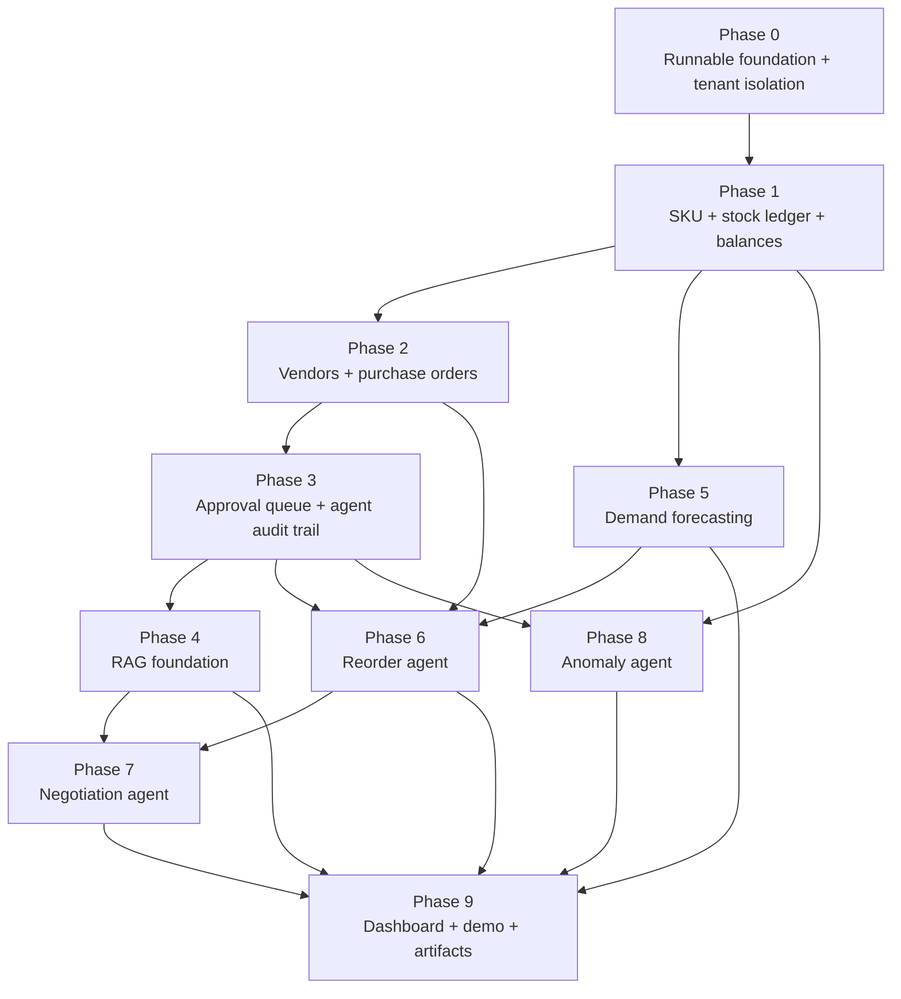
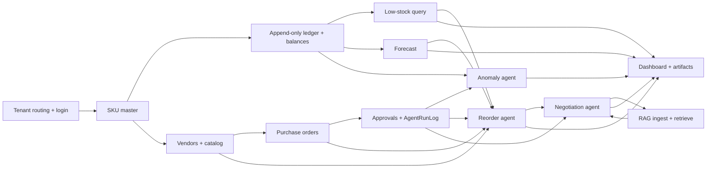

# Dependency graph

## 7. Dependency Graph

### 7.1 Phase-level

Critical path: `P0 → P1 → P2 → P3 → P4 → P7 → P9`. `P5` and `P8` are parallelizable with `P6/P7` after their prerequisites.

### 7.2 Feature-level

The `NEGO → RAG` edge is the transcript feedback loop required by demo step 6/7: finalizing a negotiation creates a new searchable source.
